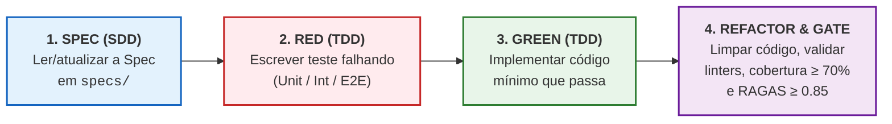

# CLAUDE.md — Guia de Engenharia e Constituição Técnica para Agentes de IA (`SmartSales RAG`)

Este arquivo define a arquitetura, os contratos, os *guardrails* inegociáveis e o fluxo obrigatório de **SDD (*Spec-Driven Development*)** e **TDD (*Test-Driven Development*)** para qualquer agente de IA ou engenheiro que atue no repositório **SmartSales RAG**.

---

## 1. Contexto Rápido do Produto

O **SmartSales RAG** é um assistente especialista de vendas consultivas B2B/B2B2C em tempo real para e-commerce de produtos tecnicamente complexos (eletroportáteis, eletrônicos, periféricos, cosméticos). Ele combina:
1. **Busca Híbrida (`PostgreSQL + pgvector`)**: similaridade vetorial (`cosine similarity`, dimensão `1536`, índice `HNSW`) nos *chunks* de manuais PDF + filtragem relacional estrita (`estoque > 0`, `voltagem`, `capacidade`, `categoria`, `preco_atual`) na tabela de catálogo.
2. **Orquestração RAG Determinística (`Python + LangChain + OpenAI`)**: geração ancorada exclusivamente nas evidências recuperadas, com citação obrigatória (`[Fonte: Manual <Produto>, p. <X>]`), *guardrails* anti-alucinação e motor de regras de **Cross-sell** (acessórios compatíveis) e **Upsell** (modelos de capacidade/linha superior dentro do teto de `+35%` de preço).
3. **Middle-end / API Gateway (`FastAPI Async + Redis Upstash`)**: gerenciamento de sessão, histórico multi-turno, cache semântico (`TTL = 3600s`), *rate limiting*, telemetria (`TTFT`, latência, uso de tokens), rota de *mock checkout* e transmissão em tempo real via **Server-Sent Events (`SSE`)**.
4. **Frontend Conversacional (`Next.js 14+ App Router + React 18 + TypeScript + Tailwind CSS`)**: vitrine de produtos integrada com **Painel Lateral do Consultor IA (*Contextual Side-Drawer* estilo Amazon Rufus)** que abre ao selecionar um produto (injetando automaticamente o `current_product_sku` na sessão), renderização progressiva token a token via SSE, *badges* clicáveis de citação da fonte, vitrine dinâmica de *Product Cards* com **link direto de checkout/afiliado (`checkout_url` / `marketplace`: Amazon, Mercado Livre, Shopee, Loja Oficial)** rastreado pelo endpoint `/api/v1/checkout/mock`, e coleta de feedback (*like/dislike*).

---

## 2. Regras Inegociáveis de Domínio e Qualidade (*Hard Guardrails*)

> [!CAUTION]
> **NUNCA VIOLE ESTAS 6 REGRAS EM NENHUM COMPONENTE DO SISTEMA:**
> 1. **Proibição Absoluta de Alucinação Técnica (`R01`)**: O LLM jamais deve inferir, adivinhar ou extrapolar voltagem (`127V` vs `220V` vs `Bivolt`), potência (`W`), capacidade (`Litros`), compatibilidade ou preço que não estejam explicitamente presentes nos *chunks* ou metadados SQL retornados pelo banco.
> 2. **Fallback Seguro Obrigatório (`score < SIMILARITY_THRESHOLD` ou `0 chunks`)**: Quando a busca híbrida retornar `0 chunks` ou `similarity_score < 0.72` (valor inicial, calibrado no *Golden Set*), o orquestrador **NÃO deve invocar geração aberta**. Deve emitir o evento SSE `error` com `code = "LOW_SIMILARITY_FALLBACK"` e a mensagem segura padronizada informando que a especificação exata não consta no manual/catálogo ativo, seguido de `recommendations` com itens similares em estoque.
> 3. **Filtro Rígido de Estoque (`stock_quantity > 0`)**: Nenhum produto esgotado (`stock_quantity <= 0`) pode ser recomendado como opção de compra principal, *upsell* ou *cross-sell* (a busca de *chunks* de manual **não** filtra estoque, para permitir responder dúvidas sobre itens esgotados).
> 4. **Sincronização de Preço e Estoque no Card e Checkout (`R09`)**: O preço e a disponibilidade exibidos no *Product Card* e validados no *Mock Checkout* devem vir sempre da consulta determinística ao PostgreSQL (nunca de texto livre gerado pelo LLM).
> 5. **Citação Verificável de Fonte**: Toda afirmação técnica extraída de manual deve conter o metadado estruturado no evento `citations` com `chunk_id`, `manual_title` e `page_number` (pertencentes aos *chunks* efetivamente recuperados no turno).
> 6. **Limiares de SLA e Qualidade (`EAP 1.4`, `5.1`, `5.3`)**:
>    - **Faithfulness / Precisão Técnica**: alvo $\ge 90\%$ (mínimo bloqueante no CI RAGAS $\ge 0,85$);
>    - **Taxa de Alucinação**: $\le 5\%$;
>    - **Precision@5 (`P@5`)**: $\ge 0,80$;
>    - **Time to First Token (`TTFT`)**: alvo nominal $\le 1,5\text{ s}$ via SSE (teto de SLA em homologação $\le 2,0\text{ s p95}$);
>    - **Tempo Total de Resposta**: $\le 8,0\text{ s p95}$;
>    - **Cache Hit Ratio (Redis)**: $\ge 30\%$;
>    - **Cobertura de Testes Automatizados**: $\ge 70\%$ com `0` defeitos críticos abertos.

---

## 3. Fluxo Obrigatório de Trabalho: SDD + TDD (*Spec-First, Test-First*)

Todo desenvolvimento neste repositório segue estritamente o ciclo de 4 passos abaixo:



### Passo a Passo para o Agente antes de Codificar:
1. **Identifique o Pacote da EAP / Gantt**: Verifique qual pacote está sendo implementado (`B01–B05`, `M01–M05`, `F01–F05`) consultando [`specs/00_INDEX.md`](specs/00_INDEX.md).
2. **Leia as Especificações de Referência**:
   - Requisitos e Regras de Negócio: [`specs/product/02_requirements_rf_rnf.md`](specs/product/02_requirements_rf_rnf.md) e [`specs/product/03_business_rules_upsell_cross_sell.md`](specs/product/03_business_rules_upsell_cross_sell.md);
   - Banco de Dados e Contratos: [`specs/architecture/02_database_pgvector_and_redis_schema.md`](specs/architecture/02_database_pgvector_and_redis_schema.md) e [`specs/architecture/03_openapi_and_sse_contracts.md`](specs/architecture/03_openapi_and_sse_contracts.md);
   - Componente da Camada: [`specs/components/`](specs/components/);
   - Casos de Teste TDD: [`specs/tdd_and_quality/02_test_cases_unit_int_e2e.md`](specs/tdd_and_quality/02_test_cases_unit_int_e2e.md).
3. **Escreva os Testes Primeiro (*Red*)**:
   - Crie o teste em `tests/unit/`, `tests/integration/` ou `tests/e2e/` reproduzindo os cenários `Given / When / Then` especificados em [`specs/tdd_and_quality/02_test_cases_unit_int_e2e.md`](specs/tdd_and_quality/02_test_cases_unit_int_e2e.md).
   - Execute a suíte para confirmar a falha esperada antes da implementação.
4. **Implemente e Valide (*Green & Refactor*)**:
   - Escreva a implementação respeitando a tipagem estrita (`Pydantic v2` no Python e `TypeScript strict` no Next.js).
   - Garanta que todos os testes passem sem quebrar contratos de API ou eventos SSE.

---

## 4. Estrutura Planejada de Diretórios de Código

Quando os módulos de código das três camadas forem inicializados, siga esta estrutura padronizada:

```text
smartsales_rag/
├── README.md                          # Visão executiva, Metas SMART, Escopo e Mapa Geral
├── CLAUDE.md                          # Este guia para agentes de IA (SDD + TDD)
├── CONTRIBUTING.md                    # Fluxo Git, PRs, DoD e governança da Squad
├── docker-compose.yml                 # Orquestração local (db, redis, backend, middleend, frontend)
├── openapi.yaml                       # Contrato OpenAPI 3.1 publicado do Gateway (/api/v1)
├── data/                              # Seed do catálogo local (catalog.json/csv) e manuais PDF (UC08)
├── specs/                             # Fonte da Verdade para SDD, TDD e Gestão (PMBOK)
│   ├── 00_INDEX.md                    # Matriz de Rastreabilidade Mestre
│   ├── product/                       # TAP, RF/RNF e Regras de Upsell/Cross-sell
│   ├── architecture/                  # Arquitetura 3-Tier, DDL pgvector/Redis e OpenAPI/SSE
│   ├── components/                    # Specs detalhadas de Backend, Middle-end e Frontend
│   ├── tdd_and_quality/               # Workflow TDD, Casos de Teste e Golden Set RAGAS
│   └── diagrams_and_pm/               # 17 Diagramas e Matrizes Oficiais do Figma (EAP a Aquisições)
├── backend/                           # Camada 3: Orquestrador RAG, Ingestão e Motor Consultivo (B01–B05)
│   ├── app/
│   │   ├── ingestion/                 # CLI de ingestão (UC08): limpeza, PDF chunking (500/50), indexação pgvector e INCR catalog:version
│   │   ├── retrieval/                 # Busca híbrida (Cosine Similarity + filtros SQL)
│   │   ├── generation/                # Prompt chaining, LLM streaming e extração de citações
│   │   ├── recommendation/            # Motor determinístico de Upsell e Cross-sell
│   │   ├── guardrails/                # Anti-prompt injection, anti-alucinação e validação de saída
│   │   └── models/                    # Schemas SQLAlchemy (pgvector) e Pydantic v2
│   └── tests/                         # Pytest (unit, integration, ragas_eval)
├── middleend/                         # Camada 2: API Gateway, Sessões, Cache Redis e SSE (M01–M05)
│   ├── app/
│   │   ├── routes/                    # /api/v1/sessions, /chat/stream, /products/{sku}, /feedback, /checkout/mock, /metrics/summary, /health
│   │   ├── sse/                       # Gerador de eventos SSE (metadata, token, correction, citations, recommendations, error, done)
│   │   ├── cache/                     # Cache semântico e histórico de sessão no Redis (Upstash)
│   │   ├── repositories/              # Acesso ao PostgreSQL: chat_sessions, chat_messages, feedback_logs, checkout_events (+ leitura de products)
│   │   ├── middleware/                # Rate limiting, CORS, correlação de trace_id e telemetria TTFT
│   │   └── schemas/                   # Contratos OpenAPI 3.1 / Pydantic v2
│   └── tests/                         # Pytest Async + httpx/sse-starlette tests
└── frontend/                          # Camada 1: Next.js 14+ UI, Streaming Chat e Product Cards (F01–F05)
    ├── src/
    │   ├── app/                       # App Router Next.js (vitrine + /admin/metricas — UC09)
    │   ├── components/
    │   │   ├── chat/                  # ChatContainer, MessageBubble, StreamingIndicator, CitationBadge
    │   │   ├── catalog/               # ProductCardCarousel, ProductCard, UpsellBadge, CheckoutModal
    │   │   └── feedback/              # FeedbackButtons (Like/Dislike + Motivo)
    │   ├── hooks/                     # useSSEChatStream, useSessionHistory, useCheckoutMock
    │   └── types/                     # Interfaces TypeScript espelhadas no OpenAPI 3.1
    └── tests/                         # Vitest + React Testing Library + Playwright E2E
```

---

## 5. Protocolo de Eventos SSE (`POST /api/v1/chat/stream`)

Toda comunicação de *streaming* entre o **Middle-end** e o **Frontend** deve emitir eventos SSE (`Content-Type: text/event-stream`) seguindo exatamente o contrato de [`specs/architecture/03_openapi_and_sse_contracts.md`](specs/architecture/03_openapi_and_sse_contracts.md). Os nomes de evento formam um conjunto fechado:

1. `event: metadata` — Emitido **uma única vez**, imediatamente antes do primeiro evento de conteúdo (`token` ou `error`): `{"message_id": "...", "session_id": "...", "cache_hit": false, "ttft_ms": 890}`.
2. `event: token` — Fragmento incremental de texto renderizado em tempo real na UI: `{"delta": "..."}`.
3. `event: correction` *(opcional)* — Emitido pelo `OutputGuardrail (G-OUT)` apenas para fallback seguro em falha de transporte; o Frontend **substitui** o texto da bolha: `{"violation_code": "STREAM_INTERRUPTED", "content": "<texto completo corrigido>"}`.
4. `event: citations` — Fontes técnicas verificadas: `{"citations": [{"chunk_id": "...", "sku": "...", "manual_title": "...", "page_number": 14, "section_title": "...", "similarity_score": 0.89, "excerpt": "..."}]}`.
5. `event: recommendations` — *Product Cards* validados no SQL (máx. 3: 1 `PRIMARY`, até 1 `UPSELL`, até 1 `CROSS_SELL`): `{"products": [{"sku": "...", "name": "...", "price": 649.90, "stock_quantity": 12, "voltage": "220V", "capacity_liters": 4.0, "power_watts": 1500, "image_url": "...", "marketplace": "AMAZON | MERCADO_LIVRE | SHOPEE | LOJA_OFICIAL", "checkout_url": "https://...", "recommendation_type": "PRIMARY | UPSELL | CROSS_SELL", "badge_label": "...", "justification": "..."}]}`.
6. `event: error` — Falha controlada ou *fallback* (**não** encerra o stream): `{"code": "GUARDRAIL_BLOCKED | LOW_SIMILARITY_FALLBACK | LLM_UNAVAILABLE | INTERNAL_ERROR", "recoverable": true, "fallback_message": "..."}`.
7. `event: done` — **Sempre o último evento**: `{"finish_reason": "stop | fallback | error", "total_latency_ms": 2140, "tokens_used": 412}`.

**Sequências válidas:**
- Fluxo normal: `metadata → token (N×) → [correction] → [citations] → [recommendations] → done (stop)`.
- Fluxo de *fallback* / contingência: `metadata → error → [recommendations] → done (fallback | error)`.

O Frontend consome o stream com `fetch` + `ReadableStream` (requisição `POST`), **nunca** com `EventSource`.

---

## 6. Comandos Padrão de Verificação e Testes

Ao executar ou criar scripts de automação nas três camadas, utilize os seguintes comandos padrão:

```bash
# Backend & RAG (Python / Pytest / RAGAS) — rodar dentro de backend/ (backend e middleend têm, cada um, um pacote "app")
cd backend && pytest tests/unit -v
cd backend && pytest tests/integration -v --cov=app --cov-fail-under=70
cd backend && pytest tests/ragas_eval -v

# Ingestão do catálogo local (UC08)
cd backend && python -m app.ingestion.run --catalog ../data/catalog.json --manuals ../data/manuals/

# Middle-end / Gateway (FastAPI / Redis / SSE)
cd middleend && pytest tests -v --cov=app --cov-fail-under=70

# Frontend (Next.js / Vitest / Playwright)
npm --prefix frontend run test:unit
npm --prefix frontend run test:e2e
```

---

## 7. Arquitetura de Layers Interna e Princípios de Clean Code / SOLID

Além da separação física nas **3 Macro-Camadas** (`frontend/`, `middleend/`, `backend/`), o código interno de cada serviço deve obedecer rigorosamente à **Arquitetura em Camadas (*Layered Architecture*)** e aos princípios de **Clean Code** e **SOLID**:

### 7.1. Regra de Dependência entre Layers Internas
O fluxo de dependência é estritamente unidirecional (`Presentation → Application → Domain ← Infrastructure`):
1. **Presentation / Controllers (`routes/`, `sse/`, `components/`)**: Apenas recebe requisições, valida *payloads* de borda (`Pydantic` / `Props`) e delega para a camada de serviço. **Proibido conter SQL, lógica de negócio ou chamadas diretas à OpenAI.**
2. **Application / Use Cases (`services/`, `orchestrators/`, `hooks/`)**: Coordena o fluxo de execução (ex.: consultar cache $\to$ acionar *retriever* $\to$ aplicar *guardrail* $\to$ emitir stream).
3. **Domain / Business Rules (`domain/`, `guardrails/`, `recommendation/`, `schemas/`)**: Contém as regras puras de negócio (`RN01` a `RN10`, cálculo de *Upsell* `+35%`, validadores factuais) **100% desacopladas de banco de dados ou frameworks HTTP** para permitir testes unitários rápidos (`< 10ms`).
4. **Infrastructure / Adapters (`repositories/`, `db/`, `cache/`, `clients/`)**: Implementa o acesso concreto ao `PostgreSQL + pgvector`, `Redis` e `OpenAI API` por meio de interfaces/protocolos injetáveis.

### 7.2. Regras Inegociáveis de Clean Code e SOLID
- **SRP (*Single Responsibility Principle*)**: Cada classe, módulo ou função deve ter uma única razão para mudar. Funções devem ser curtas (idealmente $\le 30$ linhas) e fazer apenas uma coisa.
- **DIP (*Dependency Inversion Principle*) & Injeção de Dependência**: Módulos de negócio (`RAGOrchestrator`, `RecommendationEngine`, `SemanticCacheService`) devem receber seus repositórios e clientes externos via construtor/`Depends()`, facilitando o *mock* nos testes TDD.
- **Nomenclatura Semântica e Reveladora de Intenção**: Proibido usar variáveis genéricas (`data`, `res`, `temp`, `obj`, `x`). Use nomes explícitos de domínio (`retrieved_manual_chunks`, `upsell_candidates`, `similarity_threshold`).
- **Zero *Magic Numbers* / *Hardcoded Strings***: Todos os limiares (`SIMILARITY_THRESHOLD = 0.72`, `UPSELL_MAX_PRICE_RATIO = 1.35`, `CHUNK_SIZE_TOKENS = 500`, `CHUNK_OVERLAP_TOKENS = 50`, `CACHE_TTL_SECONDS = 3600`) devem residir em constantes tipadas ou `Settings` (`pydantic-settings`).
- **Tipagem Estrita em 100% do Código (*Type Safety*)**:
  - **Python**: *Type hints* obrigatórios em todas as assinaturas de funções e retornos (`mypy --strict` / `Pydantic v2`).
  - **TypeScript**: `strict: true` no `tsconfig.json`; **proibido o uso de `any`**.
- **Tratamento Explícito de Erros (*Fail-Fast & Domain Exceptions*)**: Nunca use `except Exception: pass` silencioso. Capture exceções específicas, registre logs estruturados com `session_id` e retorne erros de domínio padronizados.
- **DRY (*Don't Repeat Yourself*) & KISS (*Keep It Simple, Stupid*)**: Extraia normalizadores e validadores comuns para utilitários puros testados, evitando duplicação e engenharia excessiva fora do escopo da Spec.

---

## 8. Referência Rápida de Documentos por Tarefa

- **Vai mexer no banco de dados ou ingestão (`B01`, `B03`)?** Leia [`specs/architecture/02_database_pgvector_and_redis_schema.md`](specs/architecture/02_database_pgvector_and_redis_schema.md) e [`specs/components/01_backend_rag_and_guardrails_spec.md`](specs/components/01_backend_rag_and_guardrails_spec.md).
- **Vai mexer nos prompts, RAG ou motor de Upsell/Cross-sell (`B02`, `B04`, `B05`)?** Leia [`specs/product/03_business_rules_upsell_cross_sell.md`](specs/product/03_business_rules_upsell_cross_sell.md) e [`specs/tdd_and_quality/03_rag_golden_set_and_ragas_spec.md`](specs/tdd_and_quality/03_rag_golden_set_and_ragas_spec.md).
- **Vai mexer no Gateway, Redis, SSE ou Checkout Mock (`M01` a `M05`)?** Leia [`specs/architecture/03_openapi_and_sse_contracts.md`](specs/architecture/03_openapi_and_sse_contracts.md) e [`specs/components/02_middleend_gateway_sse_redis_spec.md`](specs/components/02_middleend_gateway_sse_redis_spec.md).
- **Vai mexer na UI do Chat, Cards ou Feedback (`F01` a `F05`)?** Leia [`specs/components/03_frontend_chat_and_cards_spec.md`](specs/components/03_frontend_chat_and_cards_spec.md) e [`specs/diagrams_and_pm/05_diagrama_sequencia.md`](specs/diagrams_and_pm/05_diagrama_sequencia.md).
- **Vai consultar prazos, responsabilidades ou riscos (`G01` a `G04`)?** Consulte [`specs/diagrams_and_pm/`](specs/diagrams_and_pm/).

Baseline normativa: consultar `specs/01_BASELINE_REVISADA.md` e `openapi.yaml`. Tokens contêm somente sentenças previamente validadas; error após tokens descarta conteúdo parcial e termina em done(error), se conexão aberta. Toda pergunta inclui client_request_id preservado nos retries.
