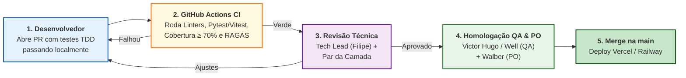

# Guia de Contribuição e Governança de Engenharia (`CONTRIBUTING.md`)

Este guia estabelece o fluxo de trabalho técnico, o padrão de *branches* e *commits*, o ciclo **SDD + TDD**, os critérios de *Code Review* e a **Definição de Pronto (*Definition of Done — DoD*)** para a equipe de 8 integrantes do **SmartSales RAG**.

---

## 1. Princípio Fundamental: SDD + TDD (*Spec-First, Test-First*)

Nenhuma linha de código de produção deve ser mesclada na `main` sem seguir os 4 passos:
1. **Consultar a Especificação (`SDD`)**: Verificar os contratos, schemas e critérios de aceite do pacote correspondente em [`specs/`](specs/00_INDEX.md).
2. **Escrever o Teste Falhando (`TDD — Red`)**: Criar os testes unitários/integração baseados nos cenários `Given/When/Then` de [`specs/tdd_and_quality/02_test_cases_unit_int_e2e.md`](specs/tdd_and_quality/02_test_cases_unit_int_e2e.md).
3. **Implementar o Código (`TDD — Green`)**: Fazer os testes passarem respeitando as regras de negócio e os *guardrails* anti-alucinação.
4. **Refatorar e Submeter PR (`TDD — Refactor & Gate`)**: Garantir cobertura $\ge 70\%$, *linting* limpo e abrir *Pull Request* vinculado ao código da EAP/Gantt.

---

## 2. Convenção de Branches e Commits

### 2.1. Fluxo Gitflow (`feature/* → develop → main`) e Nomenclatura de Branches

O repositório adota proteção estrita nas branches **`develop`** (integração contínua da Sprint) e **`main`** (produção/entregas de Marco `M1–M5`):
- **Proibido *push* direto em `main` e `develop`**: Toda alteração deve entrar via *Pull Request* com status check CI verde (`spec-contracts` / testes automatizados) e **no mínimo 1 revisão aprovada (*Code Review*)** por outro integrante (Aprovador `A` da camada na Matriz RACI).
- **Fluxo diário**: Crie sua branch a partir de `develop` $\rightarrow$ abra PR para `develop` $\rightarrow$ após homologação do Marco (`M1–M5`), abra PR de `develop` para `main`.

Todas as *branches* de trabalho devem referenciar explicitamente o código do pacote operacional (`G01–G04`, `B01–B05`, `M01–M05`, `F01–F05`) e o subpacote da EAP (`1.1–7.4`):

| Tipo | Formato da Branch | Destino do PR | Exemplo Real no Projeto |
| :--- | :--- | :---: | :--- |
| **Integração Contínua** | `develop` | `main` (Marcos `M1–M5`) | `develop` |
| **Feature Técnica** | `feat/<PACOTE>-<descricao-curta>` | `develop` | `feat/B01-pgvector-catalog-ingestion` |
| **Correção de Bug** | `fix/<PACOTE>-<descricao-curta>` | `develop` | `fix/M02-sse-reconnection-timeout` |
| **Testes / QA / RAGAS** | `test/<PACOTE>-<descricao-curta>` | `develop` | `test/B05-ragas-golden-set-suite` |
| **Documentação / Spec** | `docs/<PACOTE>-<descricao-curta>` | `develop` | `docs/G04-openapi-swagger-publish` |

### 2.2. Padrão de Commits (*Conventional Commits 1.0.0*)
Todos os commits devem seguir a especificação **`<tipo>(<escopo>): <descrição imperativa curta>`**, onde `<escopo>` é obrigatoriamente o código do pacote (`B01–B05`, `M01–M05`, `F01–F05`, `G01–G04`):

| Tipo (`type`) | Quando Utilizar | Exemplo Oficial |
| :---: | :--- | :--- |
| `feat` | Nova funcionalidade técnica ou de produto prevista na EAP | `feat(B02): implement hybrid retrieval with cosine threshold 0.72` |
| `fix` | Correção de defeito ou desvio de regra de negócio/guardrail | `fix(B03): block voltage inversion in post-generation guardrail` |
| `test` | Adição ou ajuste de testes TDD (Unitários, Integração, E2E, RAGAS) | `test(B04): add unit tests for upsell +35% price ceiling filter` |
| `refactor` | Melhoria interna de código (Clean Code) sem alterar comportamento | `refactor(M02): extract SSE event serializer into pure function` |
| `perf` | Otimização de latência (`TTFT`), query SQL/HNSW ou cache Redis | `perf(M03): optimize semantic cache lookup pipeline in Redis` |
| `docs` | Criação ou atualização de especificações (`specs/`), README ou Swagger | `docs(G04): update OpenAPI 3.1 contract with marketplace field` |
| `ci` / `chore` | Configuração de Docker, GitHub Actions, linters ou dependências | `ci(B01): add pgvector service container to GitHub Actions workflow` |

### 2.3. Arquitetura em Layers e Princípios de Clean Code / SOLID
Tanto a divisão macro do sistema (**3 Camadas**: `frontend/`, `middleend/`, `backend/`) quanto a organização interna de cada módulo seguem **Layered Architecture** e **Clean Code**:
1. **Isolamento Estrito de Layers (`Presentation → Application → Domain ← Infrastructure`)**:
   - **Presentation (`routes/`, `components/`)**: Apenas recebe requests/eventos de UI e valida schemas de entrada/saída. Proibido ter SQL ou regra de negócio em rotas/componentes.
   - **Application (`services/`, `orchestrators/`, `hooks/`)**: Orquestra os casos de uso (`UC01` a `UC09`).
   - **Domain (`domain/`, `guardrails/`, `recommendation/`, `schemas/`)**: Regras puras de negócio (`RN01–RN10`), sem dependência de banco ou framework externo.
   - **Infrastructure (`repositories/`, `db/`, `cache/`, `clients/`)**: Persistência em `PostgreSQL + pgvector`, `Redis` e clientes HTTP (`OpenAI`).
2. **Diretrizes Obrigatórias de Clean Code e SOLID nos PRs**:
   - **Single Responsibility (SRP) & Funções Pequenas**: Cada função/classe faz apenas uma coisa ($\le 30$ linhas por função).
   - **Dependency Inversion (DIP)**: Repositórios e clientes de IA são injetados via construtor/`Depends()` para permitir testes unitários isolados.
   - **Nomes Significativos e Zero *Magic Numbers***: Proibido usar variáveis genéricas (`data`, `temp`, `res`) ou constantes mágicas soltas no código (`0.72`, `1.35`, `500`, `3600` devem ser constantes nomeadas).
   - **Tipagem Estrita (`Type Safety`)**: `Pydantic v2` + *type hints* completos no Python e `TypeScript strict` (proibido `any`) no Frontend.
   - **Tratamento Explícito de Exceções**: Proibido `except Exception: pass`; falhas devem ser tratadas com exceções de domínio e *fallbacks* seguros documentados.

---

## 3. Fluxo de Revisão de Código (*Pull Requests*) e Governança (`C04`, `C07` / `EAP 3.5`)

Conforme o [Fluxo do Processo de Garantia da Qualidade](specs/diagrams_and_pm/12_qualidade_fluxo_processo.md) e a [Matriz RACI](specs/diagrams_and_pm/02_matriz_raci.md):

### Regras de Aprovação por Camada:
- **Backend e IA (`B01–B05`)**: aprovação obrigatória de **Filipe** (Tech Lead) ou **Diogo** + suíte RAGAS $\ge 0,85$.
- **Middle-end / Gateway (`M01–M05`)**: aprovação obrigatória de **Pablo** ou **Well** + validação de contrato OpenAPI 3.1 com **Filipe**.
- **Frontend e UX (`F01–F05`)**: aprovação obrigatória de **Eduardo** ou **Victor Hugo** + validação visual/funcional do PO (**Walber**).
- **Documentação e Gestão (`G01–G04`)**: aprovação de **Antônio Rodrigo** (GP) e **Walber** (PO).

---

## 4. Definição de Pronto (*Definition of Done — DoD*)

Um pacote de trabalho só pode ser movido para **Concluído (`Done`)** no quadro das Sprints se cumprir **100% dos itens abaixo**:

- [ ] **Aderência à Spec (SDD)**: Todos os requisitos funcionais (`RF`), não-funcionais (`RNF`) e contratos de dados da Spec correspondente foram integralmente atendidos.
- [ ] **Testes Automatizados (TDD)**: Testes unitários e de integração escritos e passando com **cobertura de código $\ge 70\%$** no módulo alterado.
- [ ] **Zero Alucinação e Guardrails Ativos**: Para entregas de RAG (`B02`, `B03`, `B04`, `B05`), a avaliação no *Golden Set* atingiu **Faithfulness $\ge 0,85$** (alvo $\ge 90\%$), **Precision@5 $\ge 0,80$** e **Taxa de Alucinação $\le 5\%$**.
- [ ] **Performance dentro do SLA**: Em rotas de *streaming* (`M02`, `F02`), o **$\text{TTFT}$** mantém-se $\le 1,5\text{ s}$ em condições nominais (e $\le 2,0\text{ s}$ no `p95`).
- [ ] **Zero Defeitos Críticos**: Nenhum bug de severidade alta/crítica aberto (`estoque = 0` recomendado, inversão `127V`/`220V`, divergência de preço entre card e checkout ou erro `5xx`).
- [ ] **Documentação Atualizada**: Caso um endpoint ou schema tenha evoluído, a Spec correspondente em `specs/` foi atualizada no mesmo PR.

---

## 5. Calendário de Rituais e Canais Oficiais (`C01` a `C09`)

Os códigos abaixo seguem exatamente o [Plano de Gerenciamento das Comunicações](specs/diagrams_and_pm/15_gestao_comunicacoes.md), que é a referência oficial. Os dias sem expediente do calendário UFAL 2026.2 (`12/10`, `15/10`, `28/10`, `02/11` e `20/11`) não têm rituais.

| Código | Ritual / Comunicação | Frequência / Gatilho | Canal | Emissor (`R`) |
| :---: | :--- | :---: | :---: | :--- |
| **C01** | **Abertura do projeto e aprovação do TAP (*kick-off*)** | `22/09/2026` | Reunião de *kick-off* + ata (Notion) | **Antônio Rodrigo** |
| **C02** | **Priorização do backlog e *Sprint Planning*** | Quinzenal, início da sprint (`22/09`, `05/10`, `19/10`, `03/11`) | Google Meet + GitHub Projects | **Walber** |
| **C03** | **Daily (acompanhamento diário e impedimentos — 15 min)** | Dias úteis (`22/09` a `24/11/2026`) | Discord / WhatsApp + GitHub Projects | **Antônio Rodrigo** |
| **C04** | **Decisões de arquitetura, API e integrações** | Sob demanda, antes de mudanças | Reunião técnica + GitHub / `openapi.yaml` | **Filipe** |
| **C05** | **Status do projeto: prazo, escopo, custos e riscos (`SPI`/`CPI`)** | Semanal, às sextas-feiras (`S1` a `S9`) | Relatório sintético (e-mail / Markdown) + Google Sheets | **Antônio Rodrigo** |
| **C06** | **Alerta de risco crítico ou bloqueio (inclui caminho crítico)** | Imediatamente ao identificar | Mensagem prioritária + reunião curta | **Antônio Rodrigo** |
| **C07** | **Resultados de testes e qualidade do RAG** | A cada *build* testada / sprint | GitHub Issues + relatório de testes | **Victor Hugo** / **Well** |
| **C08** | ***Sprint Review*, retrospectiva (PDCA) e aceite parcial** | Quinzenal, fim da sprint (`02/10`, `16/10`, `30/10`, `13/11`) | Google Meet + ambiente de homologação + FigJam | **Walber** |
| **C09** | **Entrega final, demo/*pitch* e lições aprendidas** | Marco `M5` (`24/11/2026`) | Presencial (UFAL) + Slides/Demo | **Antônio Rodrigo** |

## Validar a baseline documental

Antes de iniciar a aplicação, validar contratos e exemplos com `python -m pip install -r tests/requirements-specs.txt` e `python -m unittest discover -s tests -v`. O workflow Specs and reference contracts executa essas checagens sem secrets. Esta suíte cobre os exemplos documentados e a validade OpenAPI; não substitui os testes futuros da aplicação nem o Golden Set real. As decisões da revisão estão em `specs/01_BASELINE_REVISADA.md`.
