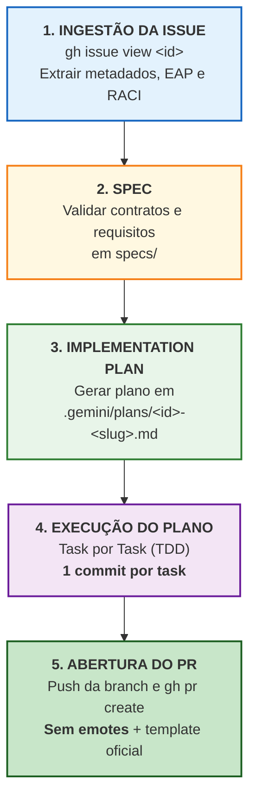

# GEMINI.md — Guia de Engenharia e Protocolo de Execução Autônoma (`SmartSales RAG`)

Este documento estabelece o guia mestre de engenharia, os contratos arquiteturais, os *guardrails* inegociáveis e o protocolo padronizado de execução **Issue-to-PR** para o agente **Gemini (Antigravity)** no repositório **SmartSales RAG**.

---

## 1. Contexto do Produto e Arquitetura

O **SmartSales RAG** é um assistente especialista de vendas consultivas B2B/B2B2C em tempo real para e-commerce de produtos tecnicamente complexos (eletroportáteis, eletrônicos, periféricos, cosméticos). Ele integra 3 macro-camadas:

1. **Backend / Orquestrador RAG (`backend/`)**:
   - Busca Híbrida (`PostgreSQL + pgvector`): similaridade vetorial (`cosine`, dimensão `1536`, índice `HNSW`) em chunks de manuais PDF + filtragem relacional estrita (`stock_quantity > 0`, `voltage`, `capacity`, `category`, `price`).
   - Geração ancorada determinística com LangChain + OpenAI, citação obrigatória de fontes (`chunk_id`, `manual_title`, `page_number`), guardrails de entrada/saída e motor de Upsell (`+35%` teto) e Cross-sell.
2. **Middle-end / API Gateway (`middleend/`)**:
   - FastAPI Async, Redis (Upstash) para cache semântico (`TTL = 3600s`) e sessões multi-turno.
   - Streaming em tempo real via Server-Sent Events (`SSE`) no endpoint `POST /api/v1/chat/stream`.
   - Endpoint de rastreamento de conversão e revalidação determinística `/api/v1/checkout/mock`.
3. **Frontend Conversacional (`frontend/`)**:
   - Next.js 16 (App Router), React 19, TypeScript estrito, Tailwind CSS 4 e shadcn/ui.
   - Drawer lateral contextual do consultor IA, renderização token a token via SSE, badges clicáveis de citação, vitrine de Product Cards com checkout afiliado direto e feedback Like/Dislike.

---

## 2. Regras Inegociáveis e Guardrails Técnicos (*Hard Guardrails*)

> [!CAUTION]
> **NUNCA VIOLE ESTAS REGRAS EM NENHUM COMPONENTE OU PR:**
> 1. **Proibição Absoluta de Alucinação Técnica (`R01`)**: O LLM jamais deve inferir ou extrapolar voltagem (`127V`, `220V`, `Bivolt`), potência (`W`), capacidade (`L`), compatibilidade ou preço não presentes nos chunks recuperados ou no catálogo SQL.
> 2. **Fallback Seguro Obrigatório (`R02`)**: Se similaridade vetorial `< 0.72` ou chunks retornados `= 0`, não invocar geração aberta; emitir evento SSE `error` com `code = "LOW_SIMILARITY_FALLBACK"` e mensagem segura padrão acompanhada de recomendações.
> 3. **Filtro Rígido de Estoque (`R03`)**: Nenhum item esgotado (`stock_quantity <= 0`) pode ser recomendado para compra, upsell ou cross-sell.
> 4. **Preço e Estoque Determinísticos no Card e Checkout (`R09`)**: Preço e disponibilidade devem vir exclusivamente da consulta relacional ao PostgreSQL, nunca do texto livre do LLM.
> 5. **Citação Estruturada Obrigatória**: Afirmações técnicas de manuais devem conter citação com `chunk_id`, `manual_title` e `page_number` reais.
> 6. **SLAs e Gates de Qualidade**:
>    - Faithfulness (RAGAS) >= 0.85 (alvo >= 0.90);
>    - Taxa de alucinação <= 5%;
>    - Precision@5 (P@5) >= 0.80;
>    - Time to First Token (TTFT) <= 1.5s via SSE (p95 <= 2.0s);
>    - Cobertura de testes automatizados >= 70% com zero defeitos críticos.

---

## 3. Protocolo Padronizado: Fluxo de Desenvolvimento Issue-to-PR

Para eliminar qualquer risco de alucinação ou divergência de governança, o repositório conta com o script determinístico **[`.gemini/scripts/issue_flow.py`](.gemini/scripts/issue_flow.py)**. 

Ao receber um comando para trabalhar em uma issue — seja via URL completa (ex: `https://github.com/rodrigololr/smartsales_rag/issues/6`) ou por referência de número (ex: `issue #6`, `iniciar #6`) —, o agente deve executar o script ou as 5 etapas abaixo:

```bash
# Iniciar uma issue (extrai metadados, cria branch e gera plano):
python .gemini/scripts/issue_flow.py start <URL_OU_NUMERO>

# Submeter PR no template oficial sem emotes:
python .gemini/scripts/issue_flow.py pr <URL_OU_NUMERO> --summary "<resumo detalhado>"
```



---

### Etapa 1: Ingestão da Issue e Preparação da Branch

1. **Extrair dados da Issue via GitHub CLI**:
   ```bash
   gh issue view <NUMERO> --repo rodrigololr/smartsales_rag --json number,title,body,labels,assignees,milestone,state
   ```
2. **Mapear Metadados Operacionais**:
   - **Código do Pacote**: `B01`–`B05` (Backend), `M01`–`M05` (Middle-end), `F01`–`F05` (Frontend), `G01`–`G04` (Gestão/Docs).
   - **EAP**: Subpacotes (`1.1` a `7.4`).
   - **Marco / Milestone**: `M1` a `M5`.
   - **Matriz RACI**: Aprovador (`A`) e Executores (`R`).
   - **Critérios de Aceite e Testes TDD**: Casos `UT-*`, `IT-*`, `E2E-*`.
3. **Criar e Alternar para a Branch de Trabalho**:
   - As branches sempre derivam de `develop`.
   - Formato do nome da branch: `<tipo>/<PACOTE>-<descricao-curta>`
     - Features: `feat/<PACOTE>-<slug>` (ex: `feat/F01-setup-nextjs-tailwind`)
     - Correções: `fix/<PACOTE>-<slug>`
     - Testes: `test/<PACOTE>-<slug>`
     - Documentação: `docs/<PACOTE>-<slug>`
   ```bash
   git checkout develop
   git pull origin develop
   git checkout -b <tipo>/<PACOTE>-<slug>
   ```

---

### Etapa 2: Consulta e Validação da Spec (`specs/`)

1. Localizar as especificações de referência mapeadas na issue:
   - Visão Geral e Rastreabilidade: `specs/00_INDEX.md`
   - Requisitos e Regras de Negócio: `specs/product/02_requirements_rf_rnf.md` e `specs/product/03_business_rules_upsell_cross_sell.md`
   - Arquitetura, DDL e Contratos: `specs/architecture/` e `openapi.yaml`
   - Componentes das Camadas: `specs/components/`
   - Casos de Teste TDD: `specs/tdd_and_quality/02_test_cases_unit_int_e2e.md`
2. Se a tarefa envolver ajuste ou definição de novos contratos/requisitos, a documentação em `specs/` deve ser atualizada como parte do pacote.

---

### Etapa 3: Elaboração do Plano de Implementação (`.gemini/plans/`)

Antes de escrever qualquer código, o agente deve gerar o arquivo de plano no caminho `.gemini/plans/<NUMERO>-<PACOTE>-<slug>.md`.

O arquivo de plano deve conter:
1. **Cabeçalho de Identificação**: Número da Issue, Título, Pacote EAP, Milestone, RACI e Labels.
2. **Objetivo e Escopo**: O que será implementado e o que está fora de escopo.
3. **Arquivos Afetados**: Lista dos arquivos a criar, modificar ou testar.
4. **Lista de Tarefas Atômicas**:
   - Tarefas divididas em granularidade pequena (ex: 1. Setup/Tipos, 2. Testes Red, 3. Implementação Green, 4. Refactor/Linters).
   - **Obrigatório para cada tarefa**: definir a mensagem exata do commit correspondente seguindo Conventional Commits (`feat(PACOTE): ...`, `test(PACOTE): ...`, etc.).
5. **Critérios de Aceite e Comandos de Validação**: Testes automatizados que devem passar antes da abertura do PR.

---

### Etapa 4: Execução do Plano (1 Commit por Task)

O agente deve executar cada tarefa do plano sequencialmente, garantindo a integridade do código e do histórico Git:

1. **Executar a Tarefa**: Escrever o código ou teste correspondente.
2. **Validar Localmente**: Executar os comandos de teste da camada (unitário, integração ou linter).
3. **Realizar o Commit Específico da Tarefa**:
   ```bash
   git add <arquivos-modificados>
   git commit -m "<tipo>(<PACOTE>): <descrição imperativa clara>"
   ```
4. **Atualizar o Checklist do Plano**: Marcar a task como concluída em `.gemini/plans/<NUMERO>-<PACOTE>-<slug>.md`.

> [!IMPORTANT]
> **REGRA FUNDAMENTAL DE COMMITS**: Cada tarefa individual do plano deve ter seu próprio commit atômico. É expressamente proibido acumular múltiplas tarefas em um único commit geral no final.

---

### Etapa 5: Abertura do Pull Request (`gh pr create`)

1. **Enviar a branch para o repositório remoto**:
   ```bash
   git push -u origin <tipo>/<PACOTE>-<slug>
   ```
2. **Montar o corpo do PR a partir do template oficial (`.github/PULL_REQUEST_TEMPLATE.md`)**:
   - Seção 1: Identificação do Pacote (EAP, Subpacote, Issue com `Closes #<ID>`, Marco).
   - Seção 2: Resumo das Alterações detalhado tecnicamente (sem generalismos).
   - Seção 3: Governança RACI (Executor `R` e Aprovador `A` identificados).
   - Seção 4: Checklist de Pronto (DoD) com itens checados `[x]`.
3. **Regra Rígida de Comunicação**:
   - **ZERO EMOTES / EMOJIS**: Não utilize emojis (ex.: proibido usar qualquer caractere como foguetes, caixas, marcas de seleção gráficas, alertas visuais). Use markdown técnico puro e formal (`[x]`, `-`, crases para código).
4. **Criar o PR via CLI**:
   ```bash
   gh pr create --base develop --head <tipo>/<PACOTE>-<slug> --title "<tipo>(<PACOTE>): <descricao-curta>" --body "<corpo-formatado>"
   ```
5. **Retornar ao Usuário**: Apresentar o link do PR criado, resumo das tarefas e status dos testes executados.

---

## 4. Estrutura de Código e Clean Code / SOLID

A organização interna do código nas 3 macro-camadas deve respeitar a arquitetura em camadas e boas práticas:

- **Isolamento de Camadas**:
  - `Presentation` (`routes/`, `sse/`, `components/`): valida schemas de entrada/saída, trata HTTP/SSE. Sem regras de negócio ou SQL direto.
  - `Application` (`services/`, `orchestrators/`, `hooks/`): orquestra casos de uso.
  - `Domain` (`domain/`, `guardrails/`, `recommendation/`, `schemas/`): regras de negócio puras desacopladas de frameworks e I/O.
  - `Infrastructure` (`repositories/`, `db/`, `cache/`, `clients/`): persistência (PostgreSQL, pgvector, Redis) e serviços externos (OpenAI).
- **Clean Code**:
  - SRP (Single Responsibility Principle) e funções curtas (idealmente <= 30 linhas).
  - Injeção de dependências em serviços e orquestradores.
  - Zero *magic numbers* ou strings soltas (usar constantes ou `Settings`).
  - Tipagem estrita: Python com type hints completos e Pydantic v2; Frontend com TypeScript `strict: true` (proibido `any`).
  - Tratamento de exceções com erros de domínio explícitos (proibido `except Exception: pass`).

---

## 5. Comandos de Verificação e Testes

### Verificação da Baseline Documental e Contratos
```bash
uv run --with-requirements tests/requirements-specs.txt python -m unittest discover -s tests -v
```

### Backend & RAG (`backend/`)
```bash
cd backend && pytest tests/unit -v
cd backend && pytest tests/integration -v --cov=app --cov-fail-under=70
cd backend && pytest tests/ragas_eval -v
cd backend && python -m app.ingestion.run --catalog ../data/catalog.json --manuals ../data/manuals/
```

### Middle-end / Gateway (`middleend/`)
```bash
cd middleend && pytest tests -v --cov=app --cov-fail-under=70
```

### Frontend (`frontend/`)
```bash
pnpm -C frontend run test:unit
pnpm -C frontend run test:e2e
pnpm -C frontend run lint
```
