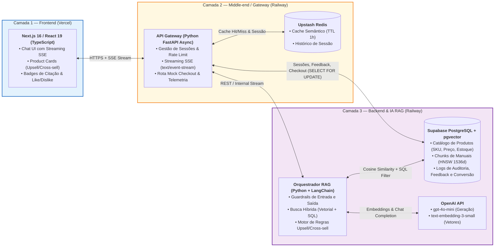

# SmartSales RAG — Assistente Especialista de Vendas Consultivas B2B/B2B2C

[](#5-arquitetura-em-3-camadas-e-stack-tecnológica)
[](#8-engenharia-guiada-por-especificações-sdd-e-testes-tdd)
[-7b1fa2)](#3-objetivos-do-projeto-metas-smart)
[-ef6c00)](#3-objetivos-do-projeto-metas-smart)

---

## Como rodar (Docker Compose)

O que está implementado: catálogo com poucos itens (com fotos); ao abrir um produto, a página do item mostra galeria, ficha técnica e compra, com um Consultor IA fixo ao lado (estilo Rufus/Alexa da Amazon) que responde **somente sobre aquele produto**, com RAG sobre a ficha técnica do catálogo e o manual do fabricante, citando a página da fonte. O backend acrescenta ao turno os cards de recomendação lidos do SQL (produto consultado, upsell até +35% e cross-sell de `product_relations`). O gateway guarda as sessões no Redis (janela de 10 mensagens, TTL de 30 min) e serve respostas repetidas pelo cache (TTL de 1 h), revalidando estoque e preço no PostgreSQL antes de cada *cache hit*. Ainda não implementados: *rate limiting*, `GET /products/{sku}`, feedback, *mock checkout* e métricas (`M01`, `M04`, `M05`).

Pré-requisitos: Docker com Compose v2 e uma chave de um provedor compatível com a API da OpenAI.

```bash
cp .env.example .env          # preencha LLM_API_KEY (chave do Google Gemini)
docker compose up --build     # db (pgvector) + redis -> ingest -> backend -> middleend -> frontend
```

| Endereço | O que é |
| :--- | :--- |
| `http://localhost:3000` | Vitrine e Consultor IA (Next.js) |
| `http://localhost:8000/api/v1/health` | Saúde do gateway (`backend`, `redis`) |
| `http://localhost:8000/docs` | Swagger UI do gateway, gerado pelo FastAPI |
| `http://localhost:8000/openapi.json` | OpenAPI do gateway em execução (o contrato normativo é o [`openapi.yaml`](openapi.yaml)) |

Variáveis do `.env` da raiz, lidas pelo `docker-compose.yml`:

| Variável | Obrigatória | Padrão | Uso |
| :--- | :---: | :--- | :--- |
| `LLM_API_KEY` | sim | — | Chave do provedor de IA (respostas e embeddings). |
| `LLM_BASE_URL` | não | vazio (OpenAI) | Endpoint compatível com a API da OpenAI; o `.env.example` aponta para o Gemini. |
| `LLM_MODEL` | não | `gpt-4o-mini` | Modelo de geração. |
| `EMBEDDING_MODEL` | não | `text-embedding-3-small` | Modelo de embeddings (1536 dimensões). |
| `SIMILARITY_THRESHOLD` | não | `0.72` | Limiar do *fallback* seguro; `0.60` no `.env.example`, calibrado para o Gemini. |

`DATABASE_URL`, `REDIS_URL`, `BACKEND_INTERNAL_URL` e `CORS_ALLOWED_ORIGINS` já vêm definidas no `docker-compose.yml` para a rede interna. Fora do Docker, use `backend/.env.example` e `middleend/.env.example`.

- **Manuais do cliente:** coloque o PDF em `data/manuals/<SKU>.pdf` (ex.: `AF-400-220V.pdf`) e rode de novo o serviço `ingest` (`docker compose run --rm ingest`). Os `.txt` atuais são manuais **sintéticos de demonstração**.
- **Catálogo:** `data/catalog.json` (os mesmos SKUs da vitrine do frontend).
- **Relações de cross-sell:** `data/product_relations.json`. A tabela `product_relations` é substituída pelo conteúdo do arquivo a cada ingestão.
- **Ingestão (`UC08`):** cada fonte roda sob um registro em `ingestion_jobs`, com até 3 tentativas. Fonte que esgota as tentativas fica em `NEEDS_INTERVENTION`, aparece na saída da CLI e faz o serviço `ingest` terminar com código 1. Ao final, a CLI executa `INCR catalog:version` no Redis, o que invalida o cache de respostas.
- **Provedor de IA:** o MVP usa o Google Gemini pelo endpoint compatível com a API da OpenAI (`gemini-3.1-flash-lite` para respostas e `gemini-embedding-001` com 1536 dimensões). Para voltar à OpenAI das specs, basta trocar `LLM_BASE_URL`, `LLM_MODEL` e `EMBEDDING_MODEL` no `.env`.
- **Limiar de similaridade:** calibrado em `0.60` para o `gemini-embedding-001` (respostas corretas ficaram entre 0.64 e 0.72; perguntas fora do escopo perto de 0.47). Ao trocar modelo ou manuais, recalibre: `cd backend && uv run --no-project python -m app.retrieval.inspect --sku AF-400-220V "Posso usar forma de vidro?"`.

Fluxo: `frontend (Next.js) -> middleend :8000 (sessões e cache no Redis, idempotência, SSE) -> backend :8001 (G-IN, busca pgvector filtrada pelo SKU, LLM via API compatível com OpenAI, G-OUT por sentença, cards do SQL) -> PostgreSQL + pgvector`.

Consulte [Desenvolvimento local](docs/DEVELOPMENT.md) para rodar cada camada separadamente e executar os testes.

## 1. Visão Geral do Projeto

O **SmartSales RAG** é uma plataforma web *full-stack* de vendas consultivas B2B/B2B2C que integra Grandes Modelos de Linguagem (**LLMs**) ao catálogo dinâmico de produtos e aos manuais técnicos de fabricantes por meio de **RAG (*Retrieval-Augmented Generation*)**, **busca híbrida vetorial (`pgvector`) + metadados SQL**, **cache semântico (`Redis`)** e **transmissão em tempo real via *Server-Sent Events* (`SSE`)**.

Desenvolvido no **Instituto de Computação (IC) da Universidade Federal de Alagoas (UFAL)**, o projeto segue rigorosamente as práticas de **Gerenciamento de Projetos (PMBOK)** combinadas com **SDD (*Spec-Driven Development*)** e **TDD (*Test-Driven Development*)**.

---

## 2. Justificativa do Projeto, Valor de Negócio e Experiência de Uso

No comércio eletrônico moderno, catálogos extensos e produtos tecnicamente complexos (eletrônicos, eletroportáteis, periféricos, cosméticos) geram sobrecarga cognitiva no consumidor. Isso resulta em altas taxas de abandono de carrinho, buscas frustradas e necessidade de equipes extensas de suporte pré-venda.

Nossa solução resolve essa dor integrando a inteligência contextual de Grandes Modelos de Linguagem (LLMs) aos dados dinâmicos do catálogo de produtos por meio da arquitetura **RAG (*Retrieval-Augmented Generation*)**. A solução atua como um **consultor de vendas 24/7** capaz de responder dúvidas técnicas com citação verificável da fonte (manuais oficiais), sugerir itens complementares (*cross-selling*) ou modelos superiores (*upselling*) respeitando o estoque em tempo real, e encurtar a jornada do usuário até a conversão de compra.

### Como Funciona na Prática (Vitrine Contextual + Painel Lateral IA Estilo Amazon + Checkout Direto)

Quando o usuário entra em um produto na nossa plataforma, o **Painel Lateral do Consultor IA (*Side-Drawer / Split-View*)** abre automaticamente ao lado do item, já contextualizado com a ficha técnica e o manual PDF oficial daquele produto:

> **Exemplo Real de Uso:**  
> Em vez de ficar perdido lendo 500 comentários contraditórios no Mercado Livre ou na Shopee, o cliente entra no **SmartSales RAG**, vê os produtos na nossa plataforma e pergunta no chat lateral:  
> *"Tô em dúvida entre esse monitor gamer LG e o Samsung, qual tem DisplayPort 1.4 real no manual e qual cabo eu preciso comprar junto?"*  
>
> O **SmartSales RAG** consulta os manuais PDF oficiais indexados no `pgvector`, responde em **menos de 1,5 segundo (`TTFT`)** citando a página exata do manual (`[Fonte: Manual LG UltraGear, p. 11]`), e exibe logo abaixo os **Product Cards interativos** (o produto principal, uma sugestão de *Upsell* e o cabo DisplayPort 1.4 como *Cross-sell*), cada um com **link direto de compra/afiliado para Amazon, Mercado Livre ou Shopee** rastreado pelo nosso motor de conversão!

---

## 3. Objetivos do Projeto (Metas SMART)

| Dimensão | Definição Estratégica e Limiares Técnicos |
| :---: | :--- |
| **S (*Específico*)** | Desenvolver uma aplicação web *full-stack* com assistente conversacional inteligente que realiza recomendações contextualizadas e responde dúvidas técnicas com base no catálogo de produtos e manuais indexados. |
| **M (*Mensurável*)** | • **Fidelidade de Contexto (*Faithfulness*) e Precisão Técnica**: atingir índice de fidelidade e precisão técnica **$\ge 90\%$** nos testes de RAG (com piso mínimo bloqueante de CI de **$\ge 0,85$** no framework RAGAS e **Taxa de Alucinação $\le 5\%$**), evitando alucinação de preços, voltagem (`127V`/`220V`) e especificações.<br/>• **Latência de Streaming (*Time to First Token — TTFT*)**: manter tempo de resposta para o primeiro token **$\text{TTFT} \le 1,5\text{ s}$** (alvo nominal via *streaming* SSE, com teto de SLA de homologação **$\le 2,0\text{ s p95}$** e tempo total **$\le 8,0\text{ s p95}$**).<br/>• **Relevância de Recomendação**: atingir **$\text{Precision@5 (P@5)} \ge 0,80$** e **100% de aderência** aos filtros de negócio (`estoque > 0`, voltagem e capacidade).<br/>• **Eficiência e Conversão**: atingir **$\text{Cache Hit Ratio} \ge 30\%$** no Redis, aprovação do usuário (**likes $\ge 80\%$**) e taxa de cliques no card (**CTR $\ge 10\%$**). |
| **A (*Atingível*)** | Utilizar modelos pré-treinados via API de inferência rápida (`gpt-4o-mini` / `text-embedding-3-small`) e banco vetorial gerenciado (`PostgreSQL + pgvector` via Supabase + `Redis` via Upstash), viabilizando o escopo dentro do prazo acadêmico e com custo financeiro direto zero (`R$ 0,00`) na UFAL via *free tiers*. |
| **R (*Relevante*)** | Conectar diretamente conceitos de Engenharia de Software, IA Generativa, Arquitetura de Sistemas Distribuídos e Gestão de Produtos ao mercado de *MarTech* e Varejo Digital. |
| **T (*Temporal*)** | Entregar a solução completa, testada e documentada ao longo de **4 Sprints** (**9 semanas / 41 dias úteis** no calendário UFAL 2026.2, de **22/09/2026 a 24/11/2026**). |

---

## 4. Declaração do Escopo

### 4.1. No Escopo (*In-Scope*)

1. **Base de Conhecimento e Vetores (`EAP 4.1`, `4.2` | `B01`, `B03`)**:
   - Ingestão do **catálogo local** (arquivo seed JSON/CSV + PDFs de manuais versionados no repositório) via CLI do backend (`python -m app.ingestion.run`, `UC08`), pipeline de limpeza, *chunking* (`500 tokens`, *overlap* de `50 tokens`), extração de PDFs de manuais e indexação vetorial em banco vetorial (`PostgreSQL + pgvector`, dimensão `1536` com índice `HNSW`).
2. **Mecanismo de RAG e Motor Consultivo (`EAP 4.3`, `4.4` | `B02`, `B04`, `B05`)**:
   - Orquestração de busca semântica híbrida (similaridade de cosseno + filtros SQL rígidos), *prompt chaining*, motor determinístico de *cross-selling* e *upselling*, citações rastreáveis (`[Fonte: Manual X, p. Y]`) e *guardrails* anti-alucinação e anti-*prompt injection*.
3. **Middle-end / Gateway (`EAP 4.5`, `4.6`, `4.7`, `4.8` | `M01` a `M05`)**:
   - Gerenciamento de sessões de chat, controle de histórico de conversa, cache semântico de respostas em memória (`Redis` com `TTL = 3600s`), *rate limiting*, telemetria (`TTFT`, latência, uso de tokens) com endpoint `GET /api/v1/metrics/summary` (`UC09`), *mock* de checkout e transmissão em tempo real via *Server-Sent Events* (`SSE`).
4. **Interface do Usuário — Frontend (`EAP 4.9`, `4.10`, `4.11` | `F01` a `F05`)**:
   - Vitrine de produtos integrada com **Painel Lateral do Consultor IA (*Side-Drawer* estilo Amazon)** que abre ao selecionar um item, renderização progressiva de texto via *streaming* SSE, *badges* clicáveis de citação da fonte, exibição de *cards* visuais interativos de produtos com links diretos de compra (`Comprar na Amazon / Mercado Livre / Shopee`) e botões de feedback (*like/dislike*), além de uma página simples de métricas `/admin/metricas` protegida por `ADMIN_TOKEN` (`UC09`).
5. **Simulação de Negócio e Redirecionamento Rastreado (`EAP 4.8` | `M05`, `F04`)**:
   - Fluxo de checkout/conversão (`POST /api/v1/checkout/mock`, `UC05`) para revalidação de estoque/preço em tempo real no PostgreSQL local, rastreamento de métricas de clique (CTR e intenção de compra) e redirecionamento para o link direto do marketplace/afiliado (`checkout_url`).
6. **Documentação de Gestão de Projetos e Engenharia (`EAP 1.0` a `7.0` | `G01` a `G04`)**:
   - TAP, EAP (7 fases / 36 subpacotes), Matriz RACI, Casos de Uso (`UC01–UC09`), Diagramas de Atividades, Sequência e Estados, Rede PERT/CPM, Cronograma de Gantt, EAC (`BAC = R$ 115.670,50` / `UFAL = R$ 0,00`), Árvore de Qualidade, Ishikawa, Fluxo de Qualidade, Ciclo PDCA, EAR, Plano de Comunicações, Matriz de Riscos (`R01–R20`), Gestão de Aquisições e Especificações SDD/TDD.

### 4.2. Fora do Escopo (*Out-of-Scope / Exclusões Explícitas*)

- Processamento financeiro real com *gateways* bancários (cartão de crédito, PIX liquidado em banco comercial ou emissão de NF-e junto à SEFAZ);
- Integração com APIs externas de lojas/marketplaces (sincronização de catálogo, carrinho ou *webhooks*): o catálogo é **local** e o marketplace apenas recebe o redirecionamento do navegador para o `checkout_url` (link de afiliado/anúncio);
- Integração com sistemas legados de ERP industrial, logística de frete ou WMS físico;
- Painel administrativo completo de CRUD de catálogo para múltiplos lojistas (*multi-tenant backoffice*);
- Atendimento por chamadas de voz telefônica ou geração de vídeo/áudio multimodal;
- Treinamento (*fine-tuning*) de modelos fundacionais proprietários do zero (uso exclusivo de RAG + *Prompt Engineering* sobre modelos pré-treinados via API).

---

## 5. Arquitetura em 3 Camadas e Stack Tecnológica



### Stack Oficial do Projeto (`EAP 3.1`)

| Camada | Tecnologia Principal | Provedor Cloud / Ambiente | Responsáveis Diretos |
| :--- | :--- | :--- | :--- |
| **Frontend & UI/UX** | Next.js 16 (App Router), React 19, TypeScript, Tailwind CSS 4, shadcn/ui, Lucide Icons, Playwright / Vitest | Vercel | **Eduardo**, **Victor Hugo** |
| **Middle-end / Gateway** | Python FastAPI (Async SSE Gateway), Pydantic v2, Redis Client (`redis-py`), SQLAlchemy 2.0 + `asyncpg`, OpenAPI 3.1 | Railway + Upstash Redis | **Pablo**, **Well** |
| **Backend & IA (RAG)** | Python 3.11+, LangChain, OpenAI SDK (`gpt-4o-mini`, `text-embedding-3-small`), RAGAS, Pytest | Railway | **Filipe**, **Diogo** |
| **Banco de Dados & Vetores** | PostgreSQL 16 + extensão `pgvector` (índice `HNSW`), SQLAlchemy 2.0 / Alembic | Supabase + Docker Compose | **Filipe**, **Diogo** |
| **Governança, SDD & QA** | GitHub Actions (CI/CD), GitHub Projects (backlog/sprints), Figma, Notion (atas), Google Sheets (EVM/SPI) | GitHub (`rodrigololr/smartsales_rag`) | **Antônio Rodrigo**, **Walber**, **Victor Hugo**, **Well** |

---

## 6. Equipe do Projeto e Governança (Squad de 8 Membros)

| Integrante | Papel Principal | Trilha / Camada | Pacotes sob Responsabilidade (`R`/`A`) |
| :--- | :--- | :--- | :--- |
| **Antônio Rodrigo** | Gerente de Projeto (GP) & Scrum Master | Gerência e Governança | `1.1`, `2.1–2.5`, `6.1–6.3`, `7.2–7.4` (`G01–G04`) |
| **Walber** | Product Owner (PO) & Co-Gerente de Projeto | Produto e Governança | `1.1–1.4`, `2.1–2.5`, `6.2`, `7.2–7.4` (`G01–G04`) |
| **Filipe** | Tech Lead / Arquiteto & Engenheiro de IA/ML | Backend e IA (RAG) | `3.1`, `3.2`, `3.5`, `4.1–4.4`, `5.1`, `5.4`, `7.1` (`B01–B05`) |
| **Diogo** | Engenheiro de IA/ML & Desenvolvedor Back-end | Backend e IA (RAG) | `4.1–4.4`, `5.1`, `5.4` (`B01–B05`) |
| **Pablo** | Desenvolvedor Middle-end / API Gateway & Contratos | Middle-end / Gateway | `3.2`, `3.3`, `4.5–4.8`, `5.2`, `5.4`, `7.1` (`M01–M05`) |
| **Well** | Desenvolvedor Middle-end / SSE, Redis & Telemetria / QA | Middle-end / Gateway & QA | `3.3`, `4.5–4.8`, `5.2–5.4` (`M01–M05`) |
| **Eduardo** | Desenvolvedor Front-end & UI | Frontend e Vitrine | `3.4`, `4.9–4.11`, `5.4` (`F01–F05`) |
| **Victor Hugo** | Designer UX/UI, Desenvolvedor Front-end & Analista de QA | Frontend, UX/UI & QA | `3.4`, `4.9–4.11`, `5.2–5.4` (`F01–F05`) |

---

## 7. Cronograma Executivo e Marcos (*Milestones*)

- **Período Oficial**: `22/09/2026` a `24/11/2026` (**9 semanas / 41 dias úteis**: 40 dias úteis no Caminho Crítico + 1 dia útil de reserva de contingência).
- **Calendário UFAL 2026.2 (Res. nº 126/2026-CONSUNI)**: sem expediente em `12/10` (N. Sra. Aparecida), `15/10` (Dia do Professor), `28/10` (ponto facultativo — Dia do Servidor Público), `02/11` (Finados) e `20/11` (Consciência Negra).
- **Caminho Crítico (`Folga = 0`)**: `B01 (9d) → B02 (8d) → B03 (8d) → B04 (7d) → F05 (5d) → G02 (3d) = 40 dias úteis` (probabilidade de cumprir o `M5` com 1 dia de reserva ≈ **73%** — ver risco `R19`).
- **Orçamento Planejado (BAC)**: `R$ 115.670,50` (com **Custo Financeiro Real na UFAL = `R$ 0,00`**).

| Marco | Data | Dia Útil | Pacotes | Entrega Verificável (*Gate*) |
| :---: | :---: | :---: | :---: | :--- |
| **M1** | `02/10/2026` | Dia `9` | `G01`, `G03`, `B01`, `M01`, `F01` | Infra Docker (`pgvector` + `Redis`), contratos OpenAPI, protótipos Figma e TAP/RACI prontos. |
| **M2** | `16/10/2026` | Dia `17` | `B02`, `M02`, `F02` | Streaming SSE ponta a ponta operacional entre Next.js, Gateway e LLM com sessão no Redis. |
| **M3** | `29/10/2026` | Dia `25` | `B03`, `M03`, `F03` | Ingestão de manuais PDF, *guardrails* anti-alucinação, citação de fonte, *like/dislike* e cache Redis. |
| **M4** | `10/11/2026` | Dia `32` | `B04`, `B05`, `M04`, `M05`, `F04` | Motor de *upsell/cross-sell*, *cards* de produtos com checkout mock e avaliação RAGAS (`>= 0,85`). |
| **M5** | `24/11/2026` | Dia `41` | `G04`, `F05`, `G02` + Reserva | Suíte E2E 100% aprovada (`0` bugs críticos), documentação publicada e *Pitch* Final realizado. |

---

## 8. Engenharia Guiada por Especificações (SDD) e Testes (TDD)

Este repositório utiliza **SDD (*Spec-Driven Development*)** e **TDD (*Test-Driven Development*)** como fluxo obrigatório de desenvolvimento. Nenhuma funcionalidade é implementada sem antes consultar sua especificação em [`specs/`](specs/00_INDEX.md) e escrever os testes automatizados correspondentes (*Red → Green → Refactor*).

### Mapa Completo da Documentação e Especificações (`specs/`)

#### A. Índice Mestre e Especificações de Engenharia (SDD & TDD)
- **[`specs/00_INDEX.md`](specs/00_INDEX.md)** — Índice Geral e Matriz de Rastreabilidade Bidirecional (`EAP ↔ Gantt ↔ UCs ↔ Specs ↔ Testes`)
- **Produto e Regras de Negócio (`specs/product/`)**:
  - [`specs/product/01_tap_vision_and_scope.md`](specs/product/01_tap_vision_and_scope.md) — Termo de Abertura do Projeto (TAP), Personas, Escopo e Metas SMART
  - [`specs/product/02_requirements_rf_rnf.md`](specs/product/02_requirements_rf_rnf.md) — Requisitos Funcionais (`RF01–RF16`), Não-Funcionais (`RNF01–RNF12`) e Critérios Gherkin
  - [`specs/product/03_business_rules_upsell_cross_sell.md`](specs/product/03_business_rules_upsell_cross_sell.md) — Regras de Negócio (`RN01–RN10`), Algoritmos de *Upsell/Cross-sell* e *Guardrails*
- **Arquitetura, Banco de Dados e Contratos (`specs/architecture/`)**:
  - [`specs/architecture/01_system_architecture_and_stack.md`](specs/architecture/01_system_architecture_and_stack.md) — Arquitetura em 3 Camadas, Topologia de Containers e Fluxos de Dados
  - [`specs/architecture/02_database_pgvector_and_redis_schema.md`](specs/architecture/02_database_pgvector_and_redis_schema.md) — Modelagem SQL (`PostgreSQL + pgvector` HNSW) e Estruturas de Chaves `Redis`
  - [`specs/architecture/03_openapi_and_sse_contracts.md`](specs/architecture/03_openapi_and_sse_contracts.md) — Contratos REST OpenAPI 3.1 e Protocolo de Eventos `SSE` (`text/event-stream`)
- **Especificações de Componentes por Camada (`specs/components/`)**:
  - [`specs/components/01_backend_rag_and_guardrails_spec.md`](specs/components/01_backend_rag_and_guardrails_spec.md) — Especificação do Backend: Ingestão, Busca Híbrida, Prompts e Guardrails (`B01–B05`)
  - [`specs/components/02_middleend_gateway_sse_redis_spec.md`](specs/components/02_middleend_gateway_sse_redis_spec.md) — Especificação do Middle-end: Gateway, Sessões, Cache Semântico, SSE e Checkout (`M01–M05`)
  - [`specs/components/03_frontend_chat_and_cards_spec.md`](specs/components/03_frontend_chat_and_cards_spec.md) — Especificação do Frontend: Chat Streaming, Citações, Product Cards e Feedback (`F01–F05`)
- **Qualidade, TDD e Avaliação RAGAS (`specs/tdd_and_quality/`)**:
  - [`specs/tdd_and_quality/01_sdd_tdd_workflow_and_dod.md`](specs/tdd_and_quality/01_sdd_tdd_workflow_and_dod.md) — Guia de Ciclo SDD + TDD, Pirâmide de Testes, Gates de CI/CD e *Definition of Done*
  - [`specs/tdd_and_quality/02_test_cases_unit_int_e2e.md`](specs/tdd_and_quality/02_test_cases_unit_int_e2e.md) — Catálogo de Casos de Teste Unitários, Integração, Contrato e E2E (`Given/When/Then`)
  - [`specs/tdd_and_quality/03_rag_golden_set_and_ragas_spec.md`](specs/tdd_and_quality/03_rag_golden_set_and_ragas_spec.md) — Especificação do *Golden Set* (50 pares) e Pipeline de Avaliação RAGAS

#### B. Diagramas e Artefatos Oficiais de Gestão (Entregas 2, 3 e 4 — `specs/diagrams_and_pm/`)
1. [`01_eap.md`](specs/diagrams_and_pm/01_eap.md) — Estrutura Analítica do Projeto (EAP — 7 Fases / 36 Subpacotes)
2. [`02_matriz_raci.md`](specs/diagrams_and_pm/02_matriz_raci.md) — Matriz de Responsabilidades (RACI)
3. [`03_diagrama_casos_de_uso.md`](specs/diagrams_and_pm/03_diagrama_casos_de_uso.md) — Diagrama de Casos de Uso (`UC01` a `UC09`)
4. [`04_diagrama_atividades.md`](specs/diagrams_and_pm/04_diagrama_atividades.md) — Diagrama de Atividades e Fluxo Conversacional RAG
5. [`05_diagrama_sequencia.md`](specs/diagrams_and_pm/05_diagrama_sequencia.md) — Diagrama de Sequência Fim a Fim (9 Participantes, 70 Passos)
6. [`06_diagrama_estados.md`](specs/diagrams_and_pm/06_diagrama_estados.md) — Diagrama de Máquina de Estados da Sessão
7. [`07_diagrama_rede_atividades_cpm.md`](specs/diagrams_and_pm/07_diagrama_rede_atividades_cpm.md) — Diagrama de Rede de Atividades (PERT/CPM e Caminho Crítico)
8. [`08_cronograma_gantt.md`](specs/diagrams_and_pm/08_cronograma_gantt.md) — Cronograma de Gantt, Sprints e Marcos (`M1` a `M5`)
9. [`09_quadro_custos_eac.md`](specs/diagrams_and_pm/09_quadro_custos_eac.md) — Estrutura Analítica de Custos (EAC) e Orçamento Semanal
10. [`10_qualidade_arvore_metricas.md`](specs/diagrams_and_pm/10_qualidade_arvore_metricas.md) — Árvore de Métricas de Qualidade (ISO/IEC 25010 + RAG)
11. [`11_qualidade_diagrama_ishikawa.md`](specs/diagrams_and_pm/11_qualidade_diagrama_ishikawa.md) — Diagrama de Causa e Efeito (Ishikawa 6M — Anti-Alucinação)
12. [`12_qualidade_fluxo_processo.md`](specs/diagrams_and_pm/12_qualidade_fluxo_processo.md) — Fluxo do Processo de Garantia da Qualidade (5 Raias)
13. [`13_qualidade_ciclo_pdca.md`](specs/diagrams_and_pm/13_qualidade_ciclo_pdca.md) — Ciclo PDCA de Melhoria Contínua do RAG
14. [`14_recursos_ear.md`](specs/diagrams_and_pm/14_recursos_ear.md) — Estrutura Analítica de Recursos (EAR)
15. [`15_gestao_comunicacoes.md`](specs/diagrams_and_pm/15_gestao_comunicacoes.md) — Matriz do Plano de Gerenciamento das Comunicações (`C01` a `C09`)
16. [`16_gestao_riscos.md`](specs/diagrams_and_pm/16_gestao_riscos.md) — Matriz de Riscos Quantitativa (`P × I`) e Catálogo (`R01` a `R20`)
17. [`17_gestao_aquisicoes.md`](specs/diagrams_and_pm/17_gestao_aquisicoes.md) — Matriz de Gerenciamento das Aquisições (`01` a `06`)
