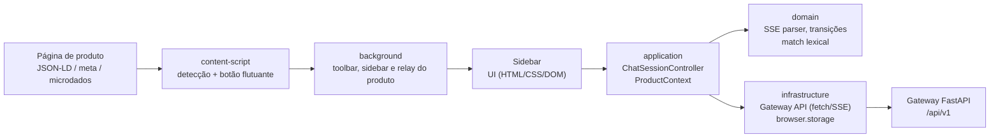

# Extensão Firefox — Consultor SmartSales

WebExtension (Manifest V3) que leva o **Consultor SmartSales RAG** para qualquer aba do
Firefox. Ela reutiliza o gateway existente (`/api/v1`) sem alterar contratos: sessão,
streaming SSE, citações, cards de recomendação, feedback e mock checkout continuam sendo
responsabilidade do Middle-end.

> Especificação de engenharia: [`specs/components/05_firefox_extension_spec.md`](../specs/components/05_firefox_extension_spec.md).

---

## O que a extensão faz

| Capacidade                | Como funciona                                                                                                                                                                                                                                                                                                                |
| :------------------------ | :--------------------------------------------------------------------------------------------------------------------------------------------------------------------------------------------------------------------------------------------------------------------------------------------------------------------------- |
| **Sidebar do consultor**  | Abre pelo botão da barra de ferramentas ou pelo atalho flutuante. Conversa em tempo real via `POST /api/v1/chat/stream` com `fetch` + `ReadableStream`.                                                                                                                                                                      |
| **Contexto por produto**  | Lê apenas dados estruturados publicados pela página (`JSON-LD`, Open Graph, microdados, `data-sku`) ou a rota explícita `/produto/<SKU>` da vitrine SmartSales; resolve o SKU no catálogo via `GET /api/v1/products/{sku}` e, se não existir, tenta um match lexical pelo título. Sem match, permanece em **modo catálogo**. |
| **Citações verificáveis** | O evento `citations` vira uma lista expansível com manual, página, seção, trecho literal e similaridade.                                                                                                                                                                                                                     |
| **Product Cards**         | Até 5 cards (`PRIMARY`, `UPSELL`, `CROSS_SELL`, `OPTION`) com preço/estoque do gateway; nunca valores gerados pelo LLM.                                                                                                                                                                                                      |
| **Checkout**              | `POST /api/v1/checkout/mock` revalida preço/estoque e devolve o link do marketplace; a extensão abre o anúncio em nova aba. Em `409`, mostra o valor/estoque atuais e permite aceitar o novo preço.                                                                                                                          |
| **Feedback**              | `POST /api/v1/feedback` com `LIKE`/`DISLIKE` + motivo, vinculado ao `message_id` do servidor.                                                                                                                                                                                                                                |
| **Sessão**                | Criada sob demanda, restaurada ao reabrir a sidebar dentro do TTL (30 min) e encerrada com `DELETE /api/v1/sessions/{id}`.                                                                                                                                                                                                   |
| **Filtros**               | Voltagem preferida e orçamento máximo viajam em `context_filters` em cada pergunta.                                                                                                                                                                                                                                          |

O produto nunca é inferido pelo LLM na extensão: a extensão apenas **exibe** o que o
gateway retorna, respeitando `R01` (sem alucinação), `R03` (sem recomendar esgotado) e
`R09` (preço/estoque do PostgreSQL).

---

## Arquitetura do módulo



- **Domain**: regras puras, sem DOM nem rede (`src/domain/`).
- **Application**: casos de uso com dependências injetadas (`src/application/`).
- **Infrastructure**: Gateway (`fetch`/SSE) e `browser.storage` (`src/infrastructure/`).
- **UI**: sidebar, options, content script (`src/ui/`, `sidebar/`, `options/`).
- **Background**: apenas gestos de toolbar/sidebar e relay; não chama a API.

---

## Pré-requisitos

- **Firefox 142+** (Manifest V3, `storage.session`, `sidebar_action` e consentimento
  embutido de coleta de dados).
- **Node.js 20+** para os testes unitários (nenhuma dependência externa).
- Gateway SmartSales no ar. Para o stack local:

```bash
# na raiz do repositório
cp .env.example .env      # preencha LLM_API_KEY
docker compose up --build
curl http://localhost:8000/api/v1/health
```

A extensão usa `http://localhost:8000` por padrão.

---

## Instalar no Firefox (desenvolvimento)

### Opção A — carregar temporariamente

1. Abra `about:debugging#/runtime/this-firefox`.
2. Clique em **Carregar add-on temporário…**.
3. Selecione [`extension/manifest.json`](manifest.json).

A extensão aparece na barra de ferramentas e em **Exibir → Barra lateral → Consultor
SmartSales**. O add-on temporário é removido ao fechar o Firefox.

### Opção B — `web-ext`

```bash
cd extension
npx --yes web-ext run --source-dir . --browser-console
```

### Empacotar

```bash
cd extension
npm run validate                 # valida manifest, arquivos e APIs browser.*
npx --yes web-ext lint --source-dir .
npx --yes web-ext build --source-dir . --artifacts-dir web-ext-artifacts
```

Para distribuir fora do modo temporário, assine o pacote no
[addons.mozilla.org](https://addons.mozilla.org/developers/) (AMO). O `gecko.id` já está
definido em `manifest.json`.

---

## Configurar

Abra as opções pela engrenagem na sidebar, pelo menu do add-on ou por
`about:addons → Consultor SmartSales → Preferências`.

| Campo                  | Efeito                                                                                          |
| :--------------------- | :---------------------------------------------------------------------------------------------- |
| **URL base da API**    | Gateway (ex.: `http://localhost:8000`, `https://rag.sua-loja.com`). Sem query/hash/credenciais. |
| **Voltagem preferida** | `context_filters.preferred_voltage` (`127V`/`220V`).                                            |
| **Orçamento máximo**   | `context_filters.budget_max` (2 casas decimais).                                                |
| **Botão flutuante**    | Exibe o atalho somente em páginas com evidência de produto.                                     |

O botão **Testar conexão** consulta `GET /api/v1/health` e mostra o estado de
`backend`/`redis`/`postgres`. O botão **Abrir consultor** abre a sidebar.

### CORS e página de erro

A sidebar é uma página de extensão (`moz-extension://…`) com `host_permissions` para
`http(s)`. Em Firefox, páginas de extensão com permissão de host podem fazer requisições
cross-origin sem alterar o `CORS_ALLOWED_ORIGINS` do gateway. O padrão do gateway
(`http://localhost:3000`) continua servindo a vitrine.

Se você restringir o acesso do add-on a sites em `about:addons`, a extensão não conseguirá
falar com o gateway nem ler o produto; reautorize o acesso.

---

## Fluxo de uso

1. Abra a página de um produto (na vitrine SmartSales ou em qualquer loja com dados
   estruturados) ou use a extensão em modo catálogo.
2. Clique no botão **Consultar com IA** ou no ícone da extensão.
3. A sidebar mostra o contexto resolvido (`SKU` + voltagem) ou **modo catálogo**.
4. Pergunte. A resposta chega por SSE; citações e cards aparecem ao final do turno.
5. Use 👍/👎 para avaliar e **Comprar na …** para o checkout mock.
6. **Reiniciar conversa** encerra a sessão no gateway, sem apagar as configurações.

### Contrato consumido

| Endpoint                       | Uso                                                                                                                                                             |
| :----------------------------- | :-------------------------------------------------------------------------------------------------------------------------------------------------------------- |
| `POST /api/v1/sessions`        | cria/restaura sessão (`200` restaurada, `201` nova).                                                                                                            |
| `DELETE /api/v1/sessions/{id}` | reinicia a conversa.                                                                                                                                            |
| `POST /api/v1/chat/stream`     | perguntas, SSE com `metadata → token* → [correction] → [citations] → [recommendations] → done`; erro controlado: `metadata → error → [recommendations] → done`. |
| `GET /api/v1/products?q=`      | resolução do produto detectado quando o SKU não existe.                                                                                                         |
| `GET /api/v1/products/{sku}`   | confirmação do SKU e ficha técnica.                                                                                                                             |
| `POST /api/v1/feedback`        | `LIKE`/`DISLIKE` + motivo.                                                                                                                                      |
| `POST /api/v1/checkout/mock`   | valida preço/estoque e devolve o link.                                                                                                                          |
| `GET /api/v1/health`           | banner de conexão e teste das opções.                                                                                                                           |

`client_request_id` é gerado por pergunta e **preservado** na reconexão automática e no
retry manual de um turno interrompido. Um `409 TURN_IN_PROGRESS` é repetido com
`Retry-After` (até 3 tentativas). `error` após tokens descarta texto/citações/cards e o
`done` encerra o turno.

---

## Privacidade e permissões

- `data_collection_permissions` — declara a transmissão de `personalCommunications`
  (mensagens digitadas, enviadas ao gateway) e `websiteContent` (nome/SKU publicados pela
  página, usados na busca do catálogo; somente o SKU resolvido segue nos turnos). O
  consentimento é exibido no install.
- `permissions: ["storage"]` — configurações, `session_id` efêmero e contexto pendente.
- `host_permissions: ["http://*/*", "https://*/*"]` — necessário para:
   - falar com o gateway configurado;
   - injetar o detector em páginas de produto.
- O content script lê **somente** `JSON-LD`, meta tags, microdados de `Product`, a rota
  `/produto/<SKU>` e atributos `data-sku`/`data-product-sku`. Não lê campos de formulário,
  não serializa a página e não envia HTML ao gateway. O nome/SKU detectados podem ser
  usados em `GET /products?q=` para localizar o item no catálogo; marca e URL ficam no
  navegador.
- As perguntas digitadas são enviadas ao gateway; o histórico fica no gateway/PostgreSQL
  conforme a política do projeto. A extensão guarda apenas o `session_id` na área
  `browser.storage.session` (limpa ao fechar o navegador).
- Imagens de produto são carregadas do `image_url` com `referrerPolicy="no-referrer"`.
- O `X-Admin-Token` e as rotas administrativas **não** são usados pela extensão.

---

## Testes

```bash
cd extension
npm test                 # 79 testes unitários (Node test runner, sem dependências)
npm run test:coverage    # cobertura do domínio/aplicação/infraestrutura
npm run validate         # integridade do manifest e referências
```

Cobertura local do núcleo (Node 26):

| Camada                      |  Linhas | Branches |
| :-------------------------- | ------: | -------: |
| `src/domain`                |    100% |   86–97% |
| `src/application`           | 94–100% |  82–100% |
| `src/infrastructure`        | 93–100% |   81–94% |
| **Total do módulo testado** | **95%** |  **84%** |

A UI da sidebar/options é validada por `npm run validate`, `web-ext lint` e pelo roteiro
manual abaixo, pois não há dependência de DOM (jsdom) neste módulo.

### Roteiro manual de aceite

1. Gateway no ar; abrir opções, **Testar conexão** → “Conectado”.
2. Abrir uma página de produto com JSON-LD; o botão flutuante aparece e a sidebar mostra
   `SKU` + voltagem.
3. Perguntar uma especificação presente no manual; tokens aparecem, citação expande com o
   trecho e a página.
4. Perguntar algo fora do manual; aparece o fallback seguro (`LOW_SIMILARITY_FALLBACK`).
5. Receber um card; comprar, aceitar o redirecionamento e conferir `checkout_events`.
6. Forçar `PRICE_CHANGED`/`OUT_OF_STOCK` no banco; o diálogo mostra o valor/estoque atuais
   e não registra compra inválida.
7. Avaliar LIKE e DISLIKE + motivo; recarregar a sidebar e confirmar feedback persistido.
8. Fechar/reabrir a sidebar dentro de 30 min; histórico recente é restaurado.
9. Reiniciar conversa; sessão é removida no gateway.
10.   Abrir uma página sem dados de produto; não há botão flutuante e o chat funciona em
      modo catálogo.

---

## Limitações conhecidas

- O detector é heurístico: sites que carregam produto apenas por canvas/WebGL ou que não
  publicam dados estruturados não terão contexto automático (use o modo catálogo).
- A extensão não faz login, não acessa o painel de métricas e não usa `ADMIN_TOKEN`.
- Sessões são por perfil do navegador e expiram no TTL do gateway; a extensão não persiste
  o transcript localmente.
- O layout da sidebar depende do tema claro/escuro do Firefox (`prefers-color-scheme`).
- `web-ext lint`/`build` são executados via `npx`; o CI roda apenas os testes e o validador
  estático.
