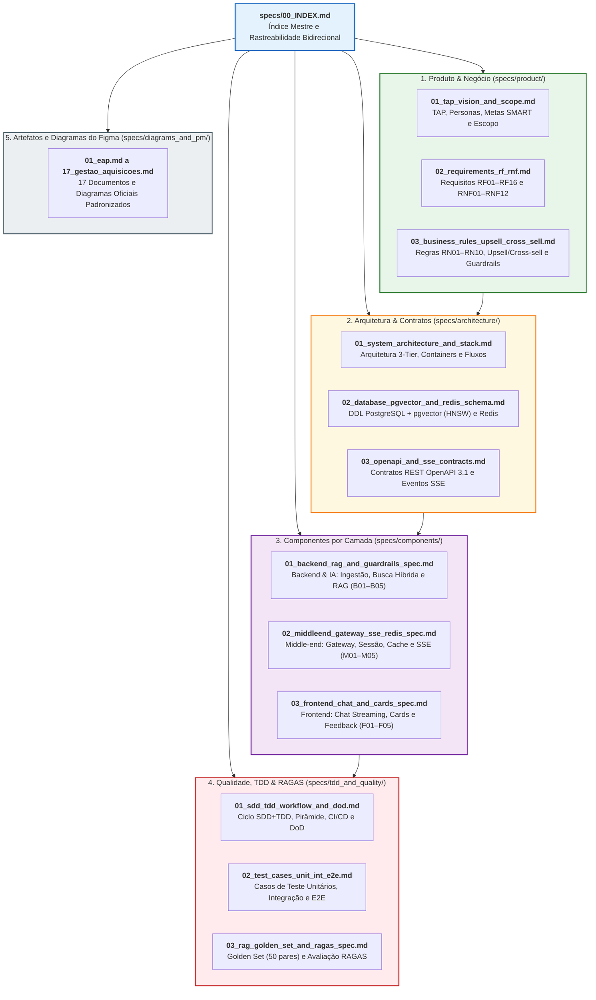

# Índice Mestre de Especificações e Matriz de Rastreabilidade Bidirecional (`specs/00_INDEX.md`)

Este documento é o ponto central de navegação da arquitetura **SDD (*Spec-Driven Development*)** e **TDD (*Test-Driven Development*)** do projeto **SmartSales RAG**. Ele conecta cada pacote da **EAP (`1.0` a `7.0`)**, atividade do **Cronograma/Rede CPM (`G01–G04`, `B01–B05`, `M01–M05`, `F01–F05`)** e **Caso de Uso (`UC01` a `UC09`)** às suas respectivas especificações técnicas e suítes de testes automatizados.

---

## 1. Arquitetura Documental do Diretório `specs/`

---

## 2. Matriz de Rastreabilidade Bidirecional (`EAP ↔ Gantt ↔ UCs ↔ Specs ↔ Testes TDD`)

| Pacote Operacional | Subpacotes EAP (`1.0–7.0`) | Casos de Uso (`UC`) | Requisitos (`RF`/`RNF`/`RN`) | Especificação Principal (`SDD`) | Casos de Teste (`TDD`) | Responsáveis (`R` / `A`) |
| :---: | :---: | :---: | :---: | :--- | :--- | :--- |
| **G01** | `1.1–1.4`, `2.1–2.3` | Todos (`UC01–UC09`) | Metas SMART, Escopo | [`product/01_tap_vision_and_scope.md`](product/01_tap_vision_and_scope.md) [`diagrams_and_pm/01_eap.md`](diagrams_and_pm/01_eap.md) [`diagrams_and_pm/02_matriz_raci.md`](diagrams_and_pm/02_matriz_raci.md) | Validação de Escopo e DoD (`T1`) | **Antônio Rodrigo**, **Walber** |
| **G03** | `2.4`, `2.5`, `6.1–6.3` | Governança | Riscos `R01–R20`, Comunicações `C01–C09` | [`diagrams_and_pm/15_gestao_comunicacoes.md`](diagrams_and_pm/15_gestao_comunicacoes.md) [`diagrams_and_pm/16_gestao_riscos.md`](diagrams_and_pm/16_gestao_riscos.md) | Auditoria de Riscos `R01–R20` e CI | **Antônio Rodrigo**, **Walber** |
| **B01** *(Crítico)* | `3.1`, `3.2`, `3.5`, `4.1` | `UC08`, `UC02` | `RF01`, `RF02`, `RNF12`, `RN01` | [`architecture/02_database_pgvector_and_redis_schema.md`](architecture/02_database_pgvector_and_redis_schema.md) [`components/01_backend_rag_and_guardrails_spec.md`](components/01_backend_rag_and_guardrails_spec.md) | `UT-B01-01` a `UT-B01-03` `IT-B01-01` | **Filipe**, **Diogo** |
| **M01** | `3.1`, `3.2`, `3.3`, `4.5` | `UC07` | `RF03`, `RNF06`, `RNF09`, `RNF11` | [`architecture/03_openapi_and_sse_contracts.md`](architecture/03_openapi_and_sse_contracts.md) [`components/02_middleend_gateway_sse_redis_spec.md`](components/02_middleend_gateway_sse_redis_spec.md) | `UT-M01-01`, `CT-M01-01` | **Pablo**, **Well** |
| **F01** | `3.1`, `3.4`, `3.5` | `UC07`, `UC01` | `RF10`, `RNF08`, `RNF10` | [`components/03_frontend_chat_and_cards_spec.md`](components/03_frontend_chat_and_cards_spec.md) | `UT-F01-01` | **Eduardo**, **Victor Hugo** |
| **B02** *(Crítico)* | `4.3` | `UC01`, `UC02` | `RF04`, `RF05`, `RF06`, `RNF01`, `RNF02`, `RNF07` | [`components/01_backend_rag_and_guardrails_spec.md`](components/01_backend_rag_and_guardrails_spec.md) [`architecture/02_database_pgvector_and_redis_schema.md`](architecture/02_database_pgvector_and_redis_schema.md) | `UT-B02-01` a `UT-B02-03` `IT-B02-01` | **Filipe**, **Diogo** |
| **M02** | `4.5`, `4.6` | `UC07`, `UC01` | `RF03`, `RF06`, `RNF01`, `RNF07` | [`components/02_middleend_gateway_sse_redis_spec.md`](components/02_middleend_gateway_sse_redis_spec.md) [`architecture/03_openapi_and_sse_contracts.md`](architecture/03_openapi_and_sse_contracts.md) [`diagrams_and_pm/06_diagrama_estados.md`](diagrams_and_pm/06_diagrama_estados.md) | `UT-M02-01`, `UT-M02-02` `IT-M02-01` | **Pablo**, **Well** |
| **F02** | `4.9` | `UC01` | `RF10`, `RNF01`, `RNF08` | [`components/03_frontend_chat_and_cards_spec.md`](components/03_frontend_chat_and_cards_spec.md) | `UT-F02-01`, `UT-F02-02`, `E2E-01` | **Eduardo**, **Victor Hugo** |
| **B03** *(Crítico)* | `4.2`, `4.3` | `UC08`, `UC01`, `UC02` | `RF02`, `RF07`, `RF08`, `RNF04`, `RNF09`, `RN02`, `RN03`, `RN07`, `RN08` | [`components/01_backend_rag_and_guardrails_spec.md`](components/01_backend_rag_and_guardrails_spec.md) [`diagrams_and_pm/11_qualidade_diagrama_ishikawa.md`](diagrams_and_pm/11_qualidade_diagrama_ishikawa.md) | `UT-B03-01` a `UT-B03-04` `IT-B03-01` | **Diogo**, **Filipe** |
| **M03** | `4.7` | `UC02` | `RF09`, `RNF03`, `RN09` | [`components/02_middleend_gateway_sse_redis_spec.md`](components/02_middleend_gateway_sse_redis_spec.md) | `UT-M03-01`, `UT-M03-02` `IT-M03-01` | **Pablo**, **Well** |
| **F03** | `4.11` | `UC01`, `UC06` | `RF11`, `RF14`, `RN07` | [`components/03_frontend_chat_and_cards_spec.md`](components/03_frontend_chat_and_cards_spec.md) | `UT-F03-01`, `UT-F03-02`, `E2E-01`, `E2E-06` | **Eduardo**, **Victor Hugo** |
| **B04** *(Crítico)* | `4.4` | `UC03` | `RF12`, `RNF05`, `RN01`, `RN04`, `RN05`, `RN06` | [`product/03_business_rules_upsell_cross_sell.md`](product/03_business_rules_upsell_cross_sell.md) [`components/01_backend_rag_and_guardrails_spec.md`](components/01_backend_rag_and_guardrails_spec.md) | `UT-B04-01` a `UT-B04-04` `IT-B04-01` | **Diogo**, **Filipe** |
| **B05** | `5.1`, `5.3` | `UC01`, `UC02`, `UC03` | `RNF04`, `RNF05`, `RN01–RN08` | [`tdd_and_quality/03_rag_golden_set_and_ragas_spec.md`](tdd_and_quality/03_rag_golden_set_and_ragas_spec.md) | `RAGAS-GS-01` a `RAGAS-GS-50` | **Filipe**, **Diogo** |
| **M04** | `4.7` | `UC04`, `UC09` | `RF13`, `RF16`, `RN06` | [`architecture/03_openapi_and_sse_contracts.md`](architecture/03_openapi_and_sse_contracts.md) [`components/02_middleend_gateway_sse_redis_spec.md`](components/02_middleend_gateway_sse_redis_spec.md) | `IT-M04-01` | **Pablo**, **Well** |
| **M05** | `4.8` | `UC05`, `UC06` | `RF14`, `RF15`, `RN06`, `RN10` | [`components/02_middleend_gateway_sse_redis_spec.md`](components/02_middleend_gateway_sse_redis_spec.md) [`architecture/03_openapi_and_sse_contracts.md`](architecture/03_openapi_and_sse_contracts.md) | `UT-M05-01`, `IT-M05-01` | **Well**, **Pablo** |
| **F04** | `4.10` | `UC03`, `UC04`, `UC05`, `UC09` | `RF13`, `RF15`, `RF16`, `RN06` | [`components/03_frontend_chat_and_cards_spec.md`](components/03_frontend_chat_and_cards_spec.md) | `UT-F04-01`, `E2E-02`, `E2E-03`, `E2E-04`, `E2E-08` | **Victor Hugo**, **Eduardo** |
| **F05** *(Crítico)* | `5.2`, `5.3`, `5.4` | `UC01` a `UC09` | Todos (`RF01–RF16`, `RNF01–RNF12`) | [`tdd_and_quality/02_test_cases_unit_int_e2e.md`](tdd_and_quality/02_test_cases_unit_int_e2e.md) | `E2E-01` a `E2E-08` + Stress SSE | **Victor Hugo**, **Well**, **Eduardo** |
| **G04** | `7.1` | Documentação | `RNF11` | [`architecture/03_openapi_and_sse_contracts.md`](architecture/03_openapi_and_sse_contracts.md) | Validação OpenAPI 3.1 (`openapi.yaml`) / Links | **Antônio Rodrigo**, **Filipe**, **Pablo** |
| **G02** *(Crítico)* | `7.2`, `7.3`, `7.4` | Demo Final (`M5`) | Todos os KPIs da Árvore | [`diagrams_and_pm/10_qualidade_arvore_metricas.md`](diagrams_and_pm/10_qualidade_arvore_metricas.md) | Smoke Test Final da Demo | **Antônio Rodrigo**, **Walber** |

---

## 3. Catálogo Completo dos 30 Arquivos em `specs/`

### 3.1. Especificações de Produto (`specs/product/`)
1. **[`01_tap_vision_and_scope.md`](product/01_tap_vision_and_scope.md)** — Termo de Abertura do Projeto (TAP), Justificativa de Negócio, Personas, Metas SMART, Escopo (*In/Out*), Orçamento (`BAC = R$ 115.670,50` / `UFAL = R$ 0,00`) e Marcos `M1–M5`.
2. **[`02_requirements_rf_rnf.md`](product/02_requirements_rf_rnf.md)** — Requisitos Funcionais (`RF01` a `RF16`), Requisitos Não-Funcionais (`RNF01` a `RNF12`) e Critérios de Aceite Gherkin.
3. **[`03_business_rules_upsell_cross_sell.md`](product/03_business_rules_upsell_cross_sell.md)** — Regras de Negócio (`RN01` a `RN10`), Fórmulas de *Scoring* de *Upsell* (`+35%` teto) e *Cross-sell*, Filtros Determinísticos e *Guardrails*.

### 3.2. Especificações de Arquitetura e Contratos (`specs/architecture/`)
4. **[`01_system_architecture_and_stack.md`](architecture/01_system_architecture_and_stack.md)** — Arquitetura em 3 Camadas, Topologia Docker/Cloud, Segurança, Observabilidade e Decisões Arquiteturais (ADRs).
5. **[`02_database_pgvector_and_redis_schema.md`](architecture/02_database_pgvector_and_redis_schema.md)** — DDL SQL completo (`products`, `manual_chunks` com `vector(1536)` e índice `HNSW`, `product_relations`, `ingestion_jobs`, `chat_sessions`, `chat_messages`, `feedback_logs`, `checkout_events`) e estruturas de dados no `Redis`.
6. **[`03_openapi_and_sse_contracts.md`](architecture/03_openapi_and_sse_contracts.md)** — Especificação OpenAPI 3.1 completa e contrato formal dos eventos SSE (`metadata`, `token`, `correction`, `citations`, `recommendations`, `error`, `done`), schemas REST e o contrato interno `/internal/rag/stream`.

### 3.3. Especificações de Componentes (`specs/components/`)
7. **[`01_backend_rag_and_guardrails_spec.md`](components/01_backend_rag_and_guardrails_spec.md)** — Especificação de Engenharia do Backend e IA (`B01` a `B05`): pipeline de ingestão, busca híbrida `pgvector`, *System Prompts*, *Guardrails* e motor consultivo.
8. **[`02_middleend_gateway_sse_redis_spec.md`](components/02_middleend_gateway_sse_redis_spec.md)** — Especificação de Engenharia do Middle-end (`M01` a `M05`): Gateway FastAPI, máquina de estados da sessão, cache semântico Redis, *streaming* SSE e *mock checkout*.
9. **[`03_frontend_chat_and_cards_spec.md`](components/03_frontend_chat_and_cards_spec.md)** — Especificação de Engenharia do Frontend (`F01` a `F05`): arquitetura de componentes Next.js/React, hook `useSSEChatStream`, *Product Cards*, citações e feedback.

### 3.4. Especificações de Qualidade, TDD e RAGAS (`specs/tdd_and_quality/`)
10. **[`01_sdd_tdd_workflow_and_dod.md`](tdd_and_quality/01_sdd_tdd_workflow_and_dod.md)** — Metodologia SDD + TDD, Pirâmide de Testes, Pipeline GitHub Actions CI/CD e *Definition of Done (DoD)*.
11. **[`02_test_cases_unit_int_e2e.md`](tdd_and_quality/02_test_cases_unit_int_e2e.md)** — Plano e Catálogo de Testes Unitários, Integração, Contrato e E2E (`Playwright`) estruturados em `Given / When / Then`.
12. **[`03_rag_golden_set_and_ragas_spec.md`](tdd_and_quality/03_rag_golden_set_and_ragas_spec.md)** — Especificação da Avaliação Cognitiva RAGAS (*Faithfulness*, *Answer Relevance*, *Context Precision*) e *Golden Set* de homologação.

### 3.5. Diagramas e Matrizes Oficiais do Figma (`specs/diagrams_and_pm/`)
13. **[`01_eap.md`](diagrams_and_pm/01_eap.md)** — Estrutura Analítica do Projeto (EAP — 7 Fases e 36 Subpacotes)
14. **[`02_matriz_raci.md`](diagrams_and_pm/02_matriz_raci.md)** — Matriz de Atribuição de Responsabilidades (RACI)
15. **[`03_diagrama_casos_de_uso.md`](diagrams_and_pm/03_diagrama_casos_de_uso.md)** — Diagrama de Casos de Uso (`UC01` a `UC09`)
16. **[`04_diagrama_atividades.md`](diagrams_and_pm/04_diagrama_atividades.md)** — Diagrama de Atividades e Fluxo Conversacional RAG
17. **[`05_diagrama_sequencia.md`](diagrams_and_pm/05_diagrama_sequencia.md)** — Diagrama de Sequência Fim a Fim (9 Participantes, 70 Passos)
18. **[`06_diagrama_estados.md`](diagrams_and_pm/06_diagrama_estados.md)** — Diagrama de Máquina de Estados da Sessão
19. **[`07_diagrama_rede_atividades_cpm.md`](diagrams_and_pm/07_diagrama_rede_atividades_cpm.md)** — Diagrama de Rede de Atividades (PERT/CPM)
20. **[`08_cronograma_gantt.md`](diagrams_and_pm/08_cronograma_gantt.md)** — Cronograma de Gantt, Sprints e Marcos (`M1` a `M5`)
21. **[`09_quadro_custos_eac.md`](diagrams_and_pm/09_quadro_custos_eac.md)** — Estrutura Analítica de Custos (EAC) e Orçamento Semanal
22. **[`10_qualidade_arvore_metricas.md`](diagrams_and_pm/10_qualidade_arvore_metricas.md)** — Árvore de Métricas de Qualidade (ISO/IEC 25010 + RAG)
23. **[`11_qualidade_diagrama_ishikawa.md`](diagrams_and_pm/11_qualidade_diagrama_ishikawa.md)** — Diagrama de Causa e Efeito (Ishikawa 6M — Anti-Alucinação)
24. **[`12_qualidade_fluxo_processo.md`](diagrams_and_pm/12_qualidade_fluxo_processo.md)** — Fluxo do Processo de Garantia da Qualidade (5 Raias)
25. **[`13_qualidade_ciclo_pdca.md`](diagrams_and_pm/13_qualidade_ciclo_pdca.md)** — Ciclo PDCA de Melhoria Contínua do RAG
26. **[`14_recursos_ear.md`](diagrams_and_pm/14_recursos_ear.md)** — Estrutura Analítica de Recursos (EAR)
27. **[`15_gestao_comunicacoes.md`](diagrams_and_pm/15_gestao_comunicacoes.md)** — Matriz do Plano de Gerenciamento das Comunicações (`C01` a `C09`)
28. **[`16_gestao_riscos.md`](diagrams_and_pm/16_gestao_riscos.md)** — Matriz de Riscos Quantitativa (`P × I`) e Catálogo (`R01` a `R20`)
29. **[`17_gestao_aquisicoes.md`](diagrams_and_pm/17_gestao_aquisicoes.md)** — Matriz de Gerenciamento das Aquisições (`01` a `06`)

## Baseline normativa revisada

Ver [decisões e rastreabilidade das correções](01_BASELINE_REVISADA.md) e [contrato executável](../openapi.yaml).
