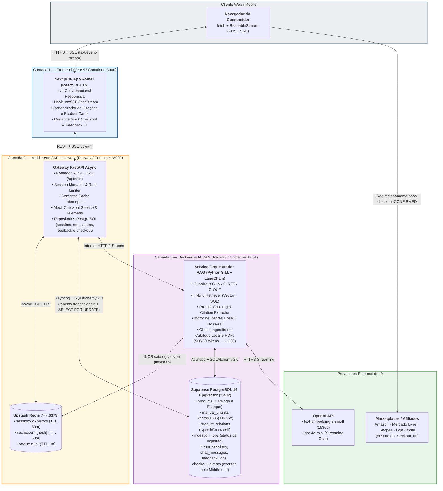
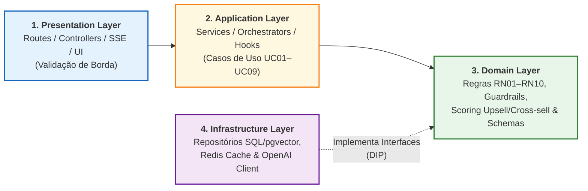

# Arquitetura do Sistema em 3 Camadas, Topologia e Stack Tecnológica (`EAP 3.1`, `3.2`, `3.5`)

Este documento especifica a arquitetura física e lógica do **SmartSales RAG**, detalhando o isolamento das **3 camadas de aplicação**, a topologia de execução (Docker local e nuvem gerenciada), o orçamento de latência (*Latency Budget*), as **Decisões de Arquitetura (*ADRs*)**, a propriedade dos dados, e as diretrizes de **Segurança** e **Observabilidade**.

> **Escopo de integração**: o catálogo é **local** (arquivo *seed* JSON/CSV + manuais PDF ingeridos no PostgreSQL pela CLI do Backend — `UC08`). Não há integração com API externa de loja: a compra é validada no **Mock Checkout** (`POST /api/v1/checkout/mock`) e o navegador é redirecionado ao **link de afiliado/anúncio** (`checkout_url`) do marketplace (`Amazon`, `Mercado Livre`, `Shopee` ou `Loja Oficial`).

---

## 1. Diagrama de Arquitetura de Containers e Camadas (`EAP 3.2`)

---

## 2. Orçamento de Latência Fim a Fim (*Latency Budget* para `TTFT <= 1,5 s`)

Para cumprir a meta SMART de **$\text{TTFT} \le 1,5\text{ s}$** (nominal) e **$\le 2,0\text{ s}$ (`p95`)**, cada etapa crítica antes da emissão do primeiro token possui um teto máximo de execução:

| Etapa do Pipeline (Caminho *Cache Miss*) | Componente Responsável | Latência Alvo (`p50`) | Teto Máximo (`p95`) | Otimização Aplicada |
| :--- | :---: | :---: | :---: | :--- |
| **1. Recepção HTTP, Rate Limit e Sessão Redis** | Middle-end (`M01`, `M02`) | `25 ms` | `50 ms` | Pipeline Redis em comando único (`MGET` / `PIPELINE`). |
| **2. Checagem de Cache Semântico no Redis** | Middle-end (`M03`) | `15 ms` | `30 ms` | Lookup por hash normalizado + índice de chaves em memória. |
| **3. Guardrail de Entrada (`G-IN`) + Geração de Embedding da Query** | Backend (`B02`, `B03`) | `180 ms` | `320 ms` | `text-embedding-3-small` com conexão HTTP/2 persistente (*keep-alive*). |
| **4. Busca Híbrida (`pgvector` HNSW + Filtros SQL de Catálogo)** | Backend + PostgreSQL (`B01`, `B02`) | `45 ms` | `90 ms` | Índice `HNSW` (`m=16, ef_construction=64`) + índice B-Tree composto em `(is_active, stock_quantity, voltage)`. |
| **5. Montagem do Prompt + Tempo até 1º Token do LLM (`gpt-4o-mini`)** | Backend + OpenAI (`B02`) | `650 ms` | `1.150 ms` | Prompt enxuto (`top_k = 5` *chunks*) + `stream=True` com buffer e validação da primeira sentença antes do SSE. |
| **6. Propagação SSE para o Navegador** | Middle-end + Frontend (`M02`, `F02`) | `35 ms` | `60 ms` | Desativação de *buffering* (`X-Accel-Buffering: no`, `Cache-Control: no-cache`). |
| **TOTAL ATÉ O PRIMEIRO TOKEN (`TTFT`)** | **Ponta a Ponta** | **`950 ms` (`0,95 s`)** | **`1.700 ms` (`1,70 s`)** | **Orçamento teórico a aferir na homologação para a Meta SMART ($\le 1,5\text{ s}$ nominal / $\le 2,0\text{ s p95}$)** |

> [!TIP]
> **Caminho Rápido (*Cache Hit* no Redis — $\ge 30\%$ das requisições)**: Nas consultas recorrentes atendidas pelo Redis (`M03`), as etapas 3, 4 e 5 são contornadas e o **$\text{TTFT}$ cai para $\le 120\text{ ms}$**.

---

## 3. Decisões Arquiteturais Registradas (*ADRs*)

| ID | Decisão Arquitetural | Justificativa Técnica e de Negócio | Alternativas Descartadas |
| :---: | :--- | :--- | :--- |
| **ADR-01** | **Separação em 3 Camadas Independentes (*Frontend*, *Middle-end*, *Backend RAG*)** | Permite paralelizar o trabalho das 3 duplas de engenharia (`Eduardo/Victor`, `Pablo/Well`, `Filipe/Diogo`) desacoplando a gestão de conexões SSE/cache (`Middle-end`) do processamento pesado de IA/vetores (`Backend`). | Monolito único acoplando UI, sessão e LangChain no mesmo processo. |
| **ADR-02** | **PostgreSQL 16 + `pgvector` (Índice `HNSW`) em vez de Banco Vetorial Isolado** | Permite executar a **Busca Híbrida em uma única transação SQL** (`JOIN` entre `manual_chunks` vetoriais e `products` com `stock_quantity > 0`), eliminando o risco `R09` de recomendar produtos esgotados ou com preço divergente. | Pinecone / Qdrant isolados do banco relacional de estoque (exigiriam sincronização dual propensa a dessincronização). |
| **ADR-03** | **Server-Sent Events (`SSE`) em vez de WebSockets** | O tráfego de geração do LLM é unidirecional (servidor $\to$ cliente após o `POST` da pergunta). O SSE opera sobre HTTP padrão e atravessa proxies/firewalls corporativos sem bloqueio. Como a pergunta é enviada via `POST`, o Frontend consome o stream com `fetch` + `ReadableStream` (não `EventSource`) e trata a reconexão no hook (`R07`). | WebSockets bidirecionais (complexidade extra de estado em proxies serverless). |
| **ADR-04** | **Motor Híbrido: Regras Determinísticas SQL para Preço/Upsell + LLM apenas para Explicação Consultiva** | Garante **0% de alucinação de preço ou estoque** nos *Product Cards*. O SQL seleciona os SKUs elegíveis (`+35%` teto de *upsell*) e o LLM redige apenas o argumento consultivo ancorado nos dados reais. | Pedir para o LLM escolher produtos e escrever preços livremente a partir de memória ou prompt longo. |
| **ADR-05** | **Catálogo Local + Mock Checkout + Link de Afiliado** | Elimina a dependência de uma API de loja inexistente no contexto acadêmico: o catálogo é versionado no repositório (`data/`), ingerido pela CLI do Backend (`UC08`) e a conversão é registrada no Mock Checkout antes do redirecionamento ao `checkout_url` do marketplace (`UC05`). | Integração com API/webhooks de e-commerce real e carrinho externo (`/cart/add`). |
| **ADR-06** | **Propriedade de Dados por Camada** | O **Middle-end** acessa o PostgreSQL diretamente e é dono de `chat_sessions`, `chat_messages`, `feedback_logs` e `checkout_events` (além de ler `products` e executar `SELECT ... FOR UPDATE` no checkout). O **Backend** é dono de `products`, `manual_chunks`, `product_relations` e `ingestion_jobs`. Evita *hops* extras no caminho de telemetria e checkout. | Todo acesso ao banco via endpoints internos do Backend (mais latência e acoplamento). |

---

## 4. Topologia de Desenvolvimento Local (`docker-compose.yml` — `EAP 3.5`)

Todos os serviços locais devem ser orquestrados via Docker Compose na raiz do repositório com *healthchecks* explícitos:

| Serviço Docker | Imagem Base | Porta Local | Variáveis de Ambiente Críticas |
| :--- | :--- | :---: | :--- |
| `db` | `pgvector/pgvector:pg16` | `5432` | `POSTGRES_DB=smartsales`, `POSTGRES_USER=postgres`, `POSTGRES_PASSWORD=postgres` |
| `redis` | `redis:7.2-alpine` | `6379` | `REDIS_MAXMEMORY=256mb`, `REDIS_MAXMEMORY_POLICY=allkeys-lru` |
| `backend` | `python:3.11-slim` (`./backend`) | `8001` | `DATABASE_URL`, `REDIS_URL`, `OPENAI_API_KEY`, `EMBEDDING_MODEL=text-embedding-3-small`, `LLM_MODEL=gpt-4o-mini` (*snapshot* fixado), `LLM_TEMPERATURE=0.2`, `LLM_FIRST_TOKEN_TIMEOUT_S=3`, `SIMILARITY_THRESHOLD=0.72` |
| `middleend` | `python:3.11-slim` (`./middleend`) | `8000` | `DATABASE_URL`, `REDIS_URL`, `BACKEND_INTERNAL_URL=http://backend:8001`, `CACHE_TTL_SECONDS=3600`, `SESSION_TTL_SECONDS=1800`, `RATE_LIMIT_PER_MINUTE=30`, `CORS_ALLOWED_ORIGINS`, `ADMIN_TOKEN` |
| `frontend` | `node:20-alpine` (`./frontend`) | `3000` | `NEXT_PUBLIC_API_GATEWAY_URL=http://localhost:8000/api/v1` |

---

## 5. Arquitetura de Layers Internas (*Clean / Layered Architecture*)

Dentro de cada uma das 3 macro-camadas (`frontend`, `middleend`, `backend`), o código é organizado em **4 Layers Internas** com inversão de dependência (**SOLID — DIP**) para garantir testabilidade unitária em TDD e conformidade com **Clean Code**:

---

## 6. Segurança e Conformidade (LGPD)

| Controle | Especificação | Pacote / Risco |
| :--- | :--- | :--- |
| **Sessões anônimas** | `session_id` em `UUID v4`; nenhum dado pessoal é solicitado no chat; `client_fingerprint` armazenado apenas como *hash*. | `M01`, `M02` · `R15` |
| **Retenção de dados** | Histórico no Redis expira em `1800s` de inatividade; `chat_messages`, `feedback_logs` e `checkout_events` retidos por **90 dias** e depois expurgados por rotina agendada. | `M05` · `R15` |
| **Proteção de borda** | `CORS` restrito a `CORS_ALLOWED_ORIGINS`; *rate limiting* de `30 req/min` por IP/sessão (`HTTP 429` + `Retry-After`); limite de `1.000` caracteres por mensagem. | `M01` · `R16` |
| **Anti-*prompt injection*** | `InputGuardrail (G-IN)` no Backend, delimitadores estritos entre *system prompt* e conteúdo do usuário, *queries* SQL 100% parametrizadas. | `B03` · `R05` |
| **Painel administrativo (`UC09`)** | `GET /api/v1/metrics/summary` e a página `/admin/metricas` exigem o cabeçalho `X-Admin-Token` igual a `ADMIN_TOKEN` (sem login multi-lojista). | `M04`, `F04` |
| **Segredos** | `OPENAI_API_KEY`, `DATABASE_URL`, `REDIS_URL` e `ADMIN_TOKEN` apenas via variáveis de ambiente / *GitHub Secrets*; `.env` fora do versionamento (`.env.example` versionado). | `G04` |

---

## 7. Observabilidade e Telemetria

- **Logs estruturados (JSON)** em todas as camadas Python com `trace_id` (propagado do Gateway ao Backend no cabeçalho `X-Trace-Id`), `session_id` e `message_id`; PII mascarada.
- **Métricas por turno** gravadas em `chat_messages`: `ttft_ms`, `total_latency_ms`, `cache_hit`, `tokens_used` e `intent`.
- **Latência por etapa** (cache, embedding, busca `pgvector`, 1º token do LLM) registrada nos logs para análise de causa raiz (Ishikawa `MD4`).
- **Agregações** expostas em `GET /api/v1/metrics/summary` (`UC09`): `ttft_p50_ms`, `ttft_p95_ms`, `total_latency_p95_ms`, `cache_hit_ratio`, `error_5xx_rate`, `like_ratio`, `card_ctr`, `confirmed_checkouts` e `top_questions`.
