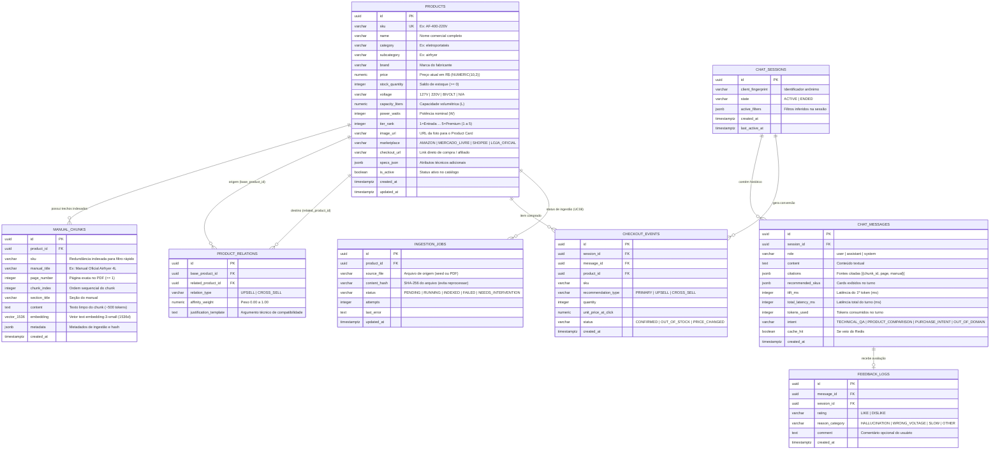

# Especificação de Banco de Dados (`PostgreSQL + pgvector`) e Cache (`Redis`) — `EAP 4.1`, `4.2`, `4.7`

Este documento especifica o modelo entidade-relacionamento, o DDL SQL completo do **PostgreSQL 16 com extensão `pgvector`**, as consultas SQL de busca híbrida e recomendação (*Upsell / Cross-sell*) e as estruturas de dados em memória no **Redis**.

---

## 1. Diagrama Entidade-Relacionamento (`ERD` — PostgreSQL + `pgvector`)



> **Propriedade dos dados (ADR-06)**: o **Backend** escreve `products`, `manual_chunks`, `product_relations` e `ingestion_jobs` (CLI de ingestão — `UC08`); o **Middle-end** escreve `chat_sessions`, `chat_messages`, `feedback_logs` e `checkout_events` e executa `SELECT ... FOR UPDATE` em `products` no *mock checkout*.

---

## 2. Script DDL Completo (`PostgreSQL 16 + pgvector`)

```sql
-- 1. Habilitar extensões obrigatórias
CREATE EXTENSION IF NOT EXISTS "uuid-ossp";
CREATE EXTENSION IF NOT EXISTS "vector";

-- 2. Tabela de Catálogo de Produtos (EAP 4.1 / B01)
CREATE TABLE products (
    id UUID PRIMARY KEY DEFAULT uuid_generate_v4(),
    sku VARCHAR(64) NOT NULL UNIQUE,
    name VARCHAR(255) NOT NULL,
    category VARCHAR(100) NOT NULL,
    subcategory VARCHAR(100) NOT NULL,
    brand VARCHAR(100) NOT NULL,
    price NUMERIC(10, 2) NOT NULL CHECK (price > 0),
    stock_quantity INTEGER NOT NULL DEFAULT 0 CHECK (stock_quantity >= 0),
    voltage VARCHAR(20) NOT NULL CHECK (voltage IN ('127V', '220V', 'BIVOLT', 'N/A')),
    capacity_liters NUMERIC(6, 2),
    power_watts INTEGER,
    tier_rank INTEGER NOT NULL DEFAULT 1 CHECK (tier_rank BETWEEN 1 AND 5),
    image_url TEXT NOT NULL,
    marketplace VARCHAR(30) NOT NULL DEFAULT 'AMAZON' CHECK (marketplace IN ('AMAZON', 'MERCADO_LIVRE', 'SHOPEE', 'LOJA_OFICIAL')),
    checkout_url TEXT NOT NULL,
    specs_json JSONB NOT NULL DEFAULT '{}'::jsonb,
    is_active BOOLEAN NOT NULL DEFAULT TRUE,
    created_at TIMESTAMPTZ NOT NULL DEFAULT NOW(),
    updated_at TIMESTAMPTZ NOT NULL DEFAULT NOW()
);

CREATE INDEX idx_products_active_stock_cat
    ON products (is_active, stock_quantity, category, subcategory, voltage);

-- 3. Tabela de Chunks Vetoriais dos Manuais Técnicos (EAP 4.2 / B03)
CREATE TABLE manual_chunks (
    id UUID PRIMARY KEY DEFAULT uuid_generate_v4(),
    product_id UUID NOT NULL REFERENCES products(id) ON DELETE CASCADE,
    sku VARCHAR(64) NOT NULL,
    manual_title VARCHAR(255) NOT NULL,
    page_number INTEGER NOT NULL CHECK (page_number >= 1),
    chunk_index INTEGER NOT NULL CHECK (chunk_index >= 0),
    section_title VARCHAR(255),
    content TEXT NOT NULL,
    embedding vector(1536) NOT NULL,
    metadata JSONB NOT NULL DEFAULT '{}'::jsonb,
    created_at TIMESTAMPTZ NOT NULL DEFAULT NOW(),
    UNIQUE (product_id, page_number, chunk_index)
);

-- Índice HNSW para Busca de Similaridade de Cosseno em Sub-50ms
CREATE INDEX idx_manual_chunks_embedding_hnsw
    ON manual_chunks USING hnsw (embedding vector_cosine_ops)
    WITH (m = 16, ef_construction = 64);

CREATE INDEX idx_manual_chunks_product_id ON manual_chunks (product_id);
CREATE INDEX idx_manual_chunks_sku ON manual_chunks (sku);

-- 4. Tabela de Relações de Recomendação Upsell e Cross-sell (EAP 4.4 / B04)
CREATE TABLE product_relations (
    id UUID PRIMARY KEY DEFAULT uuid_generate_v4(),
    base_product_id UUID NOT NULL REFERENCES products(id) ON DELETE CASCADE,
    related_product_id UUID NOT NULL REFERENCES products(id) ON DELETE CASCADE,
    relation_type VARCHAR(20) NOT NULL CHECK (relation_type IN ('UPSELL', 'CROSS_SELL')),
    affinity_weight NUMERIC(4, 3) NOT NULL DEFAULT 0.800 CHECK (affinity_weight BETWEEN 0 AND 1),
    justification_template TEXT NOT NULL,
    created_at TIMESTAMPTZ NOT NULL DEFAULT NOW(),
    UNIQUE (base_product_id, related_product_id, relation_type)
);

-- 5. Tabelas de Sessão, Mensagens, Feedback e Conversão (EAP 4.5, 4.8, 4.11)
CREATE TABLE chat_sessions (
    id UUID PRIMARY KEY DEFAULT uuid_generate_v4(),
    client_fingerprint VARCHAR(128),
    state VARCHAR(16) NOT NULL DEFAULT 'ACTIVE' CHECK (state IN ('ACTIVE', 'ENDED')),
    active_filters JSONB NOT NULL DEFAULT '{}'::jsonb,
    created_at TIMESTAMPTZ NOT NULL DEFAULT NOW(),
    last_active_at TIMESTAMPTZ NOT NULL DEFAULT NOW()
);

CREATE TABLE chat_messages (
    id UUID PRIMARY KEY DEFAULT uuid_generate_v4(),
    session_id UUID NOT NULL REFERENCES chat_sessions(id) ON DELETE CASCADE,
    role VARCHAR(20) NOT NULL CHECK (role IN ('user', 'assistant', 'system')),
    content TEXT NOT NULL,
    citations JSONB NOT NULL DEFAULT '[]'::jsonb,
    recommended_skus JSONB NOT NULL DEFAULT '[]'::jsonb,
    ttft_ms INTEGER,
    total_latency_ms INTEGER,
    tokens_used INTEGER,
    intent VARCHAR(30) CHECK (intent IN ('TECHNICAL_QA', 'PRODUCT_COMPARISON', 'PURCHASE_INTENT', 'OUT_OF_DOMAIN')),
    cache_hit BOOLEAN NOT NULL DEFAULT FALSE,
    created_at TIMESTAMPTZ NOT NULL DEFAULT NOW()
);

CREATE TABLE feedback_logs (
    id UUID PRIMARY KEY DEFAULT uuid_generate_v4(),
    message_id UUID NOT NULL UNIQUE REFERENCES chat_messages(id) ON DELETE CASCADE,
    session_id UUID NOT NULL REFERENCES chat_sessions(id) ON DELETE CASCADE,
    rating VARCHAR(10) NOT NULL CHECK (rating IN ('LIKE', 'DISLIKE')),
    reason_category VARCHAR(20) CHECK (reason_category IN ('HALLUCINATION', 'WRONG_VOLTAGE', 'SLOW', 'OTHER')),
    comment TEXT,
    created_at TIMESTAMPTZ NOT NULL DEFAULT NOW()
);

CREATE TABLE checkout_events (
    id UUID PRIMARY KEY DEFAULT uuid_generate_v4(),
    session_id UUID NOT NULL REFERENCES chat_sessions(id) ON DELETE CASCADE,
    message_id UUID REFERENCES chat_messages(id) ON DELETE SET NULL,
    product_id UUID NOT NULL REFERENCES products(id),
    sku VARCHAR(64) NOT NULL,
    recommendation_type VARCHAR(20) NOT NULL CHECK (recommendation_type IN ('PRIMARY', 'UPSELL', 'CROSS_SELL')),
    quantity INTEGER NOT NULL DEFAULT 1 CHECK (quantity > 0),
    unit_price_at_click NUMERIC(10, 2) NOT NULL,
    status VARCHAR(30) NOT NULL CHECK (status IN ('CONFIRMED', 'OUT_OF_STOCK', 'PRICE_CHANGED')),
    created_at TIMESTAMPTZ NOT NULL DEFAULT NOW()
);

-- 6. Status da Ingestão do Catálogo Local e Manuais (EAP 4.1, 4.2 / UC08)
CREATE TABLE ingestion_jobs (
    id UUID PRIMARY KEY DEFAULT uuid_generate_v4(),
    product_id UUID REFERENCES products(id) ON DELETE CASCADE,
    source_file TEXT NOT NULL,
    content_hash VARCHAR(64) NOT NULL,
    status VARCHAR(20) NOT NULL DEFAULT 'PENDING' CHECK (status IN ('PENDING', 'RUNNING', 'INDEXED', 'FAILED', 'NEEDS_INTERVENTION')),
    attempts INTEGER NOT NULL DEFAULT 0 CHECK (attempts >= 0),
    last_error TEXT,
    updated_at TIMESTAMPTZ NOT NULL DEFAULT NOW(),
    UNIQUE (source_file, content_hash)
);

CREATE INDEX idx_chat_messages_session_created ON chat_messages (session_id, created_at);
CREATE INDEX idx_checkout_events_created ON checkout_events (created_at);
```

---

## 3. Query Oficial de Busca Híbrida (`pgvector` + Filtros SQL — `RN02`)

> A busca de *chunks* **não** filtra estoque (permite responder sobre item esgotado, ex.: `RAGAS-GS-06`); o filtro `stock_quantity > 0` (`RN01`) é aplicado nas consultas de recomendação (`B04`). `:sku_scope` recebe o `current_product_sku` (ou os SKUs comparados quando a intenção é `PRODUCT_COMPARISON`); `NULL` busca em todo o catálogo ativo. O limiar `0.72` é o valor inicial de `SIMILARITY_THRESHOLD`, calibrado no *Golden Set* (`EAP 5.1`).

```sql
-- Amplia a lista de candidatos do HNSW antes dos filtros (evita retornar < 5 linhas)
SET LOCAL hnsw.ef_search = 100;
-- pgvector >= 0.8: SET LOCAL hnsw.iterative_scan = relaxed_order;

SELECT
    mc.id AS chunk_id,
    mc.sku,
    mc.manual_title,
    mc.page_number,
    mc.section_title,
    mc.content,
    p.id AS product_id,
    p.name AS product_name,
    p.price,
    p.stock_quantity,
    p.voltage,
    p.capacity_liters,
    p.power_watts,
    p.image_url,
    p.marketplace,
    p.checkout_url,
    1 - (mc.embedding <=> CAST(:query_embedding AS vector)) AS similarity_score
FROM manual_chunks mc
INNER JOIN products p ON p.id = mc.product_id
WHERE p.is_active = TRUE
  AND (:sku_scope IS NULL OR mc.sku = ANY(:sku_scope))
  AND (:voltage_filter IS NULL OR p.voltage IN (:voltage_filter, 'BIVOLT'))
  AND (:category_filter IS NULL OR p.category = :category_filter)
  AND (1 - (mc.embedding <=> CAST(:query_embedding AS vector))) >= :similarity_threshold
ORDER BY mc.embedding <=> CAST(:query_embedding AS vector) ASC
LIMIT 5;
```

---

## 4. Arquitetura de Chaves no `Redis` (Upstash / Local — `EAP 4.5`, `4.7`)

| Padrão da Chave (`Key Pattern`) | Tipo Redis | TTL Padrão | Conteúdo / Estrutura JSON | Responsável |
| :--- | :---: | :---: | :--- | :---: |
| `session:{session_id}:state` | `HASH` | `1800s` (30m) | `{ "state": "IDLE \| VALIDATING_CACHE \| STREAMING_TOKENS \| EMITTING_CARDS_AND_CITATIONS \| ERROR_CONTINGENCY", "active_sku": "AF-400-220V", "voltage_pref": "220V", "updated_at": "..." }` | `M02` |
| `session:{session_id}:history` | `LIST` | `1800s` (30m) | Lista FIFO limitada aos últimos `10` turnos (`LPUSH` + `LTRIM 0 9`) serializados em JSON. | `M02` |
| `cache:sem:{catalog_ver}:{sha256_query}` | `STRING` | `3600s` (60m) | JSON contendo `{ "answer_text": "...", "citations": [...], "recommendations": [...] }`. | `M03` |
| `catalog:version` | `STRING` (`INCR`) | Sem expiração | Inteiro incremental (ex.: `42`, usado na chave como `v42`) incrementado pela CLI de ingestão (`B01`/`B03`) e pelo *mock checkout* quando o estoque zera ou o preço muda (`M05`), invalidando *caches* antigos (`RN09`). | `M03` / `B01` / `M05` |
| `ratelimit:ip:{client_ip}` | `STRING` (`INCR`) | `60s` (1m) | Contador de requisições por minuto (limite padrão: `30 req/min` por IP/sessão). | `M01` |
