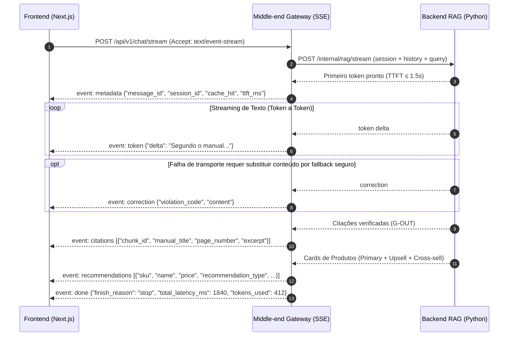

# Contratos de API REST (`OpenAPI 3.1`) e Protocolo de Streaming (`SSE`) — `EAP 3.3`, `4.5`, `4.6`

Este documento define o contrato formal de comunicação entre **Frontend**, **Middle-end / API Gateway** e **Backend RAG**, garantindo desenvolvimento paralelo sem conflito de integração (mitigação do Risco `R11`). A especificação executável correspondente é o arquivo `openapi.yaml` (OpenAPI 3.1) na raiz do repositório, validado no CI pelo teste `CT-M01-01`.

---

## 1. Mapa de Endpoints do API Gateway (`/api/v1`)

| Método | Rota | Descrição Funcional | Formato de Resposta | Pacote |
| :---: | :--- | :--- | :---: | :---: |
| `POST` | `/api/v1/sessions` | Cria ou recupera uma sessão conversacional anônima (`session_id`) e seu histórico ativo (`UC07`). | `application/json` | `M01`, `M02` |
| `DELETE` | `/api/v1/sessions/{session_id}` | Encerra a sessão atual (botão *"Reiniciar conversa"* — `UC07`): marca `state = 'ENDED'` e remove as chaves Redis da sessão. | `204 No Content` | `M02` |
| `POST` | `/api/v1/chat/stream` | Envia mensagem do usuário e abre o fluxo de *streaming* de resposta, citações e recomendações (`UC01`, `UC02`, `UC03`). | `text/event-stream` (`SSE`) | `M02`, `B02`, `F02` |
| `GET` | `/api/v1/products` | Lista/pesquisa a vitrine inicial (q, categoria, voltagem, paginação). | `application/json` | `M04`, `F01` |
| `GET` | `/api/v1/products/{sku}` | Consulta determinística de detalhes, preço atualizado e estoque em tempo real de um `SKU` (`UC04`). | `application/json` | `M04`, `B01` |
| `POST` | `/api/v1/feedback` | Registra avaliação explícita (`LIKE` ou `DISLIKE` + motivo) sobre uma mensagem do assistente (`UC06`). | `application/json` | `M05`, `F03` |
| `POST` | `/api/v1/checkout/mock` | Executa a validação atômica de estoque/preço, registra a conversão simulada e devolve o link do marketplace (`UC05`). | `application/json` | `M05`, `F04` |
| `GET` | `/api/v1/metrics/summary` | Agregações de conversão e qualidade para o painel `/admin/metricas` (`UC09`); exige o cabeçalho `X-Admin-Token`. | `application/json` | `M04`, `F04` |
| `GET` | `/api/v1/health` | Verifica status operacional do Gateway, Redis e PostgreSQL `pgvector`. | `application/json` | `M01` |

> **Contrato interno (não exposto ao Frontend)**: `POST /internal/rag/stream` (Gateway → Backend, `:8001`) — ver seção 4.

---

## 2. Protocolo de Eventos *Server-Sent Events* (`POST /api/v1/chat/stream`)

### 2.1. Payload de Entrada (`ChatStreamRequest`)
```json
{
  "session_id": "550e8400-e29b-41d4-a716-446655440000",
  "client_request_id": "b2e32625-00f1-46e8-89cb-53b0906d4521",
  "message": "Essa Airfryer de 4L serve para 5 pessoas? Posso usar forma de alumínio nela?",
  "context_filters": {
    "preferred_voltage": "220V",
    "category": "eletroportateis",
    "current_product_sku": "AF-400-220V"
  }
}
```

### 2.2. Sequência Formal de Eventos no Stream (`Content-Type: text/event-stream`)



**Regras de ordenação (conjunto fechado de eventos: `metadata`, `token`, `correction`, `citations`, `recommendations`, `error`, `done`):**
- **Fluxo normal**: `metadata → token (N×) → [correction] → [citations] → [recommendations] → done ("stop")`.
- **Fluxo de *fallback* / contingência**: `metadata → error → [recommendations] → done ("fallback" | "error")`.
- `metadata` é emitido **uma única vez**, imediatamente antes do primeiro evento de conteúdo (`token` ou `error`); `ttft_ms` é medido nesse instante.
- `done` é **sempre** o último evento. Em *Cache Hit*, o Gateway reproduz a resposta armazenada com a mesma sequência (`cache_hit: true`).
- O Frontend consome o stream com `fetch` + `ReadableStream` (`POST`), nunca com `EventSource`.

### 2.3. Especificação Exata de Cada Evento SSE

#### Evento 1: `metadata` (Emitido uma única vez, imediatamente antes do primeiro evento de conteúdo)
```text
event: metadata
data: {"message_id": "9b1deb4d-3b7d-4bad-9bdd-2b0d7b3dcb6d", "session_id": "550e8400-e29b-41d4-a716-446655440000", "cache_hit": false, "ttft_ms": 890}
```

#### Evento 2: `token` (Emitido N vezes conforme cada fragmento textual é gerado)
```text
event: token
data: {"delta": "Sim, você pode utilizar formas de alumínio dentro da **Airfryer SmartChef 4L**, desde que não bloqueiem o fluxo de ar quente [Fonte: Manual Airfryer SmartChef 4L, p. 14]."}
```

#### Evento 3: `correction` (Opcional — emitido somente para substituir conteúdo parcial por fallback seguro)
O Frontend **substitui** integralmente o texto da bolha pelo `content` recebido. `violation_code` ∈ `STREAM_INTERRUPTED`.
```text
event: correction
data: {"violation_code": "STREAM_INTERRUPTED", "content": "A resposta foi interrompida. Tente novamente para consultar as especificações verificadas."}
```

#### Evento 4: `citations` (Emitido após os tokens com as fontes auditadas do manual)
```text
event: citations
data: {
  "citations": [
    {
      "chunk_id": "c1a2b3d4-0001-4000-8000-000000000014",
      "sku": "AF-400-220V",
      "manual_title": "Manual Oficial Airfryer SmartChef 4L",
      "page_number": 14,
      "section_title": "Utensílios Compatíveis e Segurança",
      "similarity_score": 0.89,
      "excerpt": "Formas metálicas ou de alumínio podem ser utilizadas no cesto interno desde que deixem ao menos 2 cm livres nas bordas para circulação de ar."
    }
  ]
}
```

#### Evento 5: `recommendations` (Emitido com os *Product Cards* validados no SQL — máximo de 3)
```text
event: recommendations
data: {
  "products": [
    {
      "sku": "AF-400-220V",
      "name": "Airfryer SmartChef 4L Digital",
      "price": 499.90,
      "stock_quantity": 15,
      "voltage": "220V",
      "capacity_liters": 4.0,
      "power_watts": 1500,
      "image_url": "/images/catalog/af-400-220v.webp",
      "marketplace": "AMAZON",
      "checkout_url": "https://www.amazon.com.br/dp/B0EXAMPLE1?tag=smartsales-20",
      "recommendation_type": "PRIMARY",
      "badge_label": "Produto Consultado",
      "justification": "Atende preparos de até 4 porções médias e aceita formas de alumínio."
    },
    {
      "sku": "AF-550-220V",
      "name": "Airfryer SmartChef Pro 5.5L Inox",
      "price": 629.90,
      "stock_quantity": 8,
      "voltage": "220V",
      "capacity_liters": 5.5,
      "power_watts": 1900,
      "image_url": "/images/catalog/af-550-220v.webp",
      "marketplace": "MERCADO_LIVRE",
      "checkout_url": "https://produto.mercadolivre.com.br/MLB-EXAMPLE2",
      "recommendation_type": "UPSELL",
      "badge_label": "Ideal para 5 Pessoas (Upgrade)",
      "justification": "Cesto 37% maior (5,5L) e 1900W para assar porções para 5 pessoas em uma única leva (+26% no valor)."
    },
    {
      "sku": "KIT-SIL-01",
      "name": "Kit Cesto de Silicone Antiaderente + Grelha Dupla Inox",
      "price": 79.90,
      "stock_quantity": 25,
      "voltage": "N/A",
      "capacity_liters": null,
      "power_watts": null,
      "image_url": "/images/catalog/kit-sil-01.webp",
      "marketplace": "SHOPEE",
      "checkout_url": "https://shopee.com.br/Kit-Silicone-Airfryer-i.123456.789012",
      "recommendation_type": "CROSS_SELL",
      "badge_label": "Compre Junto Compatível",
      "justification": "Compatível com cestos de 4L a 5.5L; duplica a área útil de cozimento e facilita a limpeza."
    }
  ]
}
```

#### Evento 6: `error` (Contingência, *fallback* ou bloqueio de *guardrail* — **não** encerra o stream)
```text
event: error
data: {
  "code": "LOW_SIMILARITY_FALLBACK",
  "recoverable": true,
  "fallback_message": "Não encontrei essa especificação exata no manual oficial do fabricante para afirmar com 100% de precisão. Posso te mostrar os detalhes técnicos confirmados dos modelos disponíveis em estoque?"
}
```

| `code` | Origem | Quando ocorre | Eventos seguintes |
| :--- | :---: | :--- | :--- |
| `GUARDRAIL_BLOCKED` | `G-IN` | *Prompt injection* ou pergunta fora do domínio (`PROMPT_INJECTION`, `OUT_OF_DOMAIN`). | `done` (`finish_reason: "fallback"`) |
| `LOW_SIMILARITY_FALLBACK` | `G-RET` | `0 chunks` ou nenhum *chunk* com `similarity_score >= SIMILARITY_THRESHOLD` (`LOW_SIMILARITY_SCORE`). | `recommendations` (similares em estoque, opcional) → `done` (`"fallback"`) |
| `LLM_UNAVAILABLE` | Orquestrador / Gateway | *Timeout* de `3 s` sem 1º token ou `5xx` da OpenAI após 1 nova tentativa (`RNF07`). | `recommendations` determinísticas via SQL → `done` (`"error"`) |
| `INTERNAL_ERROR` | Qualquer camada | Exceção não prevista (registrada com `trace_id`). | `done` (`"error"`) |

#### Evento 7: `done` (Sempre o último evento da transmissão)
```text
event: done
data: {"finish_reason": "stop", "total_latency_ms": 1920, "tokens_used": 412}
```

---

## 3. Contratos REST (Sessões, Produtos, Feedback, Mock Checkout, Métricas e Erros)

### 3.1. `POST /api/v1/feedback`

#### Request (`FeedbackCreateRequest`)
```json
{
  "session_id": "550e8400-e29b-41d4-a716-446655440000",
  "message_id": "9b1deb4d-3b7d-4bad-9bdd-2b0d7b3dcb6d",
  "rating": "LIKE",
  "reason_category": null,
  "comment": "Mostrou a página exata do manual e indicou o tamanho certo para 5 pessoas."
}
```

*`rating` ∈ `LIKE | DISLIKE`; `reason_category` (obrigatório em `DISLIKE`) ∈ `HALLUCINATION | WRONG_VOLTAGE | SLOW | OTHER`; 1 avaliação por `message_id` (`409` se repetida).*

#### Response (`201 Created` — `FeedbackCreateResponse`)
```json
{
  "feedback_id": "11223344-5566-7788-99aa-bbccddeeff00",
  "status": "RECORDED",
  "recorded_at": "2026-10-25T14:32:10Z"
}
```

---

### 3.2. `POST /api/v1/checkout/mock`

#### Request (`MockCheckoutRequest`)
```json
{
  "session_id": "550e8400-e29b-41d4-a716-446655440000",
  "message_id": "9b1deb4d-3b7d-4bad-9bdd-2b0d7b3dcb6d",
  "sku": "AF-550-220V",
  "recommendation_type": "UPSELL",
  "quantity": 1,
  "displayed_price": 629.90
}
```

#### Response (`200 OK` — `MockCheckoutResponse`)
```json
{
  "checkout_event_id": "aabbccdd-1122-3344-5566-77889900aabb",
  "status": "CONFIRMED",
  "sku": "AF-550-220V",
  "product_name": "Airfryer SmartChef Pro 5.5L Inox",
  "voltage": "220V",
  "marketplace": "MERCADO_LIVRE",
  "redirect_checkout_url": "https://produto.mercadolivre.com.br/MLB-EXAMPLE2",
  "quantity": 1,
  "confirmed_unit_price": 629.90,
  "total_amount": 629.90,
  "remaining_stock": 7,
  "message": "Conversão registrada com sucesso! Redirecionando para o anúncio oficial."
}
```
Após `status: "CONFIRMED"`, o Frontend abre o `redirect_checkout_url` (link de afiliado/anúncio do marketplace). Se o estoque chegar a `0` ou o preço mudar, o Gateway executa `INCR catalog:version` (`RN09`).

#### Response (`409 Conflict` — `MockCheckoutResponse` com divergência, cumprindo a **RN10**)
```json
{
  "checkout_event_id": "aabbccdd-1122-3344-5566-77889900aacc",
  "status": "OUT_OF_STOCK",
  "sku": "AF-550-220V",
  "current_price": 629.90,
  "current_stock": 0,
  "redirect_checkout_url": null,
  "message": "Este item acabou de esgotar. Veja uma alternativa em estoque no chat."
}
```
*(Para `PRICE_CHANGED`, `current_price` traz o novo preço e o card é atualizado na UI antes de nova confirmação.)*

---

### 3.3. `POST /api/v1/sessions` e `DELETE /api/v1/sessions/{session_id}` (`UC07`)

#### Request (`SessionCreateRequest`)
```json
{ "session_id": null, "current_product_sku": "AF-400-220V" }
```
*(Se `session_id` for informado e existir no Redis com TTL ativo, a sessão é restaurada; caso contrário uma nova é criada.)*

#### Response (`200 OK` restaurada / `201 Created` nova — `SessionResponse`)
```json
{
  "session_id": "550e8400-e29b-41d4-a716-446655440000",
  "restored": false,
  "history": [],
  "expires_in_seconds": 1800
}
```
`DELETE /api/v1/sessions/{session_id}` retorna `204 No Content` e marca `chat_sessions.state = 'ENDED'`.

---

### 3.4. `GET /api/v1/products/{sku}` (`UC04`)

#### Response (`200 OK` — `ProductDetailResponse`; `404` se o `SKU` não existir ou estiver inativo)
Mesmos campos do *Product Card* (`sku`, `name`, `price`, `stock_quantity`, `voltage`, `capacity_liters`, `power_watts`, `image_url`, `marketplace`, `checkout_url`) acrescidos de `category`, `subcategory`, `brand`, `specs_json` e `updated_at`.

---

### 3.5. `GET /api/v1/metrics/summary` (`UC09` — cabeçalho `X-Admin-Token` obrigatório)

#### Query params: `from`, `to` (ISO-8601, opcionais — padrão: últimos 7 dias)

#### Response (`200 OK` — `MetricsSummaryResponse`; `401` sem token válido)
```json
{
  "window": { "from": "2026-11-02T00:00:00Z", "to": "2026-11-09T00:00:00Z" },
  "turns": 412,
  "ttft_p50_ms": 910,
  "ttft_p95_ms": 1680,
  "total_latency_p95_ms": 5200,
  "cache_hit_ratio": 0.34,
  "error_5xx_rate": 0.004,
  "like_ratio": 0.83,
  "card_ctr": 0.12,
  "confirmed_checkouts": 37,
  "top_questions": [ { "question": "a airfryer 4l e 220v", "count": 21 } ]
}
```

---

### 3.6. `GET /api/v1/health`

#### Response (`200 OK` saudável / `503` degradado)
```json
{ "status": "ok", "components": { "redis": "ok", "postgres": "ok", "backend": "ok" }, "version": "1.0.0" }
```

---

### 3.7. Envelope Padrão de Erros REST (`4xx` / `5xx`)

Todas as rotas JSON retornam erros no formato abaixo (`422` validação Pydantic, `401` token inválido, `404` recurso inexistente, `429` *rate limit* com cabeçalho `Retry-After`, `500`/`503` falha interna):
```json
{ "error": { "code": "RATE_LIMITED", "message": "Limite de 30 requisições por minuto excedido.", "trace_id": "6f1c...", "details": null } }
```

---

## 4. Contrato Interno Gateway → Backend (`POST /internal/rag/stream`)

Rede interna (`BACKEND_INTERNAL_URL`), não exposto publicamente. Resposta em `application/x-ndjson` (1 objeto JSON por linha) usando os **mesmos nomes de evento** do SSE público, exceto `metadata` e `done`, que são gerados pelo Gateway.

#### Request (`RagStreamRequest`)
```json
{
  "session_id": "550e8400-e29b-41d4-a716-446655440000",
  "message_id": "9b1deb4d-3b7d-4bad-9bdd-2b0d7b3dcb6d",
  "message": "Essa Airfryer de 4L serve para 5 pessoas?",
  "history": [ { "role": "user", "content": "..." }, { "role": "assistant", "content": "..." } ],
  "context_filters": { "preferred_voltage": "220V", "category": "eletroportateis", "current_product_sku": "AF-400-220V" }
}
```

#### Linhas emitidas (exemplo)
```text
{"event": "token", "data": {"delta": "Sim, você pode..."}}
{"event": "citations", "data": {"citations": [...]}}
{"event": "recommendations", "data": {"products": [...]}}
{"event": "end", "data": {"tokens_used": 412, "intent": "TECHNICAL_QA"}}
```
*(`end` é interno: sinaliza ao Gateway o fim da geração para que ele persista o turno e emita o `done` público.)*

## 5. Contratos normativos complementares

### Catálogo inicial

`GET /api/v1/products?q=&category=&voltage=&page=1&page_size=20` retorna `{items: ProductDetailResponse[], page, page_size, total}`. `q` (0–200 caracteres) pesquisa nome/SKU sem diferenciar caixa; categoria é igualdade; voltagem aceita 127V/220V e inclui BIVOLT/N/A. Apenas ativos com estoque positivo. Ordenação fixa por nome crescente e SKU crescente. `page>=1`, `1<=page_size<=100`; página além do total retorna items vazio. Ausência de filtro não restringe. A vitrine lê exclusivamente esse endpoint; estoque/preço continuam revalidados no checkout.

### Identidade de turno e repetição

`ChatStreamRequest.client_request_id` UUID v4 é obrigatório, criado pelo navegador antes do primeiro envio e preservado nos retries. Chave de deduplicação: `(session_id, client_request_id)`, persistida em PostgreSQL com UNIQUE, hash de payload e estado RUNNING/COMPLETED/FAILED por 24h; Redis pode acelerar mas não é fonte exclusiva. Mesmo ID/payload concluído reproduz resultado validado com o mesmo message_id e sem nova geração/persistência de turno; métricas de entrega podem ser novas, mas não duplicar métricas lógicas. Mesmo ID em execução retorna 409 `TURN_IN_PROGRESS` com Retry-After; aguardar e repetir o mesmo ID. Payload diferente retorna 409 `IDEMPOTENCY_CONFLICT`. Novo pedido explícito depois de FAILED recebe novo ID; replay de FAILED retorna o resultado terminal gravado. Concluir e persistir antes de `done`, tornando segura a perda desse evento. Não compartilhar esses registros entre sessões. Após 24h, apagar o payload mas manter tombstone até o fim da sessão (máximo de 90 dias); ID expirado retorna 410 `TURN_EXPIRED`, solicitando envio explícito novo.

### Dinheiro e falhas parciais

Todos os valores monetários REST/SSE são JSON number em BRL, com duas casas de precisão de domínio; SQL e cálculos usam Decimal, com serialização JSON explícita conforme `Money` no Backend. Não usar float para cálculo/comparação de negócio. `displayed_price` é convertido de sua representação decimal para Decimal antes da comparação. Schemas de saída validam o tipo efetivamente serializado.

Sequência adicional válida: `metadata → token(N×) → error → [recommendations] → done(error)`. Em `error`, a UI descarta texto/citações/cards parciais e mostra somente fallback_message e novos cards validados. Não reiniciar geração depois de tokens já publicados. `metadata` continua único; `done` somente se conexão aberta. EOF sem `end` interno é falha, nunca `stop`. `correction` pode substituir texto por fallback seguro, mas nenhum token pode conter sentença crítica ainda não aprovada. `end` é marcador interno obrigatório em sucesso/fallback e inclui tokens_used.
