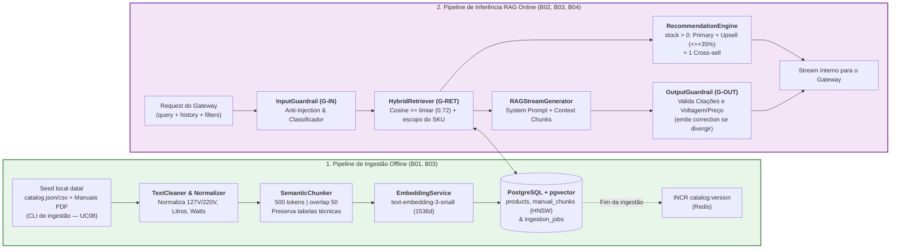

# Especificação de Componente: Backend, Pipeline de Ingestão e Orquestrador RAG (`B01` a `B05`)

- **Pacotes da EAP / Rede CPM**: `EAP 4.1`, `4.2`, `4.3`, `4.4`, `5.1` (`B01`, `B02`, `B03`, `B04`, `B05`)
- **Responsáveis Técnicos**: **Filipe** (Tech Lead / Arquiteto & IA) e **Diogo** (Engenheiro de IA/ML & Back-end)
- **Stack**: Python 3.11+, FastAPI (Internal Worker), LangChain, OpenAI (`text-embedding-3-small`, `gpt-4o-mini`), SQLAlchemy 2.0 + `asyncpg`, `pgvector`, PyMuPDF / Unstructured, Pydantic v2, Pytest, RAGAS.

---

## 1. Arquitetura Interna dos Módulos do Backend (`backend/app/`)



---

## 2. Especificação do Pipeline de Ingestão e Chunking (`B01`, `B03`)

### 2.0. Execução da Ingestão do Catálogo Local (`UC08`)
- Disparo pelo Operador/Lojista via CLI: `python -m app.ingestion.run --catalog data/catalog.json --manuals data/manuals/` (também usado no *seed* do `docker compose` e do CI).
- Etapas: validação de *schema* do catálogo (`UT-B01-01`) → *upsert* em `products`/`product_relations` → para cada PDF novo ou alterado (`content_hash` SHA-256 diferente) cria/atualiza `ingestion_jobs` (`PENDING → RUNNING → INDEXED`) → extração, *chunking*, *embeddings* e *upsert* em `manual_chunks` → ao final, `INCR catalog:version` no Redis (`RN09`).
- Falhas: até `3` tentativas com *backoff* exponencial; esgotadas, o job vai para `NEEDS_INTERVENTION` e é listado na saída da CLI e no painel `/admin/metricas` (`UC09`). Produtos removidos do *seed* são marcados `is_active = FALSE` e seus *chunks* apagados.

### 2.1. Regras de Processamento de Manuais Técnicos (`EAP 4.2`)
1. **Extração por Página com Preservação de Tabelas**:
   - Cada página do PDF é extraída mantendo seu número original (`page_number >= 1`).
   - Tabelas de ficha técnica (*Dimensões, Potência, Tensão Elétrica, Consumo*) são convertidas em formato Markdown estruturado (`| Atributo | Valor |`) para evitar perda de alinhamento coluna-valor (mitigação direta da causa **Matéria-Prima** do [Diagrama de Ishikawa](../diagrams_and_pm/11_qualidade_diagrama_ishikawa.md)).
2. **Parâmetros de Segmentação (*Chunking*)**:
   - `chunk_size = 500 tokens` (medidos via `tiktoken` `cl100k_base`);
   - `chunk_overlap = 50 tokens`;
   - Separadores hierárquicos: `["\n## ", "\n### ", "\n\n", "\n", ". ", " "]`.
3. **Injeção de Cabeçalho de Contexto em Cada Chunk**:
   - Todo *chunk* salvo em `manual_chunks.content` recebe um prefixo canônico antes de gerar o vetor:
     ```text
     [PRODUTO: Airfryer SmartChef 4L Digital | SKU: AF-400-220V | VOLTAGEM: 220V | CAPACIDADE: 4.0L | MANUAL PÁG: 14]
     <conteúdo do trecho extraído>
     ```
   - Isso impede que um *chunk* do modelo `127V` seja confundido semanticamente com um *chunk* do modelo `220V` (`R01`).

---

## 3. Especificação do *System Prompt* Oficial Anti-Alucinação (`B02`, `B03`)

```text
Você é o Consultor Técnico Especialista do SmartSales RAG.
Sua missão é ajudar o cliente a tirar dúvidas técnicas e escolher o produto ideal usando EXCLUSIVAMENTE os dados fornecidos nos blocos <CATALOGO_SQL> e <CHUNKS_MANUAIS>.

REGRAS OBRIGATÓRIAS E INEGOCIÁVEIS:
1. FIDELIDADE ABSOLUTA: Responda apenas com base nas informações explícitas em <CATALOGO_SQL> e <CHUNKS_MANUAIS>. NUNCA invente, deduza ou extrapole voltagem (127V/220V/Bivolt), potência (W), capacidade (L), dimensões, compatibilidade de materiais ou preços.
2. CITAÇÃO OBRIGATÓRIA: Toda afirmação técnica extraída de um manual DEVE terminar com a citação exata no formato: [Fonte: <manual_title>, p. <page_number>].
3. INFORMAÇÃO AUSENTE: Se a pergunta exigir um dado técnico que não está presente em <CHUNKS_MANUAIS>, diga claramente: "Essa especificação específica não consta no manual técnico oficial deste modelo." Jamais tente adivinhar.
4. CONSULTORIA DE CAPACIDADE E VOLTAGEM:
   - Se o cliente informar uma necessidade superior à capacidade do produto consultado (ex.: família de 5+ pessoas para cesto de 4L), explique a limitação técnica e apresente a opção de UPSELL disponível em <RECOMENDACOES_SQL>.
   - Sempre destaque a voltagem exata do produto recomendado.
5. TOM E FORMATO: Seja objetivo, cordial, técnico e estruturado em tópicos curtos.
```

**Parâmetros de geração**: `LLM_MODEL=gpt-4o-mini` (*snapshot* fixado — `R14`), `temperature = 0.2`, `max_tokens = 600`, `stream = True`; *timeout* de `3 s` até o 1º token com **1** nova tentativa (`RNF07`).

---

## 4. Contratos Internos Pydantic v2 (`backend/app/models/schemas.py`)

```python
from decimal import Decimal
from typing import Literal, Optional
from uuid import UUID
from pydantic import BaseModel, Field

class RetrievedChunk(BaseModel):
    chunk_id: UUID
    sku: str
    manual_title: str
    page_number: int = Field(ge=1)
    section_title: Optional[str] = None
    content: str
    similarity_score: float = Field(ge=0.0, le=1.0)

class ProductRecommendation(BaseModel):
    sku: str
    name: str
    price: Decimal = Field(gt=0)
    stock_quantity: int = Field(gt=0)
    voltage: Literal["127V", "220V", "BIVOLT", "N/A"]
    capacity_liters: Optional[float] = None
    power_watts: Optional[int] = None
    image_url: str
    marketplace: Literal["AMAZON", "MERCADO_LIVRE", "SHOPEE", "LOJA_OFICIAL"]
    checkout_url: str
    recommendation_type: Literal["PRIMARY", "UPSELL", "CROSS_SELL"]
    badge_label: str
    justification: str

class GuardrailCheckResult(BaseModel):
    passed: bool
    violation_code: Optional[Literal[
        "PROMPT_INJECTION",
        "OUT_OF_DOMAIN",
        "LOW_SIMILARITY_SCORE",
        "VOLTAGE_MISMATCH",
        "PRICE_MISMATCH",
        "MISSING_CITATION"
    ]] = None
    safe_fallback_response: Optional[str] = None
```

**Mapeamento `violation_code` → evento SSE** (ver [`03_openapi_and_sse_contracts.md`](../architecture/03_openapi_and_sse_contracts.md)):

| `violation_code` | Guardrail | Evento SSE emitido |
| :--- | :---: | :--- |
| `PROMPT_INJECTION`, `OUT_OF_DOMAIN` | `G-IN` | `error` com `code = "GUARDRAIL_BLOCKED"` |
| `LOW_SIMILARITY_SCORE` | `G-RET` | `error` com `code = "LOW_SIMILARITY_FALLBACK"` + `recommendations` (similares em estoque) |
| `VOLTAGE_MISMATCH`, `PRICE_MISMATCH`, `MISSING_CITATION` | `G-OUT` | `correction` com o texto completo corrigido |

---

## 5. Especificação do Verificador Factual Pós-Geração (`OutputGuardrail` — `B03`)

O módulo `OutputGuardrail` acumula o texto transmitido e, ao fim da geração, executa três verificações determinísticas em $< 10\text{ ms}$ antes de emitir os eventos `citations` e `recommendations`. Como os tokens já foram exibidos, qualquer violação é tratada com o evento SSE `correction`, cujo `content` substitui integralmente o texto da bolha no Frontend:
1. **Verificação de Voltagem (`check_voltage_consistency`)**:
   - Se o `SKU` primário é exclusivamente `220V` e o texto gerado afirma que o referido `SKU` é `127V` ou `Bivolt` (sem estar comparando com outro `SKU` `127V`), marca `violation_code = "VOLTAGE_MISMATCH"` e reescreve a afirmação com a voltagem do SQL no `content` do evento `correction`.
2. **Verificação de Preço (`check_price_consistency`)**:
   - Extrai todos os valores monetários `R$ X.XXX,XX` do texto e valida se pertencem ao conjunto `{p.price for p in recommendations}`; divergência gera `PRICE_MISMATCH` e substituição pelo preço canônico do SQL.
3. **Verificação de Citações (`check_citations_exist`)**:
   - Confirma que cada `chunk_id` e `page_number` emitido no evento `citations` pertence ao subconjunto de `RetrievedChunk`s efetivamente recuperados naquele turno.
