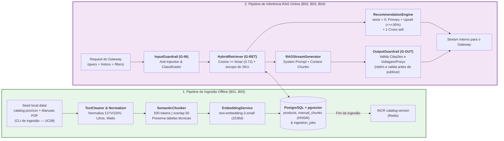

# Especificação de Componente: Backend, Pipeline de Ingestão e Orquestrador RAG (`B01` a `B05`)

- **Pacotes da EAP / Rede CPM**: `EAP 4.1`, `4.2`, `4.3`, `4.4`, `5.1` (`B01`, `B02`, `B03`, `B04`, `B05`)
- **Responsáveis Técnicos**: **Filipe** (Tech Lead / Arquiteto & IA) e **Diogo** (Engenheiro de IA/ML & Back-end)
- **Stack**: Python 3.11+, FastAPI (Internal Worker), LangChain, OpenAI (`text-embedding-3-small`, `gpt-4o-mini`), SQLAlchemy 2.0 + `asyncpg`, `pgvector`, PyMuPDF / Unstructured, Pydantic v2, Pytest, RAGAS.

---

## 1. Arquitetura Interna dos Módulos do Backend (`backend/app/`)



### 1.1. Busca escopada por SKU

A busca de *chunks* do turno é uma varredura **exata** dos *chunks* do SKU consultado
(CTE `MATERIALIZED` filtrada por `sku`, ordenada por distância de cosseno). Ela não usa o
índice HNSW: quando o planejador escolhe o HNSW, ele obtém só os ~`ef_search` (40)
vizinhos da tabela inteira e aplica o filtro de `sku` depois, e um produto fora desse
grupo voltaria com `0 chunks` (*fallback* falso). Reproduzido com o seed: 10 de 32 SKUs
sem resultado com o plano HNSW. Cada produto tem poucos *chunks*, então o custo da
varredura exata é baixo; o índice HNSW segue disponível para buscas sem filtro.

### 1.2. Limiar de similaridade por modelo de *embedding* (`RN02`)

O padrão do código continua `SIMILARITY_THRESHOLD = 0.72`, valor das specs para
`text-embedding-3-small`. Para `gemini-embedding-001` (1536 dimensões), o limiar
aprovado é **`0.60`**: desvio de `RN02` registrado pelo GP em 07/11 (commit `525c1c8`),
calibrado nos manuais da demo (respostas corretas entre 0,64 e 0,72; perguntas fora do
tema perto de 0,47) e configurado em `.env.example` e `backend/.env.example`. O limiar só
vale para o modelo com que foi calibrado: ao trocar `EMBEDDING_MODEL`, recalibrar com
`python -m app.retrieval.inspect`. Na subida, o backend registra numa única linha o
limiar efetivo e os modelos em uso
(`rag_settings similarity_threshold=... embedding_model=... llm_model=...`).

---

## 2. Especificação do Pipeline de Ingestão e Chunking (`B01`, `B03`)

### 2.0. Execução da Ingestão do Catálogo Local (`UC08`)
- Disparo pelo Operador/Lojista via CLI: `python -m app.ingestion.run --catalog data/catalog.json --manuals data/manuals/` (também usado no *seed* do `docker compose` e do CI).
- Etapas: validação de *schema* do catálogo (`UT-B01-01`) → *upsert* em `products`/`product_relations` → para cada PDF novo ou alterado (`content_hash` SHA-256 diferente) cria/atualiza `ingestion_jobs` (`PENDING → RUNNING → INDEXED`) → extração, *chunking*, *embeddings* e substituição transacional dos chunks da versão anterior (seção 6) → ao final, `INCR catalog:version` no Redis (`RN09`).
- Falhas: até `3` tentativas com *backoff* exponencial para falhas transitórias (indisponibilidade do provedor de embeddings, `psycopg.OperationalError`: conexão perdida, *deadlock*, serialização); erros permanentes (ex.: `IntegrityError`, PDF corrompido, chave de API rejeitada) vão direto para `NEEDS_INTERVENTION`. Esgotadas as tentativas, o job vai para `NEEDS_INTERVENTION` e é listado na saída da CLI e no painel `/admin/metricas` (`UC09`). Produtos removidos do *seed* são marcados `is_active = FALSE` e seus *chunks* apagados.

Quando `--relations` é informado, o seed substitui integralmente `product_relations`
em uma transação. Antes do DELETE, adquirir `LOCK TABLE product_relations IN SHARE
ROW EXCLUSIVE MODE` para serializar escritores, inclusive ao publicar `[]`; leituras
continuam vendo o último seed confirmado. Commit ou rollback libera o bloqueio.
Sem `--relations`, preservar as relações existentes; arquivo informado e inexistente
é erro. Este bloqueio protege a substituição da tabela e complementa o lock global
de ingestão de B03, responsável pelos demais passos da carga.

### 2.1. Regras de Processamento de Manuais Técnicos (`EAP 4.2`)
1. **Extração por Página com Preservação de Tabelas**:
   - Cada página do PDF é extraída mantendo seu número original (`page_number >= 1`).
   - Tabelas de ficha técnica (*Dimensões, Potência, Tensão Elétrica, Consumo*) são convertidas em formato Markdown estruturado (`| Atributo | Valor |`) para evitar perda de alinhamento coluna-valor (mitigação direta da causa **Matéria-Prima** do [Diagrama de Ishikawa](../diagrams_and_pm/11_qualidade_diagrama_ishikawa.md)).
2. **Parâmetros de Segmentação (*Chunking*)**:
   - `chunk_size = 500 tokens` (medidos via `tiktoken` `cl100k_base`);
   - `chunk_overlap = 50 tokens`;
   - Separadores hierárquicos: `["\n## ", "\n### ", "\n\n", "\n", ". ", " "]`.
3. **Injeção de Cabeçalho de Contexto em Cada Chunk**:
   - Todo *chunk* salvo em `manual_chunks.content` recebe um prefixo canônico antes de gerar o vetor:
     ```text
     [PRODUTO: Airfryer SmartChef 4L Digital | SKU: AF-400-220V | VOLTAGEM: 220V | CAPACIDADE: 4.0L | MANUAL PÁG: 14]
     <conteúdo do trecho extraído>
     ```
   - Isso impede que um *chunk* do modelo `127V` seja confundido semanticamente com um *chunk* do modelo `220V` (`R01`).

---

## 3. Especificação do *System Prompt* Oficial Anti-Alucinação (`B02`, `B03`)

```text
Você é o Consultor Técnico Especialista do SmartSales RAG.
Sua missão é ajudar o cliente a tirar dúvidas técnicas e escolher o produto ideal usando EXCLUSIVAMENTE os dados fornecidos nos blocos <CATALOGO_SQL> e <CHUNKS_MANUAIS>.

REGRAS OBRIGATÓRIAS E INEGOCIÁVEIS:
1. FIDELIDADE ABSOLUTA: Responda apenas com base nas informações explícitas em <CATALOGO_SQL> e <CHUNKS_MANUAIS>. NUNCA invente, deduza ou extrapole voltagem (127V/220V/Bivolt), potência (W), capacidade (L), dimensões, compatibilidade de materiais ou preços.
2. CITAÇÃO OBRIGATÓRIA: Toda afirmação técnica extraída de um manual DEVE terminar com a citação exata no formato: [Fonte: <manual_title>, p. <page_number>].
3. INFORMAÇÃO AUSENTE: Se a pergunta exigir um dado técnico que não está presente em <CHUNKS_MANUAIS>, diga claramente: "Essa especificação específica não consta no manual técnico oficial deste modelo." Jamais tente adivinhar.
4. CONSULTORIA DE CAPACIDADE E VOLTAGEM:
   - Se o cliente informar uma necessidade superior à capacidade do produto consultado (ex.: família de 5+ pessoas para cesto de 4L), explique a limitação técnica e apresente a opção de UPSELL disponível em <RECOMENDACOES_SQL>.
   - Sempre destaque a voltagem exata do produto recomendado.
5. TOM E FORMATO: Seja objetivo e técnico. Sem saudação, introdução ou fecho: comece diretamente pelo fato citado. Para listas, use tópicos iniciados por "- ", nunca numerados.
```

O TTFT é medido na primeira sentença **aprovada** pelo G-OUT: saudações e marcadores numerados ("1. ") são descartados pelo verificador, por isso o *prompt* pede resposta começando pelo fato citado e tópicos com "- " (o hífen é preservado, inclusive antes de `SKU <código>:`). Cada sentença bloqueada é registrada em nível `INFO` (`gout_blocked_sentence`, com `sku` e até 200 caracteres do texto gerado) para diagnóstico.

**Parâmetros de geração**: `LLM_MODEL=gpt-4o-mini` (*snapshot* fixado — `R14`), `temperature = 0.2`, `max_tokens = 600`, `stream = True`; *timeout* de `3 s` até o 1º token com **1** nova tentativa (`RNF07`). Essa é a **única** política de *retry* da chamada ao LLM: o cliente do SDK roda com `max_retries=0`, para que *retries* internos do SDK não se somem ao `RNF07`. O *embedding* da pergunta tem *timeout* próprio e curto (`EMBEDDING_TIMEOUT_SECONDS`, padrão `3 s`; a ingestão mantém o *timeout* do cliente). Qualquer resposta HTTP de erro do provedor (`400`, `401`, `404`, `429`, `5xx`) ou falha de transporte vira `LLMUnavailableError` → evento `error` `LLM_UNAVAILABLE` seguido dos *cards* determinísticos, sem quebrar o stream NDJSON.

---

## 4. Contratos Internos Pydantic v2 (`backend/app/models/schemas.py`)

```python
from decimal import Decimal
from typing import Annotated, Literal, Optional
from uuid import UUID
from pydantic import BaseModel, Field, PlainSerializer

Money = Annotated[Decimal, PlainSerializer(float, when_used="json")]

class RetrievedChunk(BaseModel):
    chunk_id: UUID
    sku: str
    manual_title: str
    page_number: int = Field(ge=1)
    section_title: Optional[str] = None
    content: str
    similarity_score: float = Field(ge=0.0, le=1.0)

class ProductRecommendation(BaseModel):
    sku: str
    name: str
    price: Money = Field(gt=0, max_digits=10, decimal_places=2)
    stock_quantity: int = Field(gt=0)
    voltage: Literal["127V", "220V", "BIVOLT", "N/A"]
    capacity_liters: Optional[float] = None
    power_watts: Optional[int] = None
    image_url: str
    marketplace: Literal["AMAZON", "MERCADO_LIVRE", "SHOPEE", "LOJA_OFICIAL"]
    checkout_url: str
    recommendation_type: Literal["PRIMARY", "UPSELL", "CROSS_SELL"]
    badge_label: str
    justification: str

class GuardrailCheckResult(BaseModel):
    passed: bool
    violation_code: Optional[Literal[
        "PROMPT_INJECTION",
        "OUT_OF_DOMAIN",
        "LOW_SIMILARITY_SCORE",
        "VOLTAGE_MISMATCH",
        "PRICE_MISMATCH",
        "MISSING_CITATION",
        "CAPACITY_MISMATCH", "POWER_MISMATCH", "UNSUPPORTED_CLAIM"
    ]] = None
    safe_fallback_response: Optional[str] = None
```

**Mapeamento `violation_code` → evento SSE** (ver [`03_openapi_and_sse_contracts.md`](../architecture/03_openapi_and_sse_contracts.md)):

| `violation_code` | Guardrail | Evento SSE emitido |
| :--- | :---: | :--- |
| `PROMPT_INJECTION`, `OUT_OF_DOMAIN` | `G-IN` | `error` com `code = "GUARDRAIL_BLOCKED"` |
| `LOW_SIMILARITY_SCORE` | `G-RET` | `error` com `code = "LOW_SIMILARITY_FALLBACK"` + `recommendations` (similares em estoque) |
| `VOLTAGE_MISMATCH`, `PRICE_MISMATCH`, `MISSING_CITATION`, `CAPACITY_MISMATCH`, `POWER_MISMATCH`, `UNSUPPORTED_CLAIM` | `G-OUT` | Bloqueia a sentença privada e publica somente template validado |

---

## 5. Especificação do Verificador Factual antes da Publicação (`OutputGuardrail` — `B03`)

O módulo retém cada sentença do LLM em buffer privado. Antes de publicar qualquer token dessa sentença, resolve as afirmações como `(sku, atributo, valor, unidade, chunk_id, página)`. Compara voltagem, preço, capacidade e potência com o registro daquele SKU e verifica que a evidência citada sustenta a afirmação, não apenas que o ID existe. Comparações são verificadas separadamente por SKU. O conjunto de preços dos cards não é um validador de associação.

Afirmações ambíguas, unidades não normalizáveis e fatos sem suporte são substituídos, antes da publicação, por template determinístico de ausência de evidência. Para compatibilidade, materiais e dimensões sem validador determinístico, publicar apenas extrato literal do trecho verificado ou fallback; nunca confiar somente no LLM como verificador. Recomendações SQL e chunks dos produtos recomendados são obtidos antes de montar o prompt e verificar suas afirmações.

O evento `correction` fica reservado à substituição por conteúdo seguro após falha de transporte; não é mecanismo para corrigir um fato incorreto já exposto. Código de violação interno inclui `CAPACITY_MISMATCH`, `POWER_MISMATCH`, `UNSUPPORTED_CLAIM`, além dos existentes. Toda medição de alucinação avalia os fatos do texto efetivamente publicado. As tentativas bloqueadas são contadas separadamente. O orçamento de 320 ms de entrada, 90 ms de recuperação e 1.150 ms de geração passa a incluir o buffer/validação da primeira sentença; TTFT nominal é alvo a medir, não garantia provada pela soma de estimativas. Homologação exige medir p95 até o primeiro token validado no navegador, sem desabilitar G-OUT para atingir SLA.

## 6. Ingestão versionada e publicação atômica

Cada manual possui `manual_source` estável e `manual_version` (SHA-256 do PDF). A extração e os embeddings são preparados fora da transação. Sob lock do produto, uma única transação apaga todos os chunks do `manual_source` substituído e insere o conjunto completo da nova versão; apenas depois marca o job INDEXED. Falha faz rollback e preserva integralmente a versão anterior. PDF menor não deixa páginas antigas. `INCR catalog:version` ocorre após commit; falha no Redis bloqueia leitura/escrita do cache até reconciliar a versão. Uma revisão nunca mistura versões na mesma busca.

O hash e a extração usam o mesmo snapshot de bytes do arquivo. Um manual sem texto
extraível exige intervenção (por exemplo, OCR para PDF digitalizado) e preserva a versão
anterior. A CLI adquire um advisory lock de sessão no PostgreSQL antes de qualquer escrita:
como catálogo, relações e desativação são globais, uma segunda ingestão simultânea é
recusada com saída 1 e `ingestion_error`, sem alterar dados nem incrementar a versão.
O lock termina quando a conexão fecha, inclusive em falhas. A troca dos chunks também
trava a linha do produto antes do DELETE, protegendo chamadas diretas ao repositório.
O cliente Redis limita conexão e leitura por `REDIS_CONNECT_TIMEOUT_SECONDS` (> 0),
sem repetir automaticamente `INCR` após uma resposta perdida.

O SHA-256 do arquivo permanece em `manual_version`. O campo JSON
`metadata.ingestion_fingerprint` identifica adicionalmente título, cabeçalho de
contexto, modelo/provedor de embeddings, dimensões e parâmetros de chunking.
Só pular a fonte se todos os chunks tiverem o mesmo hash e fingerprint atual;
mudança de contexto ou configuração reconstrói o índice. Chunks anteriores sem
fingerprint são reindexados uma vez. Se os chunks atuais já estiverem completos,
reconciliar jobs ausentes como INDEXED sem chamar embeddings (attempts=0 para o
registro reconstruído). Uma troca de extensão aposenta os chunks do manual
anterior do SKU somente na transação que confirma a nova versão.

Erro de leitura que impede obter os bytes/hash é listado em `source_read_errors`
e `needs_intervention`, preservando a versão anterior e processando as demais
fontes. Não inventar um content_hash para um arquivo que não pôde ser lido.

Na publicação, preço e valores elétricos/capacidade são conferidos contra o SQL
do SKU consultado. Sentenças SQL usam estruturas simples que vinculam atributo
e unidade (aceitando as formas usuais em português: "A potência é de 1500 W",
"A capacidade é de 4 litros", "O preço atual é de R$ 499,90", "Este produto é 220V");
o valor continua tendo de ser exatamente o do SQL daquele SKU. Números com ponto de
milhar ("1.500 W") valem 1500; vírgula é separador decimal ("1,5 kW"). Afirmações não
verificáveis caem no fallback. Para outros fatos,
exigir extrato literal da evidência, preservando negações e restrições. Citações
precisam sustentar a sentença na página indicada; se um extrato não vier com
citação, vinculá-lo deterministicamente ao chunk de suporte. Emitir apenas seus
IDs no evento citations, sem acrescentar páginas não utilizadas. Chunks de outro
SKU não entram no prompt. O aviso "Essa especificação específica não consta no manual" só
é emitido quando a sentença bloqueada contém uma afirmação técnica (número com unidade,
preço ou bivolt); cortesias e paráfrases sem dado técnico são descartadas em silêncio,
sem sugerir ao cliente que falta uma especificação. Se o próprio modelo escrever a frase da regra 3 do
*prompt* ("Essa especificação específica não consta no manual técnico oficial deste
modelo."), ela é tratada como esse aviso (publicado uma única vez, junto de texto
aprovado), e não como afirmação rejeitada. O protocolo SSE permanece igual; nenhuma correção de
fato incorreto depende de já tê-lo exposto ao usuário.

Se não houver nenhuma sentença aprovada e a consulta não puder ser respondida com evidência, emitir error LOW_SIMILARITY_FALLBACK, recomendações determinísticas e end; o Gateway conclui com done(fallback). Nunca transmitir o rascunho rejeitado.

## 7. Integração consultiva B04

Aplicar as regras de integração de `product/03_business_rules_upsell_cross_sell.md`:
propagar filtros resolvidos, ler cada conjunto de cards em snapshot SQL somente
leitura REPEATABLE READ e manter precisão do ranking até a seleção. Há uma seleção
antes do prompt (`RECOMENDACOES_SQL`) e outra após a geração, para emissão dos
cards atuais. O texto de uma opção exige prefixo `SKU <código>:` e validação de
seus próprios atributos SQL. Os chunks do SKU consultado não justificam afirmações
sobre outra opção. Sem manual daquela opção, o texto se limita aos atributos SQL;
quantidade de pessoas/porções não é inferida a partir da capacidade em litros.

Para encurtar o caminho até o primeiro token, as leituras independentes rodam em
paralelo: a consulta do produto junto com o *embedding* da pergunta (pulado se o G-IN
bloquear), e a busca de *chunks* junto com a seleção de cards para o *prompt*. Num turno
de *fallback* essa seleção é descartada e os substitutos são lidos (uma consulta SQL a
mais nesse caminho). A releitura após a geração é mantida de propósito (`R09`): os cards
emitidos refletem o SQL do fim do turno, não o snapshot do *prompt*.
A seleção adicional antes da geração afeta o caminho até o primeiro token;
TTFT, precisão/relevância e recusas excessivas exigem medição B05/F05. A issue #13
usa uma fórmula ilustrativa antiga: os pesos normativos desta baseline são os
especificados em product/03, incluindo 0,50/0,30/0,20 para upsell.
