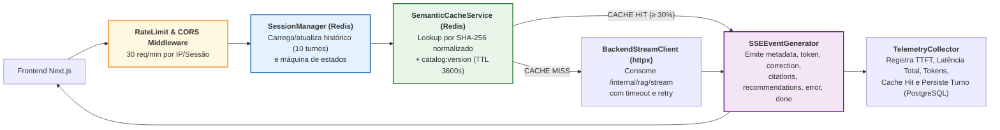

# Especificação de Componente: Middle-end / API Gateway, Sessões, Cache Redis e Streaming SSE (`M01` a `M05`)

- **Pacotes da EAP / Rede CPM**: `EAP 3.3`, `4.5`, `4.6`, `4.7`, `4.8` (`M01`, `M02`, `M03`, `M04`, `M05`)
- **Responsáveis Técnicos**: **Pablo** (Desenvolvedor Middle-end / API Gateway & Contratos) e **Well** (Desenvolvedor Middle-end / SSE, Redis & Telemetria)
- **Stack**: Python 3.11+, FastAPI Async, `sse-starlette` / `StreamingResponse`, `redis.asyncio` (Upstash), `httpx` (Async HTTP/2 Client), SQLAlchemy 2.0 + `asyncpg` (tabelas `chat_sessions`, `chat_messages`, `feedback_logs`, `checkout_events` — ADR-06), Pydantic v2, Pytest Async.

---

## 1. Arquitetura Interna do Middle-end / API Gateway (`middleend/app/`)



---

## 2. Máquina de Estados da Sessão no Redis (`M02` | Alinhado a [`06_diagrama_estados.md`](../diagrams_and_pm/06_diagrama_estados.md))

Toda requisição em `POST /api/v1/chat/stream` transita a sessão `session:{id}:state` pelos estados formais abaixo:

| Estado Interno | Evento Gatilho | Ação Executada pelo Gateway | Próximo Estado |
| :--- | :--- | :--- | :--- |
| `IDLE` | Recebimento de `POST /api/v1/chat/stream` | Valida payload, adquire *lock* leve de geração da sessão e carrega últimos `10` turnos do Redis. | `VALIDATING_CACHE` |
| `VALIDATING_CACHE` | Lookup em `cache:sem:{ver}:{hash}` | Se *Cache Hit*, prepara *stream* acelerado ($\text{TTFT} \le 120\text{ ms}$). Se *Cache Miss*, despacha ao Backend RAG. | `STREAMING_TOKENS` |
| `STREAMING_TOKENS` | Recepção dos deltas do Backend / Cache | Emite `event: metadata` (registrando `ttft_ms`), seguido de múltiplos `event: token`. | `EMITTING_CARDS_AND_CITATIONS` |
| `EMITTING_CARDS_AND_CITATIONS` | Fim dos tokens textuais | Emite `event: correction` (se o G-OUT apontar divergência), `event: citations`, `event: recommendations` e `event: done`. Salva resposta no cache Redis (se elegível), no histórico Redis e em `chat_messages`. | `IDLE` |
| `ERROR_CONTINGENCY` | *Timeout* (`> 3 s` sem 1º token, após 1 nova tentativa) ou erro `5xx` no LLM | Aciona contingência (`RNF07`): `event: metadata` → `event: error` (`LLM_UNAVAILABLE`) → `event: recommendations` determinísticas do SQL → `event: done` (`finish_reason: "error"`); libera o *lock* da sessão. | `IDLE` |

> **Mapeamento de estados**: os estados acima são **estados de turno** guardados em `session:{id}:state` (Redis). O ciclo de vida persistido da sessão em `chat_sessions.state` é apenas `ACTIVE | ENDED` (Máquina 1 de [`06_diagrama_estados.md`](../diagrams_and_pm/06_diagrama_estados.md)); os estados visuais do Frontend (`CONNECTING`, `STREAMING`, `ENRICHING`, `COMPLETED`) são derivados dos eventos SSE recebidos.

---

## 3. Especificação do Cache Semântico e Normalização de Chave (`M03` | `RN09`)

Para atingir **$\text{Cache Hit Ratio} \ge 30\%$** sem jamais entregar produtos esgotados ou com voltagem trocada:

1. **Função de Normalização Canônica (`normalize_query_for_cache`)**:
   - Converte texto para minúsculas, remove acentos e pontuação redundante;
   - Ordena tokens relevantes e concatena com os filtros ativos de contexto:
     ```python
     def build_cache_key(
         catalog_version: str,
         query: str,
         sku_context: str | None,
         voltage_filter: str | None,
     ) -> str:
         normalized = normalize_text(query)
         raw = f"{catalog_version}|{sku_context or 'ALL'}|{voltage_filter or 'ANY'}|{normalized}"
         digest = hashlib.sha256(raw.encode("utf-8")).hexdigest()
         return f"cache:sem:{catalog_version}:{digest}"
     ```
2. **Regra de Invalidação Imediata (`catalog:version`)**:
   - Sempre que o endpoint `POST /api/v1/checkout/mock` zerar o estoque de um `SKU` (`remaining_stock == 0`) ou detectar mudança de preço, o Gateway executa `INCR catalog:version`; a CLI de ingestão do Backend (`UC08`) faz o mesmo ao final de cada carga do catálogo. Chaves antigas deixam de ser consultadas imediatamente e expiram pelo TTL.
3. **Observação sobre o nome "semântico"**: a chave é um *hash* exato da consulta **normalizada** (minúsculas, sem acentos/pontuação, tokens ordenados) + contexto; não há busca por similaridade vetorial no cache. A meta de `Cache Hit Ratio >= 30%` deve ser aferida nas baterias de perguntas recorrentes de catálogo (`RNF03`).

---

## 4. Implementação de Referência do Gerador SSE (`M02`)

```python
import json
import logging
import time
from typing import AsyncGenerator

from fastapi import Request

logger = logging.getLogger(__name__)

CONTENT_EVENTS = {"token", "error"}


def format_sse(event: str, payload: dict) -> str:
    return f"event: {event}\ndata: {json.dumps(payload, ensure_ascii=False)}\n\n"


async def sse_chat_generator(
    request: Request,
    session_id: str,
    message_id: str,
    backend_stream: AsyncGenerator[dict, None],
    cache_hit: bool,
) -> AsyncGenerator[str, None]:
    start_time = time.perf_counter()
    metadata_emitted = False
    finish_reason = "stop"
    tokens_used = 0

    try:
        async for backend_event in backend_stream:
            if await request.is_disconnected():
                return

            event_type = backend_event["event"]
            payload = backend_event["data"]

            if event_type == "end":  # evento interno do Backend (não repassado)
                tokens_used = payload.get("tokens_used", 0)
                continue

            if event_type in CONTENT_EVENTS and not metadata_emitted:
                ttft_ms = int((time.perf_counter() - start_time) * 1000)
                yield format_sse("metadata", {
                    "message_id": message_id,
                    "session_id": session_id,
                    "cache_hit": cache_hit,
                    "ttft_ms": ttft_ms,
                })
                metadata_emitted = True

            if event_type == "error":
                finish_reason = "error" if payload["code"] in {"LLM_UNAVAILABLE", "INTERNAL_ERROR"} else "fallback"

            yield format_sse(event_type, payload)

    except (TimeoutError, ConnectionError) as stream_failure:
        logger.warning("stream_contingency", extra={"session_id": session_id, "error": repr(stream_failure)})
        finish_reason = "error"
        if not metadata_emitted:
            yield format_sse("metadata", {
                "message_id": message_id,
                "session_id": session_id,
                "cache_hit": cache_hit,
                "ttft_ms": int((time.perf_counter() - start_time) * 1000),
            })
        yield format_sse("error", {
            "code": "LLM_UNAVAILABLE",
            "recoverable": True,
            "fallback_message": (
                "Estamos com alta demanda no consultor automático neste instante. "
                "Confira abaixo as especificações verificadas diretamente no nosso catálogo."
            ),
        })
        # Cards determinísticos via SQL (RNF07) são emitidos pelo serviço de contingência antes do done.

    total_latency_ms = int((time.perf_counter() - start_time) * 1000)
    yield format_sse("done", {
        "finish_reason": finish_reason,
        "total_latency_ms": total_latency_ms,
        "tokens_used": tokens_used,
    })
```

### Cabeçalhos HTTP Obrigatórios na Resposta SSE:
- `Content-Type: text/event-stream; charset=utf-8`
- `Cache-Control: no-cache, no-transform`
- `Connection: keep-alive`
- `X-Accel-Buffering: no` (impede que proxies Nginx/Cloudflare retenham tokens em buffer, garantindo $\text{TTFT} \le 1,5\text{ s}$).

---

## 5. Especificação de Telemetria e Transação de Mock Checkout (`M05`)

1. **Coleta de Métricas de Qualidade (`EAP 4.7`, `5.3`)**:
   - Todo turno finalizado registra em `chat_messages`: `ttft_ms`, `total_latency_ms`, `tokens_used`, `intent` e `cache_hit`.
   - Expõe agregações em `GET /api/v1/metrics/summary` (cabeçalho `X-Admin-Token`, consumido pela página `/admin/metricas` — `UC09`): `ttft_p50_ms`, `ttft_p95_ms`, `total_latency_p95_ms`, `cache_hit_ratio`, `error_5xx_rate`, `like_ratio`, `card_ctr`, `confirmed_checkouts` e `top_questions`.
2. **Validação Atômica no Mock Checkout (`POST /api/v1/checkout/mock` — `RN10`)**:
   - Abre transação SQL com `SELECT ... FOR UPDATE` na linha do `SKU` em `products`:
     - Se `stock_quantity < quantity`: grava `checkout_events` com `status = 'OUT_OF_STOCK'` e retorna `HTTP 409 Conflict` com `current_stock`;
     - Se `price != displayed_price`: grava `status = 'PRICE_CHANGED'`, executa `INCR catalog:version` e retorna `HTTP 409 Conflict` com o `current_price`;
     - Caso contrário: decrementa `stock_quantity` (configurável por `CHECKOUT_DECREMENT_STOCK=true`), grava `status = 'CONFIRMED'` e retorna `HTTP 200 OK` com `redirect_checkout_url = products.checkout_url` (link de afiliado/anúncio do marketplace); se o estoque chegar a `0`, executa `INCR catalog:version`.
