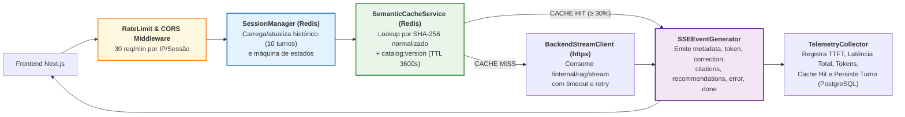

# Especificação de Componente: Middle-end / API Gateway, Sessões, Cache Redis e Streaming SSE (`M01` a `M05`)

- **Pacotes da EAP / Rede CPM**: `EAP 3.3`, `4.5`, `4.6`, `4.7`, `4.8` (`M01`, `M02`, `M03`, `M04`, `M05`)
- **Responsáveis Técnicos**: **Pablo** (Desenvolvedor Middle-end / API Gateway & Contratos) e **Well** (Desenvolvedor Middle-end / SSE, Redis & Telemetria)
- **Stack**: Python 3.11+, FastAPI Async, `sse-starlette` / `StreamingResponse`, `redis.asyncio` (Upstash), `httpx` (Async HTTP/2 Client), SQLAlchemy 2.0 + `asyncpg` (tabelas `chat_sessions`, `chat_messages`, `feedback_logs`, `checkout_events` — ADR-06), Pydantic v2, Pytest Async.

---

## 1. Arquitetura Interna do Middle-end / API Gateway (`middleend/app/`)



---

## 2. Máquina de Estados da Sessão no Redis (`M02` | Alinhado a [`06_diagrama_estados.md`](../diagrams_and_pm/06_diagrama_estados.md))

Toda requisição em `POST /api/v1/chat/stream` transita a sessão `session:{id}:state` pelos estados formais abaixo:

| Estado Interno | Evento Gatilho | Ação Executada pelo Gateway | Próximo Estado |
| :--- | :--- | :--- | :--- |
| `IDLE` | Recebimento de `POST /api/v1/chat/stream` | Valida payload, adquire *lock* leve de geração da sessão e carrega últimos `10` turnos do Redis. | `VALIDATING_CACHE` |
| `VALIDATING_CACHE` | Lookup em `cache:sem:{ver}:{hash}` | Se *Cache Hit*, prepara *stream* acelerado ($\text{TTFT} \le 120\text{ ms}$). Se *Cache Miss*, despacha ao Backend RAG. | `STREAMING_TOKENS` |
| `STREAMING_TOKENS` | Recepção dos deltas do Backend / Cache | Emite `event: metadata` (registrando `ttft_ms`), seguido de múltiplos `event: token`. | `EMITTING_CARDS_AND_CITATIONS` |
| `EMITTING_CARDS_AND_CITATIONS` | Fim dos tokens textuais | Emite `event: correction` (somente fallback de transporte), `event: citations`, `event: recommendations` e persiste resposta validada/registro idempotente. Atualiza cache e histórico; só então emite `event: done`. | `IDLE` |
| `ERROR_CONTINGENCY` | *Timeout* (`> 3 s` sem 1º token, após 1 nova tentativa) ou erro `5xx` no LLM | Aciona contingência (`RNF07`): `event: metadata` → `event: error` (`LLM_UNAVAILABLE`) → `event: recommendations` determinísticas do SQL → `event: done` (`finish_reason: "error"`); libera o *lock* da sessão. | `IDLE` |

> **Mapeamento de estados**: os estados acima são **estados de turno** guardados em `session:{id}:state` (Redis). O ciclo de vida persistido da sessão em `chat_sessions.state` é apenas `ACTIVE | ENDED` (Máquina 1 de [`06_diagrama_estados.md`](../diagrams_and_pm/06_diagrama_estados.md)); os estados visuais do Frontend (`CONNECTING`, `STREAMING`, `ENRICHING`, `COMPLETED`) são derivados dos eventos SSE recebidos.

---

## 3. Especificação do Cache Semântico e Normalização de Chave (`M03` | `RN09`)

Para atingir **$\text{Cache Hit Ratio} \ge 30\%$** sem jamais entregar produtos esgotados ou com voltagem trocada:

1. **Identidade canônica (`build_cache_key`)**: aplicar somente Unicode NFC e normalização de espaços; preservar ordem, pontuação, acentos e números. O Gateway calcula a chave após carregar o histórico e resolver os filtros. O histórico contém os pares user/assistant anteriores em ordem cronológica, nunca o turno atual. Filtros incluem SKU, voltagem, categoria, capacidade mínima e orçamento; chaves ausentes recebem null. `policy_version` muda ao alterar prompts, guardrails, ranking ou modelo. Cache compartilhado só é usado com histórico vazio; caso contrário o snapshot do histórico participa da chave. Cache armazena apenas texto validado e nunca IDs de outra sessão.

```python
import hashlib
import json
import unicodedata

def build_cache_key(catalog_version, query, resolved_filters, history, policy_version):
    normalized = " ".join(unicodedata.normalize("NFC", query).split())
    raw = json.dumps({"catalog": catalog_version, "query": normalized,
                      "filters": resolved_filters, "history": history,
                      "policy": policy_version}, sort_keys=True, ensure_ascii=False,
                     separators=(",", ":"))
    return f"cache:sem:{catalog_version}:" + hashlib.sha256(raw.encode("utf-8")).hexdigest()
```
2. **Regra de Invalidação Imediata (`catalog:version`)**:
   - Sempre que o endpoint `POST /api/v1/checkout/mock` zerar o estoque de um `SKU` (`remaining_stock == 0`) ou detectar mudança de preço, o Gateway executa `INCR catalog:version`; a CLI de ingestão do Backend (`UC08`) faz o mesmo ao final de cada carga do catálogo. Chaves antigas deixam de ser consultadas imediatamente e expiram pelo TTL.
3. **Observação sobre o nome "semântico"**: a chave é um *hash* exato da consulta **normalizada** (NFC e espaços, com ordem/pontuação preservadas) + todos os filtros + histórico + versão de política; não há busca por similaridade vetorial no cache. A meta de `Cache Hit Ratio >= 30%` deve ser aferida nas baterias de perguntas recorrentes de catálogo (`RNF03`).

---

## 4. Implementação de Referência do Gerador SSE (`M02`)

```python
import json
import logging
import time

logger = logging.getLogger(__name__)

def format_sse(event, payload):
    return f"event: {event}\ndata: {json.dumps(payload, ensure_ascii=False)}\n\n"

async def sse_chat_generator(request, session_id, message_id, backend_stream, cache_hit,
                             release_turn, fallback_products, started_at=None):
    # backend_stream já contém apenas sentenças aprovadas pelo G-OUT.
    start = time.perf_counter() if started_at is None else started_at
    metadata_sent = False
    received_end = False
    finish_reason = "stop"
    tokens_used = 0
    disconnected = False
    try:
        async for item in backend_stream:
            if await request.is_disconnected():
                disconnected = True
                return
            event, payload = item["event"], item["data"]
            if event == "end":
                tokens_used = payload["tokens_used"]
                received_end = True
                break
            if event not in {"token", "correction", "citations", "recommendations", "error"}:
                raise ValueError("Evento interno inválido")
            if not metadata_sent:
                if event not in {"token", "error"}:
                    raise ValueError("Conteúdo inicial inválido")
                yield format_sse("metadata", {"session_id": session_id, "message_id": message_id,
                    "cache_hit": cache_hit, "ttft_ms": int((time.perf_counter()-start)*1000)})
                metadata_sent = True
            if event == "error":
                finish_reason = "error" if payload["code"] in {"INTERNAL_ERROR", "LLM_UNAVAILABLE"} else "fallback"
            yield format_sse(event, payload)
        if not received_end or not metadata_sent:
            raise ValueError("Stream interno incompleto")
    except Exception as failure:
        # Inclui exceções de transporte do adaptador httpx; cancelamento não é engolido.
        logger.exception("stream_failed", extra={"session_id": session_id})
        if await request.is_disconnected():
            disconnected = True
            return
        finish_reason = "error"
        if not metadata_sent:
            yield format_sse("metadata", {"session_id": session_id, "message_id": message_id,
                "cache_hit": cache_hit, "ttft_ms": int((time.perf_counter()-start)*1000)})
        code = "LLM_UNAVAILABLE" if isinstance(failure, (TimeoutError, ConnectionError)) else "INTERNAL_ERROR"
        yield format_sse("error", {"code": code, "recoverable": True,
            "fallback_message": "Não foi possível concluir a resposta. Tente novamente."})
        try:
            products = await fallback_products()
            yield format_sse("recommendations", {"products": products})
        except Exception:
            logger.exception("fallback_products_failed")
    finally:
        try:
            await backend_stream.aclose()
        finally:
            await release_turn()
    if not disconnected:
        yield format_sse("done", {"finish_reason": finish_reason,
            "total_latency_ms": int((time.perf_counter()-start)*1000), "tokens_used": tokens_used})
```

`release_turn` libera o lock; o serviço chamador persiste o resultado validado antes de transmitir `done`, inclusive no cache hit. Resultados com erro não entram no cache. Desconexão/cancelamento libera recursos e não tenta escrever `done` em conexão fechada. O adaptador converte timeouts e indisponibilidade HTTP do httpx para `TimeoutError`/`ConnectionError`; demais falhas viram `INTERNAL_ERROR`. `started_at` é capturado no recebimento HTTP, antes de sessão/cache.


### Cabeçalhos HTTP Obrigatórios na Resposta SSE:
- `Content-Type: text/event-stream; charset=utf-8`
- `Cache-Control: no-cache, no-transform`
- `Connection: keep-alive`
- `X-Accel-Buffering: no` (impede que proxies Nginx/Cloudflare retenham tokens em buffer, garantindo $\text{TTFT} \le 1,5\text{ s}$).

---

## 5. Especificação de Telemetria e Transação de Mock Checkout (`M05`)

1. **Coleta de Métricas de Qualidade (`EAP 4.7`, `5.3`)**:
   - Todo turno finalizado registra em `chat_messages`: `ttft_ms`, `total_latency_ms`, `tokens_used`, `intent` e `cache_hit`.
   - Expõe agregações em `GET /api/v1/metrics/summary` (cabeçalho `X-Admin-Token`, consumido pela página `/admin/metricas` — `UC09`): `ttft_p50_ms`, `ttft_p95_ms`, `total_latency_p95_ms`, `cache_hit_ratio`, `error_5xx_rate`, `like_ratio`, `card_ctr`, `confirmed_checkouts` e `top_questions`.
2. **Validação Atômica no Mock Checkout (`POST /api/v1/checkout/mock` — `RN10`)**:
   - Abre transação SQL com `SELECT ... FOR UPDATE` na linha do `SKU` em `products`:
     - Se `stock_quantity < quantity`: grava `checkout_events` com `status = 'OUT_OF_STOCK'` e retorna `HTTP 409 Conflict` com `current_stock`;
     - Se `price != displayed_price`: grava `status = 'PRICE_CHANGED'`, executa `INCR catalog:version` e retorna `HTTP 409 Conflict` com o `current_price`;
     - Caso contrário: decrementa `stock_quantity` (configurável por `CHECKOUT_DECREMENT_STOCK=true`), grava `status = 'CONFIRMED'` e retorna `HTTP 200 OK` com `redirect_checkout_url = products.checkout_url` (link de afiliado/anúncio do marketplace); se o estoque chegar a `0`, executa `INCR catalog:version`.
