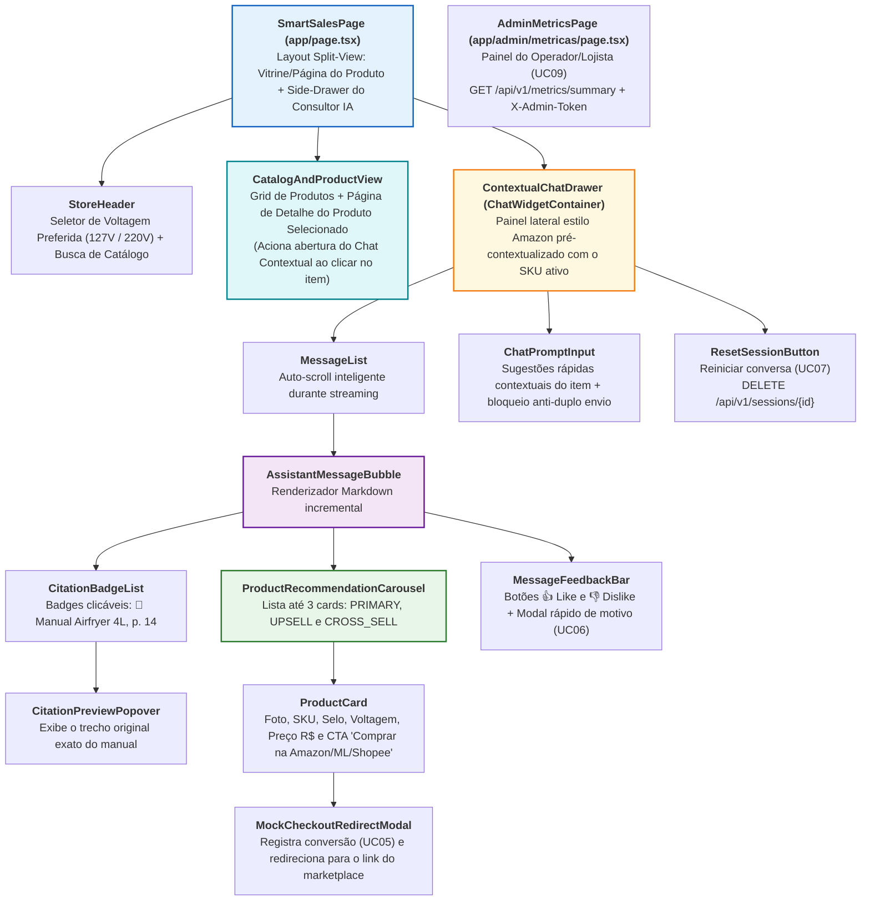

# Especificação de Componente: Frontend, Chat com Streaming SSE, Citações e Product Cards (`F01` a `F05`)

- **Pacotes da EAP / Rede CPM**: `EAP 3.4`, `4.8`, `4.9`, `4.10`, `4.11`, `5.2` (`F01`, `F02`, `F03`, `F04`, `F05`)
- **Responsáveis Técnicos**: **Eduardo** (Desenvolvedor Front-end & UI) e **Victor Hugo** (Designer UX/UI, Desenvolvedor Front-end & Analista de QA)
- **Stack**: Next.js 14+ (App Router), React 18, TypeScript 5 (`strict: true`), Tailwind CSS, Lucide React, Vitest + React Testing Library, Playwright (E2E).

---

## 1. Hierarquia de Componentes da Interface (`frontend/src/components/`)

A interface segue o padrão moderno de **Vitrine de Produtos + Painel Lateral Contextual de IA (*Contextual Side-Drawer*, inspirado no Amazon Rufus)**: quando o usuário entra em um item do catálogo, o painel do **Consultor IA** abre na lateral direita já ancorado no `SKU` e no manual PDF daquele produto, permitindo tirar dúvidas técnicas, comparar com concorrentes da loja e receber sugestões de *Upsell* e *Cross-sell* com links diretos de compra (`Amazon`, `Mercado Livre`, `Shopee`).



---

## 2. Interfaces TypeScript Estritas (`frontend/src/types/chat.ts`)

```typescript
export type VoltageType = "127V" | "220V" | "BIVOLT" | "N/A";
export type RecommendationType = "PRIMARY" | "UPSELL" | "CROSS_SELL";
export type MarketplaceType = "AMAZON" | "MERCADO_LIVRE" | "SHOPEE" | "LOJA_OFICIAL";
export type FeedbackRating = "LIKE" | "DISLIKE";

export interface ManualCitation {
  chunk_id: string;
  sku: string;
  manual_title: string;
  page_number: number;
  section_title?: string;
  similarity_score: number;
  excerpt: string;
}

export interface ProductCardData {
  sku: string;
  name: string;
  price: number;
  stock_quantity: number;
  voltage: VoltageType;
  capacity_liters?: number | null;
  power_watts?: number | null;
  image_url: string;
  marketplace: MarketplaceType;
  checkout_url: string;
  recommendation_type: RecommendationType;
  badge_label: string;
  justification: string;
}

export type SSEEventName =
  | "metadata"
  | "token"
  | "correction"
  | "citations"
  | "recommendations"
  | "error"
  | "done";

export type StreamErrorCode =
  | "GUARDRAIL_BLOCKED"
  | "LOW_SIMILARITY_FALLBACK"
  | "LLM_UNAVAILABLE"
  | "INTERNAL_ERROR";

export type FeedbackReasonCategory = "HALLUCINATION" | "WRONG_VOLTAGE" | "SLOW" | "OTHER";

export interface MetricsSummary {
  turns: number;
  ttft_p50_ms: number;
  ttft_p95_ms: number;
  total_latency_p95_ms: number;
  cache_hit_ratio: number;
  error_5xx_rate: number;
  like_ratio: number;
  card_ctr: number;
  confirmed_checkouts: number;
  top_questions: { question: string; count: number }[];
}

export interface ChatMessage {
  id: string;
  role: "user" | "assistant";
  content: string;
  isStreaming: boolean;
  ttftMs?: number;
  cacheHit?: boolean;
  citations: ManualCitation[];
  recommendations: ProductCardData[];
  feedback?: FeedbackRating | null;
  errorFallback?: string | null;
  errorCode?: StreamErrorCode | null;
  wasCorrected?: boolean;
}
```

---

## 3. Especificação do Hook de Streaming SSE (`useSSEChatStream` — `F02`)

O hook `useSSEChatStream` gerencia o ciclo de vida da requisição `POST /api/v1/chat/stream` usando `fetch` + `ReadableStream` (`TextDecoderStream`) — **não** `EventSource`, que não suporta `POST` — para enviar o payload JSON (`session_id`, `message`, `context_filters`) e ler progressivamente os eventos SSE definidos em [`03_openapi_and_sse_contracts.md`](../architecture/03_openapi_and_sse_contracts.md):

1. **Estados Visuais da Conversa** (alinhados ao [Diagrama de Estados](../diagrams_and_pm/06_diagrama_estados.md)):
   - `IDLE`: Input habilitado; sugestões rápidas visíveis;
   - `CONNECTING` (`0 ms` a `TTFT`): Exibe *skeleton* pulsante *"Consultando manuais oficiais e estoque..."*;
   - `STREAMING`: A cada evento `token`, concatena `delta` ao estado da mensagem atual com *requestAnimationFrame* para evitar *layout thrashing*; ao receber `correction`, **substitui** todo o texto da bolha por `content` e marca `wasCorrected = true`;
   - `ENRICHING`: Ao receber `citations` e `recommendations`, renderiza com transição suave os *badges* de página do manual e o carrossel de *Product Cards*;
   - `ERROR`: Ao receber `error`, exibe `fallback_message` em destaque (sem *badges* de citação) e mantém os cards de `recommendations` que vierem em seguida;
   - `COMPLETED`: Ao receber `done` (sempre o último evento), habilita a barra de feedback (`👍` / `👎`) e reabilita o campo de envio.
   - *Estes estados são apenas visuais; não correspondem a `chat_sessions.state` (`ACTIVE | ENDED`).*
2. **Resiliência em Conexões Móveis Instáveis (Mitigação do Risco `R07`)**:
   - Se a conexão cair antes do evento `done`, o hook descarta o texto parcial e **reenvia a mesma requisição `POST`, incluindo o mesmo `client_request_id`, uma única vez**; caso persista a falha, exibe botão `"Tentar novamente"` mantendo a pergunta do usuário preservada.

---

## 4. Regras de UI/UX para *Product Cards*, Citações e Feedback (`F03`, `F04`)

### 4.1. Anatomia Obrigatória do `ProductCard` (`EAP 4.10`)
Cada card renderizado na vitrine da mensagem deve exibir obrigatoriamente:
- **Badge Superior Diferenciado por Tipo**:
  - `PRIMARY`: Azul (`"Produto Consultado"`);
  - `UPSELL`: Roxo/Dourado (`"Upgrade Recomendado — Maior Capacidade"`);
  - `CROSS_SELL`: Verde (`"Compre Junto Compatível"`).
- **Tag de Voltagem em Destaque Visual**: Pílula de alto contraste (`220V`, `127V` ou `Bivolt`) para prevenir compra de tensão errada pelo consumidor.
- **Justificativa Consultiva Curta**: 1 frase explicando por que o item foi sugerido para o contexto do usuário.
- **Preço Formatado em `BRL` (`Intl.NumberFormat('pt-BR')`), Estoque e Botão Direto de Marketplace (`EAP 4.8`)**:
  - Exibe `"Em estoque (X un.)"` e o selo do canal oficial (`Amazon`, `Mercado Livre`, `Shopee` ou `Loja Oficial`).
  - O botão de ação primária **`Comprar na {Marketplace}`** (`data-testid="buy-now-btn-{sku}"`) dispara `POST /api/v1/checkout/mock` (validando estoque/preço em tempo real e registrando a métrica de conversão CTR no PostgreSQL) e, ao confirmar `status: "CONFIRMED"`, abre o modal de confirmação/redireciona para o `redirect_checkout_url` (link de afiliado/anúncio do marketplace). Em `HTTP 409` (`OUT_OF_STOCK` ou `PRICE_CHANGED`), atualiza o card com `current_stock`/`current_price` e exibe alerta amigável sugerindo um item alternativo no chat (`UC05`).

### 4.2. Interação de Citação Verificável (`CitationBadge` — `EAP 4.9`)
- Clicar no badge `[📄 Manual Airfryer SmartChef 4L, p. 14]` abre um *popover* acessível (`role="dialog"`) exibindo o `excerpt` literal extraído da página 14 do PDF e a seção técnica correspondente.

### 4.3. Interação de Feedback (`MessageFeedbackBar` — `EAP 4.11`)
- Clicar em `👍` dispara imediatamente `POST /api/v1/feedback` com `rating: "LIKE"` e exibe confirmação `"Obrigado pelo feedback!"`.
- Clicar em `👎` exibe 4 pílulas rápidas e envia `POST /api/v1/feedback` com `rating: "DISLIKE"` e o `reason_category` correspondente — `"Informação imprecisa"` → `HALLUCINATION`, `"Voltagem/medida incorreta"` → `WRONG_VOLTAGE`, `"Demorou a responder"` → `SLOW`, `"Outro"` → `OTHER` —, alimentando o [Ciclo PDCA](../diagrams_and_pm/13_qualidade_ciclo_pdca.md). Cada mensagem aceita uma única avaliação (`UC06`).

### 4.4. Painel de Métricas do Operador/Lojista (`AdminMetricsPage` — `UC09`, `RF16`)
- Rota `/admin/metricas` (fora do layout da vitrine), solicita o `ADMIN_TOKEN` uma vez (guardado em `sessionStorage`) e chama `GET /api/v1/metrics/summary` com o cabeçalho `X-Admin-Token`.
- Exibe *cards* de KPI (`TTFT p50/p95`, tempo total `p95`, *cache hit ratio*, taxa `5xx`, aprovação de *likes*, CTR dos cards e checkouts confirmados) comparados às metas da [Árvore de Qualidade](../diagrams_and_pm/10_qualidade_arvore_metricas.md) e a lista das dúvidas mais frequentes. Em `401`, volta a pedir o token.

## 5. Vitrine, retry e texto seguro

Carregar a vitrine e a pesquisa em `GET /api/v1/products` com os parâmetros/resultado normativos da seção 5 do contrato. Criar `client_request_id` UUID v4 antes de enviar a pergunta e preservar o mesmo ID/payload na única reconexão automática. Tratar 409 TURN_IN_PROGRESS aguardando Retry-After sem criar outro turno; 409 IDEMPOTENCY_CONFLICT é erro de cliente, não retry; 410 pede novo envio explícito. No evento error, descartar todo conteúdo parcial e mostrar fallback. Nenhum token recebido pode depender de correction posterior para se tornar factualmente seguro.
