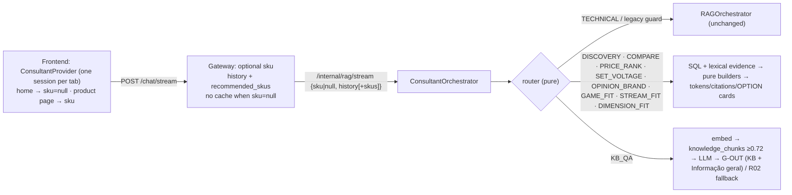

<!-- Spec SDD do Consultor unificado (decisões do GP em 21/11/2026: conhecimento híbrido, chat único, novas categorias). Interfaces I1–I5 congeladas para os pacotes P1–P4. -->

# Consultor unificado: SDD design (worktree `integration/final`)

ROOT = `/home/antonio/Documentos/gerencia_projeto/smartsales_intfinal`. All paths below are relative to ROOT. I did not edit any files.

## 0. Key findings that shape the design

1. **The RAGAS corpus is pinned to `data/catalog.json`.**
   - `backend/tests/ragas_eval/corpus.py` hashes the whole catalog, its manuals and the relations into `corpus_manifest.json`. `test_corpus.py` asserts that hash, and `checkpoint.py:83` binds the homologation approval to it.
   - `verify_database()` requires the SQL `products` and `manual_chunks` to equal that seed exactly.
   - So adding SKUs to `data/catalog.json`, or putting KB rows into `manual_chunks`, invalidates the homologated RAGAS run.
   - **Decision D1:** new SKUs go to `data/catalog_consultor.json` and `data/product_relations_consultor.json`. The KB goes to a **separate table `knowledge_chunks`**. `data/catalog.json`, `golden_set.json` and `corpus_manifest.json` stay untouched. RAGAS keeps running on a DB seeded with the base files only (that is today's command).
2. **The RAGAS pipeline calls `RAGOrchestrator` directly** (`backend/tests/ragas_eval/pipeline.py:122`).
   - **D2:** the new layer wraps it as `ConsultantOrchestrator`. `RAGOrchestrator` and its G-OUT behaviour are not changed. Every G-OUT extension is opt-in through constructor kwargs whose defaults keep today's behaviour.
3. **The golden set holds questions that look like the new intents** — GS-41 *"Tenho tomada 127V. Há alguma Airfryer 127V neste catálogo…"*, GS-44 *"…a três metros?"*, GS-13/14 voltage questions.
   - **D3 (legacy guard):** a product-page turn on a *legacy* category with no shown products in history is delegated verbatim to `RAGOrchestrator`. Section 2 has the exact rule.
4. **Gemini free tier is 15 RPM.**
   - **D4:** every route except `TECHNICAL` and `KB_QA` is **deterministic**: SQL plus lexical lookups in manuals and the KB, with fixed pt-BR templates. They make no embedding call and no LLM call.
   - That also fixes R01 for comparisons and fit checks, and TTFT on those turns is SQL-only.
5. **Session history** keeps role and content only (`HistoryItem`). `chat_messages.recommended_skus` is written but never read back.
   - **D5:** add `recommended_skus` to `HistoryItem` in all 3 stores and forward it to the backend. The backend derives the "shown set" from it.



---

## 1. Conversation model

**Where the state lives:** in the gateway session history (already windowed: 10 messages, `session_history_max_messages`). No new storage.

**Gateway changes:**
- `middleend/app/sessions/store.py`:
  - add `HistoryItem.recommended_skus: tuple[str, ...] = ()`.
  - `turn_messages()` sets `tuple(card["sku"] for card in turn.products)` on the assistant item.
- `middleend/app/sessions/postgres_store.py::_snapshot`: also `SELECT m.recommended_skus`.
- `middleend/app/sessions/redis_store.py`:
  - `history_json` adds `"skus": [...]`.
  - `_snapshot` reads `row.get("skus", [])`, which keeps old Redis entries readable.
  - The Lua script is unchanged because it pushes the JSON built in Python.
- `middleend/app/clients/backend.py::open_stream(sku: str | None, …)`: each history item becomes `{"role","content"}`, plus `"recommended_skus"` when non-empty.

**Backend request (`backend/app/models/schemas.py`):**
```python
class ChatTurn(BaseModel):
    role: Literal["user", "assistant"]
    content: str
    recommended_skus: list[str] = Field(default_factory=list, max_length=6)   # NEW

class ConsultantRequest(BaseModel):            # NEW: body of /internal/rag/stream
    sku: str | None = Field(default=None, min_length=1, max_length=64)   # None = catalog mode
    question: str = Field(min_length=1, max_length=1000)
    history: list[ChatTurn] = Field(default_factory=list, max_length=20)
    preferred_voltage: Literal["127V", "220V"] | None = None
    category: str | None = None
    capacity_min: Decimal | None = Field(default=None, allow_inf_nan=False)
    budget_max: Decimal | None = Field(default=None, gt=0, decimal_places=2)
    def rag_request(self, sku: str) -> RagRequest: ...   # RagRequest unchanged (sku: str)
```

Example internal JSON (turn 4 of the PO dialog):
```json
{"sku": null, "question": "desses que você mandou qual o melhor?",
 "history": [
  {"role":"user","content":"quero um computador novo"},
  {"role":"assistant","content":"Encontrei 4 opções…","recommended_skus":["PC-VX3-BIV","NB-NX15-BIV","PC-VX5-BIV","NB-NX16-BIV"]},
  {"role":"user","content":"pra jogar GTA 6"},
  {"role":"assistant","content":"GTA 6 foi anunciado…"},
  {"role":"user","content":"mas quero um PC"},
  {"role":"assistant","content":"Encontrei 4 opções…","recommended_skus":["PC-VX3-BIV","PC-VX5-BIV","PC-VX5P-220V","PC-VX7-220V"]}]}
```

**Derived state** (pure, `backend/app/consultant/conversation.py`):
```python
@dataclass(frozen=True)
class CategoryTarget: category: str; subcategories: tuple[str, ...]
@dataclass(frozen=True)
class Slots:
    category: CategoryTarget | None = None
    budget_max: Decimal | None = None
    voltage: Literal["127V", "220V"] | None = None
    game: str | None = None              # canonical: "GTA 6", "GTA RP", "GTA V", "Roblox", "Fortnite", "Counter-Strike 2"
    seats: int | None = None             # "3 lugares"
    room_width_cm: Decimal | None = None # CURRENT message only
@dataclass(frozen=True)
class ConversationState:
    current_sku: str | None
    shown_skus: tuple[str, ...]          # most recent assistant turn with recommended_skus, order kept, ≤6
    mentioned_skus: tuple[str, ...]      # SKU tokens in the question (validated against SQL later), ≤3
    slots: Slots
def conversation_state(request: ConsultantRequest) -> ConversationState: ...
```

**Rules:**
- "desses" / "esses" means the last shown set, not the union of all turns.
- Slots are merged over user messages, newest first, and the merge **stops at the first older message that names a different `category`**. So "computador" → "PC" keeps the GTA 6 slot, while computer → sofa drops a stale budget.
- Request filters (`preferred_voltage`, `budget_max`, `category`) override slots.
- Limits: history ≤ 20 items as received (the gateway sends ≤ 10); shown ≤ 6; cards per turn ≤ 5.

**Session across pages (decision):**
- One conversation per browser tab, held by a provider in the root layout.
- The session is created with `current_product_sku: null`; the SKU travels per turn in `context_filters`.
- This avoids the gateway falling back to the session's SKU on the home page.
- A page reload starts a new conversation (accepted limitation).

---

## 2. Intent routing (`backend/app/consultant/router.py`, pure)

All regexes run on folded text (lowercase, accents removed). Make `recommendation/intent.py::_folded` public as `folded()`.

```python
class Route(StrEnum):
    BLOCKED = "BLOCKED"; GREETING = "GREETING"; DIMENSION_FIT = "DIMENSION_FIT"; STREAM_FIT = "STREAM_FIT"
    GAME_FIT = "GAME_FIT"; SET_VOLTAGE = "SET_VOLTAGE"; PRICE_RANK = "PRICE_RANK"; OPINION_BRAND = "OPINION_BRAND"
    COMPARE = "COMPARE"; DISCOVERY = "DISCOVERY"; TECHNICAL = "TECHNICAL"; KB_QA = "KB_QA"
def route(question: str, state: ConversationState, current: CatalogProduct | None) -> Route: ...
```

**Keyword lists** (in `slots.py` / `router.py`):
```python
CATEGORY_KEYWORDS = (   # first match wins; order matters
  (r"\b(notebooks?|laptops?)\b",                 CategoryTarget("Computadores", ("Notebooks Gamer",))),
  (r"\b(pcs?|desktops?|gabinete|computador de mesa)\b", CategoryTarget("Computadores", ("PCs Gamer",))),
  (r"\bcomputador(es)?\b",                       CategoryTarget("Computadores", ("PCs Gamer", "Notebooks Gamer"))),
  (r"\bmonitor(es)?\b",                          CategoryTarget("Monitores", ("Monitores Gamer",))),
  (r"\b(webcams?|cameras?)\b",                   CategoryTarget("Periféricos", ("Webcams",))),
  (r"\bsofas?\b",                                CategoryTarget("Móveis", ("Sofás",))),
  (r"\b(airfryer|fritadeira)s?\b",               CategoryTarget("Eletroportáteis", ("Fritadeiras Elétricas",))),
  # …one row per existing subcategory (cafeteira, liquidificador, chaleira, panela, aspirador, fone,
  #   caixa de som, mouse, teclado, headset, secador, prancha, escova secadora)
)
GAME_ALIASES = {r"\bgta ?(6|vi)\b": "GTA 6", r"\bgta ?rp\b|\bgta roleplay\b": "GTA RP",
                r"\bgta ?(5|v)\b": "GTA V", r"\broblox\b": "Roblox", r"\bfortnite\b": "Fortnite",
                r"\b(cs2|counter.?strike)\b": "Counter-Strike 2"}
BUDGET = r"\b(?:ate|no maximo|maximo de|orcamento(?: de)?|gastar(?: ate)?)\s*(?:r\$\s*)?(\d[\d.]*(?:,\d{1,2})?)\s*(mil|k)?\b|\b(\d+)\s*mil reais\b"
VOLTAGE = r"\b(127|110)\s*v\b|\btomada (de )?(127|110)\b → 127V ; \b220\s*v\b|\btomada (de )?220\b → 220V"
LENGTH  = r"(\d+(?:[.,]\d+)?)\s*(cm|centimetros?|m|metros?)\b"   # → cm (×100 for m); in guardrails/output.py as length_measures_cm()
SEATS   = r"\b(\d)\s*lugares\b"
DEICTIC_SET = r"\b(desses|dessas|destes|destas|esses|essas|estes|estas|eles|elas|todos|todas|entre (eles|elas)|cada um|que voce (mandou|mostrou|indicou))\b"
VOLTAGE_TOPIC = r"\b(127|110|220)\s*v?\b|\bbivolt\b|\b(voltagem|tensao|tomada)\b"
PRICE_RANK = r"\bmais (barat[oa]s?|car[oa]s?|em conta|economic[oa]s?)\b|\b(menor|maior) preco\b"
BRAND_OPINION = r"\bmarcas?\b.*\b(confia\w*|melhor|boa|qualidade|durav\w*)\b|\b(confia\w*|melhor)\b.*\bmarcas?\b"
BEST = r"\bqua(l|is)\b.*\b(melhor(es)?|recomenda\w*|indica\w*|escolh\w*|compensa)\b|\bcompar\w*|\bdiferenca\b"
FIT_SPACE = r"\b(cabe|caber|cabera|espaco|largura|parede)\b"
PLAY = r"\b(jogar|jogo|jogos|roda|rodar|rodaria|aguenta|consigo|da pra)\b"
STREAM = r"\b(live|lives|stream\w*|transmi\w*|twitch)\b"
PURCHASE = r"\b(quero|queria|procuro|procurando|preciso|busco|comprar|indica\w*|recomenda\w*|sugere|mostra\w*|opcoes?)\b"
GREETING = r"^\s*(oi|ola|bom dia|boa tarde|boa noite|obrigad[oa]|valeu)\b[\s!.]*$"
```

**Order (first match wins):**

| # | Route | Condition |
|---|---|---|
| 1 | BLOCKED | `is_prompt_injection(question)` (existing G-IN) |
| 2 | GREETING | `GREETING` |
| 3 | DIMENSION_FIT | `FIT_SPACE` and (`room_width_cm` parsed, or target subcategory is Sofás) |
| 4 | STREAM_FIT | `STREAM` |
| 5 | GAME_FIT | game in the *current* message and (`PLAY`, or a Computadores noun, or computers in context) |
| 6 | SET_VOLTAGE | `VOLTAGE_TOPIC` and `DEICTIC_SET` and comparison set ≥ 2 |
| 7 | PRICE_RANK | `PRICE_RANK` |
| 8 | OPINION_BRAND | `BRAND_OPINION` |
| 9 | COMPARE | `BEST` and (`DEICTIC_SET`, or shown set non-empty) |
| 10 | DISCOVERY | category in current message, or `BUDGET` in current message, or (`PURCHASE` and merged category) |
| 11 | TECHNICAL | a referent exists: explicit catalog SKU in question, else `current_sku`, else shown set of size 1 |
| 12 | KB_QA | otherwise. 0 KB chunks ≥ threshold gives: shown ≥ 2 → deterministic "which product?" clarification; else R02 `LOW_SIMILARITY_FALLBACK` with the catalog message |

**Legacy guard (D3), checked before rows 3–12:**
- `current.category ∉ CONSULTANT_CATEGORIES = {"Computadores", "Monitores", "Móveis"}` → only these routes are allowed:
  - SET_VOLTAGE, PRICE_RANK, OPINION_BRAND and COMPARE, when the **filtered shown set has ≥ 2 products**;
  - STREAM_FIT when `current.subcategory == "Webcams"`.
- Anything else goes to TECHNICAL, i.e. `RAGOrchestrator.stream(request.rag_request(current.sku))`, byte-for-byte today's behaviour.
- Golden-set fixtures are single-turn with no history, so every one routes to TECHNICAL.

**Comparison set** (`comparison_set()`):
- Start from the shown products, filtered by a category noun in the question when present ("esses **PCs**"); otherwise keep only the category of `shown[0]`, which drops accessory cross-sells.
- If fewer than 2 remain and a referent exists, use in-stock peers of the referent's subcategory (≤ 4, by price) plus the referent.
- If still fewer than 2: "Ainda não mostrei opções…" clarification.

**Intent → `end.intent`:**

| Routes | `end.intent` |
|---|---|
| DISCOVERY | `PURCHASE_INTENT` |
| COMPARE, PRICE_RANK, SET_VOLTAGE, OPINION_BRAND | `PRODUCT_COMPARISON` |
| fit routes, KB_QA, TECHNICAL | `TECHNICAL_QA` |
| GREETING | `OUT_OF_DOMAIN` |

These are the existing `STORED_INTENTS`, so the `chat_messages` CHECK is unchanged.

**Router trace of the examples** (the PO's dialog as I reconstructed it; please confirm the turn order):

| Turn / example | Mode | Route | Behaviour |
|---|---|---|---|
| T1 "quero um computador novo" | catalog | DISCOVERY | Computadores (both subcats), 4 cheapest in stock, ask for use/budget |
| T2 "pra jogar GTA 6" | catalog | GAME_FIT | KB GTA 6: no PC version; "nenhum computador do catálogo roda GTA 6"; no cards |
| T3 "mas quero um PC" | catalog | DISCOVERY | subcat PCs Gamer; game slot GTA 6 carried → platform note once; 4 OPTION cards |
| T4 "desses que você mandou qual o melhor?" | catalog | COMPARE | T3 set; criteria table + per-criterion winners; no "melhor" verdict |
| T5 "qual a marca mais confiável?" | catalog | OPINION_BRAND | no reliability data; warranty + ratings per brand |
| T6 "posso ligar todos esses PCs em 127V?" | catalog | SET_VOLTAGE | "Não: 2 dos 4…"; compatible in-stock as OPTION |
| T7 "esse é mais barato?" | catalog | PRICE_RANK | no unique referent → cheapest/most expensive of the T6 set |
| "esse é mais barato?" on a PC page | product | PRICE_RANK | referent = current → "Não. Este produto aqui é mais barato: SKU …" |
| WC-1080-01 page "consigo fazer live na Twitch com a melhor qualidade?" | legacy + Webcams | STREAM_FIT | 30 fps < 60 → "Este outro atende: SKU WC-1080-60…" |
| SF-3L-210R page "esse sofá cabe na minha sala? tenho 2 metros" | product | DIMENSION_FIT | 210 + 2×10 > 200 → "Não cabe…"; alternative SF-3L-180 |
| PC page "consigo jogar Roblox nesse computador?" / "e GTA RP?" | product | GAME_FIT | manual table row; GTA RP → KB alias → GTA V row |
| catalog "GTA 6 roda no PC?" | catalog | GAME_FIT | platform facts only |
| catalog "quais os requisitos do Roblox?" | catalog | KB_QA | LLM over KB-ROBLOX, cited |
| catalog "me conta uma piada" | catalog | KB_QA → 0 chunks | `error LOW_SIMILARITY_FALLBACK` (catalog message) |

---

## 3. Retrieval

**Policy:**
- Product **selection is SQL only** (R03, R09). There is no catalog-wide semantic search over manuals to pick products, because similarity would bypass the structured filters.
- Chunk scopes:
  1. SKU-scoped: the existing `PostgresCatalog.search`, used only by TECHNICAL.
  2. Lexical lookups for deterministic builders: game tables and KB pages.
  3. KB-only vector search for KB_QA.
- Stock: cards always need `stock_quantity > 0 AND is_active`. Text about a shown sold-out item is allowed and flagged "(esgotado no momento)".

**New read adapter `backend/app/db/consultant_repository.py`** (separate file so P1 can own `repository.py`):
```python
@dataclass(frozen=True)
class CatalogQuery:
    categories: tuple[str, ...]; subcategories: tuple[str, ...] | None
    budget_max: Decimal | None = None; voltage: Literal["127V", "220V"] | None = None
class ConsultantCatalog(Protocol):            # implemented by PostgresConsultantCatalog
    async def products(self, skus: Sequence[str]) -> list[CatalogProduct]: ...        # active, any stock, input order
    async def search(self, query: CatalogQuery) -> list[CatalogProduct]: ...          # in stock, ORDER BY price, sku (no LIMIT; Python filters then caps)
    async def categories_in_stock(self) -> list[tuple[str, str]]: ...
    async def game_tables(self, skus: Sequence[str]) -> list[RetrievedChunk]: ...
    async def knowledge_page(self, doc_id: str, page: int) -> list[RetrievedChunk]: ...
    async def search_knowledge(self, embedding: Sequence[float], limit: int) -> list[RetrievedChunk]: ...
```

```sql
-- search
SELECT {_PRODUCT_COLUMNS} FROM products
WHERE is_active AND stock_quantity > 0 AND category = ANY(%(categories)s)
  AND (%(subcats)s::text[] IS NULL OR subcategory = ANY(%(subcats)s))
  AND (%(budget)s::numeric IS NULL OR price <= %(budget)s)
  AND (%(voltage)s::text IS NULL OR voltage IN (%(voltage)s, 'BIVOLT', 'N/A'))
ORDER BY price, sku;
-- game_tables (lexical; similarity_score reported as 1.0 = exact lookup)
SELECT id AS chunk_id, sku, manual_title, page_number, section_title, content, 1.0 AS similarity_score
FROM manual_chunks WHERE sku = ANY(%s) AND manual_source LIKE 'manual:%%' AND content ILIKE '%%Desempenho em jogos%%';
-- search_knowledge (exact scan: a few dozen rows)
SELECT id AS chunk_id, doc_id AS sku, title AS manual_title, page_number, NULL AS section_title, content,
       GREATEST(0, 1 - (embedding <=> %s::vector)) AS similarity_score
FROM knowledge_chunks ORDER BY embedding <=> %s::vector LIMIT %s;
```

- Python filters after `search`: room fit (`largura_cm + 2·folga ≤ room`), webcam fit (height ≥ H and fps ≥ F, parsed from `specs_json["resolucao"]` "W x H" and `specs_json["fps"]`), and `seats`.
- Cap: `CONSULTANT_MAX_OPTIONS = 4` in `Settings`.

**KB ingestion (owned by P1):** a separate table. KB documents are not products, `manual_chunks.product_id` is NOT NULL, and `deactivate_missing` would delete KB rows.
```sql
CREATE TABLE IF NOT EXISTS knowledge_chunks (
  id UUID PRIMARY KEY DEFAULT uuid_generate_v4(),
  doc_id VARCHAR(64) NOT NULL,             -- file stem, e.g. KB-TWITCH-TRANSMISSAO
  title VARCHAR(255) NOT NULL,             -- first line of the file
  page_number INTEGER NOT NULL CHECK (page_number >= 1),
  chunk_index INTEGER NOT NULL CHECK (chunk_index >= 0),
  doc_version VARCHAR(64) NOT NULL,        -- sha256 of the file
  content TEXT NOT NULL,                   -- "[BASE DE CONHECIMENTO: <title> | PÁG: n]\n<piece>"
  embedding vector(1536) NOT NULL,
  created_at TIMESTAMPTZ NOT NULL DEFAULT NOW(),
  UNIQUE (doc_id, page_number, chunk_index));
```

- File format: `data/knowledge/KB-*.txt`. Pages are separated by `\f`, as in manuals.
  - Line 1 is the title; it must contain no comma, because `CITATION_MARK` is non-greedy.
  - Line 2 is the source and date: "Fonte de referência: <url oficial>; consultado em 21/11/2026 (curadoria SmartSales)."
  - Structured values go in markdown rows: `| <rótulo> | <número> <unidade> |`.
- Ingestion (`backend/app/ingestion/knowledge.py` plus wiring in `run.py`):
  - pure `knowledge_docs(dir) -> list[KnowledgeDoc(doc_id, title, version, pages)]`;
  - per doc: skip when every row has `doc_version == sha`, else embed and `DELETE doc_id` + `INSERT` in one transaction;
  - `DELETE FROM knowledge_chunks WHERE doc_id <> ALL(%s)` runs only when `--knowledge` is given;
  - failures go to `report.needs_intervention` (exit 1). `catalog:version` is bumped as today.
- Citations: a KB chunk travels as `RetrievedChunk(sku=doc_id, manual_title=title)`. The text form is `[Fonte: <KB title>, p. N]` and the `citations[].sku` value is the doc id. `_citation()` excerpt-stripping works unchanged.
- CLI: `--catalog` and `--relations` become `action="append"` (the SKU union feeds `load_relations` and `deactivate_missing`), plus a new `--knowledge DIR`.
  - `docker-compose.yml` seed: `--catalog /data/catalog.json --catalog /data/catalog_consultor.json --relations /data/product_relations.json --relations /data/product_relations_consultor.json --knowledge /data/knowledge`.
  - `replace_product_relations` replaces the whole table, so both relation files must always be passed together.

---

## 4. Deterministic answer builders

**Pure modules:**
- `backend/app/consultant/evidence.py`:
  - `parse_game_rows(chunk) -> list[GameRow(game, resolution, preset, fps, chunk)]`, with row regex `^\|\s*(?P<game>[^|]+?)\s*\|\s*(?P<res>\d{3,4}p)\s*\|\s*(?P<preset>[^|]+?)\s*\|\s*(?P<fps>\d+)\s*fps\s*\|$` (header row = first cell "Jogo");
  - `kb_measure(chunks, label) -> KbMeasure(value: Decimal, unit: str, chunk) | None`;
  - `kb_sentence(chunks, sentence) -> RetrievedChunk | None`: literal presence after whitespace normalisation; **fail-closed**, so a missing KB sentence means the line is dropped and logged;
  - `webcam_capability(p) -> tuple[int, int] | None` returning (height, fps).
- `backend/app/consultant/knowledge_facts.py`: constants `(doc_id, page, sentence | row label)` (section 8).
- `backend/app/consultant/builders.py`: each builder returns
  ```python
  @dataclass(frozen=True)
  class ConsultantAnswer:
      sentences: tuple[str, ...]; cited: tuple[RetrievedChunk, ...]; cards: tuple[ProductCard, ...]; intent: str
  ```

**Signatures:**
```python
def discovery_answer(options, slots, *, game_rows: Mapping[str, GameRow | None], game_fact: KbFactHit | None,
                     relaxed: CatalogProduct | None, categories_in_stock: Sequence[tuple[str, str]]) -> ConsultantAnswer
def game_fit_answer(targets, game: str, rows: Mapping[str, GameRow | None], platform: Sequence[KbFactHit],
                    alias: KbFactHit | None, alternative: tuple[CatalogProduct, GameRow] | None, consoles_in_catalog: bool) -> ConsultantAnswer
def stream_fit_answer(target: CatalogProduct | None, height: KbMeasure, fps: KbMeasure,
                      matches: Sequence[CatalogProduct]) -> ConsultantAnswer
def dimension_fit_answer(target: CatalogProduct | None, room_cm: Decimal | None, clearance: KbMeasure,
                         matches: Sequence[CatalogProduct]) -> ConsultantAnswer
def set_voltage_answer(products, voltage: Literal["127V", "220V"] | None) -> ConsultantAnswer
def price_rank_answer(products, referent: CatalogProduct | None, direction: Literal["cheapest", "priciest"], from_peers: bool) -> ConsultantAnswer
def comparison_answer(products, game_rows: Mapping[str, GameRow | None], game: str | None) -> ConsultantAnswer
def brand_opinion_answer(products) -> ConsultantAnswer
```

**Formatting helpers (DRY):**
- Make `recommendation/cards.py::_brl` public as `brl()` → "R$ 4.499,00".
- `voltage_text`: BIVOLT → "bivolt"; "127V"/"220V" as-is; N/A → omitted.
- Ratings use a pt-BR decimal ("4,6").
- `key_specs(p)` per subcategory, omitting missing keys:
  - PCs / Notebooks: `"{placa_de_video}, {memoria_ram_gb} GB de RAM"`
  - Monitores: `"{tela_polegadas} polegadas, {taxa_atualizacao_hz} Hz"`
  - Webcams: `"resolução {resolucao} a {fps} fps"`
  - Sofás: `"{largura_cm} cm de largura, {lugares} lugares"`
- Every sentence ends with `"\n"`.

**Templates (exact):**

DISCOVERY
- `Encontrei {n} {opção|opções} em estoque{scope}, do menor para o maior preço:` where `scope = " em {subcats joined ' e '}" + " até {brl(budget)}" + " que funcionam em {V}"`
- `- SKU {sku}: {name}, {brl}, {key_specs}, voltagem {voltage_text}.` (the voltage clause is omitted for N/A)
- game, row: `  {jogo}: {fps} fps em {res}, predefinição {preset} [Fonte: {title}, p. {page}].`; missing: `  {jogo}: desempenho não informado no manual.`
- game not on PC: `Lembrando: {KB sentence} [Fonte: {title}, p. {page}]` (once)
- no budget: `Para refinar, me diga o uso principal e o orçamento máximo.`
- empty: `Não encontrei {subcats} em estoque{scope}.`; relaxed (drop budget only): `Sem o limite de orçamento, a opção mais barata em estoque é SKU {sku}: {name}, {brl}.`
- no category: `Posso ajudar com estas categorias em estoque: {c1}, {c2}, …. Qual delas você procura?`
- cards: OPTION, justification `{key_specs}.`

GAME_FIT
- platform: `{KB_GTA6_PLATFORMS} [Fonte…]` + `{KB_GTA6_NO_PC} [Fonte…]` + `Por isso, nenhum computador do catálogo roda {jogo} hoje.` + (if no Consoles subcategory) `O catálogo ativo não tem consoles.` + `Se quiser, mostro o desempenho informado nos manuais em outros jogos, como GTA V e Roblox.`
- alias: `{KB_GTA_RP} [Fonte…]` (the rows then use "GTA V")
- row: `SKU {sku}: sim, o manual informa {fps} fps em {jogo} a {res}, predefinição {preset} [Fonte: {title}, p. {page}].`
- missing: `SKU {sku}: o manual não informa desempenho em {jogo}, então não confirmo que roda.`
- alternative (single target missing): `Este outro tem desempenho informado em {jogo}: SKU {alt}: {fps} fps a {res}, predefinição {preset} [Fonte…].` + OPTION card
- `Informação geral: o desempenho real varia com drivers, atualizações do jogo e configurações gráficas.`

STREAM_FIT
- `A Twitch recomenda transmitir em até {H}p a {F} fps [Fonte: {title}, p. {page}].`
- `SKU {sku}: resolução {resolucao} a {fps} fps, segundo a ficha técnica.`
- `Esta câmera atende à qualidade máxima recomendada pela Twitch.` or `Esta câmera não atende à qualidade máxima recomendada pela Twitch: fica em {fps} fps, abaixo de {F} fps.` (or `a resolução fica abaixo de {H}p.`)
- `Este outro atende: SKU {alt}: resolução {res} a {fps} fps, {brl}.` + OPTION card; or `Não há outra webcam em estoque que atenda a essa recomendação.`
- `Informação geral: a qualidade final da live também depende da sua conexão de internet e do computador usado na transmissão.`
- No target: guideline line + DISCOVERY-style list of matching webcams.

DIMENSION_FIT
- no measure: `Qual é a largura livre do espaço onde o sofá vai ficar, em metros ou centímetros?`
- `SKU {sku}: largura de {w} cm, profundidade de {d} cm.`
- `A orientação é deixar pelo menos {c} cm livres de cada lado do sofá [Fonte: {title}, p. {page}], então ele precisa de {w+2c} cm.`
- verdict: `Cabe nos {m} cm informados, com a folga recomendada.` / `Cabe nos {m} cm informados, mas sem a folga recomendada.` / `Não cabe nos {m} cm informados.`
- alternative: `Este outro cabe com folga: SKU {alt}: largura de {w2} cm, {lugares} lugares, {brl}.` + OPTION card. Pick the widest that fits, then the lowest price.
- `Informação geral: confira também a profundidade e o caminho até a sala, como portas e corredores.`

SET_VOLTAGE
- `Sim: os {n} produtos mostrados funcionam em {V}.` / `Não: {k} dos {n} produtos mostrados funcionam em {V}.` / `Não: nenhum dos {n} produtos mostrados funciona em {V}.`
- per product:
  - `- SKU {sku}: bivolt, funciona em {V}.`
  - `- SKU {sku}: {V}, funciona em {V}.`
  - `- SKU {sku}: {v}, não deve ser ligado em {V}.`
  - `- SKU {sku}: não é ligado diretamente na tomada.`
  - `(esgotado no momento)` appended when sold out
- cards: compatible and in stock, OPTION, justification `Funciona em {V}.`

PRICE_RANK
- referent cheapest: `Sim: SKU {R} é o mais barato dos {n} comparados, por {brl}.`
- else: `Não. Este produto aqui é mais barato: SKU {C}, por {brl(C)}, contra {brl(R)} do SKU {R}.`
- no referent: `O mais barato dos {n} comparados é SKU {C}, por {brl}; o mais caro é SKU {E}, por {brl}.`
- tie: `SKU {a} e SKU {b} empatam no menor preço, {brl}.`
- "mais caro" mirrors these.
- `from_peers` adds the prefix `Comparando com {subcategoria} em estoque:`.
- card: cheapest (OPTION).

COMPARE
- `Não há um melhor absoluto; comparo pelos dados do catálogo:`
- `- SKU {sku}: {brl}, {key_specs}, voltagem {v}, garantia de {g} meses, avaliação {r} de 5 em {n} avaliações.` (missing: `garantia não informada`, `sem avaliações no catálogo`)
- winners: `Menor preço: SKU {x}.` `Maior garantia: SKU {y}, {g} meses.` `Melhor avaliação média: SKU {z}, {r} de 5.` `Maior desempenho informado em {jogo}: SKU {w}, {fps} fps [Fonte…].` (game line only when a supported game slot exists; ties list every tied SKU)
- `Se me disser o que pesa mais para você, preço, garantia ou desempenho, indico um deles.`
- cards: in-stock members, OPTION.

OPINION_BRAND
- `Não tenho dados de confiabilidade ou de defeitos por marca, então não faço ranking de marcas.`
- `Os critérios objetivos do catálogo para os produtos mostrados são garantia e avaliações:`
- `- SKU {sku}, marca {brand}: garantia de {g} meses, avaliação {r} de 5 em {n} avaliações.`
- no cards.

Fixed messages: GREETING `Olá! Posso ajudar a escolher um produto, comparar opções ou tirar dúvidas técnicas. O que você procura?` · clarify `Sobre qual dos produtos mostrados? Cite o SKU, por exemplo SKU {first}, ou abra a página do produto.`

**Publication of deterministic answers:**
- Sentences are evidence-derived by construction, so they are published directly as `token` events. This follows the existing precedent `RAGOrchestrator._alternative_answer`.
- Sequence: `token×N → [citations(cited)] → [recommendations(cards)] → end(0, intent)`, which is a valid §5 sequence.
- Cards: `build_card(product, "OPTION", justification)` with badge `"Opção"`, built from the same SQL read as the text (R09).
- The fixed `Informação geral:` constants have a unit test asserting that `general_information()` (section 5) approves them.

---

## 5. G-OUT changes (`backend/app/guardrails/publication.py`), all opt-in

1. `SentenceVerifier(product: CatalogProduct | ProductRecommendation | None, chunks)`: with `None` there are no SQL claims and all chunks are kept (KB). The foreign-SKU check is guarded.
2. `ConsultativeVerifier(product: CatalogProduct | None, chunks, recommendations: Sequence[CatalogProduct | ProductRecommendation], *, allow_general_information: bool = False, user_message: str = "")`:
   - Options can be all shown products, not only cards. `"SKU <code>:"` anchoring is unchanged, so multi-product sentences each carry their SKU.
   - Each option verifier has no chunks, so manual facts are never borrowed across products.
3. **"Informação geral:"**:
   - `GENERAL_INFORMATION_PREFIX = "Informação geral:"`; `general_information(sentence) -> bool`.
   - Approve only if the sentence (optionally after `"- "`) starts with the prefix and the folded remainder has **no** digit, no `[Fonte:`, no `_SKU` match, no `UNIT_WORDS` token, and no match of
     `\b(volts?|voltagem|tensao|bivolt|watts?|potencia|litros?|capacidade|preco|custa|reais|garantia|fps|hz|polegadas|resolucao|requisitos?|compativel|compatibilidade|confiavel|confiabilidade|melhor marca|pior marca)\b`.
   - Cap `GENERAL_INFORMATION_MAX = 2` per answer, counted in `_PublicationGate`.
4. **User-echoed lengths:**
   - Add `length_measures_cm(text) -> list[Decimal]` in `guardrails/output.py` (regex in section 2). The global `_UNITS` is **not** changed, so RAGAS is unaffected.
   - Approve iff every numeral in the sentence belongs to a length measure, `set(lengths) ⊆ user lengths`, `\b(voce|sua|seu|informad[ao]s?)\b` is present, and there is no other claim.
   - V/W/L/BRL are never echoable, so "posso ligar em 127V?" cannot become a fact.
5. **KB citations:** no regex change. Items 1 and 3 let `[Fonte: <KB title>, p. N]` resolve against KB chunks in `_cited_support`.
6. `_PublicationGate(verifier, label, notice=MISSING_EVIDENCE_NOTICE)`: KB_QA passes `CATALOG_MISSING_NOTICE = "Parte da resposta não consta na base de conhecimento da loja e foi omitida."`
7. Used only by KB_QA: `ConsultativeVerifier(None, kb_chunks, shown_products, allow_general_information=True, user_message=question)`.
   - TECHNICAL / RAGAS calls keep the defaults, so every existing R01 protection is unchanged.
   - Brand rankings without numbers are already rejected, since they have no literal support and are not an SQL statement.

**KB_QA prompt** (`generation/prompt.py`, new `CATALOG_SYSTEM_PROMPT` + `build_catalog_messages(products, chunks, history, question, *, history_limit)`):
- Answer only from `<BASE_CONHECIMENTO>` (cite `[Fonte: título, p. N]`) and the SQL facts in `<PRODUTOS_SQL>`, using the rule-7/8 formats with `SKU <código>:`.
- General context only in sentences beginning "Informação geral:", without numbers, units, prices, specifications or brand rankings.
- Never rank brands or call a product "o melhor".
- At most 6 sentences; no greeting.

---

## 6. Contract changes (backward compatible for the product flow)

- **`ChatStreamRequest`**: `context_filters.current_product_sku` is already optional in the schema. The route stops returning 422 `PRODUCT_CONTEXT_REQUIRED`; with neither a filter SKU nor a session SKU the turn runs in catalog mode.
  - Edits: `middleend/app/routes/chat.py` (`sku: str | None`); `_open_answer` sets `cache_key=None` when `sku is None` (no semantic cache in catalog mode, since revalidation is keyed on a consulted product); `cache.store` is called only when there is a key.
- **New role `recommendation_type: "OPTION"`**, badge "Opção".
  - Rule for a turn: ≤ 5 cards; PRIMARY, UPSELL and CROSS_SELL each at most once; OPTION ≤ 4; every card in stock and read from SQL.
  - Product turns keep producing ≤ 3 PRIMARY/UPSELL/CROSS_SELL as today.
  - Files:
    - `backend/app/recommendation/models.py` (`RecommendationType`) and `cards.py` (`_BADGES["OPTION"]="Opção"`), plus `models/schemas.py::ProductRecommendation`;
    - `middleend/app/sse/models.py::ProductCard`;
    - `middleend/app/sse/validation.py::products()`: `MAX_CARDS = 5`, `MAX_OPTIONS = 4`, uniqueness only for the three legacy roles;
    - `middleend/app/commerce.py::RecommendationType`;
    - `middleend/app/repositories/commerce.sql`: `ALTER TABLE checkout_events DROP CONSTRAINT IF EXISTS checkout_events_recommendation_type_check; ALTER TABLE checkout_events ADD CONSTRAINT checkout_events_recommendation_type_check CHECK (recommendation_type IN ('PRIMARY','UPSELL','CROSS_SELL','OPTION'));`.
- **`openapi.yaml`**:
  - `Card.recommendation_type` and `CheckoutCreate.recommendation_type` enums gain `OPTION`;
  - `recommendations.products.maxItems` 3 → 5, with a description of the role caps;
  - `Citation.sku` description: "SKU do produto ou id do documento KB-*";
  - `Filters.current_product_sku` description: "omitido = modo catálogo".
  - Keep it equal to the runtime schema (`middleend/tests/unit/test_rate_limit_and_openapi.py`).
- **Internal events:** unchanged shape; new card role; KB citations carry `sku = doc_id`.
- **Specs to update:** CLAUDE.md §2 R01 amendment (hybrid knowledge, PO 21/11/2026) and §5 recommendations rule; `specs/architecture/03_openapi_and_sse_contracts.md` event 5; `specs/product/02_requirements_rf_rnf.md`; `specs/product/03_business_rules_upsell_cross_sell.md`; new `specs/components/04_consultor_unificado_spec.md`.
  - Proposed new requirement IDs: RF17 Consultor unificado, RF18 Base de conhecimento curada, RN11 cards OPTION, RN12 "Informação geral", RN13 opinião = critérios objetivos.

---

## 7. Frontend

- **Types:** `frontend/src/types/chat.ts` adds `"OPTION"`. `ProductRecommendationCarousel.tsx` gets `toneByType.OPTION` (slate) and `sealByType.OPTION = "Opção"`, plus a "Ver detalhes" `<Link href={`/produto/${sku}`}>` on every card, which enables the home → product handoff.
- **Provider:** new `frontend/src/components/chat/ConsultantProvider.tsx` ("use client"), mounted in `app/layout.tsx`.
  - It exposes `useConsultant() → { chat, contextProduct, setContextProduct }`.
  - `useChatSession()` loses its product argument: `send(prompt, product: Product | null)`, `retry(id, product)`.
  - `createSession(null)` sends `{}`. `streamChat` omits `context_filters` when the SKU is null.
  - Mock mode with a null product yields one canned token ("O consultor do catálogo exige a API real.") followed by `done`.
- **Panel:** `ProductAssistant` keeps its name; `product: Product | null`.
  - Subtitle "Respostas sobre {name}" or "Catálogo completo".
  - Context strip "Manual e ficha técnica de {SKU}" or "Catálogo, manuais e base de conhecimento".
  - Placeholder "Pergunte sobre este produto" or "O que você procura?".
  - Empty state:
    - `suggestionsFor(product)` extended:
      - PCs / Notebooks: "Consigo jogar GTA RP neste computador?", "Funciona em 127V?"
      - Webcams: "Consigo fazer live na Twitch com a melhor qualidade?"
      - Sofás: "Este sofá cabe em 2 metros?"
      - Monitores: "Qual é a taxa de atualização?"
    - `CATALOG_SUGGESTIONS = ["Quero um PC para jogar Roblox até R$ 4.000", "Qual notebook gamer funciona em 127V?", "Quero um monitor para jogos", "Qual webcam serve para live na Twitch?", "Um sofá de 3 lugares cabe em 2 metros?"]`.
- **Home:** `CatalogView` gets a floating "Pergunte ao Consultor IA" button at every width that opens `ContextualChatDrawer` with `product={null}`. The drawer's product prop becomes optional.
- **Product page:** `ProductPageView` uses `useConsultant()` instead of its own `useChatSession`, and calls `setContextProduct(product)` on mount and `null` on unmount. The conversation started on the home page continues and the product's SKU travels per turn.
- Comparison text renders as-is (`whitespace-pre-wrap`, "- SKU …" lines). No table component.
- `lib/format.ts` `SPEC_UNITS` gains `gb: "GB"`, `polegadas: "″"`, `fps: "fps"`, `ms: "ms"` for the new `specs_json` keys.

---

## 8. Data plan (P1)

All new SKUs are in `data/catalog_consultor.json` with fictional brands, `capacity_liters: null`, and image `/images/<sku-lower>.svg` (placeholder SVGs in `frontend/public/images/`).

| SKU | Name | Cat / Subcat | Price | Volt | W | Tier | Stock | Key specs | Gar. | Rating (n) |
|---|---|---|---|---|---|---|---|---|---|---|
| PC-VX3-BIV | PC Gamer Vortex X3 | Computadores / PCs Gamer | 3499.00 | BIVOLT | 500 | 1 | 7 | Ryzen 5 5600, RTX 3050 6 GB, 16 GB, 512 GB | 12 | 4.4 (180) |
| PC-VX5-BIV | PC Gamer Vortex X5 | idem | 4499.00 | BIVOLT | 650 | 2 | 5 | Ryzen 5 7600, RTX 4060 8 GB, 16 GB, 1000 GB | 12 | 4.6 (312) |
| PC-VX5P-220V | PC Gamer Vortex X5 Pro | idem | 5799.00 | 220V | 750 | 3 | 3 | Ryzen 7 7700, RTX 4060 Ti, 32 GB, 1000 GB | 24 | 4.7 (95) |
| PC-VX7-220V | PC Gamer Vortex X7 | idem | 7499.00 | 220V | 850 | 4 | 2 | Ryzen 7 7800X3D, RTX 4070 Super, 32 GB, 2000 GB | 24 | 4.8 (41) |
| NB-NX15-BIV | Notebook Gamer Nimbus 15 | Computadores / Notebooks Gamer | 4299.00 | BIVOLT | 180 | 1 | 6 | i5-12450H, RTX 3050, 16 GB, 512 GB, 15,6", 144 Hz | 12 | 4.3 (220) |
| NB-NX16-BIV | Notebook Gamer Nimbus 16 | idem | 5599.00 | BIVOLT | 230 | 2 | 4 | i7-13620H, RTX 4060, 16 GB, 1000 GB, 16", 165 Hz | 12 | 4.5 (140) |
| NB-NX17-BIV | Notebook Gamer Nimbus 17 Pro | idem | 7199.00 | BIVOLT | 280 | 3 | **0** (R03 demo) | i9, RTX 4070, 32 GB, 17,3", 240 Hz | 24 | 4.8 (60) |
| MN-LM24-BIV | Monitor Gamer Lumina 24 FHD | Monitores / Monitores Gamer | 899.00 | BIVOLT | 30 | 1 | 12 | 24", 1920 x 1080, 165 Hz, 1 ms, IPS | 12 | 4.5 (410) |
| MN-LM27Q-BIV | Monitor Gamer Lumina 27 QHD | idem | 1199.00 | BIVOLT | 35 | 2 | 8 | 27", 2560 x 1440, 170 Hz | 24 | 4.6 (230) |
| MN-LM27U-BIV | Monitor Lumina 27 4K | idem | 1599.00 | BIVOLT | 45 | 3 | 5 | 27", 3840 x 2160, 144 Hz | 24 | 4.4 (75) |
| WC-1080-60 | Webcam Cliqon Stream 1080p60 | Periféricos / Webcams | 249.90 | N/A | – | 2 | 14 | resolucao "1920 x 1080", fps 60 | 12 | 4.6 (520) |
| WC-2K-60 | Webcam Cliqon Pro 2K60 | idem | 329.90 | N/A | – | 3 | 9 | resolucao "2560 x 1440", fps 60 | 24 | 4.7 (180) |
| SF-2L-150 | Sofá Aurora 2 Lugares | Móveis / Sofás | 1299.00 | N/A | – | 1 | 6 | 150 × 85 × 88 cm, 2 lugares, suede | 12 | 4.3 (88) |
| SF-3L-180 | Sofá Aurora 3 Lugares | idem | 1699.00 | N/A | – | 2 | 4 | 180 × 90 × 90 cm, 3 lugares | 12 | 4.5 (150) |
| SF-3L-210R | Sofá Aurora 3 Lugares Retrátil | idem | 2199.00 | N/A | – | 3 | 3 | 210 × 95 × 92 cm, retrátil + reclinável | 24 | 4.6 (64) |

**`specs_json` keys** (suffix = unit, matching `lib/format.ts`); rating and warranty live in `specs_json`, with **no new columns** (the RAGAS DB check compares columns):
- PCs: `processador, placa_de_video, memoria_ram_gb, armazenamento_gb, armazenamento_tipo, fonte_bivolt_automatica(bool), largura_cm, altura_cm, profundidade_cm, garantia_meses, avaliacao_media, avaliacoes_total`
- Notebooks: `processador, placa_de_video, memoria_ram_gb, armazenamento_gb, tela_polegadas, taxa_atualizacao_hz, peso_kg, garantia_meses, avaliacao_media, avaliacoes_total`
- Monitors: `tela_polegadas, resolucao, taxa_atualizacao_hz, tempo_resposta_ms, painel, entradas, garantia_meses, avaliacao_media, avaliacoes_total`
- Webcams: **reuse the existing keys** `resolucao` ("W x H") and `fps` (WC-1080-01 cannot change), plus `foco, microfone, garantia_meses, avaliacao_media, avaliacoes_total`
- Sofás: `largura_cm, profundidade_cm, altura_cm, lugares, material, retratil, reclinavel, garantia_meses, avaliacao_media, avaliacoes_total`

**Upsell ladders (RN04, all ratios checked ≤ 1.35):**
- X3 → X5 (×1.286, bivolt); X5P → X7 (×1.293, 220V). X5 → X5P is blocked by voltage unless the customer filters 220V.
- NX15 → NX16 (×1.302). NX16 → NX17 is ×1.286 but NX17 is sold out, so no upsell.
- LM24 → LM27Q (×1.334) → LM27U (×1.334).
- WC-1080-01 → WC-1080-60 (×1.316) → WC-2K-60 (×1.32).
- SF-2L → SF-3L-180 (×1.308) → SF-3L-210R (×1.294).

**Cross-sell (`data/product_relations_consultor.json`, PC/notebook → monitor):** X3 → LM24, X5 → LM27Q, X5P → LM27Q, X7 → LM27U, NX15 → LM24, NX16 → LM27Q, all with affinity 0.9. A monitor → PC cross-sell is impossible under RN05 (price ≤ 0.40 × base), so only that direction exists.

**Manuals** `data/manuals/<SKU>.txt` (`\f` pages, `## ` headings, each page ≤ 400 tokens so a page stays one chunk):
- PC / Notebook:
  - p1 cover + safety;
  - p2 specifications;
  - p3 electrical: "Fonte de 650 W com seleção automática de tensão (bivolt automática)." or "Fonte de 750 W para uso exclusivo em 220V.";
  - **p4 `## Desempenho em jogos`** with header `| Jogo | Resolução | Predefinição | Desempenho médio |` and rows `| Roblox | 1080p | Alto | 160 fps |`, `| GTA V | 1080p | Muito alto | 75 fps |`, `| Fortnite | 1080p | Médio | 90 fps |`, `| Counter-Strike 2 | 1080p | Alto | 140 fps |`, with fps rising by tier, plus the footnote "Valores medidos pelo fabricante em ambiente de teste.";
  - p5 dimensions;
  - p6 warranty ("Garantia de {g} meses…").
- Monitor: specs, inputs/compatibility, VESA, warranty.
- Webcam: specs, "Uso em transmissões", warranty.
- Sofá: `| Largura | 210 cm |`-style dimension table, assembly, cleaning, warranty.

**KB** `data/knowledge/` (facts the GP must verify against official sources, dated 21/11/2026):

| doc_id | Required content (frozen strings used by builders) |
|---|---|
| KB-GTA6-PLATAFORMAS | "GTA 6 foi anunciado para PlayStation 5 e Xbox Series X\|S." · "Não há versão de GTA 6 para PC anunciada até a data de atualização desta base." |
| KB-GTA-RP | "GTA RP é jogado no GTA V para PC por meio de servidores de roleplay." |
| KB-GTAV-REQUISITOS | GTA V PC minimum/recommended requirements (free text, for KB_QA) |
| KB-ROBLOX-REQUISITOS | Roblox PC requirements (free text) |
| KB-TWITCH-TRANSMISSAO | `\| Altura máxima de vídeo recomendada \| 1080 px \|` · `\| Taxa de quadros máxima recomendada \| 60 fps \|` + non-numeric guidance |
| KB-SOFA-ESPACO | `\| Folga lateral mínima por lado \| 10 cm \|` · `\| Passagem livre mínima à frente \| 60 cm \|` |

These strings and labels are the constants in `backend/app/consultant/knowledge_facts.py`. A P1 test asserts they occur literally in the files.

---

## 9. Test plan (TDD; red first)

**Backend unit, pure (`backend/tests/unit/`):**
- `test_consultant_slots.py` (UT-CU-01..06):
  - category table: computador → both subcats, pc, notebook, monitor, câmera, sofá, airfryer;
  - budget: "até 3 mil" → 3000, "até R$ 4.500", "no máximo 5000 reais", "orçamento de 3.500,00"; "R$ 4.499" alone is not a budget;
  - voltage: "127V", "tomada 110" → 127V; "220 reais" is not a voltage;
  - games: gta 6 / gta vi / gta6, gta rp, gta 5 / gta v, roblox;
  - `length_measures_cm`: "2 metros" → 200, "200 cm", "2,5 m" → 250, "1.80 m" → 180, "dois metros" → none;
  - `merge_slots`: latest wins, reset on category change, filters override.
- `test_consultant_router.py` (UT-CU-07/08):
  - every row of the trace table;
  - legacy guard: GS-13, GS-14, GS-41, GS-44 queries on their SKUs with empty history → TECHNICAL;
  - legacy airfryer with shown set ≥ 2 + "qual o mais barato?" → PRICE_RANK;
  - `comparison_set` filtering (noun, accessory drop, peers fallback).
- `test_consultant_builders.py` (UT-CU-09..16): exact expected strings for each template, including ties, missing warranty or rating, sold-out member, N/A voltage, empty search with budget relaxation, single vs multi target, no measure; every card is OPTION, in stock, with SQL price.
- `test_consultant_evidence.py` (UT-CU-17): game-row parser (header skipped, malformed rows ignored); `kb_measure`; `kb_sentence` fail-closed; `webcam_capability("1920 x 1080", 30)`.
- `test_publication_consultant.py` (UT-CU-18):
  - "Informação geral" approve/reject matrix (digit, unit word, SKU, price word, voltage word, citation → reject; cap 2);
  - user echo ("Você informou 200 cm." approved only when the user said "2 metros"; "127 V" never echoed);
  - `SentenceVerifier(None, kb)` literal support + KB citation;
  - every fixed "Informação geral" constant passes;
  - **existing `test_publication_evidence.py` / `test_guardrails.py` stay green unchanged.**

**Backend orchestrator with fakes:** `test_consultant_orchestrator.py`.
- `FakeConsultantCatalog` is loaded from `data/catalog_consultor.json` + `data/catalog.json`; manual and KB pages become `RetrievedChunk` objects. Also `FakeRag` (records delegation), `FakeEmbedder`, `FakeChatModel`.
- It replays every dialog in `tests/conversational/dialogs.json` offline. Asserts per turn:
  - route / `end.intent`;
  - valid §5 event order;
  - `must_contain` / `must_not_contain`;
  - card roles and counts, stock > 0, prices equal to the fake SQL;
  - **every number in the published text belongs to the evidence**: SQL row values, cited excerpts, or the user message.
- Plus: TECHNICAL delegates the exact `RagRequest`; KB_QA with 0 KB chunks gives `LOW_SIMILARITY_FALLBACK`; KB_QA with a hallucinated number drops the sentence; an SQL failure gives `error INTERNAL_ERROR` + end.

**Backend integration (pgvector):**
- `tests/integration/test_consultant_repository.py`: search filters, stock filter, voltage incl. BIVOLT/N/A, `game_tables`, `knowledge_page`, `search_knowledge`.
- `test_knowledge_ingestion.py`: idempotent skip, replace on change, delete a removed doc, untouched `manual_chunks`.
- `test_consultor_seed.py` (P1): schema; voltage variety; a games table on every Computadores manual; sofa dimensions; ladders ≤ 1.35; relations resolve; KB frozen strings present; no comma in KB titles.

**Gateway (`middleend/tests/unit/`):**
- chat without SKU → 200 SSE and the fake backend receives `"sku": null`;
- history carries `recommended_skus` after a completed turn (in-memory, Redis fake, Postgres when available; legacy Redis JSON without `skus` still reads);
- no cache key and no cache store in catalog mode;
- SSE validation: accepts 4 OPTION and 1 PRIMARY + 4 OPTION; rejects 5 OPTION, 6 cards, a duplicate PRIMARY;
- checkout accepts OPTION (DDL migration idempotent);
- `openapi.yaml` matches runtime;
- product-flow regression suite unchanged.

**Frontend:**
- Vitest:
  - carousel OPTION badge "Opção" and tone; "Ver detalhes" href;
  - hook: catalog mode omits `context_filters`, product mode sends the SKU, the session is created once with a null SKU and reused when the product changes;
  - home button opens the drawer with catalog suggestions; panel subtitle per mode.
- Playwright (SSE mocked with `page.route`): home → ask → OPTION cards → "Ver detalhes" → product page panel shows the same messages → the next turn's body contains `current_product_sku`.

**Live scripted suite (Gemini):** `tests/live/test_consultor_dialogs.py`, `@pytest.mark.live`, skipped unless `LIVE_API_BASE_URL` is set.
- It drives the public API with real `client_request_id`s and parses SSE.
- Dialog set (shared with the offline test): PO-01 (the 7 turns), PO-02 webcam/Twitch on WC-1080-01, PO-03 sofa 2 m on SF-3L-210R, PO-04 Roblox + GTA RP on PC-VX3-BIV, PO-05 "GTA 6 no PC?", PO-06 Roblox requirements (KB_QA), PO-07 off-topic → fallback, PO-08 airfryer product page "tem maior?" (legacy regression).
- Pacing: LLM turns (KB_QA / TECHNICAL) are throttled to ≤ 10 RPM; deterministic turns are not.
- Run: `LIVE_API_BASE_URL=http://localhost:8000 pytest tests/live -m live -v`.
- **The RAGAS golden set is not edited.** `tests/conversational/dialogs.json` is the separate conversational eval set.

---

## 10. Work breakdown: 4 parallel packages, frozen interfaces

**Interfaces frozen before work starts** (copy into `specs/components/04_consultor_unificado_spec.md`):
- **I1:** internal request JSON (section 1);
- **I2:** card role OPTION and its caps; KB citation `sku = doc_id`;
- **I3:** public OpenAPI/SSE deltas (section 6);
- **I4:** data shapes — `knowledge_chunks` DDL, KB file format and frozen strings, `specs_json` keys, games-table row format, SKU list (section 8);
- **I5:** `ConsultantCatalog` protocol (section 3).

| Pkg | Owner scope (files) | Done when |
|---|---|---|
| **P1 Data + KB ingestion** | `data/catalog_consultor.json`, `data/product_relations_consultor.json`, `data/manuals/<15 SKUs>.txt`, `data/knowledge/KB-*.txt`, `frontend/public/images/*.svg`, `backend/app/db/schema.sql` (+knowledge_chunks), `backend/app/db/repository.py` (KB writes), `backend/app/ingestion/{knowledge.py,run.py}`, `docker-compose.yml` seed, `backend/tests/unit/test_consultor_seed.py`, `backend/tests/integration/test_knowledge_ingestion.py` | `cd backend && pytest tests/unit -v` green; seed runs twice idempotently; `pytest tests/ragas_eval/test_corpus.py` still green (catalog.json untouched) |
| **P2 Backend consultant** (critical path) | `backend/app/consultant/{conversation,slots,router,evidence,knowledge_facts,builders,service}.py`, `backend/app/db/consultant_repository.py`, `guardrails/{publication,output}.py` (opt-in), `generation/prompt.py` (catalog prompt), `models/schemas.py`, `recommendation/{models,cards,intent}.py`, `main.py` (endpoint body `ConsultantRequest`, `get_orchestrator` → `ConsultantOrchestrator(rag=…)`), tests in section 9 | unit + orchestrator dialogs green; existing backend suites green; RAGAS offline tests unchanged |
| **P3 Gateway** | `middleend/app/{routes/chat.py,schemas.py,clients/backend.py,sse/models.py,sse/validation.py,commerce.py,repositories/commerce.sql}`, `sessions/{store,postgres_store,redis_store}.py`, `openapi.yaml`, gateway tests | `cd middleend && pytest tests -v --cov=app --cov-fail-under=70` green |
| **P4 Frontend** | `frontend/src/types/chat.ts`, `hooks/use-chat-session.ts`, `lib/{chat-api,mock-api,format}.ts`, `components/chat/{ConsultantProvider,ProductAssistant,ContextualChatDrawer}.tsx`, `components/shop/{ProductRecommendationCarousel,ProductPageView}.tsx`, `components/catalog/CatalogView.tsx`, `app/layout.tsx`, tests | `pnpm -C frontend run test:unit` + `test:e2e` green; `tsc --noEmit` strict, no `any` |

**Merge order:** P1 → P3 → P4 → P2.
- P1 and P3 are backward compatible on their own.
- P4 must accept OPTION before any backend emits it; P3 must accept OPTION and a null SKU too, otherwise the gateway converts the stream to INTERNAL_ERROR.
- P2 merges last and switches the behaviour on. Its integration tests need P1's data.
- After P2: run the offline dialogs, then the live suite once.

**Cut list if 24/11 is at risk, in order:** KB_QA LLM path (replace it with the R02 catalog fallback) → "Ver detalhes" link → STREAM_FIT catalog-mode listing → COMPARE game criterion. The deterministic routes and the legacy guard are the minimum viable scope.

**Risks:**
1. **RAGAS invalidation.**
   - Avoided by D1/D2/D3 and the opt-in G-OUT.
   - Remaining: the RAGAS DB must be seeded with the base files only, because `verify_database` rejects extra products and chunks. P1 must document the base-only seed command and must not change the existing one.
2. **Gemini 15 RPM.** Deterministic routes make 0 calls; KB_QA and TECHNICAL make 1 embed + 1 chat. Ingestion of ~15 SKUs × (6 pages + 1 spec sheet) ≈ 105 embeddings in 2 batches, plus KB ≈ 10. The live suite is paced.
3. **Router keyword misroutes.** Mitigated by fall-through to TECHNICAL / KB_QA, the R02 fallback, and the dialog suite. Log the route for every turn (`consultant_route route=… sku=…`).
4. **Real-world KB facts** (GTA 6 platforms, GTA V / Roblox requirements, Twitch guidance) are time-sensitive. The GP must verify them against official sources and date them; the system cites the KB, never the model.
5. **Deterministic sentences bypass G-OUT** (existing `_alternative_answer` precedent). Correctness rests on the builder unit tests and the "numbers ⊆ evidence" assertion in the dialog suite.
6. **Deploy order:** an old frontend would crash on an unknown `recommendation_type`. Hence the merge order above.
7. **Assumption to confirm:** I reconstructed the PO's 6-turn dialog as T1–T6, with "esse é mais barato?" as T7. Confirm the order before the dialogs file is written.

**Not checked:** I did not run any test suite or read the RAGAS README's seeding command, so risk 1's "base-only DB" step needs a check by P1. I did not read `specs/01_BASELINE_REVISADA.md` beyond its headings, or `lib/mock-api.ts`.
