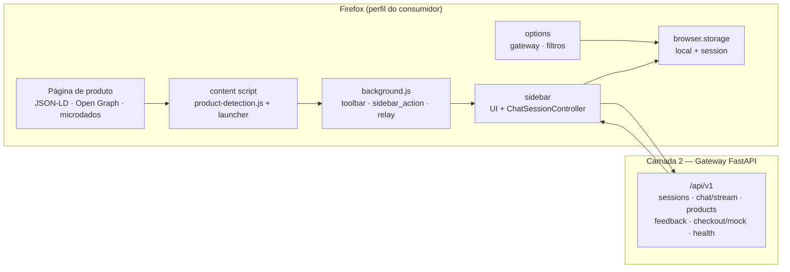
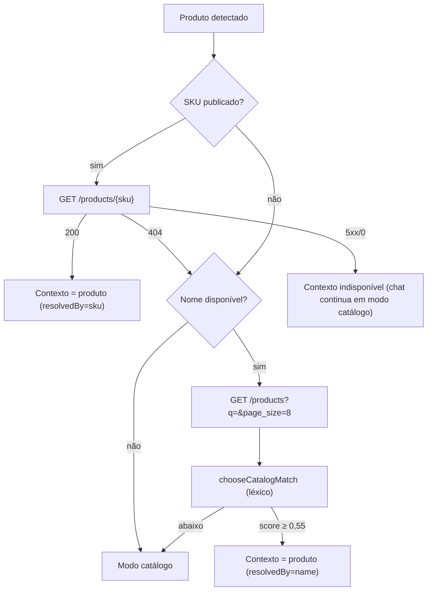
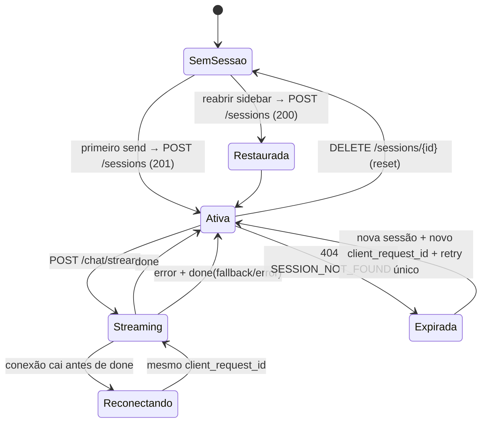

# Especificação de Componente: Extensão Firefox, Detecção de Produto e Sidebar do Consultor (`EXT`)

- **Canal de entrega**: adicional ao canal Web (não substitui `F01–F05`).
- **Stack**: WebExtension **Manifest V3**, JavaScript ES modules, JSDoc com checagem estrita
  opcional, Node.js **test runner** nativo (zero dependências de runtime), `web-ext` para
  lint/empacotamento.
- **Compatibilidade mínima**: Firefox **142+** (`sidebar_action`, MV3 event page,
  `storage.session`, consentimento embutido de coleta de dados e `color-mix`).
- **Contratos externos**: [`architecture/03_openapi_and_sse_contracts.md`](../architecture/03_openapi_and_sse_contracts.md)
  e [`openapi.yaml`](../../openapi.yaml). Nenhuma alteração no Backend, Middle-end, banco ou
  schema é introduzida por este componente.
- **Regras de negócio preservadas**: `R01`, `R03`, `R09`, `RN01`, `RN04`, `RN05`, `RN06`,
  `RN09`, `RN10` e o protocolo SSE da [`CLAUDE.md`](../../CLAUDE.md) §5.

---

## 1. Contexto e Motivação

O SmartSales RAG foi projetado como uma vitrine Next.js com o consultor ancorado ao produto.
Este componente adiciona o **mesmo consultor dentro do Firefox**, para que o consumidor
possa pesquisar no catálogo SmartSales enquanto navega em páginas de produto de terceiros
(marketplaces, lojas parceiras ou a própria vitrine), sem copiar/colar especificações.

A extensão é um **cliente da Camada 2** (Gateway). Ela é composta por:

1. **Sidebar** (`sidebar/sidebar.html`): chat com streaming, citações, cards, feedback e
   checkout.
2. **Content script**: detecta a identidade do produto publicada na página e oferece um
   atalho flutuante; não envia conteúdo da página ao gateway.
3. **Background event page**: abre/fecha a sidebar, coleta o produto da aba ativa quando o
   usuário clica no ícone e retransmite o contexto detectado às páginas da extensão.
4. **Options page**: gateway, filtros de catálogo, botão flutuante e teste de conexão.



---

## 2. Objetivos e Não-Objetivos

### 2.1 Objetivos

- `EXT-O1`: permitir `UC01` (dúvidas técnicas) a partir de qualquer aba, com streaming SSE e
  citação de manual.
- `EXT-O2`: contextualizar `UC02`/`UC03` com o produto detectado na página, sem inventar SKU.
- `EXT-O3`: renderizar `UC04` (cards), `UC05` (mock checkout) e `UC06` (feedback) com os
  mesmos contratos da vitrine.
- `EXT-O4`: restaurar `UC07` dentro do TTL de sessão e permitir reinício explícito.
- `EXT-O5`: manter o código testável fora do Firefox por injeção de dependências, com
  cobertura ≥ 70% nas camadas de domínio/aplicação/infraestrutura.

### 2.2 Não-Objetivos

- Substituir a vitrine Next.js ou o painel `/admin/metricas` (`UC09`).
- Acessar o Backend diretamente (`:8001`), OpenAI ou PostgreSQL. Toda I/O passa pelo
  Gateway.
- Sincronizar catálogo, carrinho ou login de marketplace (`UC08` continua na CLI do
  Backend).
- Persistir transcript localmente ou rastrear o usuário entre sites.
- Publicar automaticamente em AMO; o empacotamento é manual.

---

## 3. Arquitetura em Camadas e Dependências

### 3.1 Estrutura de arquivos

```text
extension/
├── manifest.json
├── background.js
├── sidebar/
│   ├── sidebar.html · sidebar.css · sidebar.js
├── options/
│   ├── options.html · options.css · options.js
├── icons/icon.svg
├── src/
│   ├── domain/
│   │   ├── chat-events.js          # SSEParser (contrato fechado)
│   │   ├── chat-state.js           # transições puras de mensagem
│   │   ├── product-detection.js    # clássico (content script) + funções puras
│   │   └── product-match.js        # normalização/similaridade lexical
│   ├── application/
│   │   ├── chat-session.js         # sessão, streaming, retry, feedback
│   │   └── product-context.js      # resolve SKU/nome no catálogo
│   ├── infrastructure/
│   │   ├── gateway-api.js          # fetch, envelope de erro e SSE
│   │   └── settings.js             # normalização e browser.storage
│   └── ui/
│       ├── content-script.js
│       ├── format.js
│       └── icons.js
├── scripts/validate-extension.mjs
└── tests/                          # node:test
```

### 3.2 Regra de dependência

- `domain/` não importa `application/`, `infrastructure/`, DOM ou `browser.*`.
- `application/` importa `domain/` e recebe `api`, `sessions`, `getSettings` por construtor.
- `infrastructure/` implementa HTTP e storage; não contém regra de negócio.
- `ui/` apenas converte gestos em chamadas de caso de uso e estado em DOM/textContent.
- `background.js` não chama o Gateway.

`product-detection.js` é carregado como script clássico antes do content script (a ordem
está no `manifest.json`) porque content scripts MV3 não suportam `import` estático. O módulo
expõe `globalThis.SmartSalesProductDetection` e é testado via `node:vm`.

---

## 4. Detecção de Produto e Resolução de Contexto

### 4.1 Evidências aceitas (somente leitura local)

| Prioridade | Fonte                                                                                                               | Campos                                                                                                                |
| :--------: | :------------------------------------------------------------------------------------------------------------------ | :-------------------------------------------------------------------------------------------------------------------- |
|     1      | `script[type="application/ld+json"]` com `@type` `Product`, `IndividualProduct` ou `ProductGroup` (inclui `@graph`) | `sku`, `productID`, `mpn`, `name`, `brand.name`                                                                       |
|     2      | Meta tags                                                                                                           | `og:type=product`, `og:title`, `product:retailer_item_id`, `product:sku`, `product:brand`, `og:brand`, `product:name` |
|     3      | Microdados `itemtype*=Product`                                                                                      | `itemprop=sku`, `name`, `brand`                                                                                       |
|     4      | DOM                                                                                                                 | `[data-sku]`, `[data-product-sku]`                                                                                    |

A página **não é considerada produto** se nenhuma evidência existir; `og:title` isolado não
basta. O SKU é validado por `^[A-Za-z0-9][A-Za-z0-9._/-]{0,63}$`; SKU inválido é descartado
e o nome ainda pode ser usado. Um bloco JSON-LD malformado é ignorado sem interromper a
detecção.

### 4.2 Resolução no catálogo



- `GET /products/{sku}` tem prioridade absoluta; não há chamada de busca por nome se o SKU
  existe.
- O match lexical normaliza acentos/pontuação, remove stopwords, usa Dice sobre tokens e
  só aceita contenção quando o título tem sobreposição substancial; um título genérico
  (“Airfryer”) **não** ancora o contexto em um SKU arbitrário.
- Quando o SKU publicado não existe no catálogo, o **nome** detectado é enviado como `q`
  em `GET /products?q=` para o match lexical. Fora desse caso, o produto detectado não é
  enviado ao gateway: no chat só viaja o `current_product_sku` resolvido em
  `context_filters`. Marca e URL ficam na UI.
- Navegação SPA é observada por `MutationObserver` com filtro de mutações relevantes,
  `popstate`, `hashchange` e mudança de aba (`tabs.onActivated`). Detecções repetidas são
  deduplicadas por assinatura `url|sku|name`.
- O usuário pode remover o contexto; a mesma assinatura não é reaplicada até a página/aba
  mudar.

---

## 5. Sessão, Streaming e Política de Falhas

### 5.1 Ciclo de vida



- A sessão é criada **sem SKU** (`current_product_sku = null`); o SKU viaja por turno, para
  que trocar de produto não reancore o histórico implicitamente.
- `client_request_id` é UUID v4 gerado por pergunta. Reconexão automática e retry manual de
  turno interrompido reutilizam o mesmo ID. Depois de `SESSION_NOT_FOUND`, um novo ID é
  gerado para a nova sessão.
- `409 TURN_IN_PROGRESS` é repetido com `Retry-After` (máx. 3 tentativas).
- `error` após tokens descarta texto/citações/cards; cards emitidos **depois** do `error`
  (fallback seguro) são novos e continuam compráveis.
- Conexão perdida antes de `done` dispara **uma** reconexão automática; se persistir, a
  bolha vira `LLM_UNAVAILABLE` com ação “Tentar novamente”.

### 5.2 Persistência

| Dado                                   | Área                      | Retenção                                       |
| :------------------------------------- | :------------------------ | :--------------------------------------------- |
| Configurações                          | `browser.storage.local`   | até o usuário alterar                          |
| `session_id`                           | `browser.storage.session` | sessão do navegador; `DELETE` limpa            |
| Produto pendente (abertura da sidebar) | `browser.storage.session` | consumido no primeiro load                     |
| Transcript                             | Gateway/PostgreSQL        | TTL/janela do Gateway; a extensão não persiste |

Ao reabrir dentro do TTL, `POST /sessions {session_id}` retorna `200` com a janela de
histórico; o sidebar reconstrói mensagens (sem citações/cards, que não fazem parte do
histórico). Mensagens restauradas preservam o `message_id` do servidor e podem ser
avaliadas por feedback.

---

## 6. UI e Acessibilidade

- **Sidebar**: cabeçalho (configurações/reiniciar), banner de conexão, chip de contexto,
  log com `aria-busy`, região `aria-live` separada para anunciar apenas a resposta final.
- **Streaming**: indicador “Consultando manuais e catálogo…”, cursor piscante e
  auto-scroll apenas se o usuário estiver próximo do fim.
- **Citações**: acordeão por citação com `aria-expanded`/`aria-controls`, trecho literal e
  similaridade; o estado aberto sobrevive a re-renderizações durante o turno.
- **Cards**: selo de tipo (`Recomendado`, `Upgrade`, `Combina`, `Opção`), badge de
  voltagem, preço BRL, estoque, especificações publicadas e CTA por marketplace. CTA fica
  desabilitado durante o streaming, sem `message_id` ou com estoque ≤ 0.
- **Checkout**: `<dialog>` nativo com confirmação; `POST` único por gesto; em
  `PRICE_CHANGED`, o usuário precisa aceitar o novo preço; em `OUT_OF_STOCK`, oferece
  alternativa no chat; em `CONFIRMED`, abre o link em nova aba.
- **Feedback**: DISLIKE exige um dos motivos do contrato; `409` é tratado como “já
  avaliada”, não como erro.
- **Tema**: claro/escuro via `prefers-color-scheme`; contraste e foco visível; animações
  respeitam `prefers-reduced-motion`.

---

## 7. Segurança e Privacidade

- Conteúdo do modelo e da página é sempre renderizado com `textContent`/DOM APIs; não há
  uso de `innerHTML` em nenhum módulo (o launcher monta o SVG com `createElementNS`).
- `safeHttpUrl` só permite `http:`/`https:` em imagens e redirecionamento de checkout.
- O content script ignora `about:`, `moz-extension:`, PDFs e páginas sem evidência de
  produto; não lê inputs, cookies ou storage da página.
- Nenhum segredo (`ADMIN_TOKEN`, chaves de IA) é armazenado ou solicitado pela extensão.
- `X-Request-ID` é enviado por requisição para correlação de logs; `client_request_id`
  permanece estável nos retries.
- `browser_specific_settings.gecko.data_collection_permissions` declara
  `personalCommunications` (mensagens digitadas enviadas ao gateway) e `websiteContent`
  (nome/SKU publicados, usados na busca do catálogo; no chat só segue o SKU resolvido). O
  Firefox 142+ exibe o consentimento no install; em versões anteriores a extensão não é
  instalada.
- Permissões declaradas e justificadas no `README.md`; acesso a sites pode ser revogado
  pelo usuário em `about:addons`. As opções verificam `permissions.contains` antes de
  salvar e orientam a reautorização; a extensão não solicita permissões opcionais em
  runtime, pois o manifesto já declara os hosts necessários.

---

## 8. Casos de Teste (TDD — `extension/tests/`)

|       ID        | Dado (_Given_)                                                                                  | Quando (_When_)                           | Então (_Then_)                                                                                                                   |
| :-------------: | :---------------------------------------------------------------------------------------------- | :---------------------------------------- | :------------------------------------------------------------------------------------------------------------------------------- |
| **`UT-EXT-01`** | Frames SSE com LF/CRLF/CR e cortes no meio do JSON                                              | `SSEParser.feed/flush` processa os chunks | Eventos na ordem, campos obrigatórios validados; evento fora do contrato lança `SSEProtocolError`.                               |
| **`UT-EXT-02`** | Stream com `metadata`, 2 `token`, `recommendations`, `done`                                     | `streamChat` consome `ReadableStream`     | Delimitadores `metadata → token → token → recommendations → done`; deltas concatenados.                                          |
| **`UT-EXT-03`** | Stream fecha sem `done`                                                                         | `streamChat` atinge EOF                   | Lança `StreamInterruptedError`.                                                                                                  |
| **`UT-EXT-04`** | Primeira resposta `409 TURN_IN_PROGRESS` + `Retry-After: 2`                                     | `streamChat` repete o pedido              | Duas chamadas com o mesmo `client_request_id`, espera de 2000 ms e sucesso na segunda.                                           |
| **`UT-EXT-05`** | Turno emite `token`, depois `error` e `recommendations`                                         | Transições de `chat-state`                | Texto/citações/cards anteriores descartados; `errorCode`/`errorFallback` definidos; cards posteriores preservados.               |
| **`UT-EXT-06`** | Produto detectado com JSON-LD/meta/microdados/`data-sku`/rota `/produto/<SKU>`; página genérica | `detectProduct(snapshot)`                 | Lê SKU/nome/brand e evidência correta; página sem evidência retorna `null`; JSON-LD inválido não lança.                          |
| **`UT-EXT-07`** | SKU publicado existe / não existe com título equivalente / não existe sem match                 | `resolveProductContext`                   | Usa SKU; cai para match lexical; ou retorna `null` mantendo `detection` e modo catálogo. Erros 5xx/0 propagam.                   |
| **`UT-EXT-08`** | Catálogo com títulos semelhantes e título genérico “Airfryer”                                   | `chooseCatalogMatch`                      | Escolhe o SKU correto por similaridade; não ancora título genérico.                                                              |
| **`UT-EXT-09`** | Sessão armazenada válida; expirada; Gateway offline                                             | `ChatSessionController.initialize()`      | Restaura histórico/`message_id`; troca por nova sessão com aviso; mantém ID salvo para o próximo turno revelar o estado.         |
| **`UT-EXT-10`** | Falha de transporte na 1ª tentativa; falha persistente; retry manual                            | `send/retry`                              | Uma reconexão automática com o mesmo ID; fallback `LLM_UNAVAILABLE` sem texto parcial; retry manual reutiliza o ID interrompido. |
| **`UT-EXT-11`** | Turno recebe `404 SESSION_NOT_FOUND`                                                            | `send`                                    | Recria a sessão, gera novo ID, repete uma vez e informa expiração.                                                               |
| **`UT-EXT-12`** | Feedback válido; `409 FEEDBACK_ALREADY_RECORDED`; mensagem sem `message_id`                     | `submitFeedback`                          | Envia `session_id`/`message_id`/motivo; 409 vira estado “já avaliada”; ausência de ID é rejeitada.                               |
| **`UT-EXT-13`** | Checkout `CONFIRMED`, `409 PRICE_CHANGED` e `409` fora do formato Conflict                      | `postCheckout`                            | Retorna contrato de sucesso; devolve Conflict como resposta de negócio; demais 409 viram `ApiError`.                             |
| **`UT-EXT-14`** | Configurações/sessão/produto pendente                                                           | `createSettingsRepository`                | Normaliza URL/voltagem/orçamento; persiste/limpa `session_id`; remove ID corrompido; pending é consumido uma vez.                |
| **`UT-EXT-15`** | Manifest e HTML da extensão                                                                     | `validateExtension` + testes de manifest  | Todas as referências existem; MV3 com `gecko.id`; sem `service_worker`/`chrome.*`; ordem do content script correta.              |

Comando: `cd extension && npm test`. Cobertura local do núcleo: **95% linhas / 84% branches**.

> A UI não tem teste de DOM automatizado porque o módulo evita dependências externas; ela é
> coberta por `npm run validate`, `web-ext lint` e pelo roteiro manual de aceite do
> [`README.md`](../../extension/README.md). A meta global de cobertura ≥ 70% permanece
> satisfeita nas camadas testáveis.

---

## 9. Critérios de Aceite (Gherkin)

```gherkin
Cenário: Consulta contextual a partir de uma página de produto
  Dado que a página publica JSON-LD de Product com SKU presente no catálogo
  Quando eu abro o Consultor SmartSales
  Então o contexto exibe o nome, o SKU e a voltagem do produto
  E a pergunta é enviada com context_filters.current_product_sku

Cenário: Fallback seguro sem invenção técnica
  Dado que a pergunta não encontra chunk acima do limiar
  Quando o stream emite error LOW_SIMILARITY_FALLBACK
  Então o texto parcial é descartado
  E a mensagem segura do gateway é exibida com os cards posteriores

Cenário: Compra validada no PostgreSQL
  Dado um card com preço e estoque do gateway
  Quando eu confirmo a compra e o preço mudou
  Então nenhum redirect é aberto
  E o diálogo mostra o preço atual e exige aceite explícito

Cenário: Sessão expirada durante a conversa
  Dado que a sessão expirou no gateway
  Quando eu envio uma pergunta
  Então uma nova sessão é criada e a pergunta é repetida uma vez
  E um aviso informa que a conversa anterior expirou

Cenário: Privacidade da página
  Dado que a página não publica dados de produto
  Quando eu abro o Consultor SmartSales
  Então nenhum botão flutuante é injetado
  E o chat funciona em modo catálogo sem enviar a URL ou o HTML da página
```

---

## 10. Riscos e Mitigações

| Risco                                           | Probabilidade | Impacto | Mitigação                                                                                      |
| :---------------------------------------------- | :-----------: | :-----: | :--------------------------------------------------------------------------------------------- |
| Detector falso-positivo em página não-produto   |     Média     |  Baixo  | Exige evidência estruturada; valida SKU; match lexical conservador; botão pode ser desativado. |
| SKU de marketplace não existe no catálogo local |     Alta      |  Baixo  | Cai para busca por título; se não houver match, modo catálogo (nunca inventa SKU).             |
| Gateway inacessível ou URL errada               |     Média     |  Alto   | Banner de conexão, teste nas opções, mensagens de fallback e `health`.                         |
| Mudança de contrato SSE/OpenAPI                 |     Baixa     |  Alto   | Parser fechado e testes de contrato; atualização coordenada com `openapi.yaml`.                |
| Permissões de host restritas pelo usuário       |     Média     |  Médio  | Instruções de reautorização; fallback de abertura em aba; degradação para modo catálogo.       |
| Re-render completo durante o streaming          |     Média     |  Baixo  | Tokens são enviados por sentença validada; estado de citações/scroll é preservado.             |
| Layout estreito da sidebar                      |     Média     |  Baixo  | Layout responsivo a partir de 260 px; cards com scroll horizontal.                             |

---

## 11. Rastreabilidade

| UC / Requisito                                                      | Cobertura neste componente                                                                       |
| :------------------------------------------------------------------ | :----------------------------------------------------------------------------------------------- |
| `UC01` — dúvidas técnicas                                           | Sidebar + SSE + citações (`UT-EXT-01/02/05`)                                                     |
| `UC02` — consulta ao catálogo                                       | `context_filters`, busca de catálogo e modo catálogo (`UT-EXT-07/08`)                            |
| `UC03` — recomendações                                              | Renderização de `recommendations` (`UT-EXT-05`)                                                  |
| `UC04` — interação com card                                         | Cards e CTA (`UT-EXT-13`)                                                                        |
| `UC05` — checkout                                                   | Diálogo, POST único e tratamento 409 (`UT-EXT-13`)                                               |
| `UC06` — feedback                                                   | LIKE/DISLIKE + motivo e 409 (`UT-EXT-12`)                                                        |
| `UC07` — sessão                                                     | Criação, restauração, expiração e reset (`UT-EXT-09/10/11`)                                      |
| `RF10`, `RF11`, `RF12`, `RF13`, `RF14`, `RF15`, `RNF08`, `RNF10`    | UI, citações, cards, checkout, feedback, acessibilidade e tratamento seguro                      |
| `R01`, `R03`, `R09`, `RN01`, `RN04`, `RN05`, `RN06`, `RN09`, `RN10` | Contexto só por evidência e API; sem SKU inventado; cards/checkout apenas com valores do gateway |
| `RNF01`, `RNF07`                                                    | Consumo SSE sem buffer adicional; TTFT medido pelo `metadata`                                    |
