# Estrutura Analítica do Projeto (EAP) — SmartSales RAG

## 1. Visão Geral do Produto e Escopo
O **SmartSales RAG** é um assistente inteligente de vendas conversacional voltado para o comércio eletrônico (modelo B2B/B2B2C), projetado para eliminar o atrito na jornada de compra de produtos com especificações técnicas densas (como eletrodomésticos, eletrônicos e equipamentos). Integrando Modelos de Linguagem de Grande Porte (LLMs) aos manuais técnicos e ao catálogo relacional do lojista via arquitetura **RAG (*Retrieval-Augmented Generation*)**, o sistema responde dúvidas complexas em linguagem natural (ex.: compatibilidade de voltagem `127V`/`220V`, capacidade volumétrica e preparo de alimentos), aplica regras comerciais de *upsell* e *cross-sell*, renderiza cards interativos de produtos em tempo real via *Server-Sent Events (SSE)* e direciona o consumidor para o checkout do marketplace/afiliado após revalidar estoque e preço no catálogo local (*checkout mock*).

A **Estrutura Analítica do Projeto (EAP / WBS)** decompõe 100% do escopo do projeto em **7 pacotes de nível 1** orientados ao ciclo de vida e entregáveis verificáveis, subdivididos em **36 pacotes de trabalho de nível 2** (`4 + 5 + 5 + 11 + 4 + 3 + 4`).

---

## 2. Diagrama da EAP

```mermaid
flowchart TD
    ROOT["<b>SmartSales RAG</b><br/>Assistente Inteligente de Vendas"]

    P1["<b>1.0 Iniciação</b>"]
    P2["<b>2.0 Planejamento</b>"]
    P3["<b>3.0 Concepção Técnica</b>"]
    P4["<b>4.0 Construção</b>"]
    P5["<b>5.0 Homologação</b>"]
    P6["<b>6.0 Monitoramento e Controle</b>"]
    P7["<b>7.0 Encerramento</b>"]

    ROOT --> P1
    ROOT --> P2
    ROOT --> P3
    ROOT --> P4
    ROOT --> P5
    ROOT --> P6
    ROOT --> P7

    %% 1.0 Iniciação
    P1 --> P1_1["1.1 Elaborar o TAP"]
    P1 --> P1_2["1.2 Levantar requisitos de produto"]
    P1 --> P1_3["1.3 Declarar o escopo e as exclusões"]
    P1 --> P1_4["1.4 Definir critérios de aceite e KPIs"]

    %% 2.0 Planejamento
    P2 --> P2_1["2.1 Construir a EAP e o dicionário"]
    P2 --> P2_2["2.2 Montar o cronograma de sprints"]
    P2 --> P2_3["2.3 Elaborar a matriz RACI"]
    P2 --> P2_4["2.4 Elaborar a matriz de riscos"]
    P2 --> P2_5["2.5 Definir o plano de comunicação"]

    %% 3.0 Concepção Técnica
    P3 --> P3_1["3.1 Definir e validar a stack"]
    P3 --> P3_2["3.2 Desenhar a arquitetura de camadas"]
    P3 --> P3_3["3.3 Especificar contratos de API (OpenAPI)"]
    P3 --> P3_4["3.4 Prototipar interfaces no Figma"]
    P3 --> P3_5["3.5 Configurar repositório, Docker e CI/CD"]

    %% 4.0 Construção
    P4 --> P4_1["4.1 Construir base de dados e ingestão do catálogo"]
    P4 --> P4_2["4.2 Construir pipeline de embeddings e indexação"]
    P4 --> P4_3["4.3 Construir orquestração RAG e guardrails"]
    P4 --> P4_4["4.4 Construir motor de recomendação e filtros"]
    P4 --> P4_5["4.5 Construir gateway de API e gestão de sessões"]
    P4 --> P4_6["4.6 Construir streaming de resposta (SSE)"]
    P4 --> P4_7["4.7 Construir camada de cache e telemetria"]
    P4 --> P4_8["4.8 Construir mock de checkout e conversão"]
    P4 --> P4_9["4.9 Construir interface de chat"]
    P4 --> P4_10["4.10 Construir vitrine de recomendações"]
    P4 --> P4_11["4.11 Construir módulo de feedback do usuário"]

    %% 5.0 Homologação
    P5 --> P5_1["5.1 Avaliar o RAG (fidelidade e precisão)"]
    P5 --> P5_2["5.2 Executar testes integrados end-to-end"]
    P5 --> P5_3["5.3 Aferir KPIs técnicos (TTFT e relevância)"]
    P5 --> P5_4["5.4 Corrigir defeitos e retestar"]

    %% 6.0 Monitoramento e Controle
    P6 --> P6_1["6.1 Conduzir rituais ágeis"]
    P6 --> P6_2["6.2 Controlar prazo, escopo e riscos"]
    P6 --> P6_3["6.3 Registrar métricas de desempenho (SPI)"]

    %% 7.0 Encerramento
    P7 --> P7_1["7.1 Publicar documentação técnica"]
    P7 --> P7_2["7.2 Preparar e executar a demo"]
    P7 --> P7_3["7.3 Elaborar o relatório de encerramento"]
    P7 --> P7_4["7.4 Registrar lições aprendidas"]

    style ROOT fill:#1e3a8a,color:#ffffff,stroke:#1e40af,stroke-width:2px
    style P1 fill:#dbeafe,stroke:#2563eb,stroke-width:2px
    style P2 fill:#dbeafe,stroke:#2563eb,stroke-width:2px
    style P3 fill:#e0e7ff,stroke:#4f46e5,stroke-width:2px
    style P4 fill:#dcfce7,stroke:#16a34a,stroke-width:2px
    style P5 fill:#fef3c7,stroke:#d97706,stroke-width:2px
    style P6 fill:#f3e8ff,stroke:#9333ea,stroke-width:2px
    style P7 fill:#fce7f3,stroke:#db2777,stroke-width:2px
```

---

## 3. Dicionário Completo da EAP e Rastreabilidade Operacional

A tabela a seguir detalha cada pacote de trabalho da EAP, sua descrição técnica, o entregável verificável, os critérios de aceitação e o vínculo com os pacotes de execução do cronograma (`G01–G04`, `B01–B05`, `M01–M05`, `F01–F05`).

| Código EAP | Pacote de Trabalho | Cód. Rede / Gantt | Camada Principal | Descrição Técnica e Escopo do Pacote | Critério de Aceite / Entregável Verificável |
| :---: | :--- | :---: | :---: | :--- | :--- |
| **1.0** | **Iniciação** | — | Gestão | Formalização da abertura do projeto, alinhamento de visão de negócio B2B/B2B2C e definição de metas de qualidade e conversão. | Termo de Abertura e Escopo Preliminar aprovados. |
| **1.1** | Elaborar o TAP | `G01` | Gestão | Documento de autorização formal contendo justificativa comercial, objetivos SMART, premissas, restrições e stakeholders. | TAP assinado pelo GP, PO e patrocinador acadêmico. |
| **1.2** | Levantar requisitos de produto | `G01` | Gestão / Todas | Mapeamento dos requisitos funcionais (RF) e não funcionais (RNF), personas (Lojista B2B e Consumidor B2C) e casos de uso (`UC01`–`UC09`). | Catálogo de requisitos e Diagrama de Casos de Uso homologados. |
| **1.3** | Declarar o escopo e as exclusões | `G01` | Gestão | Delimitação explícita do que compõe o MVP (RAG sobre manuais, streaming SSE, vitrine no chat e mock de checkout) e exclusões (gateway bancário real, ERP fiscal). | Declaração de Escopo com fronteiras de sistema definidas. |
| **1.4** | Definir critérios de aceite e KPIs | `G01` | Gestão / QA | Definição das metas quantitativas do produto: Fidelidade RAG $\ge 0,85$, Precisão técnica $\ge 90\%$, Alucinação $\le 5\%$, P@5 $\ge 0,80$, TTFT $\le 2\text{ s (p95)}$ e Tempo total $\le 8\text{ s (p95)}$. | Árvore de Métricas de Qualidade (ISO/IEC 25010) aprovada. |
| **2.0** | **Planejamento** | — | Gestão | Estruturação do escopo, cronograma, responsabilidades, custos, recursos, riscos, aquisições e comunicações. | Plano de Gerenciamento do Projeto (PGP) consolidado. |
| **2.1** | Construir a EAP e o dicionário | `G01` | Gestão | Decomposição hierárquica orientada a entregáveis em 7 fases e especificação detalhada de cada pacote de trabalho. | Diagrama da EAP e Dicionário da EAP homologados. |
| **2.2** | Montar o cronograma de sprints | `G01` | Gestão | Sequenciamento de atividades, estimativa de 3 pontos (PERT), cálculo do Caminho Crítico (CPM) e construção do Cronograma de Gantt (`22/09/2026` a `24/11/2026`, 41 dias úteis no calendário UFAL 2026.2). | Rede PERT/CPM e Cronograma Gantt com 5 marcos (`M1` a `M5`). |
| **2.3** | Elaborar a matriz RACI | `G01` | Gestão | Atribuição formal de papéis (*Responsible*, *Accountable*, *Consulted*, *Informed*) para os 8 membros da squad em todos os pacotes. | Matriz RACI sem ambiguidades (exatamente 1 *Accountable* por item). |
| **2.4** | Elaborar a matriz de riscos | `G03` | Gestão | Identificação, categorização (EAR de Riscos), cálculo de probabilidade $\times$ impacto e definição de planos preventivos e de contingência. | Matriz de Riscos (Top 5 executivos e catálogo de 20 riscos) publicada. |
| **2.5** | Definir o plano de comunicação | `G03` | Gestão | Definição do fluxo informacional e das 9 rotinas de comunicação (`C01` a `C09`) com emissores, receptores, canais, frequências e evidências. | Matriz de Comunicações ativa e calendário de rituais configurado. |
| **3.0** | **Concepção Técnica** | — | Arquitetura / Todas | Especificação da arquitetura distribuída em 3 camadas, contratos de comunicação, protótipos de alta fidelidade e infraestrutura base. | Marco `M1` (Arquitetura e Contratos Prontos) atingido. |
| **3.1** | Definir e validar a stack | `B01` / `M01` / `F01` | Todas | Seleção validada: Next.js/React + TailwindCSS (Front), Python FastAPI + Redis Upstash (Middle/Gateway), Python + LangChain + PostgreSQL/`pgvector` + OpenAI `gpt-4o-mini` (Back/RAG). | Documento de Decisão Arquitetural (ADR) da stack tecnológica. |
| **3.2** | Desenhar a arquitetura de camadas | `B01` / `M01` | Todas | Modelagem dos diagramas de Atividades, Sequência (70 passos) e Estados (Sessão, Processamento e Indexação Vetorial). | Artefatos de modelagem dinâmica validados pelo Tech Lead. |
| **3.3** | Especificar contratos de API (OpenAPI) | `M01` | Middle-end | Definição formal dos endpoints REST e streams SSE (`/sessions`, `/chat/stream`, `/products/{sku}`, `/feedback`, `/checkout/mock`, `/metrics/summary`, `/health`) e do contrato interno `/internal/rag/stream` no padrão OpenAPI 3.1. | Especificação `openapi.yaml` publicada e validada entre Front, Mid e Back. |
| **3.4** | Prototipar interfaces no Figma | `F01` | Frontend / UX | Criação dos wireframes e protótipos interativos da janela de chat, estados de *skeleton/streaming*, citações de manuais, cards de vitrine e botões de checkout. | Protótipo navegável no Figma aprovado pelo PO. |
| **3.5** | Configurar repositório, Docker e CI/CD | `B01` / `F01` | DevOps / Todas | Estruturação do repositório Git, `docker-compose.yml` (PostgreSQL `pgvector` + Redis + serviços) e pipeline de CI (lint, testes automatizados e build). | Pipeline CI executando com sucesso e cobertura de testes $\ge 70\%$. |
| **4.0** | **Construção** | — | Engenharia | Implementação incremental das funcionalidades do assistente conversacional, motor RAG, vitrine comercial e telemetria. | Marcos `M2`, `M3` e `M4` entregues em ambiente de homologação. |
| **4.1** | Construir base de dados e ingestão do catálogo | `B01` | Backend | Modelagem relacional de produtos (SKU, título, preço, estoque, voltagem, capacidade, URL de foto, `marketplace` e `checkout_url`) e ingestão do catálogo local (seed JSON/CSV) via CLI `python -m app.ingestion.run` (`UC08`). | Banco PostgreSQL populado com catálogo e metadados estruturados. |
| **4.2** | Construir pipeline de embeddings e indexação | `B03` | Backend | Extração de texto e tabelas de manuais técnicos em PDF, *chunking* semântico com *overlap*, geração de vetores de embeddings, *upsert* no índice HNSW do `pgvector` e `INCR catalog:version` no Redis ao final. | Máquina de estados de indexação (`UC08`, tabela `ingestion_jobs`) operacional com *retry/backoff*. |
| **4.3** | Construir orquestração RAG e guardrails | `B02` / `B03` | Backend | Construção do orquestrador de prompts com injeção dos *chunks* top-k, *system prompt* restritivo anti-alucinação, validação de voltagem/capacidade e citação da página do manual. | Respostas fundamentadas estritamente nos manuais com alucinação $\le 5\%$. |
| **4.4** | Construir motor de recomendação e filtros | `B04` | Backend | Lógica de detecção de intenção de compra e incompatibilidade técnica (ex.: cliente pede panela para 1 kg de feijão e item atual é de 3L) para acionar *upsell* ou *cross-sell* (`UC03`). | Filtros rígidos de negócio (100% de aderência a voltagem/capacidade) e P@5 $\ge 0,80$. |
| **4.5** | Construir gateway de API e gestão de sessões | `M01` / `M02` | Middle-end | Implementação do API Gateway responsável por *rate limiting*, CORS, criação/recuperação/encerramento de sessão anônima (`UC07`), anexação de histórico recente e roteamento para o motor RAG. | Taxa de erro 5xx da API $\le 1\%$ e gerenciamento de ciclo de vida de sessão ativo. |
| **4.6** | Construir streaming de resposta (SSE) | `M02` | Middle-end | Canal unidirecional *Server-Sent Events* transmitindo fragmentos de texto (*tokens*), citações de fonte e *payload* estruturado de cards de produtos em tempo real. | Streaming SSE estável com TTFT $\le 2\text{ s (p95)}$. |
| **4.7** | Construir camada de cache e telemetria | `M03` / `M04` | Middle-end | Cache semântico/exato em Redis para perguntas recorrentes e serviço de coleta de métricas de latência, consumo de tokens, *cache hit* e acurácia, exposto em `GET /api/v1/metrics/summary` (`UC09`). | Taxa de acerto de cache (*hit rate*) $\ge 30\%$ e disponibilidade $\ge 99\%$. |
| **4.8** | Construir mock de checkout e conversão | `M05` | Middle-end | Endpoint `POST /api/v1/checkout/mock`: revalidação atômica de estoque/preço no PostgreSQL local (`SELECT ... FOR UPDATE`), registro em `checkout_events` e retorno do `checkout_url` do marketplace/afiliado para redirecionamento (`UC05`). | Redirecionamento ao marketplace/afiliado funcional e registro de clique computado. |
| **4.9** | Construir interface de chat | `F02` | Frontend | Componente web responsivo com suporte a renderização progressiva via SSE, indicador de digitação, tratamento de reconexão e botão de reinício de sessão (`UC07`). | Interface fluida no desktop e mobile consumindo eventos SSE em tempo real. |
| **4.10** | Construir vitrine de recomendações | `F04` | Frontend | Renderização dinâmica de cards de produtos dentro do fluxo de conversa com foto, especificações resumidas, selo de compatibilidade, preço e CTA *"Comprar na {Marketplace}"* (`UC03`, `UC04`, `UC05`), além da página simples `/admin/metricas` para o lojista (`UC09`). | Cards interativos renderizados com taxa de cliques meta $\ge 10\%$ e página de métricas exibindo os indicadores de `GET /api/v1/metrics/summary`. |
| **4.11** | Construir módulo de feedback do usuário | `F03` | Frontend | Botões de avaliação rápida (*Like / Dislike*) por resposta gerada e exibição expansível do trecho/página do manual técnico consultado (`UC06`). | Eventos de avaliação persistidos no Serviço de Métricas com meta $\ge 80\%$ de aprovação. |
| **5.0** | **Homologação** | — | QA / Todas | Validação sistêmica de qualidade do modelo RAG, testes integrados ponta a ponta, aferição de performance e estabilização para entrega final. | Zero defeitos críticos abertos e metas da Árvore de Qualidade atingidas. |
| **5.1** | Avaliar o RAG (fidelidade e precisão) | `B05` | Backend / QA | Execução da bateria de testes sobre o *Golden Set* de perguntas técnicas avaliando *Faithfulness* ($\ge 0,85$), Precisão técnica ($\ge 90\%$) e Taxa de alucinação ($\le 5\%$). | Relatório de avaliação RAGAS homologado. |
| **5.2** | Executar testes integrados end-to-end | `F05` | Frontend / QA | Execução de testes E2E cobrindo todos os fluxos de `UC01` a `UC09` (pergunta técnica → streaming SSE → card de recomendação → clique em comprar → checkout). | Suíte de testes E2E aprovada com 100% de aderência aos filtros de negócio. |
| **5.3** | Aferir KPIs técnicos (TTFT e relevância) | `B05` / `F05` | QA / Todas | Medição em homologação do TTFT ($\le 2\text{ s p95}$), tempo total de resposta ($\le 8\text{ s p95}$) e Precisão das Recomendações P@5 ($\ge 0,80$). | Painel de telemetria comprovando cumprimento dos SLAs de desempenho. |
| **5.4** | Corrigir defeitos e retestar | `F05` | Todas | Análise de causa raiz (Diagrama de Ishikawa 6M) para eventuais desvios, ajuste fino de prompts/chunking/limiar do `pgvector` e reteste no pipeline CI. | Zero bugs críticos pendentes na *branch* principal. |
| **6.0** | **Monitoramento e Controle** | — | Gestão | Acompanhamento contínuo da execução das sprints, controle de mudanças, gestão de riscos ativos e medição de indicadores de prazo e custo. | Relatórios semanais de status (`C05`) e quadro de tarefas atualizado. |
| **6.1** | Conduzir rituais ágeis | Contínuo | Gestão | Facilitação de *Sprint Planning* (`C02`), *Daily Standups* (`C03`), *Sprint Review* (`C08`) e Retrospectivas ao longo do ciclo do projeto. | Atas de sprint e incremento avaliado pelo PO ($\ge 90\%$ de itens aceitos). |
| **6.2** | Controlar prazo, escopo e riscos | Contínuo | Gestão | Monitoramento do caminho crítico, disparo de alertas de bloqueio (`C06`), execução de planos de contingência e controle da reserva de 1 dia útil (`24/11`). | Matriz de riscos monitorada e escopo controlado sem *scope creep*. |
| **6.3** | Registrar métricas de desempenho (SPI) | Contínuo | Gestão | Apuração por sprint do Valor Planejado ($PV$), Valor Agregado ($EV$), Custo Real ($AC$), Índice de Desempenho de Prazo ($\text{SPI} \ge 0,90$) e Custos ($\text{CPI}$). | Relatórios de desempenho EVM consolidados. |
| **7.0** | **Encerramento** | — | Gestão / Todas | Consolidação da documentação de engenharia e gestão, demonstração executiva final e fechamento formal do projeto. | Marco `M5` (Entrega Final UFAL em `24/11/2026`) concluído. |
| **7.1** | Publicar documentação técnica | `G04` | Gestão / Back / Mid | Consolidação da arquitetura, contratos OpenAPI, esquemas de banco vetorial, instruções de deploy Docker e guias de operação. | Repositório documentado e especificações técnicas completas. |
| **7.2** | Preparar e executar a demo | `G02` | Todas | Preparação do roteiro de demonstração ao vivo simulando a jornada do consumidor e do lojista no SmartSales RAG. | Demonstração final executada e homologada (`C09`). |
| **7.3** | Elaborar o relatório de encerramento | `G02` | Gestão | Fechamento do balanço de escopo, tempo, orçamento (EAC vs. Real) e indicadores finais de qualidade alcançados. | Termo de Encerramento e Relatório Final entregues. |
| **7.4** | Registrar lições aprendidas | `G02` | Todas | Documentação técnica e gerencial dos aprendizados sobre calibração de RAG, streaming SSE, cache semântico e trabalho em squad. | Catálogo de Lições Aprendidas anexado ao fechamento do ciclo PDCA. |
