# Matriz de Responsabilidades (RACI) — SmartSales RAG

## 1. Definições dos Papéis da Matriz RACI
A **Matriz RACI** define as atribuições de cada membro da equipe para todos os pacotes de trabalho da **Estrutura Analítica do Projeto (EAP)**, garantindo clareza de governança, ausência de sobrecarga oculta e responsabilidade única de aprovação por entrega:

- **R — Responsible (Responsável pela Execução)**: Quem executa a tarefa e realiza o trabalho prático para concluir o entregável. Pode haver mais de um `R` trabalhando em colaboração em um pacote.
- **A — Accountable (Aprovador / Autoridade)**: Quem tem a palavra final, aprova a entrega e responde pelo sucesso ou fracasso do resultado perante o projeto. **Regra obrigatória de governança**: deve haver **exatamente um `A`** por pacote de trabalho.
- **C — Consulted (Consultado)**: Especialista técnico ou de negócio consultado para fornecer informações vitais, insumos e pareceres antes ou durante a execução (comunicação bidirecional / mão dupla).
- **I — Informed (Informado)**: Parte interessada mantida atualizada sobre o progresso, decisões e conclusão da entrega, sem participar diretamente da execução (comunicação unidirecional / mão única).

---

## 2. Quadro da Equipe e Papéis Funcionais

| Integrante | Sigla / Camada | Papel Funcional e Ágil no Projeto | Responsabilidade Principal |
| :--- | :---: | :--- | :--- |
| **Antônio Rodrigo** | `GP` | Gerente de Projeto / Scrum Master | Governança geral, cronograma, custos (EAC), riscos, aquisições, rituais ágeis e remoção de impedimentos. |
| **Walber** | `GP / PO` | Product Owner (PO) & Co-Gerente de Projeto | Gestão do backlog, priorização de valor de negócio, critérios de aceite, homologação de entregas e comunicação. |
| **Filipe** | `Back / IA` | Tech Lead / Arquiteto & Engenheiro de IA/ML | Arquitetura do sistema, orquestração RAG, engenharia de prompts, guardrails anti-alucinação e revisão de código. |
| **Diogo** | `Back / IA` | Engenheiro de IA/ML & Dev Back-end | Ingestão de manuais PDF, pipeline de chunking/embeddings, indexação no PostgreSQL (`pgvector`) e motor de regras *cross-sell/upsell*. |
| **Pablo** | `Mid` | Desenvolvedor Middle-end / API Gateway | Especificação de contratos OpenAPI, API Gateway, contrato interno com o Backend RAG e validação de estoque/preço no checkout mock. |
| **Well** | `Mid / QA` | Desenvolvedor Middle-end / SSE, Cache & Telemetria | Canal de streaming *Server-Sent Events (SSE)*, gestão de sessões e cache em Redis, serviço de métricas e mock de checkout. |
| **Eduardo** | `Front` | Desenvolvedor Front-end & UI/UX | Construção da interface web em Next.js/React, consumo de streaming SSE em tempo real, responsividade mobile e testes E2E. |
| **Victor Hugo** | `Front / QA` | Designer UX/UI, Dev Front-end & Analista de QA | Prototipação no Figma, vitrine dinâmica de cards de produtos, módulo de feedback (*like/dislike*), *Golden Set* e inspeção de qualidade. |

---

## 3. Diagrama de Governança RACI por Camada

```mermaid
flowchart LR
    subgraph GOV["Governança e Produto (GP / PO)"]
        AR["<b>Antônio Rodrigo</b><br/>Gerente de Projeto / Scrum Master"]
        WB["<b>Walber</b><br/>Product Owner / Co-GP"]
    end

    subgraph BACK["Backend & Inteligência Artificial (RAG)"]
        FL["<b>Filipe</b><br/>Tech Lead & Eng. IA/ML"]
        DG["<b>Diogo</b><br/>Eng. IA/ML & Dev Back-end"]
    end

    subgraph MID["Middle-end, API Gateway & Integração"]
        PB["<b>Pablo</b><br/>Dev Middle-end & Contratos API"]
        WL["<b>Well</b><br/>Dev Middle-end, SSE & Redis"]
    end

    subgraph FRONT["Frontend, UI/UX & Qualidade"]
        ED["<b>Eduardo</b><br/>Dev Front-end & Streaming UI"]
        VH["<b>Victor Hugo</b><br/>Designer UX/UI, Front & QA"]
    end

    GOV -->|"Aprova Escopo, Prazo, Custos e Aceite (A)"| BACK
    GOV -->|"Aprova Escopo, Prazo, Custos e Aceite (A)"| MID
    GOV -->|"Aprova Escopo, Prazo, Custos e Aceite (A)"| FRONT
    BACK <-->|"Contratos internos RAG / SSE (C)"| MID
    MID <-->|"Contratos OpenAPI / Eventos SSE (C)"| FRONT
```

---

## 4. Matriz RACI Completa (Alinhada à EAP 1.0 a 7.0 e Rede/Gantt)

| Cód. EAP | Pacote de Trabalho / Entregável | Cód. Gantt | Antônio Rodrigo (`GP/SM`) | Walber (`PO/GP`) | Filipe (`Tech Lead/Back`) | Diogo (`IA/Back`) | Pablo (`Mid/API`) | Well (`Mid/SSE`) | Eduardo (`Front`) | Victor Hugo (`UX/QA`) |
| :---: | :--- | :---: | :---: | :---: | :---: | :---: | :---: | :---: | :---: | :---: |
| **1.0** | **INICIAÇÃO** | — | **A** | **R** | **C** | **I** | **C** | **I** | **I** | **C** |
| **1.1** | Elaborar o TAP | `G01` | **A** | **R** | **C** | **I** | **C** | **I** | **I** | **I** |
| **1.2** | Levantar requisitos de produto | `G01` | **C** | **A** | **R** | **C** | **R** | **C** | **C** | **R** |
| **1.3** | Declarar o escopo e as exclusões | `G01` | **R** | **A** | **C** | **I** | **C** | **I** | **C** | **I** |
| **1.4** | Definir critérios de aceite e KPIs | `G01` | **C** | **A** | **R** | **C** | **C** | **C** | **I** | **R** |
| **2.0** | **PLANEJAMENTO** | — | **A** | **R** | **C** | **I** | **C** | **I** | **I** | **C** |
| **2.1** | Construir a EAP e o dicionário | `G01` | **A** | **R** | **C** | **C** | **C** | **I** | **C** | **I** |
| **2.2** | Montar o cronograma de sprints | `G01` | **A** | **R** | **C** | **I** | **C** | **I** | **C** | **I** |
| **2.3** | Elaborar a matriz RACI | `G01` | **R** | **A** | **C** | **I** | **I** | **I** | **I** | **I** |
| **2.4** | Elaborar a matriz de riscos | `G03` | **A** | **R** | **C** | **C** | **C** | **C** | **I** | **C** |
| **2.5** | Definir o plano de comunicação | `G03` | **R** | **A** | **I** | **I** | **I** | **I** | **I** | **I** |
| **3.0** | **CONCEPÇÃO TÉCNICA** | — | **I** | **C** | **A** | **R** | **R** | **R** | **R** | **R** |
| **3.1** | Definir e validar a stack | `B01`/`M01`/`F01` | **I** | **C** | **A** | **R** | **R** | **C** | **R** | **C** |
| **3.2** | Desenhar a arquitetura de camadas | `B01`/`M01` | **I** | **C** | **A** | **R** | **R** | **R** | **C** | **C** |
| **3.3** | Especificar contratos de API (OpenAPI) | `M01` | **I** | **I** | **C** | **C** | **A** | **R** | **C** | **C** |
| **3.4** | Prototipar interfaces no Figma | `F01` | **I** | **C** | **I** | **I** | **C** | **I** | **R** | **A** |
| **3.5** | Configurar repositório, Docker e CI/CD | `B01`/`F01` | **I** | **I** | **A** | **R** | **R** | **C** | **C** | **I** |
| **4.0** | **CONSTRUÇÃO** | — | **I** | **C** | **A** | **R** | **R** | **R** | **R** | **R** |
| **4.1** | Construir base de dados e ingestão do catálogo | `B01` | **I** | **I** | **A** | **R** | **C** | **I** | **I** | **I** |
| **4.2** | Construir pipeline de embeddings e indexação | `B03` | **I** | **I** | **R** | **A** | **I** | **I** | **I** | **I** |
| **4.3** | Construir orquestração RAG e guardrails | `B02`/`B03` | **I** | **C** | **A** | **R** | **C** | **I** | **I** | **C** |
| **4.4** | Construir motor de recomendação e filtros | `B04` | **I** | **C** | **R** | **A** | **C** | **I** | **I** | **C** |
| **4.5** | Construir gateway de API e gestão de sessões | `M01`/`M02` | **I** | **I** | **C** | **I** | **A** | **R** | **C** | **I** |
| **4.6** | Construir streaming de resposta (SSE) | `M02` | **I** | **I** | **C** | **C** | **R** | **A** | **C** | **I** |
| **4.7** | Construir camada de cache e telemetria | `M03`/`M04` | **I** | **I** | **C** | **I** | **R** | **A** | **I** | **C** |
| **4.8** | Construir mock de checkout e conversão | `M05` | **I** | **C** | **I** | **I** | **A** | **R** | **C** | **C** |
| **4.9** | Construir interface de chat | `F02` | **I** | **C** | **I** | **I** | **C** | **C** | **A** | **R** |
| **4.10** | Construir vitrine de recomendações | `F04` | **I** | **C** | **I** | **C** | **C** | **I** | **R** | **A** |
| **4.11** | Construir módulo de feedback do usuário | `F03` | **I** | **C** | **I** | **I** | **I** | **C** | **R** | **A** |
| **5.0** | **HOMOLOGAÇÃO** | — | **C** | **A** | **R** | **R** | **R** | **R** | **R** | **R** |
| **5.1** | Avaliar o RAG (fidelidade e precisão) | `B05` | **I** | **C** | **A** | **R** | **I** | **I** | **I** | **R** |
| **5.2** | Executar testes integrados end-to-end | `F05` | **I** | **C** | **C** | **C** | **R** | **R** | **R** | **A** |
| **5.3** | Aferir KPIs técnicos (TTFT e relevância) | `B05`/`F05` | **C** | **I** | **R** | **R** | **C** | **A** | **C** | **R** |
| **5.4** | Corrigir defeitos e retestar | `F05` | **I** | **C** | **A** | **R** | **R** | **R** | **R** | **R** |
| **6.0** | **MONITORAMENTO E CONTROLE** | — | **A** | **R** | **C** | **I** | **C** | **I** | **I** | **C** |
| **6.1** | Conduzir rituais ágeis | Contínuo | **A** | **R** | **C** | **C** | **C** | **C** | **C** | **C** |
| **6.2** | Controlar prazo, escopo e riscos | Contínuo | **A** | **R** | **C** | **I** | **C** | **I** | **I** | **I** |
| **6.3** | Registrar métricas de desempenho (SPI) | Contínuo | **A** | **R** | **I** | **I** | **I** | **C** | **I** | **C** |
| **7.0** | **ENCERRAMENTO** | — | **A** | **R** | **R** | **C** | **R** | **C** | **R** | **R** |
| **7.1** | Publicar documentação técnica | `G04` | **C** | **I** | **A** | **R** | **R** | **C** | **R** | **C** |
| **7.2** | Preparar e executar a demo | `G02` | **R** | **A** | **R** | **R** | **R** | **R** | **R** | **R** |
| **7.3** | Elaborar o relatório de encerramento | `G02` | **A** | **R** | **C** | **I** | **I** | **I** | **I** | **C** |
| **7.4** | Registrar lições aprendidas | `G02` | **A** | **R** | **C** | **C** | **C** | **C** | **C** | **C** |

---

## 5. Balanceamento de Responsabilidades por Integrante

| Integrante | Papel Principal | Total de Pacotes como `A` (Aprovador) | Total de Pacotes como `R` (Executor) | Foco de Aprovação (`Accountable`) |
| :--- | :--- | :---: | :---: | :--- |
| **Antônio Rodrigo** | GP / Scrum Master | 9 | 4 | TAP (`1.1`), EAP (`2.1`), Cronograma (`2.2`), Riscos (`2.4`), Rituais (`6.1`), Controle (`6.2`), SPI (`6.3`), Relatório Final (`7.3`) e Lições Aprendidas (`7.4`). |
| **Walber** | PO / Co-GP | 6 | 9 | Requisitos (`1.2`), Escopo (`1.3`), KPIs (`1.4`), RACI (`2.3`), Plano de Comunicação (`2.5`) e Demo Final (`7.2`). |
| **Filipe** | Tech Lead / IA | 8 | 6 | Stack (`3.1`), Arquitetura (`3.2`), CI/CD (`3.5`), Base de Dados (`4.1`), Orquestração RAG (`4.3`), Avaliação RAG (`5.1`), Correção de Bugs (`5.4`) e Doc Técnica (`7.1`). |
| **Diogo** | IA / Back-end | 2 | 10 | Pipeline de Embeddings e Indexação (`4.2`) e Motor de Recomendação e Filtros (`4.4`). |
| **Pablo** | Middle-end / API | 3 | 10 | Contratos OpenAPI (`3.3`), API Gateway e Sessões (`4.5`) e Mock de Checkout (`4.8`). |
| **Well** | Middle-end / SSE | 3 | 7 | Streaming de Resposta SSE (`4.6`), Camada de Cache e Telemetria (`4.7`) e Aferição de KPIs Técnicos (`5.3`). |
| **Eduardo** | Front-end | 1 | 8 | Interface de Chat com Streaming (`4.9`). |
| **Victor Hugo** | UX/UI / Front / QA | 4 | 7 | Prototipagem no Figma (`3.4`), Vitrine de Recomendações (`4.10`), Módulo de Feedback (`4.11`) e Testes Integrados E2E (`5.2`). |
| **Total** | **36 pacotes de nível 2** | **36** | **61** | Exatamente 1 `A` por pacote e ao menos 1 `R` em cada pacote (linhas de fase `X.0` não entram na contagem). |
