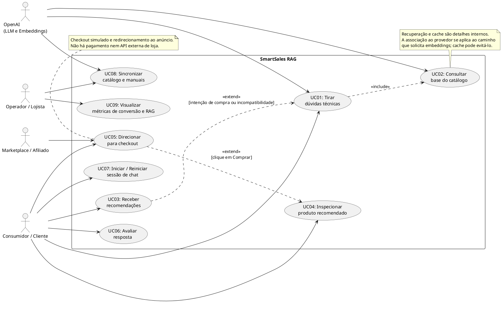

# Diagrama de Casos de Uso — SmartSales RAG

## 1. Visão Geral Funcional
O **Diagrama de Casos de Uso** delimita a fronteira funcional da plataforma **SmartSales RAG — Assistente de Vendas**, mapeando as interações entre os atores humanos (**Consumidor / Cliente** e **Operador / Lojista**), os sistemas externos (**Marketplace / Afiliado** e **Modelo LLM**) e o subsistema interno de serviço (**Busca Vetorial / RAG**).

> **Escopo de integração adotado:** o catálogo de produtos é **local** (arquivo *seed* JSON/CSV + manuais PDF versionados no repositório e ingeridos no `PostgreSQL + pgvector`). Não há API externa de loja: a compra é validada pelo *mock checkout* (`POST /api/v1/checkout/mock`) e o consumidor é redirecionado ao link direto/afiliado do marketplace (`checkout_url`).

---

## 2. Dicionário de Atores e Sistemas Externos

| Ator / Entidade | Classificação | Papel e Responsabilidade na Interação |
| :--- | :---: | :--- |
| **Consumidor / Cliente** | Ator Primário (Humano - B2C) | Usuário final que navega na vitrine, inicia sessões de atendimento, formula dúvidas técnicas em linguagem natural, interage com os cards de recomendação, avança para o checkout e avalia a utilidade das respostas. |
| **Operador / Lojista** | Ator Secundário (Humano - B2B) | Responsável por manter o arquivo *seed* do catálogo (JSON/CSV) e os manuais PDF, executar a ingestão local via CLI (`UC08`) e consultar o painel de métricas de conversão e qualidade do RAG (`UC09`). |
| **Marketplace / Afiliado** | Sistema Externo | Anúncio oficial do produto (`AMAZON`, `MERCADO_LIVRE`, `SHOPEE` ou `LOJA_OFICIAL`) que apenas recebe o redirecionamento do navegador do consumidor para o `checkout_url` (link direto/afiliado). Não há integração por API. |
| **LLM (Modelo de Linguagem)** | Sistema Externo / Serviço Cognitivo | Provedor de inferência generativa (`gpt-4o-mini`) encarregado de sintetizar a resposta fundamentada a partir dos trechos recuperados dos manuais técnicos, respeitando os *guardrails* de fidelidade e identificando intenções de compra. |
| **Busca Vetorial / RAG** | Serviço Interno (`<<service>>`) | Módulo de recuperação semântica baseado em PostgreSQL + `pgvector` que converte a pergunta do usuário em *embedding*, realiza busca por similaridade (*top-k*) e cruza com filtros rígidos de negócio do catálogo local. |

---

## 3. Diagrama de Casos de Uso (PlantUML)

---

## 4. Catálogo e Especificação Completa dos Casos de Uso (`UC01` a `UC09`)

| ID | Caso de Uso | Ator Primário | Relações UML | Pré-condições | Fluxo Principal e Regras de Negócio | Pós-condições / Exceções |
| :---: | :--- | :---: | :--- | :--- | :--- | :--- |
| **UC01** | **Tirar Dúvidas Técnicas** (Voltagem, capacidade, especificações) | Consumidor / Cliente | `<<include>>` `UC02` Estendido por `UC03` | Sessão de chat ativa (`UC07`). | 1. O consumidor envia uma dúvida técnica em linguagem natural (ex.: *"Essa panela de pressão elétrica cabe 1 kg de feijão e tem em 220V?"*) via `POST /api/v1/chat/stream`. 2. O sistema aciona obrigatoriamente `UC02` para recuperar o contexto técnico dos manuais e metadados. 3. O orquestrador envia a pergunta + trechos recuperados + *guardrails* ao modelo `LLM`. 4. A resposta é transmitida progressivamente via **SSE (*Server-Sent Events*)** (`metadata` → `token` → [`correction`] → `citations` → [`recommendations`] → `done`) com citação do manual. | **Pós-condição**: Dúvida esclarecida sem alucinação e pergunta registrada nas métricas. **Exceção**: Se nenhum trecho atingir o limiar de similaridade, emite `event: error` (`LOW_SIMILARITY_FALLBACK`) com mensagem de fallback informando ausência do dado no manual. |
| **UC02** | **Consultar Base do Catálogo** | Sistema (incluído por `UC01`) | Incluído por `UC01` Associação com `Busca Vetorial / RAG` | Catálogo e manuais previamente ingeridos (`UC08`). | 1. Converte a consulta do usuário em vetor de *embedding* (ou responde do cache Redis se a pergunta normalizada for recorrente). 2. Executa busca semântica *top-k* no `pgvector` combinada com filtros rígidos de atributos do catálogo local (voltagem `127V`/`220V`, capacidade em litros, categoria, SKU em contexto). 3. Retorna os fragmentos de manual e especificações vigentes do PostgreSQL. | **Pós-condição**: Trechos relevantes entregues ao orquestrador RAG. **Exceção**: Em caso de *timeout* no banco vetorial, realiza *retry* com *backoff* antes de acionar fallback. |
| **UC03** | **Receber Recomendações** (Produtos similares / *Cross-sell* / *Upsell*) | Consumidor / Cliente | `<<extend>>` `UC01` | Ponto de extensão: intenção de compra ou incompatibilidade técnica detectada em `UC01`. | 1. Durante o processamento de `UC01`, o motor de regras identifica se o produto consultado não atende à restrição do cliente (ex.: panela de 3L insuficiente para 1 kg de feijão, ou indisponível na voltagem 220V) ou se há oportunidade complementar. 2. Aciona estratégia de **Upsell** (modelo superior compatível, preço até `+35%`) ou **Cross-sell** (1 item complementar compatível). 3. Consulta o **catálogo local (PostgreSQL)** para obter fotos, preços, estoque (`stock_quantity > 0`), `marketplace` e `checkout_url` e emite o evento SSE `recommendations` (máx. 3 cards) para renderização (`UC04`). | **Pós-condição**: Recomendações contextualizadas anexadas ao evento SSE da resposta. **Exceção**: Se não houver candidato elegível em estoque, o sistema entrega apenas a resposta textual de `UC01` sem quebrar o chat. |
| **UC04** | **Interagir com Card de Produto** (Ver detalhes, fotos e preço) | Consumidor / Cliente | Estendido por `UC05` | Recomendação gerada por `UC03` na conversa. | 1. O frontend renderiza o card dinâmico do produto dentro do chat contendo imagem em miniatura, título, tags de especificações validadas (ex.: `6 Litros`, `220V`), preço do PostgreSQL, selo do marketplace e botão de ação. 2. O consumidor visualiza e inspeciona as especificações resumidas diretamente na conversa (detalhes via `GET /api/v1/products/{sku}`). | **Pós-condição**: Card exibido com dados comerciais sincronizados com o catálogo local. |
| **UC05** | **Direcionar para Checkout** (Mock checkout + link de afiliado) | Consumidor / Cliente | `<<extend>>` `UC04` Associação com `Marketplace / Afiliado` | Ponto de extensão: consumidor clica em *"Comprar na {Marketplace}"* no card (`UC04`). | 1. O consumidor aciona o botão de compra no card do produto recomendado. 2. O frontend envia `POST /api/v1/checkout/mock`; o Gateway revalida estoque e preço no PostgreSQL (`SELECT ... FOR UPDATE`, `RN10`). 3. O sistema grava o evento de conversão em `checkout_events` e, com `status = CONFIRMED`, o navegador é redirecionado ao `redirect_checkout_url` do marketplace (link direto/afiliado). | **Pós-condição**: Conversão contabilizada (CTR) e consumidor no anúncio oficial do marketplace. **Exceção**: Se o estoque zerou ou o preço mudou no instante do clique (`HTTP 409` — `OUT_OF_STOCK` / `PRICE_CHANGED`), exibe aviso e sugere alternativa. |
| **UC06** | **Avaliar Resposta** (Feedback Positivo / Negativo) | Consumidor / Cliente | Associação direta | Resposta do assistente entregue na sessão (`UC01`). | 1. O consumidor clica no ícone de avaliação positiva (👍 `LIKE`) ou negativa (👎 `DISLIKE` + motivo opcional) abaixo da mensagem do assistente. 2. O sistema grava a avaliação via `POST /api/v1/feedback` em `feedback_logs`, vinculada à sessão, à mensagem e aos *chunks* citados. | **Pós-condição**: Indicador de satisfação do usuário atualizado para auditoria de qualidade e melhoria contínua (PDCA). |
| **UC07** | **Iniciar / Reiniciar Sessão de Chat** | Consumidor / Cliente | Associação direta | Usuário acessa a vitrine / página de produto. | 1. Ao abrir o painel do chat, o frontend chama `POST /api/v1/sessions`, que verifica se há um `session_id` ativo e válido no Redis. 2. Se válido, restaura o histórico recente da conversa; se inexistente ou expirado, cria um novo `session_id` (`UUID v4`) e exibe a saudação inicial. 3. Caso o consumidor clique em *"Reiniciar conversa"*, o frontend chama `DELETE /api/v1/sessions/{session_id}` e um novo contexto limpo é instanciado. | **Pós-condição**: Sessão isolada pronta para receber perguntas sem contaminação de contexto anterior. |
| **UC08** | **Sincronizar Catálogo de Produtos** (Ingestão local) | Operador / Lojista | Associação com `Busca Vetorial / RAG` | Arquivo *seed* do catálogo (JSON/CSV) e manuais PDF disponíveis no repositório (`data/`). | 1. O operador atualiza o *seed* do catálogo e/ou os manuais PDF e executa a CLI `python -m app.ingestion.run --catalog data/catalog.json --manuals data/manuals/`. 2. A CLI registra cada item em `ingestion_jobs`, extrai o texto dos manuais, divide em *chunks* (`500/50`), gera os *embeddings* e executa *upsert* em `products` e `manual_chunks` (`pgvector`). 3. Produtos removidos do *seed* têm seus vetores expurgados; ao final a CLI executa `INCR catalog:version` no Redis, invalidando o cache semântico. | **Pós-condição**: Índice vetorial e catálogo atualizados com a versão vigente do *seed*. **Exceção**: Em caso de falha após o número máximo de *retries* com *backoff*, o item fica em `NEEDS_INTERVENTION` em `ingestion_jobs` e é sinalizado no log da CLI e no painel (`UC09`). |
| **UC09** | **Visualizar Métricas de Conversão e RAG** | Operador / Lojista | Associação direta | Telemetria coletada pelo Gateway (`chat_messages`, `feedback_logs`, `checkout_events`) e `ADMIN_TOKEN` configurado. | 1. O operador acessa a página simples `/admin/metricas` do frontend (protegida por `ADMIN_TOKEN`, sem login multi-lojista). 2. A página consulta `GET /api/v1/metrics/summary` (cabeçalho `X-Admin-Token`) e apresenta CTR dos cards, conversões direcionadas ao checkout, dúvidas técnicas mais frequentes, latência (`TTFT` e tempo total), taxa de acerto do cache Redis, aprovação (*likes/dislikes*) e status de `ingestion_jobs`. | **Pós-condição**: Visão executiva de performance comercial (MarTech) e técnica disponibilizada ao operador. |

---

## 5. Conceitos Técnicos e Comerciais Aplicados aos Casos de Uso

1. **SSE (*Server-Sent Events*)**: Protocolo de comunicação unidirecional sobre HTTP utilizado em `UC01` para transmitir os tokens gerados pela LLM em tempo real para o navegador do cliente (consumido via `fetch` + `ReadableStream`, pois a requisição é um `POST`), garantindo um *Time To First Token (TTFT)* inferior a 2 segundos (`p95`) e eliminando a percepção de travamento.
2. **Upsell (`UC03`)**: Estratégia comercial de recomendar uma versão superior ou de maior capacidade quando o modelo inicialmente consultado pelo cliente não atende à sua demanda técnica (ex.: ofertar uma panela de pressão elétrica de 6L quando o cliente pergunta se o modelo de 3L comporta 1 kg de feijão), limitada a `+35%` do preço base.
3. **Cross-sell (`UC03`)**: Estratégia comercial de recomendar um produto complementar ou acessório compatível com o item principal que o cliente está adquirindo (ex.: sugerir uma cuba antiaderente extra ou cabo/acessório compatível), elevando o ticket médio do pedido.
4. **Checkout Mock + Afiliado (`UC05`)**: O SmartSales RAG não processa pagamentos; ele revalida estoque/preço no catálogo local, registra a conversão e redireciona ao anúncio do marketplace (`checkout_url`).
