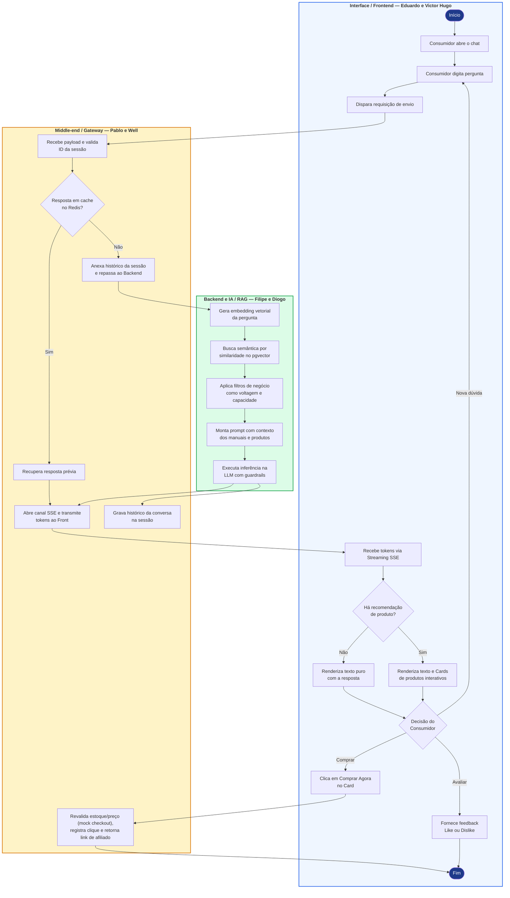

# Diagrama de Atividades (Fluxo Operacional em Raias) — SmartSales RAG

## 1. Visão Geral Arquitetural
O **Diagrama de Atividades** modela o fluxo operacional completo de uma requisição dentro da arquitetura em 3 camadas do **SmartSales RAG**, evidenciando a divisão de responsabilidades entre:
1. **Interface / Frontend (`Eduardo e Victor Hugo`)**: Interação direta com o consumidor, captura de perguntas, consumo do canal de streaming *Server-Sent Events (SSE)*, renderização condicional de texto puro ou cards interativos de produtos e captura de ações de conversão/feedback.
2. **Middle-end / Gateway (`Pablo e Well`)**: Validação de sessão, interceptação de consultas recorrentes via cache em memória (**Redis**), gerenciamento de contexto conversacional, abertura e transmissão do canal **SSE**, persistência de histórico/telemetria no PostgreSQL e revalidação do *mock checkout* (`POST /api/v1/checkout/mock`) com redirecionamento ao link de afiliado do marketplace.
3. **Backend e IA / RAG (`Filipe e Diogo`)**: Conversão da dúvida em vetor de *embedding*, busca semântica por similaridade no **PostgreSQL (`pgvector`)**, aplicação de filtros determinísticos de negócio (como voltagem e capacidade), construção de prompt enriquecido com trechos de manuais técnicos e inferência na **LLM** protegida por *guardrails*.

---

## 2. Diagrama de Atividades em Raias (Swimlanes)

---

## 3. Especificação Detalhada das Etapas por Raia

### 3.1 Raia 1: Interface / Frontend (`Eduardo e Victor Hugo`)

| Etapa | Nó no Diagrama | Descrição Técnica da Operação | Entrada | Saída |
| :---: | :--- | :--- | :--- | :--- |
| **1** | `Consumidor abre o chat` | Abre o painel lateral do Consultor IA na vitrine e recupera ou cria o identificador de sessão via `POST /api/v1/sessions` (`session_id`). | Abertura da página/chat | Sessão pronta na UI |
| **2** | `Consumidor digita pergunta` | Captura a dúvida em linguagem natural no campo de entrada (com validação de texto não vazio e higienização básica). | Texto digitado pelo cliente | String da pergunta |
| **3** | `Dispara requisição de envio` | Envia `POST /api/v1/chat/stream` com o *payload* JSON (`{ session_id, message, context_filters }`) ao API Gateway e lê os eventos SSE com `fetch` + `ReadableStream` (o `EventSource` nativo não suporta `POST`). | Clique em enviar / Enter | Requisição HTTP / SSE |
| **4** | `Recebe tokens via Streaming SSE` | Consome os fragmentos (`chunks`) de texto à medida que são emitidos pelo Middle-end, atualizando a bolha de mensagem em tempo real. | Eventos `metadata` / `token` / `correction` | Texto renderizado progressivamente |
| **5** | `Há recomendação de produto?` | Avalia se o stream SSE trouxe o evento `recommendations` com produtos (`products[]` não vazio) antes do evento `done`. | Evento `recommendations` | Desvio condicional (`Sim` / `Não`) |
| **6A** | `Renderiza texto puro com a resposta` | Caso a dúvida seja estritamente informativa e sem sugestão comercial, finaliza a exibição com a resposta fundamentada e a referência do manual. | `products[]` vazio / ausente | Mensagem textual concluída |
| **6B** | `Renderiza texto e Cards de produtos interativos` | Caso haja recomendação (*upsell* ou *cross-sell*), exibe a resposta textual acompanhada do carrossel/vitrine de cards contendo foto, especificações, preço e botão de compra. | `products[]` populado | Mensagem + Cards de Vitrine |
| **7** | `Decisão do Consumidor` | Aguarda a reação do usuário diante da resposta e das recomendações apresentadas na tela. | Interação do usuário | Compra, Avaliação ou Nova Pergunta |
| **8A** | `Clica em Comprar Agora no Card` | Dispara `POST /api/v1/checkout/mock` com `sku`, `session_id`, `message_id`, `recommendation_type` e `displayed_price`; com `status = CONFIRMED` abre o `redirect_checkout_url` do marketplace. | Clique no botão CTA do card | Chamada para rota de checkout |
| **8B** | `Fornece feedback Like ou Dislike` | Envia `POST /api/v1/feedback` com `rating = LIKE` ou `DISLIKE` (+ `reason_category` opcional) sobre a utilidade e exatidão da resposta recebida. | Clique em 👍 ou 👎 | Registro de feedback e encerramento do fluxo |

---

### 3.2 Raia 2: Middle-end / Gateway (`Pablo e Well`)

| Etapa | Nó no Diagrama | Descrição Técnica da Operação | Regra de Negócio e Desempenho |
| :---: | :--- | :--- | :--- |
| **1** | `Recebe payload e valida ID da sessão` | Verifica integridade do payload, aplica *rate limiting* por IP/sessão e valida se o `session_id` existe no Redis (renovando o TTL de `1800s`). | Proteção contra abuso de bots e garantia de isolamento de sessão. |
| **2** | `Resposta em cache no Redis?` | Calcula o *hash* normalizado da pergunta + SKU em foco e verifica se já existe resposta válida armazenada em cache no Redis. | Meta de taxa de acerto (*cache hit rate*) $\ge 30\%$ para reduzir custo de tokens e latência. |
| **3A** | `Recupera resposta prévia` | Em caso de *Cache Hit*, lê imediatamente a resposta validada e os metadados de recomendação diretamente da memória do Redis, poupando o acionamento da LLM. | Reduz o TTFT para a casa de milissegundos em dúvidas frequentes. |
| **3B** | `Anexa histórico da sessão e repassa ao Backend` | Em caso de *Cache Miss*, recupera as últimas mensagens da sessão no Redis para manter o contexto de conversação (ex.: pronomes *"e ela tem em 220V?"*) e encaminha ao Backend. | Preserva a coerência multi-turno da conversa. |
| **4** | `Abre canal SSE e transmite tokens ao Front` | Mantém a conexão HTTP aberta com cabeçalhos `Content-Type: text/event-stream` e faz o *flush* imediato dos eventos (`metadata`, `token`, [`correction`], `citations`, `recommendations`, `done`) gerados pelo Backend (ou lidos do cache) para o Frontend. | Garante TTFT $\le 2\text{ s (p95)}$ e tempo total $\le 8\text{ s (p95)}$. |
| **5** | `Grava histórico da conversa na sessão` | Ao término da geração pela LLM, persiste o par `(pergunta, resposta)` no histórico da sessão no Redis e em `chat_messages` (PostgreSQL, com `ttft_ms`, `total_latency_ms` e `cache_hit`) e armazena a resposta no cache com TTL de `3600s`. | Mantém a memória da sessão e alimenta o cache para consultas futuras. |
| **6** | `Revalida estoque/preço (mock checkout), registra clique e retorna link de afiliado` | Recebe `POST /api/v1/checkout/mock`, revalida estoque e preço no PostgreSQL (`SELECT ... FOR UPDATE`, `RN10`), grava `checkout_events` e devolve o `redirect_checkout_url` (link direto/afiliado do marketplace) ou `HTTP 409` (`OUT_OF_STOCK` / `PRICE_CHANGED`). | Rastreabilidade ponta a ponta das vendas assistidas pelo chat. |

---

### 3.3 Raia 3: Backend e IA / RAG (`Filipe e Diogo`)

| Etapa | Nó no Diagrama | Descrição Técnica da Operação | Mecanismo de Qualidade / Guardrail |
| :---: | :--- | :--- | :--- |
| **1** | `Gera embedding vetorial da pergunta` | Transforma a consulta do usuário (enriquecida com o contexto da conversa) em um vetor numérico denso utilizando o modelo de *embeddings*. | Normalização semântica para termos coloquiais do consumidor. |
| **2** | `Busca semântica por similaridade no pgvector` | Executa consulta vetorial *top-k* (distância de cosseno) sobre a tabela de fragmentos de manuais técnicos e fichas de produtos no PostgreSQL (`pgvector`). | Limiar mínimo de similaridade (*similarity threshold*) calibrado para descartar trechos irrelevantes. |
| **3** | `Aplica filtros de negócio como voltagem e capacidade` | Filtra deterministicamente os candidatos recuperados e o catálogo local segundo atributos estruturados obrigatórios (ex.: `voltage = 220V`, `capacity_liters >= 5`); `stock_quantity > 0` é exigido para todo produto recomendado (cards). | Meta de **100% de aderência** aos filtros de negócio (impede sugerir item 127V para quem pediu 220V). |
| **4** | `Monta prompt com contexto dos manuais e produtos` | Constrói o prompt estruturado combinando instruções de sistema (*System Prompt*), trechos oficiais dos manuais com número de página e lista de produtos elegíveis para *upsell/cross-sell*. | Isolamento de contexto para evitar o efeito *Lost in the Middle*. |
| **5** | `Executa inferência na LLM com guardrails` | Realiza a chamada em modo *streaming* ao modelo LLM aplicando *guardrails* que proíbem inventar especificações ausentes no contexto e exigem citação explícita da fonte. | Meta de Fidelidade (*Faithfulness*) $\ge 0,85$ e Taxa de Alucinação $\le 5\%$; o `OutputGuardrail (G-OUT)` bloqueia a sentença privada inválida antes de emitir qualquer token. |
