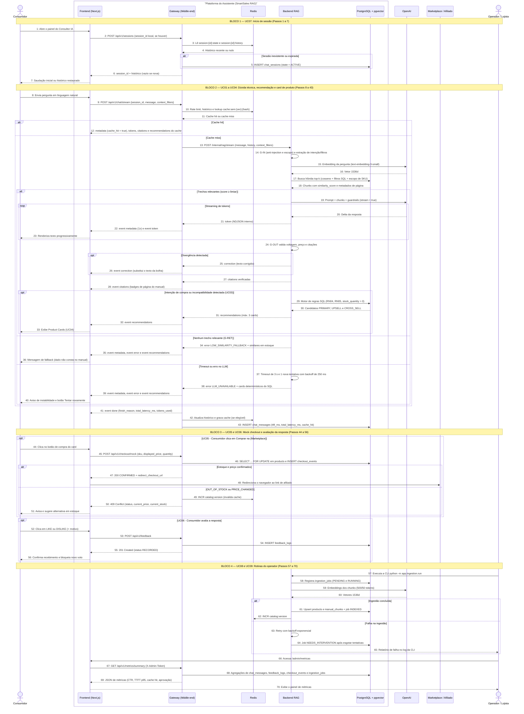

# Diagrama de Sequência — SmartSales RAG

## 1. Visão Geral

O **Diagrama de Sequência** do projeto **SmartSales RAG** modela a ordem cronológica das trocas de mensagens síncronas e assíncronas (incluindo fluxos de *streaming* via *Server-Sent Events* — SSE) entre os atores externos (**Consumidor** e **Operador / Lojista**), os componentes internos da **Plataforma do Assistente** distribuídos nas 3 camadas (**Frontend Next.js**, **Gateway / Middle-end**, **Redis**, **Backend RAG** e **PostgreSQL + pgvector**) e os sistemas externos (**OpenAI** e **Marketplace / Afiliado**).

O catálogo é **local** (seed JSON/CSV + manuais PDF ingeridos no PostgreSQL) e a compra usa **checkout mock + link de afiliado**: não existe API externa de loja.

A modelagem abrange **70 passos numerados**, estruturados em quatro blocos operacionais que cobrem integralmente os casos de uso `UC01` a `UC09`:
1. **Início e Recuperação de Sessão (`UC07`)** — Passos `1` a `7`.
2. **Dúvida Técnica, Busca Semântica, Recomendação Consultiva e Card de Produto (`UC01` a `UC04`)** — Passos `8` a `43`.
3. **Mock Checkout com Redirecionamento ao Marketplace (`UC05`) e Avaliação de Resposta (`UC06`)** — Passos `44` a `56`.
4. **Rotinas do Operador / Lojista: Ingestão Local do Catálogo (`UC08`) e Painel de Métricas (`UC09`)** — Passos `57` a `70`.

---

## 2. Participantes e *Lifelines*

| Participante / *Lifeline* | Tipo | Fronteira | Pacotes EAP Relacionados | Responsabilidade nas Interações |
| :--- | :--- | :--- | :---: | :--- |
| **Consumidor** | Ator Primário | Externa | — | Abre o painel do chat, envia perguntas em linguagem natural, recebe tokens via *streaming* SSE e *cards* de produto, aciona a compra (`Comprar na {Marketplace}`) e avalia respostas (`LIKE`/`DISLIKE`). |
| **Frontend (Next.js)** | Camada 1 — Interface | Plataforma do Assistente | `4.9`, `4.10`, `4.11` (`F02`, `F03`, `F04`) | Renderiza vitrine e painel lateral, consome o stream SSE com `fetch` + `ReadableStream`, exibe citações e *cards*, chama o *mock checkout*, redireciona ao marketplace e hospeda a página `/admin/metricas`. |
| **Gateway (Middle-end FastAPI)** | Camada 2 — API Gateway | Plataforma do Assistente | `4.5` a `4.8` (`M01` a `M05`) | Sessões, *rate limiting*, cache semântico, geração dos eventos SSE (`metadata`, `token`, `correction`, `citations`, `recommendations`, `error`, `done`), telemetria, feedback, *mock checkout* e métricas. Dono das tabelas `chat_sessions`, `chat_messages`, `feedback_logs` e `checkout_events`. |
| **Redis** | Cache e Sessão (Upstash) | Plataforma do Assistente | `4.5`, `4.7` (`M02`, `M03`) | Histórico e estado de turno da sessão (TTL `1800s`), cache semântico `cache:sem:{ver}:{hash}` (TTL `3600s`), `catalog:version` e contadores de *rate limit*. |
| **Backend RAG (Python + LangChain)** | Camada 3 — Orquestrador | Plataforma do Assistente | `4.1` a `4.4` (`B01` a `B04`) | Guardrails `G-IN`/`G-RET`/`G-OUT`, busca híbrida, geração em *streaming*, motor de *upsell/cross-sell* e CLI de ingestão (`UC08`). Dono de `products`, `manual_chunks`, `product_relations` e `ingestion_jobs`. |
| **PostgreSQL + pgvector** | Persistência relacional e vetorial | Plataforma do Assistente | `4.1`, `4.2` (`B01`, `B03`) | Catálogo local, *chunks* vetoriais (`HNSW`), relações de recomendação, sessões, mensagens, feedback, conversões e jobs de ingestão. |
| **OpenAI** | Sistema Externo | Externa | `4.2`, `4.3` (`B02`, `B03`) | `text-embedding-3-small` (vetores `1536d`) e `gpt-4o-mini` (geração em *streaming*, `temperature = 0,2`). |
| **Marketplace / Afiliado** | Sistema Externo | Externa | `4.8` (`M05`, `F04`) | Anúncio oficial (`AMAZON`, `MERCADO_LIVRE`, `SHOPEE`, `LOJA_OFICIAL`) que recebe apenas o redirecionamento do navegador para o `checkout_url`. |
| **Operador / Lojista** | Ator Secundário | Externa | — | Mantém o seed do catálogo e os manuais PDF, executa a CLI de ingestão e consulta o painel `/admin/metricas`. |

---

## 3. Diagrama de Sequência Completo (Mermaid)

---

## 4. Especificação Detalhada dos 70 Passos da Sequência

### 4.1. Bloco 1: `UC07` — Início de Sessão (Passos 1 a 7)

| Passo | Origem | Destino | Tipo de Mensagem | Fragmento / Condição | Descrição Técnica e Contrato de Dados |
| :---: | :--- | :--- | :---: | :--- | :--- |
| **1** | Consumidor | Frontend | Síncrona | — | O consumidor seleciona um produto na vitrine e o painel lateral do Consultor IA é aberto (`EAP 4.9`). |
| **2** | Frontend | Gateway | Síncrona (`POST /api/v1/sessions`) | — | Envia o `session_id` armazenado localmente (se houver) para validação ou criação de sessão (`EAP 4.5`). |
| **3** | Gateway | Redis | Síncrona | — | Lê `session:{id}:state` e `session:{id}:history` (últimos `10` turnos) em *pipeline* único (`EAP 4.5`, `4.7`). |
| **4** | Redis | Gateway | Retorno | — | Retorna o histórico recente ou nulo se a chave expirou (TTL `1800s`). |
| **5** | Gateway | PostgreSQL | Síncrona (`INSERT`) | `alt [Sessão inexistente ou expirada]` | Cria nova linha em `chat_sessions` com `state = ACTIVE` e novo `session_id` (`UUID v4`) (`EAP 4.5`). |
| **6** | Gateway | Frontend | Retorno (`200/201`) | — | Devolve `session_id` e histórico (vazio se nova sessão). |
| **7** | Frontend | Consumidor | Retorno Visual | — | Renderiza a saudação inicial (ou restaura o histórico) e habilita o campo de entrada (`EAP 4.9`). *Reiniciar conversa* usa `DELETE /api/v1/sessions/{session_id}` e reinicia este bloco. |

### 4.2. Bloco 2: `UC01` a `UC04` — Dúvida Técnica, Recomendação e Card de Produto (Passos 8 a 43)

| Passo | Origem | Destino | Tipo de Mensagem | Fragmento / Condição | Descrição Técnica e Contrato de Dados |
| :---: | :---: | :--- | :---: | :--- | :--- |
| **8** | Consumidor | Frontend | Síncrona | — | O consumidor digita e envia uma pergunta técnica ou comercial (`EAP 4.9`). |
| **9** | Frontend | Gateway | Assíncrona (`POST /api/v1/chat/stream`) | — | Envia `{session_id, message, context_filters: {preferred_voltage, category, current_product_sku}}` e lê a resposta `text/event-stream` com `fetch` + `ReadableStream` (`EAP 4.5`, `4.6`). |
| **10** | Gateway | Redis | Síncrona | — | Aplica *rate limit* (`30 req/min`), carrega histórico e consulta `cache:sem:{catalog_version}:{sha256}` (`EAP 4.7`, `RN09`). |
| **11** | Redis | Gateway | Retorno | — | Indica *cache hit* (resposta validada) ou *cache miss*. |
| **12** | Gateway | Frontend | Eventos SSE | `alt [Cache hit]` | Reemite a resposta do cache: `metadata` (`cache_hit = true`, `TTFT ≤ 120 ms`), `token`, `citations` e `recommendations` (`EAP 4.6`, `4.7`). |
| **13** | Gateway | Backend RAG | Assíncrona (`POST /internal/rag/stream`) | `else [Cache miss]` | Encaminha pergunta, histórico e filtros ao orquestrador; a resposta interna é NDJSON com os mesmos nomes de evento (exceto `metadata`, gerado pelo Gateway) (`EAP 4.3`). |
| **14** | Backend RAG | Backend RAG | Auto-chamada Interna | — | `InputGuardrail (G-IN)` bloqueia *prompt injection* e perguntas fora do domínio (`error GUARDRAIL_BLOCKED`) e extrai intenção e filtros (`RF04`). |
| **15** | Backend RAG | OpenAI | Síncrona (API) | — | Gera o *embedding* da pergunta com `text-embedding-3-small` (`EAP 4.2`). |
| **16** | OpenAI | Backend RAG | Retorno | — | Vetor de `1536` dimensões. |
| **17** | Backend RAG | PostgreSQL | Síncrona (SQL/pgvector) | — | Busca híbrida `top_k = 5` por cosseno em `manual_chunks` com `is_active = TRUE` e escopo de SKU (`EAP 4.2`, `4.3`). |
| **18** | PostgreSQL | Backend RAG | Retorno | — | *Chunks* com `similarity_score`, `manual_title`, `page_number` e metadados do produto. |
| **19** | Backend RAG | OpenAI | Assíncrona (API Stream) | `alt [Trechos relevantes]` | Com `similarity_score ≥ SIMILARITY_THRESHOLD` (`0,72` inicial), envia *System Prompt* + `<CATALOGO_SQL>` + `<CHUNKS_MANUAIS>` com `stream = true` e `temperature = 0,2` (`EAP 4.3`). |
| **20** | OpenAI | Backend RAG | Retorno em *Stream* | `loop [Streaming de tokens]` | Fragmentos (deltas) da resposta fundamentada. |
| **21** | Backend RAG | Gateway | Stream interno | `loop [Streaming de tokens]` | Repassa cada delta como evento `token` (NDJSON). |
| **22** | Gateway | Frontend | Evento SSE (`metadata` 1x, `token`) | `loop [Streaming de tokens]` | Antes do primeiro token emite `event: metadata` (`ttft_ms` medido nesse instante); em seguida `event: token {"delta": "..."}` com *flush* imediato (`EAP 4.6`). |
| **23** | Frontend | Consumidor | Atualização UI | `loop [Streaming de tokens]` | Renderiza o texto progressivamente (`EAP 4.9`). |
| **24** | Backend RAG | Backend RAG | Auto-chamada Interna | — | `OutputGuardrail (G-OUT)` verifica voltagem, preço (`RN08`) e citações (`RN07`) contra os dados SQL e os *chunks* do turno. |
| **25** | Backend RAG | Gateway | Stream interno | `opt [Divergência detectada]` | Emite `correction` com `violation_code` e o texto completo corrigido. |
| **26** | Gateway | Frontend | Evento SSE (`correction`) | `opt [Divergência detectada]` | O Frontend substitui o texto da bolha pelo conteúdo corrigido. |
| **27** | Backend RAG | Gateway | Stream interno | — | Lista de citações verificadas (`chunk_id`, `manual_title`, `page_number`, `excerpt`). |
| **28** | Gateway | Frontend | Evento SSE (`citations`) | — | Renderiza os *badges* de página do manual (`EAP 4.9`, `RF11`). |
| **29** | Backend RAG | PostgreSQL | Síncrona (SQL) | `opt [Intenção de compra ou incompatibilidade]` | Motor determinístico de *upsell* (`RN04`, teto `+35%`) e *cross-sell* (`RN05`, 1 item), sempre com `stock_quantity > 0` e voltagem compatível (`EAP 4.4`). |
| **30** | PostgreSQL | Backend RAG | Retorno | `opt [...]` | Candidatos elegíveis do catálogo local com preço, estoque, `marketplace` e `checkout_url`. |
| **31** | Backend RAG | Gateway | Stream interno | `opt [...]` | `recommendations` com até 3 cards (`PRIMARY`, `UPSELL`, `CROSS_SELL`). |
| **32** | Gateway | Frontend | Evento SSE (`recommendations`) | `opt [...]` | `{"products": [...]}` com dados vindos exclusivamente do PostgreSQL (`RN06`). |
| **33** | Frontend | Consumidor | Atualização UI | `opt [...]` | Renderiza o carrossel de *Product Cards* (`UC04`, `EAP 4.10`). |
| **34** | Backend RAG | Gateway | Stream interno | `else [Nenhum trecho relevante]` | `G-RET` bloqueia a geração livre e emite `error LOW_SIMILARITY_FALLBACK` seguido de `recommendations` com similares em estoque (`RN02`, `RN03`). |
| **35** | Gateway | Frontend | Eventos SSE (`metadata`, `error`, `recommendations`) | `else [Nenhum trecho relevante]` | O evento `error` não é terminal; o stream segue até `done` (`finish_reason = fallback`). |
| **36** | Frontend | Consumidor | Atualização UI | `else [Nenhum trecho relevante]` | Exibe o `fallback_message` informando que a especificação não consta no manual oficial. |
| **37** | Backend RAG | Backend RAG | Auto-chamada Interna | `else [Timeout ou erro no LLM]` | Timeout de `3 s` até o primeiro token e `1` nova tentativa com *backoff* de `250 ms` (`RNF07`). |
| **38** | Backend RAG | Gateway | Stream interno | `else [Timeout ou erro no LLM]` | `error LLM_UNAVAILABLE` + cards determinísticos via SQL, mantendo `HTTP 200`. |
| **39** | Gateway | Frontend | Eventos SSE (`metadata`, `error`, `recommendations`) | `else [Timeout ou erro no LLM]` | Contingência sem derrubar a sessão; o stream encerra com `done` (`finish_reason = error`). |
| **40** | Frontend | Consumidor | Atualização UI | `else [Timeout ou erro no LLM]` | Exibe aviso de instabilidade e o botão `"Tentar novamente"` preservando a pergunta. |
| **41** | Gateway | Frontend | Evento SSE (`done`) | Sempre o último evento | `{"finish_reason": "stop \| fallback \| error", "total_latency_ms": ..., "tokens_used": ...}`. |
| **42** | Gateway | Redis | Assíncrona | Sempre | Atualiza `session:{id}:history` (`LPUSH` + `LTRIM 0 9`) e grava `cache:sem:...` se a resposta for elegível (`EAP 4.7`). |
| **43** | Gateway | PostgreSQL | Assíncrona (`INSERT`) | Sempre | Persiste o turno em `chat_messages` com `citations`, `recommended_skus`, `ttft_ms`, `total_latency_ms` e `cache_hit` (`EAP 4.7`, `5.3`). |

### 4.3. Bloco 3: `UC05` e `UC06` — Mock Checkout e Avaliação da Resposta (Passos 44 a 56)

| Passo | Origem | Destino | Tipo de Mensagem | Fragmento / Condição | Descrição Técnica e Contrato de Dados |
| :---: | :--- | :--- | :---: | :--- | :--- |
| **44** | Consumidor | Frontend | Síncrona (Clique UI) | `opt [UC05]` | O consumidor aciona `Comprar na {Marketplace}` (`data-testid="buy-now-btn-{sku}"`) em um card (`EAP 4.10`). |
| **45** | Frontend | Gateway | Síncrona (`POST /api/v1/checkout/mock`) | `opt [UC05]` | Envia `session_id`, `message_id`, `sku`, `recommendation_type`, `quantity` e `displayed_price` (`EAP 4.8`). |
| **46** | Gateway | PostgreSQL | Transação SQL | `opt [UC05]` | `SELECT ... FOR UPDATE` na linha do SKU em `products` e `INSERT` em `checkout_events` com o status apurado (`RN10`). |
| **47** | Gateway | Frontend | Retorno (`200 OK`) | `alt [Estoque e preço confirmados]` | `status = CONFIRMED` com `redirect_checkout_url`, `confirmed_unit_price` e `remaining_stock`. |
| **48** | Frontend | Marketplace / Afiliado | Redirecionamento | `alt [Estoque e preço confirmados]` | Abre o `redirect_checkout_url` (link direto/afiliado do anúncio oficial). |
| **49** | Gateway | Redis | Síncrona (`INCR`) | `else [OUT_OF_STOCK ou PRICE_CHANGED]` | Incrementa `catalog:version`, invalidando respostas em cache com dados obsoletos (`RN09`). Também ocorre quando o checkout confirmado zera o estoque. |
| **50** | Gateway | Frontend | Retorno (`409 Conflict`) | `else [...]` | Corpo `MockCheckoutResponse` com `status = OUT_OF_STOCK` ou `PRICE_CHANGED`, `current_price` e `current_stock`. |
| **51** | Frontend | Consumidor | Atualização UI | `else [...]` | Atualiza o card, exibe aviso amigável e sugere item substituto em estoque. |
| **52** | Consumidor | Frontend | Síncrona (Clique UI) | `opt [UC06]` | Clica em 👍 (`LIKE`) ou 👎 (`DISLIKE` + motivo) abaixo da resposta (`EAP 4.11`). |
| **53** | Frontend | Gateway | Síncrona (`POST /api/v1/feedback`) | `opt [UC06]` | `{session_id, message_id, rating, reason_category, comment}`. |
| **54** | Gateway | PostgreSQL | Síncrona (`INSERT`) | `opt [UC06]` | Grava em `feedback_logs` (uma avaliação por mensagem) (`EAP 4.7`, `4.11`). |
| **55** | Gateway | Frontend | Retorno (`201 Created`) | `opt [UC06]` | `{"feedback_id", "status": "RECORDED", "recorded_at"}`. |
| **56** | Frontend | Consumidor | Retorno Visual | `opt [UC06]` | Exibe confirmação e desabilita novo voto na mensagem. |

### 4.4. Bloco 4: `UC08` e `UC09` — Rotinas do Operador / Lojista (Passos 57 a 70)

| Passo | Origem | Destino | Tipo de Mensagem | Fragmento / Condição | Descrição Técnica e Contrato de Dados |
| :---: | :--- | :--- | :---: | :--- | :--- |
| **57** | Operador / Lojista | Backend RAG | Execução de CLI | — | Executa `python -m app.ingestion.run --catalog data/catalog.json --manuals data/manuals/` após atualizar o seed ou os PDFs (`EAP 4.1`, `4.2`). |
| **58** | Backend RAG | PostgreSQL | Síncrona (`INSERT/UPDATE`) | — | Registra cada produto/manual em `ingestion_jobs` (`PENDING` → `RUNNING`). |
| **59** | Backend RAG | OpenAI | Síncrona (API em lotes) | — | Gera os *embeddings* dos *chunks* (`500` tokens, *overlap* `50`) com cabeçalho canônico de produto/página (`EAP 4.2`). |
| **60** | OpenAI | Backend RAG | Retorno | — | Vetores `1536d`. |
| **61** | Backend RAG | PostgreSQL | Síncrona (`UPSERT`) | `alt [Ingestão concluída]` | Atualiza `products` e `manual_chunks` (expurga vetores de produtos removidos do seed) e marca o job como `INDEXED`. |
| **62** | Backend RAG | Redis | Síncrona (`INCR`) | `alt [Ingestão concluída]` | Incrementa `catalog:version`, invalidando o cache semântico (`RN09`, `EAP 4.7`). |
| **63** | Backend RAG | Backend RAG | Auto-chamada Interna | `else [Falha na ingestão]` | Em PDF corrompido ou indisponibilidade da API de *embeddings*, incrementa `attempts` e repete com *backoff* exponencial. |
| **64** | Backend RAG | PostgreSQL | Síncrona (`UPDATE`) | `else [Falha na ingestão]` | Esgotadas as tentativas, marca o job como `NEEDS_INTERVENTION` com `last_error`. |
| **65** | Backend RAG | Operador / Lojista | Saída da CLI | `else [Falha na ingestão]` | Relatório de falha no log da CLI (o status também aparece no painel `UC09`). |
| **66** | Operador / Lojista | Frontend | Navegação | — | Acessa a página `/admin/metricas` (`UC09`). |
| **67** | Frontend | Gateway | Síncrona (`GET /api/v1/metrics/summary`) | — | Requisição com cabeçalho `X-Admin-Token` (valor de `ADMIN_TOKEN`) (`EAP 4.7`). |
| **68** | Gateway | PostgreSQL | Síncrona (SQL agregado) | — | Agrega `chat_messages`, `feedback_logs`, `checkout_events` e `ingestion_jobs`. |
| **69** | Gateway | Frontend | Retorno (`200 OK`) | — | JSON com CTR, conversões, `ttft_p50_ms`, `ttft_p95_ms`, `total_latency_p95_ms`, `cache_hit_ratio`, `error_5xx_rate`, aprovação e dúvidas frequentes. |
| **70** | Frontend | Operador / Lojista | Retorno Visual | — | Exibe o painel de métricas de conversão e qualidade do RAG (`EAP 4.7`, `5.3`). |
