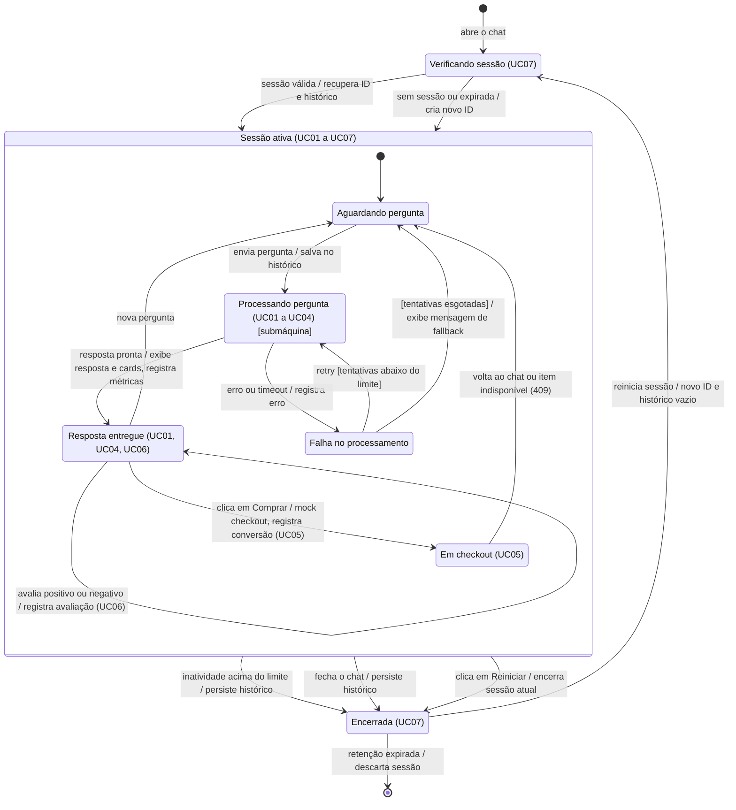
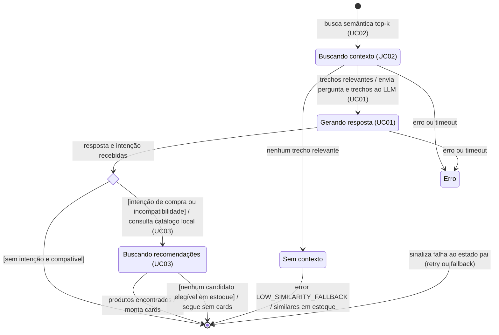
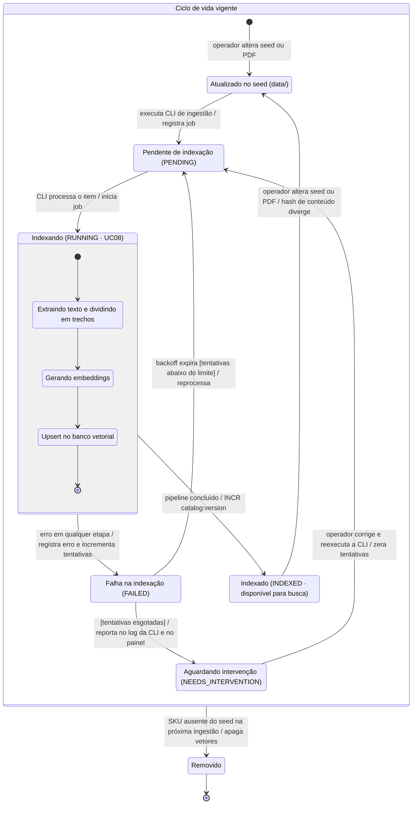

# Diagrama de Máquina de Estados — SmartSales RAG

## 1. Visão Geral

A modelagem comportamental de estados do **SmartSales RAG** é dividida em **três máquinas de estados complementares** que governam o ciclo de vida transacional e assíncrono do sistema (`EAP 3.2`):
1. **Máquina 1 — Sessão de Atendimento (`UC01` a `UC07`)**: Modela o ciclo de vida da conversa do consumidor desde a abertura do chat e validação do identificador no Redis até a entrega da resposta, redirecionamento ao *checkout*, avaliação e encerramento/expiração por retenção (`EAP 4.5`, `4.6`, `4.8` a `4.11`).
2. **Máquina 2 — Submáquina "Processando Pergunta" (`UC01`, `UC02`, `UC03`)**: Detalha internamente o estado composto `Processando_pergunta`, cobrindo a busca semântica `top-k`, a geração aumentada via LLM com *guardrails*, a decisão condicional de intenção comercial/incompatibilidade e a montagem de *cards* de recomendação (`EAP 4.2`, `4.3`, `4.4`).
3. **Máquina 3 — Ciclo de Vida do Conteúdo de Produto no Índice Vetorial (`UC08`)**: Modela o estado de ingestão de cada produto e manual técnico do catálogo **local** (seed JSON/CSV + PDFs) no banco vetorial `PostgreSQL + pgvector`, executada pela CLI do backend e registrada na tabela `ingestion_jobs`, incluindo reprocessamento por *backoff* e exclusão física dos vetores (`EAP 4.1`, `4.2`, `4.7`).

---

## 2. Máquina 1: Sessão de Atendimento (`UC01` a `UC07`)

### 2.1. Diagrama de Estados — Sessão de Atendimento (Mermaid)

### 2.2. Tabela de Estados e Transições — Sessão de Atendimento

| Estado de Origem | Evento Gatilho | Condição de Guarda `[...]` | Ação de Transição `/ ...` | Estado de Destino | Casos de Uso / EAP |
| :--- | :--- | :--- | :--- | :--- | :---: |
| `[*]` (Inicial) | `abre o chat` | — | Inicializa componente de chat no *Frontend* | `Verificando sessão` | `UC07` · `EAP 4.9` |
| `Verificando sessão` | `sessão válida` | `[session_id existe no Redis e TTL ativo]` | `recupera ID e histórico` | `Sessão ativa → Aguardando pergunta` | `UC07` · `EAP 4.5` |
| `Verificando sessão` | `sem sessão ou expirada` | `[session_id ausente ou TTL expirado]` | `cria novo ID` | `Sessão ativa → Aguardando pergunta` | `UC07` · `EAP 4.5` |
| `Aguardando pergunta` | `envia pergunta` | `[input não vazio e dentro do limite]` | `salva no histórico` | `Processando pergunta [submáquina]` | `UC01`–`UC04` · `EAP 4.5` |
| `Processando pergunta` | `resposta pronta` | `[submáquina concluída com sucesso ou fallback documental]` | `exibe resposta e cards, registra métricas` | `Resposta entregue` | `UC01`, `UC04` · `EAP 4.6`, `4.10` |
| `Processando pergunta` | `erro ou timeout` | `[exceção de rede, banco vetorial ou LLM]` | `registra erro` | `Falha no processamento` | `UC01`–`UC03` · `EAP 4.5` |
| `Falha no processamento` | `retry` | `[tentativas abaixo do limite]` | Incrementa contador e aguarda *backoff* | `Processando pergunta [submáquina]` | `UC01`–`UC03` · `EAP 4.5` |
| `Falha no processamento` | — | `[tentativas esgotadas]` | `exibe mensagem de fallback` | `Aguardando pergunta` | `UC01` · `EAP 4.9` |
| `Resposta entregue` | `nova pergunta` | — | Prepara novo ciclo de consulta na sessão | `Aguardando pergunta` | `UC01`, `UC07` · `EAP 4.9` |
| `Resposta entregue` | `avalia positivo ou negativo` | `[usuário ainda não avaliou a mensagem]` | `registra avaliação (UC06)` | `Resposta entregue` *(auto-transição)* | `UC06` · `EAP 4.11` |
| `Resposta entregue` | `clica em Comprar` | `[card de produto exibido e estoque > 0]` | `POST /api/v1/checkout/mock` revalida estoque/preço, registra conversão em `checkout_events` e redireciona ao `redirect_checkout_url` do marketplace (`UC05`) | `Em checkout` | `UC05` · `EAP 4.8`, `4.10` |
| `Em checkout` | `volta ao chat` ou `HTTP 409` (`OUT_OF_STOCK` / `PRICE_CHANGED`) | — | Retoma a conversa ativa (com aviso e sugestão de substituto em caso de `409`) | `Aguardando pergunta` | `UC05`, `UC07` · `EAP 4.9` |
| `Sessão ativa` *(qualquer subestado)* | `inatividade acima do limite` | `[tempo ocioso > TTL de sessão ativa]` | `persiste histórico` | `Encerrada` | `UC07` · `EAP 4.5`, `4.7` |
| `Sessão ativa` *(qualquer subestado)* | `fecha o chat` | — | `persiste histórico` | `Encerrada` | `UC07` · `EAP 4.5`, `4.7` |
| `Sessão ativa` *(qualquer subestado)* | `clica em Reiniciar` | — | `encerra sessão atual` (`DELETE /api/v1/sessions/{session_id}`) | `Encerrada` | `UC07` · `EAP 4.5`, `4.9` |
| `Encerrada` | `reinicia sessão` | — | `novo ID e histórico vazio` | `Verificando sessão` | `UC07` · `EAP 4.5` |
| `Encerrada` | `retenção expirada` | `[tempo após encerramento > política LGPD (mensagens retidas por 90 dias)]` | `descarta sessão` | `[*]` (Final) | `UC07` · `EAP 4.7` |

---

## 3. Máquina 2: Submáquina "Processando Pergunta" (`UC01`, `UC02`, `UC03`)

### 3.1. Diagrama de Estados — Submáquina "Processando Pergunta" (Mermaid)

### 3.2. Tabela de Estados e Transições — Submáquina "Processando Pergunta"

| Estado de Origem | Evento Gatilho | Condição de Guarda `[...]` | Ação de Transição `/ ...` | Estado de Destino | Casos de Uso / EAP |
| :--- | :--- | :--- | :--- | :--- | :---: |
| `[*]` (Entrada da Submáquina) | Entrada no estado `Processando pergunta` | — | `busca semântica top-k (UC02)` | `Buscando contexto` | `UC02` · `EAP 4.2` |
| `Buscando contexto` | `trechos relevantes` | `[score de similaridade >= limiar mínimo]` | `envia pergunta e trechos ao LLM (UC01)` | `Gerando resposta` | `UC01`, `UC02` · `EAP 4.3` |
| `Buscando contexto` | `nenhum trecho relevante` | `[todos os chunks < limiar ou retorno vazio]` | Bloqueia geração livre (*guardrail*) | `Sem contexto` | `UC02` · `EAP 4.3` |
| `Buscando contexto` | `erro ou timeout` | `[falha na conexão com pgvector ou API de embeddings]` | Captura exceção de busca | `Erro` | `UC02` · `EAP 4.2` |
| `Gerando resposta` | `resposta e intenção recebidas` | `[streaming de tokens concluído com sucesso]` | Consolida texto gerado e metadado de intenção | `<<choice>> Decisao_Intencao` | `UC01`, `UC03` · `EAP 4.3` |
| `Gerando resposta` | `erro ou timeout` | `[timeout da API do LLM ou queda de stream]` | Interrompe geração parcial | `Erro` | `UC01` · `EAP 4.3`, `4.6` |
| `<<choice>> Decisao_Intencao` | Avaliação de intenção | `[sem intenção e compatível]` | — | `[*]` (Saída com sucesso para `Resposta entregue`) | `UC01` · `EAP 4.3` |
| `<<choice>> Decisao_Intencao` | Avaliação de intenção | `[intenção de compra ou incompatibilidade]` | `consulta catálogo local (UC03)` via motor de regras SQL (*cross-sell* / *upsell*) | `Buscando recomendações` | `UC03` · `EAP 4.4` |
| `Buscando recomendações` | `produtos encontrados` | `[PostgreSQL retorna candidatos com stock_quantity > 0, voltagem compatível e teto de +35%]` | `monta cards` e emite `event: recommendations` (`UC04`) | `[*]` (Saída com sucesso para `Resposta entregue`) | `UC03`, `UC04` · `EAP 4.4`, `4.10` |
| `Buscando recomendações` | Retorno sem candidatos | `[nenhum candidato elegível em estoque]` | `segue sem cards` (preserva a resposta textual) | `[*]` (Saída com sucesso para `Resposta entregue`) | `UC03` · `EAP 4.4` |
| `Sem contexto` | Finalização de *fallback* documental | — | Emite `event: error` (`LOW_SIMILARITY_FALLBACK`) informando ausência nos manuais, seguido de `recommendations` com similares em estoque | `[*]` (Saída controlada para `Resposta entregue`) | `UC01`, `UC02` · `EAP 4.3` |
| `Erro` | Propagação de exceção | — | `sinaliza falha ao estado pai (retry ou fallback)` | `[*]` (Saída de erro para `Falha no processamento`) | `UC01`–`UC03` · `EAP 4.5` |

---

## 4. Máquina 3: Ciclo de Vida do Conteúdo de Produto no Índice Vetorial (`UC08`)

A ingestão é **local**: o Operador / Lojista atualiza o seed do catálogo (`data/catalog.json` ou `.csv`) e os manuais PDF (`data/manuals/`) e executa a CLI `python -m app.ingestion.run`. Cada produto/manual tem uma linha em `ingestion_jobs` (`status`: `PENDING` | `RUNNING` | `INDEXED` | `FAILED` | `NEEDS_INTERVENTION`, `attempts`, `last_error`).

### 4.1. Diagrama de Estados — Ciclo de Vida no Índice Vetorial (Mermaid)

### 4.2. Tabela de Estados e Transições — Índice Vetorial (`UC08`)

| Estado de Origem | Evento Gatilho | Condição de Guarda `[...]` | Ação de Transição `/ ...` | Estado de Destino | Etapa EAP |
| :--- | :--- | :--- | :--- | :--- | :---: |
| `[*]` (Inicial) | `operador altera seed ou PDF` | — | Versiona o arquivo em `data/catalog.json` / `data/manuals/` | `Atualizado no seed` | `EAP 4.1` (`B01`) |
| `Atualizado no seed` | `executa CLI de ingestão` | `[hash do conteúdo difere do último indexado]` | `registra job` em `ingestion_jobs` (`PENDING`) | `Pendente de indexação` | `EAP 4.1`, `4.2` (`B01`, `B03`) |
| `Pendente de indexação` | `CLI processa o item` | — | `inicia job` (`RUNNING`) | `Indexando (UC08)` | `EAP 4.2` (`B03`) |
| `Indexando → Extraindo texto` | Conclusão do *chunking* | `[texto extraído e dividido em chunks válidos de 500/50 tokens]` | Envia lotes de texto para o modelo de *embeddings* | `Indexando → Gerando embeddings` | `EAP 4.2` (`B03`) |
| `Indexando → Gerando embeddings` | Vetores gerados | `[API de embeddings retorna vetores 1536d]` | Executa escrita transacional no `PostgreSQL + pgvector` | `Indexando → Upsert no banco vetorial` | `EAP 4.1`, `4.2` (`B01`, `B03`) |
| `Indexando (UC08)` | `pipeline concluído` | `[upsert confirmado sem erros]` | Marca `INDEXED` e executa `INCR catalog:version` no Redis (invalida o cache semântico) | `Indexado (disponível para busca)` | `EAP 4.2`, `4.7` (`B03`, `M03`) |
| `Indexando (UC08)` | `erro em qualquer etapa` | `[PDF corrompido, falha de rede ou erro no banco]` | `registra erro e incrementa tentativas` (`FAILED`, `last_error`) | `Falha na indexação` | `EAP 4.2` (`B03`) |
| `Falha na indexação` | `backoff expira` | `[tentativas abaixo do limite]` | `reprocessa` com *backoff* exponencial | `Pendente de indexação` | `EAP 4.2` (`B03`) |
| `Falha na indexação` | Limite de tentativas atingido | `[tentativas esgotadas]` | Marca `NEEDS_INTERVENTION`, reporta no log da CLI e no painel `/admin/metricas` (`UC09`) | `Aguardando intervenção` | `EAP 4.2` (`B03`) |
| `Aguardando intervenção` | `operador corrige e reexecuta a CLI` | `[arquivo/cadastro corrigido no seed]` | `zera tentativas` | `Pendente de indexação` | `EAP 4.2` (`B03`) |
| `Indexado (disponível para busca)` | `operador altera seed ou PDF` | `[hash de conteúdo diverge]` | Marca o item para reindexação na próxima execução da CLI | `Atualizado no seed` | `EAP 4.1` (`B01`) |
| `Ciclo de vida vigente` *(qualquer subestado)* | `SKU ausente do seed na próxima ingestão` | `[SKU removido de data/catalog.json]` | Apaga os vetores de `manual_chunks`, desativa o produto (`is_active = FALSE`) e executa `INCR catalog:version` | `Removido` → `[*]` | `EAP 4.1`, `4.2`, `4.7` |

---

## 5. Mapeamento dos Estados para a Implementação

Os estados conceituais das máquinas acima são materializados em três níveis distintos, que **não** devem ser confundidos:

| Nível | Onde fica | Valores | Relação com as Máquinas |
| :--- | :--- | :--- | :--- |
| **Ciclo de vida da sessão** | `chat_sessions.state` (PostgreSQL) | `ACTIVE` \| `ENDED` | Máquina 1: `Sessão ativa` = `ACTIVE`; `Encerrada` = `ENDED`. |
| **Estado do turno no Gateway** | `session:{id}:state` (Redis, TTL `1800s`) | `IDLE` \| `VALIDATING_CACHE` \| `STREAMING_TOKENS` \| `EMITTING_CARDS_AND_CITATIONS` \| `ERROR_CONTINGENCY` | Máquinas 1 e 2: `Aguardando pergunta` = `IDLE`; `Processando pergunta` = `VALIDATING_CACHE` → `STREAMING_TOKENS` → `EMITTING_CARDS_AND_CITATIONS`; `Falha no processamento` = `ERROR_CONTINGENCY`. |
| **Estado visual do chat** | Hook `useSSEChatStream` (Frontend) | `IDLE` \| `CONNECTING` \| `STREAMING` \| `ENRICHING` \| `COMPLETED` \| `ERROR` | Apenas visual: `CONNECTING` até `metadata`; `STREAMING` durante `token`/`correction`; `ENRICHING` em `citations`/`recommendations`; `COMPLETED` em `done`; `ERROR` em `error` ou queda de conexão. |
| **Ingestão de conteúdo** | `ingestion_jobs.status` (PostgreSQL) | `PENDING` \| `RUNNING` \| `INDEXED` \| `FAILED` \| `NEEDS_INTERVENTION` | Máquina 3. |
