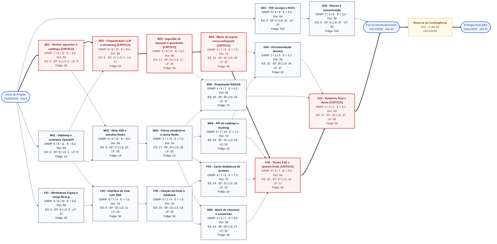

# Diagrama de Rede de Atividades (CPM / PERT) — SmartSales RAG

## 1. Visão Geral e Metodologia de Estimativa

O **Diagrama de Rede de Atividades** do projeto **SmartSales RAG** modela o encadeamento lógico de dependências (`Término-Início` — *Finish-to-Start*), as estimativas probabilísticas **PERT de 3 Pontos** e o cálculo determinístico do **Método do Caminho Crítico (CPM — *Critical Path Method*)**.

A janela total do projeto compreende **9 semanas (41 dias úteis)**, iniciando em **22/09/2026** e encerrando com a entrega final (**Marco M5**) em **24/11/2026**:
- **Calendário de referência**: Calendário Acadêmico UFAL 2026.2 (Resolução nº 126/2026-CONSUNI/UFAL, de 17/07/2026). Não são dias úteis do projeto: `12/10` (N. Sra. Aparecida), `15/10` (Dia do Professor — feriado total na UFAL), `28/10` (Dia do Servidor Público — ponto facultativo, tratado como não trabalhado), `02/11` (Finados) e `20/11` (Consciência Negra). `15/11` cai no domingo.
- **Ciclo de Execução e Caminho Crítico (`ES = 0` a `EF = 40`)**: **40 dias úteis** (de **22/09/2026** a **23/11/2026**).
- **Reserva de Contingência de Cronograma (`+1 dia útil`)**: **24/11/2026**, protegendo minimamente a data de entrega final (prazo improrrogável) contra variações de integração e homologação.

### 1.1. Fórmulas Aplicadas (PERT e CPM)

- **Duração Esperada PERT ($E$)**:
  $$E = \frac{O + 4M + P}{6}$$
  Onde $O$ = Estimativa Otimista, $M$ = Estimativa Mais Provável e $P$ = Estimativa Pessimista (em dias úteis). A duração operacional adotada na rede ($\text{Dur}$) corresponde ao arredondamento inteiro de $E$.
- **Desvio Padrão da Atividade ($\sigma$)**:
  $$\sigma = \frac{P - O}{6}$$
- **Cálculo de Ida (*Forward Pass*)**:
  - $ES$ (*Early Start* / Início Mais Cedo) = $\max(EF \text{ das predecessoras imediatas})$
  - $EF$ (*Early Finish* / Término Mais Cedo) = $ES + \text{Dur}$
- **Cálculo de Volta (*Backward Pass*)**:
  - $LF$ (*Late Finish* / Término Mais Tarde) = $\min(LS \text{ das sucessoras imediatas})$
  - $LS$ (*Late Start* / Início Mais Tarde) = $LF - \text{Dur}$
- **Folga Total (*Total Float* / *Slack*)**:
  $$\text{Folga} = LS - ES = LF - EF$$
  Atividades com $\text{Folga} = 0\text{d}$ compõem o **Caminho Crítico** do projeto.

---

## 2. Diagrama de Rede de Atividades (Mermaid)

---

## 3. Tabela Completa de Cálculo PERT / CPM (19 Pacotes de Rede)

*Nota: Os pacotes contínuos de Monitoramento e Controle (`6.1 Conduzir rituais ágeis`, `6.2 Controlar prazo, escopo e riscos` e `6.3 Registrar métricas de desempenho SPI`) acompanham transversalmente toda a execução de `G01`/`G03` até `G02`.*

| Cód. | Pacote de Trabalho / Atividade | Subpacotes EAP (`1.0` a `7.0`) | Predecessoras | $O$ (d) | $M$ (d) | $P$ (d) | $E$ (PERT) | $\sigma$ (Desvio) | Dur (d) | $ES$ | $EF$ | $LS$ | $LF$ | Folga (d) | Status CPM |
| :---: | :--- | :---: | :---: | :---: | :---: | :---: | :---: | :---: | :---: | :---: | :---: | :---: | :---: | :---: | :---: |
| **G01** | TAP, escopo e RACI | `1.1` a `1.4`, `2.1` a `2.3` | Início | 4 | 6 | 9 | 6,2 | 0,83 | **6** | 0 | 6 | 31 | 37 | 31d | Não Crítico |
| **G03** | Riscos e comunicação | `2.4`, `2.5`, `6.1` a `6.3` | `G01` | 2 | 3 | 5 | 3,2 | 0,50 | **3** | 6 | 9 | 37 | 40 | 31d | Não Crítico |
| **B01** | Docker, pgvector e catálogo | `3.1`, `3.2`, `3.5`, `4.1` | Início | 7 | 9 | 11 | 9,0 | 0,67 | **9** | 0 | 9 | 0 | 9 | **0d** | **CRÍTICO** |
| **M01** | Gateway e contratos OpenAPI | `3.1`, `3.2`, `3.3`, `4.5` | Início | 6 | 8 | 11 | 8,2 | 0,83 | **8** | 0 | 8 | 1 | 9 | 1d | Quase Crítico |
| **F01** | Wireframes Figma e setup Next.js | `3.1`, `3.4`, `3.5` | Início | 6 | 8 | 10 | 8,0 | 0,67 | **8** | 0 | 8 | 3 | 11 | 3d | Não Crítico |
| **B02** | Orquestração LLM e streaming | `4.3` | `B01`, `M01` | 6 | 8 | 10 | 8,0 | 0,67 | **8** | 9 | 17 | 9 | 17 | **0d** | **CRÍTICO** |
| **M02** | Rota SSE e sessões Redis | `4.5`, `4.6` | `B01`, `M01` | 6 | 8 | 10 | 8,0 | 0,67 | **8** | 9 | 17 | 10 | 18 | 1d | Quase Crítico |
| **F02** | Interface de chat com SSE | `4.9` | `M01`, `F01` | 5 | 7 | 9 | 7,0 | 0,67 | **7** | 8 | 15 | 11 | 18 | 3d | Não Crítico |
| **B03** | Ingestão de manuais e guardrails | `4.2`, `4.3` | `B02` | 6 | 8 | 11 | 8,2 | 0,83 | **8** | 17 | 25 | 17 | 25 | **0d** | **CRÍTICO** |
| **M03** | Filtros semânticos e cache Redis | `4.7` | `M02` | 5 | 7 | 9 | 7,0 | 0,67 | **7** | 17 | 24 | 18 | 25 | 1d | Quase Crítico |
| **F03** | Citação da fonte e feedback | `4.11` | `F02` | 5 | 7 | 9 | 7,0 | 0,67 | **7** | 15 | 22 | 18 | 25 | 3d | Não Crítico |
| **B04** | Motor de regras cross-sell/upsell | `4.4` | `B03` | 5 | 7 | 9 | 7,0 | 0,67 | **7** | 25 | 32 | 25 | 32 | **0d** | **CRÍTICO** |
| **M04** | API de catálogo e tracking | `4.7` | `M03` | 5 | 7 | 10 | 7,2 | 0,83 | **7** | 24 | 31 | 25 | 32 | 1d | Quase Crítico |
| **B05** | Preparação RAGAS | `5.1`, `5.3` | `B03`, `M03` | 4 | 5 | 7 | 5,2 | 0,50 | **5** | 25 | 30 | 32 | 37 | 7d | Não Crítico |
| **F04** | Cards dinâmicos de produto | `4.10` | `M03`, `F03` | 5 | 7 | 9 | 7,0 | 0,67 | **7** | 24 | 31 | 25 | 32 | 1d | Quase Crítico |
| **M05** | Mock de checkout e conversão | `4.8` | `M03`, `F03` | 3 | 5 | 7 | 5,0 | 0,67 | **5** | 24 | 29 | 27 | 32 | 3d | Não Crítico |
| **G04** | Documentação técnica | `7.1` | `B04`, `M04` | 2 | 3 | 5 | 3,2 | 0,50 | **3** | 32 | 35 | 34 | 37 | 2d | Não Crítico |
| **F05** | Testes E2E e ajustes finais | `5.2`, `5.3`, `5.4` | `B04`, `M04`, `F04`, `M05` | 4 | 5 | 7 | 5,2 | 0,50 | **5** | 32 | 37 | 32 | 37 | **0d** | **CRÍTICO** |
| **G02** | Relatório final e demo | `7.2`, `7.3`, `7.4` | `G04`, `B05`, `F05` | 2 | 3 | 5 | 3,2 | 0,50 | **3** | 37 | 40 | 37 | 40 | **0d** | **CRÍTICO** |

---

## 4. Análise do Caminho Crítico e Trilhas Quase Críticas

### 4.1. Caminho Crítico Determinístico (`Folga = 0d`)

$$\text{Início} \longrightarrow \mathbf{B01} \ (9\text{d}) \longrightarrow \mathbf{B02} \ (8\text{d}) \longrightarrow \mathbf{B03} \ (8\text{d}) \longrightarrow \mathbf{B04} \ (7\text{d}) \longrightarrow \mathbf{F05} \ (5\text{d}) \longrightarrow \mathbf{G02} \ (3\text{d}) \longrightarrow \text{Fim Dev} \ (40\text{d})$$

- **Soma das Durações no Caminho Crítico**: $9 + 8 + 8 + 7 + 5 + 3 = \mathbf{40\text{ dias úteis}}$ (`22/09/2026` a `23/11/2026`, descontados os 5 dias sem expediente da UFAL nesse intervalo).
- **Variância do Caminho Crítico ($\sigma^2_{CC}$)**:
  $$\sigma^2_{CC} = (0,67)^2 + (0,67)^2 + (0,83)^2 + (0,67)^2 + (0,50)^2 + (0,50)^2 \approx 2,53\text{ d}^2 \implies \sigma_{CC} \approx \mathbf{1,59\text{ dias úteis}}$$
- **Cobertura pela Reserva de Contingência (`+1 dia útil`)**: Com os feriados e o ponto facultativo do calendário UFAL 2026.2, a reserva cai de `4` para `1 dia útil` (`24/11/2026`), equivalente a $+0,63\,\sigma_{CC}$, o que confere uma probabilidade de aproximadamente **73%** de cumprimento da entrega final (**Marco M5**) até **24/11/2026** (antes da revisão: `4 dias` / $+2,51\,\sigma_{CC}$ / 99,4%).
- **Resposta Gerencial (Risco `R19`)**: Como o `M5` é improrrogável, o caminho crítico passa a ser monitorado semanalmente no relatório de status (`C05`), com alerta imediato (`C06`) a qualquer atraso; a contingência é o *crashing* interno sem custo (pareamento) em `B02`–`B04` e `F05`, nunca a mudança da data do `M5`.

### 4.2. Trilha Quase Crítica (*Near-Critical Path* — `Folga = 1d`)

A trilha de **Middle-end e Integração de Cards**:
$$\mathbf{M01} \ (8\text{d}) \longrightarrow \mathbf{M02} \ (8\text{d}) \longrightarrow \mathbf{M03} \ (7\text{d}) \longrightarrow \{\mathbf{M04} \ (7\text{d}), \ \mathbf{F04} \ (7\text{d})\} \longrightarrow \mathbf{F05}$$
possui **Folga Total de apenas 1 dia útil**. Qualquer atraso superior a 1 dia útil nas entregas de **Pablo** e **Well** (`M01` a `M04`) ou na construção dos *cards* dinâmicos por **Eduardo** e **Victor Hugo** (`F04`) desloca imediatamente a atividade crítica `F05` (`ES = 32`).

B05 (5 dias, ES25–EF30) prepara fixtures, calibração e runner; não é aceite final. A avaliação completa integrada pertence a F05 (ES32–EF37), já dependente de B04, e ao gate M4 no commit de integração. Falha bloqueia M4/M5 e consome a janela F05; não há folga fictícia de homologação. As durações e o caminho crítico de 40 dias permanecem iguais. Reservar execução/reteste RAGAS dentro das horas F05, não somar nova atividade sem replanejar.
