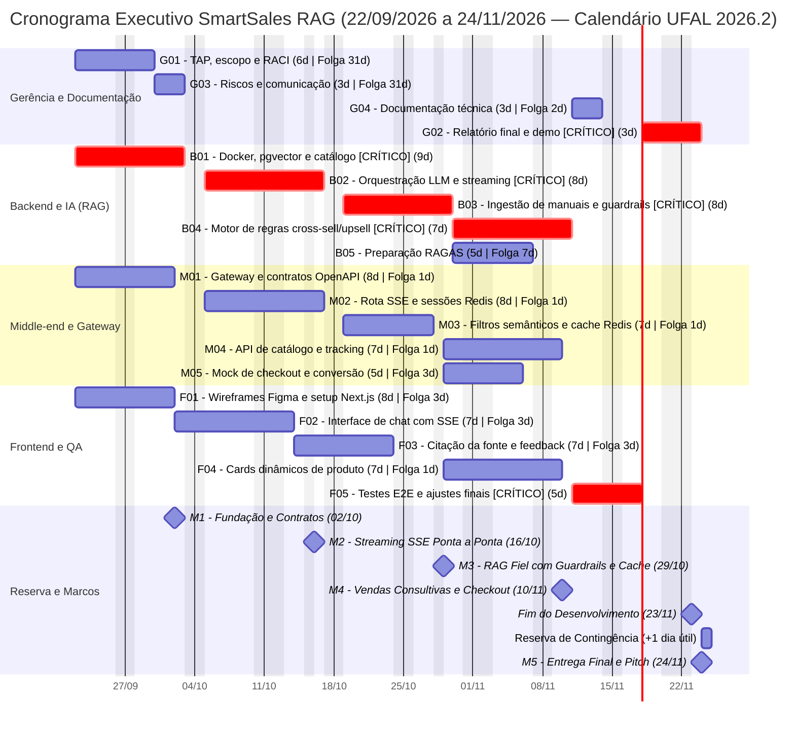

# Cronograma de Gantt, Sprints e Marcos — SmartSales RAG

## 1. Visão Geral do Cronograma

O cronograma executivo do projeto **SmartSales RAG** distribui os **19 pacotes de trabalho da rede CPM/PERT** ao longo de **9 semanas (41 dias úteis)**, compreendendo o período de **22/09/2026** a **24/11/2026**.

O planejamento combina:
- **Calendário Acadêmico UFAL 2026.2** (Resolução nº 126/2026-CONSUNI/UFAL, de 17/07/2026) como calendário de trabalho: além dos fins de semana, não são dias úteis do projeto `12/10` (N. Sra. Aparecida), `15/10` (Dia do Professor — feriado total na UFAL), `28/10` (Dia do Servidor Público — ponto facultativo, tratado como não trabalhado), `02/11` (Finados) e `20/11` (Consciência Negra). A SINPETE (`26/10` a `30/10`) não suspende o trabalho do projeto.
- **4 Sprints de Desenvolvimento e Homologação (Semanas 1 a 9)**, totalizando **40 dias úteis** de execução técnica e encerrando o desenvolvimento em **23/11/2026**.
- **Reserva de Contingência**: **1 dia útil** (**24/11/2026**) de pulmão de cronograma, culminando no **Marco M5 (Entrega Final e Pitch)** em **24/11/2026** (prazo improrrogável). A probabilidade de cumprimento cai para **≈ 73%** (ver [Rede CPM](07_diagrama_rede_atividades_cpm.md) e risco `R19`).
- **Alocação Balanceada por Trilha**: Os 8 integrantes da equipe atuam em quatro trilhas paralelas (**Gerência e QA**, **Backend e IA**, **Middle-end / Gateway** e **Frontend e UI/UX**) sem sobrealocação, respeitando o teto de 20 horas semanais por membro (160h semanais do time).

---

## 2. Diagrama de Gantt Completo (Mermaid)

---

## 3. Tabela Detalhada do Cronograma por Pacote de Trabalho

| Cód. | Atividade / Pacote | Subpacotes EAP (`1.0` a `7.0`) | Trilha | Responsáveis Diretos | Predecessoras | Dur (d) | $ES$–$EF$ (Dias Úteis) | Data de Início | Data de Término | Folga | Crítico? |
| :---: | :--- | :---: | :--- | :--- | :---: | :---: | :---: | :---: | :---: | :---: | :---: |
| **G01** | TAP, escopo e RACI | `1.1` a `1.4`, `2.1` a `2.3` | Gerência | Antônio Rodrigo, Walber | Início | 6d | `0` – `6` | 22/09/2026 | 29/09/2026 | 31d | Não |
| **G03** | Riscos e comunicação | `2.4`, `2.5`, `6.1` a `6.3` | Gerência | Antônio Rodrigo, Walber | `G01` | 3d | `6` – `9` | 30/09/2026 | 02/10/2026 | 31d | Não |
| **B01** | Docker, pgvector e catálogo | `3.1`, `3.2`, `3.5`, `4.1` | Backend e IA | Filipe, Diogo | Início | 9d | `0` – `9` | 22/09/2026 | 02/10/2026 | **0d** | **SIM** |
| **M01** | Gateway e contratos OpenAPI | `3.1`, `3.2`, `3.3`, `4.5` | Middle-end | Pablo, Well | Início | 8d | `0` – `8` | 22/09/2026 | 01/10/2026 | 1d | Não |
| **F01** | Wireframes Figma e setup Next.js | `3.1`, `3.4`, `3.5` | Frontend/UX | Eduardo, Victor Hugo | Início | 8d | `0` – `8` | 22/09/2026 | 01/10/2026 | 3d | Não |
| **B02** | Orquestração LLM e streaming | `4.3` | Backend e IA | Filipe, Diogo | `B01`, `M01` | 8d | `9` – `17` | 05/10/2026 | 16/10/2026 | **0d** | **SIM** |
| **M02** | Rota SSE e sessões Redis | `4.5`, `4.6` | Middle-end | Pablo, Well | `B01`, `M01` | 8d | `9` – `17` | 05/10/2026 | 16/10/2026 | 1d | Não |
| **F02** | Interface de chat com SSE | `4.9` | Frontend/UX | Eduardo, Victor Hugo | `M01`, `F01` | 7d | `8` – `15` | 02/10/2026 | 13/10/2026 | 3d | Não |
| **B03** | Ingestão de manuais e guardrails | `4.2`, `4.3` | Backend e IA | Diogo, Filipe | `B02` | 8d | `17` – `25` | 19/10/2026 | 29/10/2026 | **0d** | **SIM** |
| **M03** | Filtros semânticos e cache Redis | `4.7` | Middle-end | Pablo, Well | `M02` | 7d | `17` – `24` | 19/10/2026 | 27/10/2026 | 1d | Não |
| **F03** | Citação da fonte e feedback | `4.11` | Frontend/UX | Eduardo, Victor Hugo | `F02` | 7d | `15` – `22` | 14/10/2026 | 23/10/2026 | 3d | Não |
| **B04** | Motor de regras cross-sell/upsell | `4.4` | Backend e IA | Diogo, Filipe | `B03` | 7d | `25` – `32` | 30/10/2026 | 10/11/2026 | **0d** | **SIM** |
| **M04** | API de catálogo e tracking | `4.7` | Middle-end | Pablo, Well | `M03` | 7d | `24` – `31` | 29/10/2026 | 09/11/2026 | 1d | Não |
| **B05** | Preparação RAGAS | `5.1`, `5.3` | Backend / QA | Filipe, Diogo, Victor Hugo | `B03`, `M03` | 5d | `25` – `30` | 30/10/2026 | 06/11/2026 | 7d | Não |
| **F04** | Cards dinâmicos de produto | `4.10` | Frontend/UX | Victor Hugo, Eduardo | `M03`, `F03` | 7d | `24` – `31` | 29/10/2026 | 09/11/2026 | 1d | Não |
| **M05** | Mock de checkout e conversão | `4.8` | Middle-end | Pablo, Well | `M03`, `F03` | 5d | `24` – `29` | 29/10/2026 | 05/11/2026 | 3d | Não |
| **G04** | Documentação técnica | `7.1` | Gerência/Tech | Filipe, Diogo, Pablo, Eduardo | `B04`, `M04` | 3d | `32` – `35` | 11/11/2026 | 13/11/2026 | 2d | Não |
| **F05** | Testes E2E e ajustes finais | `5.2`, `5.3`, `5.4` | QA / Full Team | Victor Hugo, Well, Filipe, Eduardo | `B04`, `M04`, `F04`, `M05` | 5d | `32` – `37` | 11/11/2026 | 17/11/2026 | **0d** | **SIM** |
| **G02** | Relatório final e demo | `7.2`, `7.3`, `7.4` | Gerência/PO | Antônio Rodrigo, Walber, Todos | `G04`, `B05`, `F05` | 3d | `37` – `40` | 18/11/2026 | 23/11/2026 | **0d** | **SIM** |
| **RES** | Reserva de Contingência | `6.2`, `7.0` | Todos | Antônio Rodrigo, Walber | `G02` | 1d | `40` – `41` | 24/11/2026 | 24/11/2026 | 0d | Pulmão |

---

## 4. Calendário Semanal e Marcos de Controle (*Milestones*)

### 4.1. Distribuição nas 9 Semanas (`S1` a `S9`)

| Semana | Período Calendário | Dias Úteis Acumulados | Sprint / Ciclo | Pacotes em Execução | Dias sem Expediente (UFAL) | Carga Horária da Equipe |
| :---: | :---: | :---: | :---: | :--- | :---: | :---: |
| **S1** | `22/09/2026` a `25/09/2026` | Dias `1` a `4` | Sprint 1 (Parte 1) | `G01`, `B01`, `M01`, `F01` | — | 160h (8 membros × 20h) |
| **S2** | `28/09/2026` a `02/10/2026` | Dias `5` a `9` | Sprint 1 (Fechamento — **M1**) | Conclusão de `G01`, `G03`, `B01`, `M01`, `F01`; início de `F02` | — | 160h (8 membros × 20h) |
| **S3** | `05/10/2026` a `09/10/2026` | Dias `10` a `14` | Sprint 2 (Parte 1) | `B02`, `M02`, `F02` | — | 160h (8 membros × 20h) |
| **S4** | `12/10/2026` a `16/10/2026` | Dias `15` a `17` | Sprint 2 (Fechamento — **M2**) | Conclusão de `F02` (`13/10`), `B02`, `M02` (`16/10`); início de `F03` | `12/10`, `15/10` | 160h (8 membros × 20h) |
| **S5** | `19/10/2026` a `23/10/2026` | Dias `18` a `22` | Sprint 3 (Parte 1) | `B03`, `M03`, `F03` (conclusão de `F03` em `23/10`) | — | 160h (8 membros × 20h) |
| **S6** | `26/10/2026` a `30/10/2026` | Dias `23` a `26` | Sprint 3 (Fechamento — **M3**) | Conclusão de `M03` (`27/10`) e `B03` (`29/10`); início de `M04`, `F04`, `M05` (`29/10`), `B04`, `B05` (`30/10`) | `28/10` (ponto facultativo) | 160h (8 membros × 20h) |
| **S7** | `02/11/2026` a `06/11/2026` | Dias `27` a `30` | Sprint 4 (Parte 1) | Conclusão de `M05` (`05/11`) e `B05` (`06/11`); `B04`, `M04`, `F04` em curso | `02/11` | 160h (8 membros × 20h) |
| **S8** | `09/11/2026` a `13/11/2026` | Dias `31` a `35` | Sprint 4 (Fechamento — **M4**) | Conclusão de `M04`, `F04` (`09/11`) e `B04` (`10/11`); `G04` (`11/11` a `13/11`); início de `F05` (`11/11`) | — | 160h (8 membros × 20h) |
| **S9** | `16/11/2026` a `24/11/2026` | Dias `36` a `41` | Homologação + Reserva | Conclusão de `F05` (`17/11`); `G02` (`18/11` a `23/11`); Reserva de Contingência e **M5** (`24/11`) | `20/11` | 160h (8 membros × 20h) |

### 4.2. Quadro de Marcos (*Milestones*)

| Marco | Nome do Marco | Data Prevista | Dia Útil | Pacotes Condicionantes | Critério Objetivo de Aceite (*Gate*) |
| :---: | :--- | :---: | :---: | :---: | :--- |
| **M1** | **Fundação, Arquitetura e Contratos Prontos** | `02/10/2026` | Dia `9` | `G01`, `G03`, `B01`, `M01`, `F01` | Containers Docker (`PostgreSQL + pgvector` e `Redis`) operacionais, contratos OpenAPI 3.1 publicados, wireframes validados e TAP/RACI assinados. |
| **M2** | **Streaming SSE Ponta a Ponta Operacional** | `16/10/2026` | Dia `17` | `B02`, `M02`, `F02` | Interface Next.js recebendo tokens em tempo real do LLM via Gateway SSE com persistência de contexto de sessão no Redis. |
| **M3** | **RAG Fiel com Guardrails, Citação e Cache** | `29/10/2026` | Dia `25` | `B03`, `M03`, `F03` | Ingestão de manuais PDF concluída, *guardrails* anti-alucinação ativos, citações de fonte e botões *like/dislike* renderizados na UI e cache semântico ativo. |
| **M4** | **Vendas Consultivas, Cards e Checkout Integrados** | `10/11/2026` | Dia `32` | `B04`, `B05`, `M04`, `M05`, `F04` | Motor de regras (*cross-sell* e *upsell*) integrado ao catálogo local, *cards* dinâmicos com botão `Comprar` revalidando estoque/preço no *checkout mock* e redirecionando ao marketplace/afiliado, página `/admin/metricas` e relatório RAGAS emitido. |
| **M5** | **Entrega Final Homologada e Pitch** | `24/11/2026` | Dia `41` | `G04`, `F05`, `G02` + Reserva | 100% dos testes E2E aprovados (`0` defeitos críticos), documentação técnica consolidada (`README` + `Swagger`), relatório de encerramento e *pitch* final realizados. |

B05 termina a preparação em 06/11. M4 em 10/11 exige avaliação completa do commit que integra B04, sem trabalho adicional após a data para declarar o marco aceito. O runner preparado executa esse gate automatizado no fechamento de B04. F05 (11–17/11), dependente de B04, inclui repetição completa e correções do RAG; qualquer mudança semântica exige novo resultado antes de M5. Gate reprovado marca M4 atrasado e aciona C06; não antecipar aceite com resultados de B05.
