# Quadro de Custos e Estrutura Analítica de Custos (EAC) — SmartSales RAG

## 1. Visão Geral Orçamentária e Duplo Cenário

O gerenciamento de custos do projeto **SmartSales RAG** adota um modelo de **duplo cenário financeiro**, permitindo simultaneamente a prática completa de **Gerenciamento do Valor Agregado (EVM — *Earned Value Management*)** para fins de governança de projetos (`EAP 6.3`) e a conformidade estrita com a realidade acadêmica da **UFAL (Universidade Federal de Alagoas)**:

1. **Cenário Simulado de Mercado (*Baseline* de Desempenho — `BAC = R$ 115.670,50`)**: Valora a força de trabalho especializada da equipe (1.440 horas ao longo de 9 semanas), as aquisições de nuvem/APIs de IA/domínio, a infraestrutura complementar/ferramental e a reserva financeira de contingência (10%).
2. **Cenário Real Acadêmico UFAL (`Custo Real de Desembolso = R$ 0,00`)**: Reflete o custo efetivo de desembolso direto, utilizando mão de obra discente acadêmica, planos gratuitos (*free tiers*) ou créditos educacionais de provedores de nuvem/IA e equipamentos próprios dos integrantes.

---

## 2. Diagrama da Estrutura Analítica de Custos — EAC (Mermaid)

```mermaid
flowchart TD
    classDef root fill:#0f172a,stroke:#334155,stroke-width:2px,color:#ffffff
    classDef cat fill:#1e3a8a,stroke:#1d4ed8,stroke-width:2px,color:#ffffff
    classDef item fill:#f8fafc,stroke:#64748b,stroke-width:1.5px,color:#0f172a
    classDef res fill:#fefce8,stroke:#ca8a04,stroke-width:2px,color:#713f12

    ROOT["<b>ORÇAMENTO TOTAL DO PROJETO (BAC)</b><br/>Simulado de Mercado: <b>R$ 115.670,50</b><br/>Real Acadêmico (UFAL): <b>R$ 0,00</b><br/>Horizonte: 9 Semanas (22/09/2026 a 24/11/2026)"]:::root

    C1["<b>1. RECURSOS HUMANOS (Mão de Obra)</b><br/>Subtotal: <b>R$ 99.000,00</b> (85,59% do BAC)<br/>1.440h · 8 Alunos (UFAL: R$ 0,00)"]:::cat
    C2["<b>2. MATERIAIS, SERVIÇOS E AQUISIÇÕES CLOUD</b><br/>Subtotal: <b>R$ 3.500,00</b> (3,03% do BAC)<br/>APIs de LLM, PaaS, DBaaS, Domínio e Reserva (UFAL: R$ 0,00)"]:::cat
    C3["<b>3. MAQUINÁRIO, INFRAESTRUTURA E FERRAMENTAL</b><br/>Subtotal: <b>R$ 2.655,00</b> (2,30% do BAC)<br/>Ambientes de Execução e Ferramental (UFAL: R$ 0,00)"]:::cat
    C4["<b>4. RESERVA DE CONTINGÊNCIA FINANCEIRA (10%)</b><br/>Subtotal: <b>R$ 10.515,50</b> (9,09% do BAC)<br/>10% sobre o Custo Base (UFAL: Margem em Horas)"]:::res

    ROOT --> C1
    ROOT --> C2
    ROOT --> C3
    ROOT --> C4

    %% Ramo 1 - RH
    RH1["<b>1.1 DEV Backend & IA (RAG)</b><br/>Filipe e Diogo (360h a R$ 75,00/h)<br/>Orçado: <b>R$ 27.000,00</b> | Real UFAL: R$ 0,00"]:::item
    RH2["<b>1.2 DEV Middle-end & Gateway</b><br/>Pablo e Well (360h a R$ 70,00/h)<br/>Orçado: <b>R$ 25.200,00</b> | Real UFAL: R$ 0,00"]:::item
    RH3["<b>1.3 DEV Frontend & UI/UX</b><br/>Eduardo e Victor Hugo (360h a R$ 65,00/h)<br/>Orçado: <b>R$ 23.400,00</b> | Real UFAL: R$ 0,00"]:::item
    RH4["<b>1.4 Gerência de Projetos (GP / PO)</b><br/>Antônio Rodrigo e Walber (360h a R$ 65,00/h)<br/>Orçado: <b>R$ 23.400,00</b> | Real UFAL: R$ 0,00"]:::item

    C1 --> RH1 & RH2 & RH3 & RH4

    %% Ramo 2 - Materiais, Serviços e Aquisições Cloud (Conciliado com Quadro de Aquisições)
    MS1["<b>2.1 Serviços Previstos no Quadro de Aquisições (01 a 06)</b><br/>OpenAI (R$ 1.200) · Railway (R$ 500) · Supabase (R$ 450)<br/>Upstash (R$ 200) · Registro.br (R$ 150) · Vercel (R$ 100)<br/>Orçado: <b>R$ 2.600,00</b> | Real UFAL: R$ 0,00"]:::item
    MS2["<b>2.2 Reserva de Contingência de Aquisições / Licenças</b><br/>Picos de consumo de tokens, reindexação e apoio<br/>Orçado: <b>R$ 900,00</b> | Real UFAL: R$ 0,00"]:::item

    C2 --> MS1 & MS2

    %% Ramo 3 - Maquinário e Infraestrutura Complementar
    MQ1["<b>3.1 Servidores & Containers (Compute 2,25 meses)</b><br/>Orçado: <b>R$ 1.125,00</b> | Real UFAL: R$ 0,00"]:::item
    MQ2["<b>3.2 Instâncias Dedicadas de Banco Vetorial (2,25 meses)</b><br/>Orçado: <b>R$ 1.012,50</b> | Real UFAL: R$ 0,00"]:::item
    MQ3["<b>3.3 Instâncias de Memória & Cache (2,25 meses)</b><br/>Orçado: <b>R$ 270,00</b> | Real UFAL: R$ 0,00"]:::item
    MQ4["<b>3.4 CDN, Edge & Estações de Trabalho (2,25 meses)</b><br/>Orçado: <b>R$ 247,50</b> | Real UFAL: R$ 0,00"]:::item

    C3 --> MQ1 & MQ2 & MQ3 & MQ4
```

---

## 3. Detalhamento Analítico das Categorias de Custo

### 3.1. Categoria 1: Recursos Humanos (`R$ 99.000,00`)

Cada um dos **8 integrantes** dedica **20 horas semanais** (incluindo trabalho assíncrono, independentemente dos 5 dias sem expediente do calendário UFAL 2026.2) durante as **9 semanas (2,25 meses)** do projeto, perfazendo **180 horas individuais** e **1.440 horas totais** de engenharia e gestão.

| Cód. EAC | Trilha / Papel Funcional | Integrantes Alocados | Qtd. | Carga Semanal | Horas por Semana (Dupla) | Total de Horas (9 Sem.) | Valor Hora (R$/h) | Custo Semanal (R$) | Custo Total Simulado (R$) | Custo Real UFAL (R$) |
| :---: | :--- | :--- | :---: | :---: | :---: | :---: | :---: | :---: | :---: | :---: |
| **1.1** | **DEV Backend & IA (RAG)** | Filipe, Diogo | 2 | 20h / membro | 40h | 360h | R$ 75,00 | R$ 3.000,00 | **R$ 27.000,00** | R$ 0,00 |
| **1.2** | **DEV Middle-end & Gateway** | Pablo, Well | 2 | 20h / membro | 40h | 360h | R$ 70,00 | R$ 2.800,00 | **R$ 25.200,00** | R$ 0,00 |
| **1.3** | **DEV Frontend & UI/UX** | Eduardo, Victor Hugo | 2 | 20h / membro | 40h | 360h | R$ 65,00 | R$ 2.600,00 | **R$ 23.400,00** | R$ 0,00 |
| **1.4** | **Gerência de Projetos (GP / PO)** | Antônio Rodrigo, Walber | 2 | 20h / membro | 40h | 360h | R$ 65,00 | R$ 2.600,00 | **R$ 23.400,00** | R$ 0,00 |
| **Total** | **Equipe Completa SmartSales RAG** | **8 Integrantes** | **8** | **20h / membro** | **160h / sem** | **1.440h** | **R$ 68,75** *(médio)* | **R$ 11.000,00** | **R$ 99.000,00** | **R$ 0,00** |

### 3.2. Categoria 2: Materiais, Serviços e Aquisições Cloud (`R$ 3.500,00`)

Esta categoria concilia de forma exata o orçamento do **Plano de Gerenciamento das Aquisições** (`R$ 3.500,00`), composto pelos **6 contratos previstos (`R$ 2.600,00`)** e pela **reserva específica de aquisições/ferramental (`R$ 900,00`)** (equivalente na visão agregada de Materiais & Serviços a `R$ 2.000,00` de APIs de IA/Embeddings e `R$ 1.500,00` de Serviços Cloud/Ferramental de Apoio):

| Cód. EAC | Item de Aquisição / Serviço Contratado | Fornecedor | Modalidade | Custo Simulado (R$) | Custo Real UFAL (R$) | Vínculo EAP / EAR |
| :---: | :--- | :--- | :--- | :---: | :---: | :---: |
| **2.1.1** | **01 · API de LLM e Embeddings** | OpenAI | Cobrança por consumo de tokens (*pay-as-you-go*) | **R$ 1.200,00** | R$ 0,00 *(créditos/free)* | `EAP 4.2`, `4.3`, `5.1` · `EAR 2.1`, `5.1` |
| **2.1.2** | **02 · Hospedagem do Frontend** | Vercel | Assinatura mensal da aplicação web | **R$ 100,00** | R$ 0,00 *(Hobby tier)* | `EAP 3.5`, `4.9`, `4.10` · `EAR 3.1`, `5.2` |
| **2.1.3** | **03 · Hospedagem do Backend** | Railway | Execução da API, processamento e memória | **R$ 500,00** | R$ 0,00 *(Trial/Docker local)* | `EAP 3.5`, `4.5`, `4.6` · `EAR 3.1`, `5.2` |
| **2.1.4** | **04 · Banco PostgreSQL + pgvector** | Supabase | Armazenamento do catálogo e consultas vetoriais | **R$ 450,00** | R$ 0,00 *(Free tier)* | `EAP 4.1`, `4.2` · `EAR 2.3`, `5.2` |
| **2.1.5** | **05 · Serviço Redis** | Upstash | Armazenamento temporário de cache e sessões | **R$ 200,00** | R$ 0,00 *(Free tier)* | `EAP 4.5`, `4.7` · `EAR 2.4`, `5.2` |
| **2.1.6** | **06 · Domínio do Sistema** | Registro.br | Registro e utilização do domínio para demonstração | **R$ 150,00** | R$ 0,00 *(subdomínio gratuito)* | `EAP 3.5`, `7.2` · `EAR 3.1`, `5.2` |
| **Subtotal 2.1** | **Serviços Previstos no Quadro de Aquisições (`01` a `06`)** | — | — | **R$ 2.600,00** | **R$ 0,00** | — |
| **2.2.1** | **Reserva de Contingência de Aquisições & Ferramental** | OpenAI / GitHub / Figma / Postman / Sentry | Margem para picos de consumo de tokens e licenças de apoio | **R$ 900,00** | **R$ 0,00** | `EAP 5.1`, `6.2` · `EAR 5.3`, `5.4` |
| **Total Cat. 2** | **Subtotal Materiais, Serviços e Aquisições Cloud** | — | — | **R$ 3.500,00** | **R$ 0,00** | — |

### 3.3. Categoria 3: Maquinário, Infraestrutura e Ferramental (`R$ 2.655,00`)

Reflete o custo de referência de infraestrutura dedicada, ambientes de homologação/produção e estações de trabalho durante os **2,25 meses (9 semanas)** do projeto:

| Cód. EAC | Item de Infraestrutura / Maquinário | Base de Cálculo (2,25 meses / 9 semanas) | Custo Simulado (R$) | Custo Real UFAL (R$) | Vínculo EAP / EAR |
| :---: | :--- | :--- | :---: | :---: | :---: |
| **3.1** | **Servidores & Containers (AWS ECS / Cloud Run)** | Capacidade computacional dedicada de containers (2,25 meses × R$ 500,00) | **R$ 1.125,00** | R$ 0,00 *(Cloud Free / Local)* | `EAP 3.5` · `EAR 3.1`, `3.2` |
| **3.2** | **Infraestrutura Dedicada de Banco Vetorial (AWS RDS / Supabase Pro)** | Instância dedicada com índice HNSW e *backups* (2,25 meses × R$ 450,00) | **R$ 1.012,50** | R$ 0,00 *(Cloud Free)* | `EAP 4.1`, `4.2` · `EAR 2.3`, `3.4` |
| **3.3** | **Infraestrutura de Cache em Memória (Upstash Redis Serverless)** | Cluster de baixa latência para sessões e telemetria (2,25 meses × R$ 120,00) | **R$ 270,00** | R$ 0,00 *(Cloud Free)* | `EAP 4.7` · `EAR 2.4`, `3.5` |
| **3.4** | **Infraestrutura Edge / Frontend & Estações de Trabalho** | Ambiente de distribuição web e depreciação de hardware (2,25 meses × R$ 110,00) | **R$ 247,50** | R$ 0,00 *(Equipamento próprio)* | `EAP 4.9` · `EAR 3.4`, `3.6` |
| **Total Cat. 3** | **Subtotal Maquinário, Infraestrutura e Ferramental** | — | **R$ 2.655,00** | **R$ 0,00** | — |

### 3.4. Consolidação Geral do Orçamento (*Budget at Completion* — BAC)

| Categoria da EAC | Valor Simulado (R$) | Participação (%) | Valor Real UFAL (R$) |
| :--- | :---: | :---: | :---: |
| **1. Recursos Humanos (1.440h — 8 Integrantes)** | R$ 99.000,00 | 85,59% | R$ 0,00 |
| **2. Materiais, Serviços e Aquisições Cloud (`R$ 2.600` serviços + `R$ 900` reserva)** | R$ 3.500,00 | 3,03% | R$ 0,00 |
| **3. Maquinário, Infraestrutura e Ferramental (2,25 meses)** | R$ 2.655,00 | 2,30% | R$ 0,00 |
| **Custo Base Direto (1 + 2 + 3)** | **R$ 105.155,00** | **90,91%** | **R$ 0,00** |
| **4. Reserva de Contingência Geral (10% sobre o Custo Base)** | R$ 10.515,50 | 9,09% | R$ 0,00 *(Margem em Horas)* |
| **ORÇAMENTO TOTAL NO TÉRMINO (BAC)** | **R$ 115.670,50** | **100,00%** | **R$ 0,00** |

---

## 4. Curva S de Desembolso Semanal e Gerenciamento do Valor Agregado (EVM)

### 4.1. Fluxo de Caixa Semanal Planejado (*Planned Value* — $PV$)

O desembolso semanal do **Custo Base (`R$ 105.155,00`)** equivale a **R$ 11.683,89/semana** (`R$ 11.000,00` de Recursos Humanos + `R$ 388,89` de Aquisições Cloud/IA + `R$ 295,00` de Maquinário/Infra), acrescido da provisão proporcional da **Reserva de Contingência (`R$ 1.168,39/semana`)**, perfazendo **R$ 12.852,28/semana** até atingir o **BAC (`R$ 115.670,50`)** na Semana 9:

| Semana | Período | RH Semanal (R$) | Cloud & Aquisições (R$) | Maquinário & Infra (R$) | Custo Base Semanal (R$) | Contingência 10% (R$) | $PV$ Semanal Total (R$) | $PV$ Acumulado — Curva S (R$) | % Acumulado do BAC |
| :---: | :---: | :---: | :---: | :---: | :---: | :---: | :---: | :---: | :---: |
| **S1** | `22/09` a `25/09/2026` | R$ 11.000,00 | R$ 388,89 | R$ 295,00 | R$ 11.683,89 | R$ 1.168,39 | R$ 12.852,28 | **R$ 12.852,28** | 11,11% |
| **S2** | `28/09` a `02/10/2026` | R$ 11.000,00 | R$ 388,89 | R$ 295,00 | R$ 11.683,89 | R$ 1.168,39 | R$ 12.852,28 | **R$ 25.704,56** | 22,22% |
| **S3** | `05/10` a `09/10/2026` | R$ 11.000,00 | R$ 388,89 | R$ 295,00 | R$ 11.683,89 | R$ 1.168,39 | R$ 12.852,28 | **R$ 38.556,83** | 33,33% |
| **S4** | `12/10` a `16/10/2026` | R$ 11.000,00 | R$ 388,89 | R$ 295,00 | R$ 11.683,89 | R$ 1.168,39 | R$ 12.852,28 | **R$ 51.409,11** | 44,44% |
| **S5** | `19/10` a `23/10/2026` | R$ 11.000,00 | R$ 388,89 | R$ 295,00 | R$ 11.683,89 | R$ 1.168,39 | R$ 12.852,28 | **R$ 64.261,39** | 55,56% |
| **S6** | `26/10` a `30/10/2026` | R$ 11.000,00 | R$ 388,89 | R$ 295,00 | R$ 11.683,89 | R$ 1.168,39 | R$ 12.852,28 | **R$ 77.113,67** | 66,67% |
| **S7** | `02/11` a `06/11/2026` | R$ 11.000,00 | R$ 388,89 | R$ 295,00 | R$ 11.683,89 | R$ 1.168,39 | R$ 12.852,28 | **R$ 89.965,94** | 77,78% |
| **S8** | `09/11` a `13/11/2026` | R$ 11.000,00 | R$ 388,89 | R$ 295,00 | R$ 11.683,89 | R$ 1.168,39 | R$ 12.852,28 | **R$ 102.818,22** | 88,89% |
| **S9** | `16/11` a `24/11/2026` | R$ 11.000,00 | R$ 388,88 | R$ 295,00 | R$ 11.683,88 | R$ 1.168,40 | R$ 12.852,28 | **R$ 115.670,50** | **100,00%** |
| **Total** | **9 Semanas (41 dias úteis)** | **R$ 99.000,00** | **R$ 3.500,00** | **R$ 2.655,00** | **R$ 105.155,00** | **R$ 10.515,50** | **R$ 115.670,50** | — | **100,00%** |

### 4.2. Métricas e Limiares de Controle EVM (`EAP 6.3`)

| Indicador EVM | Sigla | Fórmula | Meta de Governança | Regra de Ação Corretiva |
| :--- | :---: | :--- | :---: | :--- |
| **Valor Planejado (*Planned Value*)** | $PV$ | Orçamento autorizado para o trabalho agendado até a data | Linha de base da Curva S | Referência para cálculo de $SV$ e $SPI$. |
| **Valor Agregado (*Earned Value*)** | $EV$ | $\sum (\% \text{ físico concluído e aceito}) \times \text{Orçamento do pacote}$ | $EV \ge 0,90 \times PV$ | Medido ao final de cada *Sprint Review* apenas para itens que cumpram a *Definition of Done* (DoD). |
| **Custo Real (*Actual Cost*)** | $AC$ | Horas efetivamente apontadas $\times$ taxa horária + faturas cloud | $AC \le EV$ | Apurado semanalmente na planilha financeira por Antônio Rodrigo e Walber. |
| **Índice de Desempenho de Prazo** | $SPI$ | $SPI = \frac{EV}{PV}$ | **$\ge 0,90$** | Caso $SPI < 0,90$, acionar pareamento técnico (*crashing* interno sem custo extra) nas atividades críticas `B01`–`B04` e `F05` — com apenas 1 dia útil de reserva no calendário UFAL, o $SPI$ do caminho crítico é apurado semanalmente (`C05`). |
| **Índice de Desempenho de Custos** | $CPI$ | $CPI = \frac{EV}{AC}$ | **$\ge 0,95$** | Caso $CPI < 0,95$ (ex.: explosão de consumo de tokens na OpenAI), ativar cache agressivo no Redis e reduzir tamanho de contexto enviado ao LLM. |
| **Estimativa no Término** | $EAC$ | $EAC = \frac{BAC}{CPI}$ | **$\le \text{R\$ } 115.670,50$** | Caso $EAC > BAC$, submeter solicitação de uso parcial da Reserva de Contingência (`R$ 10.515,50`) ao Patrocinador. |
