# Árvore de Métricas de Qualidade (ISO/IEC 25010) — SmartSales RAG

## 1. Visão Geral do Modelo de Qualidade

A **Árvore de Métricas de Qualidade** do projeto **SmartSales RAG** estrutura o que é medido no projeto seguindo o encadeamento **Dimensão → Atributo de Qualidade → Métrica → Meta → Como Medir → Pacote da EAP**, com base nos atributos da norma **ABNT NBR ISO/IEC 25010**, nos indicadores do pipeline **RAG (*Retrieval-Augmented Generation*)** (`EAP 1.4`, `5.1`, `5.3`, `6.3`) e nas métricas de conversão comercial do assistente.

A árvore decompõe a qualidade global do **SmartSales RAG (Assistente de Vendas com RAG)** em **duas dimensões**, **sete atributos de qualidade** e **dezesseis métricas verificáveis**:
1. **Qualidade do Produto**:
   - **Adequação Funcional** (*Respostas técnicas corretas*)
   - **Relevância da Recomendação** (*Produtos certos para o cliente*)
   - **Eficiência de Desempenho** (*Resposta rápida no chat*)
   - **Confiabilidade** (*Serviço estável*)
   - **Satisfação e Conversão** (*Valor para cliente e lojista*)
2. **Qualidade do Processo**:
   - **Manutenibilidade e Testes** (*Código confiável de evoluir*)
   - **Desempenho do Projeto** (*Entregas no prazo e aceitas*)

---

## 2. Diagrama da Árvore de Métricas de Qualidade (Mermaid)

```mermaid
flowchart LR
    classDef root fill:#0f172a,stroke:#334155,stroke-width:2px,color:#ffffff
    classDef dimProd fill:#1e3a8a,stroke:#1d4ed8,stroke-width:2px,color:#ffffff
    classDef dimProc fill:#15803d,stroke:#16a34a,stroke-width:2px,color:#ffffff
    classDef attrProd fill:#eff6ff,stroke:#2563eb,stroke-width:1.5px,color:#1e3a8a
    classDef attrProc fill:#f0fdf4,stroke:#16a34a,stroke-width:1.5px,color:#14532d
    classDef metrica fill:#f8fafc,stroke:#64748b,stroke-width:1.5px,color:#0f172a

    ROOT["<b>Qualidade do SmartSales RAG</b><br/>Assistente de vendas com RAG"]:::root

    D1["<b>Qualidade do Produto</b>"]:::dimProd
    D2["<b>Qualidade do Processo</b>"]:::dimProc

    ROOT --> D1
    ROOT --> D2

    %% Atributos de Qualidade do Produto
    A1["<b>Adequação funcional</b><br/>Respostas técnicas corretas"]:::attrProd
    A2["<b>Relevância da recomendação</b><br/>Produtos certos para o cliente"]:::attrProd
    A3["<b>Eficiência de desempenho</b><br/>Resposta rápida no chat"]:::attrProd
    A4["<b>Confiabilidade</b><br/>Serviço estável"]:::attrProd
    A5["<b>Satisfação e conversão</b><br/>Valor para cliente e lojista"]:::attrProd

    D1 --> A1 & A2 & A3 & A4 & A5

    %% Métricas de Adequação Funcional
    M1["<b>Fidelidade do RAG (faithfulness)</b>: ≥ 0,85<br/><i>Golden set avaliado por LLM-juiz + revisão amostral</i> · <b>EAP 5.1</b>"]:::metrica
    M2["<b>Precisão das respostas técnicas</b>: ≥ 90%<br/><i>Gabarito do golden set (voltagem, capacidade, specs)</i> · <b>EAP 5.1</b>"]:::metrica
    M3["<b>Taxa de alucinação</b>: ≤ 5%<br/><i>Respostas com dado crítico sem suporte nos chunks/SQL</i> · <b>EAP 5.1</b>"]:::metrica
    A1 --> M1 & M2 & M3

    %% Métricas de Relevância da Recomendação
    M4["<b>Precisão da recuperação (P@5)</b>: ≥ 0,80<br/><i>Chunks relevantes entre os 5 primeiros da busca híbrida</i> · <b>EAP 5.3</b>"]:::metrica
    M5["<b>Aderência aos filtros de negócio</b>: 100%<br/><i>Testes E2E: voltagem e capacidade respeitadas</i> · <b>EAP 4.4 · 5.2</b>"]:::metrica
    A2 --> M4 & M5

    %% Métricas de Eficiência de Desempenho
    M6["<b>TTFT — tempo até o 1º token</b>: ≤ 2 s (p95)<br/><i>Telemetria do streaming SSE</i> · <b>EAP 5.3</b>"]:::metrica
    M7["<b>Tempo total de resposta</b>: ≤ 8 s (p95)<br/><i>Telemetria do gateway de API</i> · <b>EAP 4.7</b>"]:::metrica
    M8["<b>Taxa de acerto do cache</b>: ≥ 30%<br/><i>Hits / requisições no Redis</i> · <b>EAP 4.7</b>"]:::metrica
    A3 --> M6 & M7 & M8

    %% Métricas de Confiabilidade
    M9["<b>Disponibilidade do chat</b>: ≥ 99%<br/><i>Monitoramento em homologação e na demo</i> · <b>EAP 4.7</b>"]:::metrica
    M10["<b>Taxa de erro da API</b>: ≤ 1%<br/><i>Logs do gateway (respostas 5xx)</i> · <b>EAP 4.5</b>"]:::metrica
    A4 --> M9 & M10

    %% Métricas de Satisfação e Conversão
    M11["<b>Aprovação das respostas (like)</b>: ≥ 80%<br/><i>Feedback like/dislike do usuário (UC06)</i> · <b>EAP 4.11</b>"]:::metrica
    M12["<b>Cliques em 'Comprar agora'</b>: ≥ 10% dos cards<br/><i>Links de checkout computados (UC05)</i> · <b>EAP 4.8</b>"]:::metrica
    A5 --> M11 & M12

    %% Atributos de Qualidade do Processo
    A6["<b>Manutenibilidade e testes</b><br/>Código confiável de evoluir"]:::attrProc
    A7["<b>Desempenho do projeto</b><br/>Entregas no prazo e aceitas"]:::attrProc

    D2 --> A6 & A7

    %% Métricas de Manutenibilidade e Testes
    M13["<b>Cobertura de testes automatizados</b>: ≥ 70%<br/><i>Relatório do pipeline CI</i> · <b>EAP 3.5</b>"]:::metrica
    M14["<b>Defeitos críticos abertos</b>: 0 na entrega<br/><i>Registro de defeitos da homologação</i> · <b>EAP 5.4</b>"]:::metrica
    A6 --> M13 & M14

    %% Métricas de Desempenho do Projeto
    M15["<b>Índice de desempenho de prazo (SPI)</b>: ≥ 0,90<br/><i>Valor agregado ÷ valor planejado por sprint</i> · <b>EAP 6.3</b>"]:::metrica
    M16["<b>Itens aceitos na Sprint Review</b>: ≥ 90%<br/><i>Itens aceitos ÷ itens apresentados ao PO</i> · <b>EAP 6.1</b>"]:::metrica
    A7 --> M15 & M16
```

---

## 3. Quadro Completo da Árvore de Métricas de Qualidade

*Nota: `p95` corresponde ao percentil 95% das requisições medidas.*

| Dimensão | Atributo de Qualidade | Métrica | Meta | Como Medir | Pacote EAP | Cód. Rede / Gantt | Responsáveis Diretos |
| :--- | :--- | :--- | :---: | :--- | :---: | :---: | :--- |
| **Qualidade do Produto** | **Adequação funcional** *(Respostas técnicas corretas)* | **Fidelidade do RAG (*faithfulness*)** | **$\ge 0,85$** | *Golden set* avaliado por LLM-juiz (RAGAS) + revisão amostral | **`5.1`** | `B05` | Filipe, Diogo, Victor Hugo |
| **Qualidade do Produto** | **Adequação funcional** *(Respostas técnicas corretas)* | **Precisão das respostas técnicas** | **$\ge 90\%$** | Gabarito do *golden set* (voltagem, capacidade, *specs*) | **`5.1`** | `B05` | Filipe, Diogo, Victor Hugo |
| **Qualidade do Produto** | **Adequação funcional** *(Respostas técnicas corretas)* | **Taxa de alucinação** | **$\le 5\%$** | % de respostas do *Golden Set* com $\ge 1$ dado crítico (voltagem, preço, capacidade, potência ou página citada) sem suporte nos *chunks*/SQL — verificador determinístico `G-OUT` + revisão humana amostral (métrica independente de $1 - \text{Faithfulness}$) | **`5.1`** | `B05` | Filipe, Diogo |
| **Qualidade do Produto** | **Relevância da recomendação** *(Produtos certos para o cliente)* | **Precisão da recuperação (`P@5`)** | **$\ge 0,80$** | Proporção de *chunks* relevantes entre os 5 primeiros (`top_k = 5`) retornados pela busca híbrida para cada pergunta do *golden set* | **`5.3`** | `B05` / `F05` | Diogo, Filipe, Well |
| **Qualidade do Produto** | **Relevância da recomendação** *(Produtos certos para o cliente)* | **Aderência aos filtros de negócio** | **$100\%$** | Testes E2E: estoque (`stock_quantity > 0`), voltagem, capacidade e teto de `+35%` respeitados sem exceção | **`4.4 · 5.2`** | `B04` / `F05` | Diogo, Victor Hugo, Eduardo |
| **Qualidade do Produto** | **Eficiência de desempenho** *(Resposta rápida no chat)* | **TTFT — tempo até o 1º token** | **$\le 2\text{ s (p95)}$** | Telemetria do *streaming* SSE (`Content-Type: text/event-stream`) | **`5.3`** | `M02` / `B05` | Well, Pablo, Filipe |
| **Qualidade do Produto** | **Eficiência de desempenho** *(Resposta rápida no chat)* | **Tempo total de resposta** | **$\le 8\text{ s (p95)}$** | Telemetria do *gateway* de API (do envio até o evento final SSE) | **`4.7`** | `M03` / `M04` | Well, Pablo |
| **Qualidade do Produto** | **Eficiência de desempenho** *(Resposta rápida no chat)* | **Taxa de acerto do cache** | **$\ge 30\%$** | *Hits* $\div$ requisições totais no Redis | **`4.7`** | `M03` | Well, Pablo |
| **Qualidade do Produto** | **Confiabilidade** *(Serviço estável)* | **Disponibilidade do chat** | **$\ge 99\%$** | Monitoramento em homologação e durante a demonstração final | **`4.7`** | `M03` / `M04` | Well, Pablo, Filipe |
| **Qualidade do Produto** | **Confiabilidade** *(Serviço estável)* | **Taxa de erro da API** | **$\le 1\%$** | Logs do *gateway* de API (proporção de respostas HTTP `5xx`) | **`4.5`** | `M01` / `M02` | Pablo, Well |
| **Qualidade do Produto** | **Satisfação e conversão** *(Valor para cliente e lojista)* | **Aprovação das respostas (*like*)** | **$\ge 80\%$** | *Feedback like/dislike* do usuário no chat (`UC06`) | **`4.11`** | `F03` | Victor Hugo, Eduardo |
| **Qualidade do Produto** | **Satisfação e conversão** *(Valor para cliente e lojista)* | **Cliques em "Comprar agora"** | **$\ge 10\%\text{ dos cards}$** | Cliques registrados em `checkout_events` (`POST /api/v1/checkout/mock`) sobre cards exibidos (`UC05`) | **`4.8`** | `M05` / `F04` | Pablo, Well, Victor Hugo |
| **Qualidade do Processo** | **Manutenibilidade e testes** *(Código confiável de evoluir)* | **Cobertura de testes automatizados** | **$\ge 70\%$** | Relatório de cobertura gerado automaticamente no pipeline CI | **`3.5`** | `B01` / `F01` | Filipe, Victor Hugo, Well |
| **Qualidade do Processo** | **Manutenibilidade e testes** *(Código confiável de evoluir)* | **Defeitos críticos abertos** | **$0\text{ na entrega}$** | Registro de defeitos da homologação no GitHub Issues | **`5.4`** | `F05` | Filipe, Victor Hugo, Toda a Equipe |
| **Qualidade do Processo** | **Desempenho do projeto** *(Entregas no prazo e aceitas)* | **Índice de desempenho de prazo (`SPI`)** | **$\ge 0,90$** | Valor agregado ($EV$) $\div$ valor planejado ($PV$) por sprint | **`6.3`** | Contínuo | Antônio Rodrigo, Walber |
| **Qualidade do Processo** | **Desempenho do projeto** *(Entregas no prazo e aceitas)* | **Itens aceitos na *Sprint Review*** | **$\ge 90\%$** | Itens aceitos sem ressalvas $\div$ itens apresentados ao PO | **`6.1`** | Contínuo | Walber, Antônio Rodrigo |

---

## 4. Critérios de Aceite Sugeridos (*Definition of Done* — DoD)

Para que qualquer pacote da fase `4.0 Construção` (`4.1` a `4.11`) seja considerado concluído e homologado na fase `5.0 Homologação` (`5.1` a `5.4`), devem ser cumpridos obrigatoriamente:
- **TTFT (tempo até o 1º token)** $\le 2\text{ s (p95)}$ e **Tempo total** $\le 8\text{ s (p95)}$;
- **Fidelidade do RAG (*faithfulness*)** $\ge 0,85$ e **Taxa de alucinação** $\le 5\%$ no *Golden Set*;
- **Precisão da recuperação (`P@5`)** $\ge 0,80$ e **100% de aderência** das recomendações aos filtros de estoque, voltagem e capacidade;
- **Cobertura de testes automatizados** $\ge 70\%$ no pipeline CI com revisão de código aprovada pelo Tech Lead (**Filipe**);
- **Zero defeitos críticos abertos** na entrega da Sprint e aprovação formal pelo Product Owner (**Walber**).
