# Diagrama de Causa e Efeito (Ishikawa / Espinha de Peixe) — SmartSales RAG

## 1. Visão Geral e Problema Central Analisado

O **Diagrama de Ishikawa (Causa e Efeito) — Qualidade das Respostas** do projeto **SmartSales RAG** mapeia as causas potenciais de falhas cognitivas e funcionais utilizando as **categorias 6M adaptadas a software**, servindo como ferramenta estruturada na retrospectiva (`EAP 7.4`) e na análise de defeitos da homologação (`EAP 5.4`) para priorizar ações corretivas:
1. **Dados (Materiais)**
2. **Método**
3. **Tecnologia (Máquina)**
4. **Pessoas (Mão de obra)**
5. **Medição**
6. **Ambiente (Meio)**

- **EFEITO CENTRAL (Cabeça do Peixe)**: **"Respostas imprecisas ou recomendações irrelevantes do assistente"** — desvio crítico que afeta diretamente a adequação funcional (`EAP 5.1`), a relevância da recomendação (`EAP 4.4`, `5.3`) e a conversão comercial (`EAP 4.8`, `4.10`).

---

## 2. Diagrama de Ishikawa — 6M (Mermaid)

```mermaid
flowchart RL
    classDef efeito fill:#fee2e2,stroke:#dc2626,stroke-width:2.5px,color:#7f1d1d
    classDef cat fill:#1e3a8a,stroke:#1d4ed8,stroke-width:2px,color:#ffffff
    classDef causa fill:#f8fafc,stroke:#64748b,stroke-width:1.5px,color:#0f172a

    EFEITO["<b>EFEITO</b><br/>Respostas imprecisas ou recomendações<br/>irrelevantes do assistente"]:::efeito

    %% 6 Categorias (6Ms)
    M1["<b>Dados (Materiais)</b>"]:::cat
    M2["<b>Método</b>"]:::cat
    M3["<b>Tecnologia (Máquina)</b>"]:::cat
    M4["<b>Pessoas (Mão de obra)</b>"]:::cat
    M5["<b>Medição</b>"]:::cat
    M6["<b>Ambiente (Meio)</b>"]:::cat

    M1 ==> EFEITO
    M2 ==> EFEITO
    M3 ==> EFEITO
    M4 ==> EFEITO
    M5 ==> EFEITO
    M6 ==> EFEITO

    %% Causas de 1. Dados (Materiais)
    D1["Seed do catálogo desatualizado ou<br/>falha na ingestão local"]:::causa
    D2["Manuais e fichas técnicas<br/>incompletos"]:::causa
    D3["Atributos ausentes (voltagem,<br/>capacidade)"]:::causa
    D4["Chunking inadequado dos<br/>documentos"]:::causa
    D1 & D2 & D3 & D4 --> M1

    %% Causas de 2. Método
    MT1["Prompt mal estruturado ou com<br/>pouco contexto"]:::causa
    MT2["Filtros de negócio aplicados<br/>incorretamente"]:::causa
    MT3["Guardrails insuficientes contra<br/>alucinação"]:::causa
    MT4["Ausência de golden set para testes<br/>de regressão"]:::causa
    MT1 & MT2 & MT3 & MT4 --> M2

    %% Causas de 3. Tecnologia (Máquina)
    T1["Modelo de embeddings fraco em<br/>português"]:::causa
    T2["Limiar de similaridade do pgvector<br/>mal calibrado"]:::causa
    T3["Cache Redis servindo resposta<br/>obsoleta"]:::causa
    T4["Timeout ou instabilidade da API da<br/>LLM"]:::causa
    T1 & T2 & T3 & T4 --> M3

    %% Causas de 4. Pessoas (Mão de obra)
    P1["Comunicação falha entre PO e time"]:::causa
    P2["Revisão de código superficial"]:::causa
    P3["Requisitos de produto mal<br/>compreendidos"]:::causa
    P4["Pouca experiência da equipe com<br/>RAG"]:::causa
    P1 & P2 & P3 & P4 --> M4

    %% Causas de 5. Medição
    MD1["KPIs sem linha de base definida"]:::causa
    MD2["Amostra de testes pequena ou<br/>enviesada"]:::causa
    MD3["Feedback like/dislike pouco utilizado"]:::causa
    MD4["Falta de telemetria por etapa do<br/>pipeline"]:::causa
    MD1 & MD2 & MD3 & MD4 --> M5

    %% Causas de 6. Ambiente (Meio)
    A1["Links de afiliado/anúncios dos<br/>marketplaces alterados ou expirados"]:::causa
    A2["Perguntas ambíguas ou fora do<br/>escopo"]:::causa
    A3["Limites de taxa (rate limit) do<br/>provedor"]:::causa
    A4["Variação de estoque e preços em<br/>tempo real"]:::causa
    A1 & A2 & A3 & A4 --> M6
```

---

## 3. Matriz das 24 Causas-Raiz (6M) e Mecanismos de Prevenção/Correção

### 3.1. Espinha 1: Dados (Materiais)

| ID | Causa Mapeada no Diagrama | Impacto na Resposta / Recomendação | Ação Preventiva e Corretiva (`EAP 5.4`) | Pacote EAP / Responsável |
| :---: | :--- | :--- | :--- | :---: |
| **D1** | **Seed do catálogo desatualizado ou falha na ingestão local** | O assistente sugere produtos fora de linha ou com preço/estoque divergente do seed vigente. | CLI de ingestão local (`UC08`) com controle em `ingestion_jobs`, *retry* exponencial, estado `NEEDS_INTERVENTION` visível no painel (`UC09`) e `INCR catalog:version` ao final (invalidação imediata do cache Redis). | `EAP 4.1`, `4.7` (Filipe, Diogo, Pablo) |
| **D2** | **Manuais e fichas técnicas incompletos** | A busca vetorial não encontra a especificação técnica e expõe o modelo ao risco de inferência indevida. | Curadoria prévia da base documental e acionamento de mensagem de *fallback* (`UC01`) quando a informação não constar no manual. | `EAP 4.1`, `4.3` (Filipe, Diogo) |
| **D3** | **Atributos ausentes (voltagem, capacidade)** | Impossibilita a validação determinística de compatibilidade elétrica (`127V`/`220V`) ou volumétrica. | Validação de *schema* obrigatório na ingestão do catálogo (`EAP 4.1`) e enriquecimento de metadados estruturados antes da indexação. | `EAP 4.1`, `4.4` (Filipe, Diogo) |
| **D4** | **Chunking inadequado dos documentos** | Quebra tabelas técnicas ao meio ou separa avisos de segurança do modelo correspondente. | *Chunking* semântico com *overlap* calibrado e preservação dos cabeçalhos de seção/página nos metadados de cada *chunk*. | `EAP 4.2` (Diogo, Filipe) |

### 3.2. Espinha 2: Método

| ID | Causa Mapeada no Diagrama | Impacto na Resposta / Recomendação | Ação Preventiva e Corretiva (`EAP 5.4`) | Pacote EAP / Responsável |
| :---: | :--- | :--- | :--- | :---: |
| **MT1** | **Prompt mal estruturado ou com pouco contexto** | O LLM gera respostas vagas, omite a fonte ou perde o foco consultivo da venda. | Engenharia de *System Prompt* com delimitadores explícitos para os *chunks* recuperados, histórico da sessão e exigência de citação da página. | `EAP 4.3` (Filipe, Diogo) |
| **MT2** | **Filtros de negócio aplicados incorretamente** | O motor sugere produto `127V` para quem pediu `220V` ou item com estoque zerado. | Aplicação de filtros rígidos SQL/metadados (`voltagem`, `capacidade`, `estoque > 0`) no motor de recomendação e validação em testes E2E (`100%`). | `EAP 4.4`, `5.2` (Diogo, Victor Hugo) |
| **MT3** | **Guardrails insuficientes contra alucinação** | O assistente inventa especificações técnicas ou responde assuntos alheios ao catálogo da loja. | *Guardrails* restritivos com temperatura baixa ($\le 0,2$), trava de fidelidade ao contexto recuperado e validação contínua (meta $\le 5\%$ de alucinação). | `EAP 4.3`, `5.1` (Filipe, Diogo) |
| **MT4** | **Ausência de *golden set* para testes de regressão** | Alterações de *prompt* ou *chunking* degradam a acurácia sem detecção imediata pela equipe. | Construção e manutenção de *Golden Set* de perguntas técnicas (voltagem, capacidade, compatibilidade) executado a cada Sprint no RAGAS. | `EAP 1.4`, `5.1` (Walber, Filipe, Victor Hugo) |

### 3.3. Espinha 3: Tecnologia (Máquina)

| ID | Causa Mapeada no Diagrama | Impacto na Resposta / Recomendação | Ação Preventiva e Corretiva (`EAP 5.4`) | Pacote EAP / Responsável |
| :---: | :--- | :--- | :--- | :---: |
| **T1** | **Modelo de embeddings fraco em português** | Baixa similaridade semântica para termos coloquiais ou regionais digitados pelo consumidor brasileiro. | Adoção de modelo de *embeddings* multilíngue de alta precisão em português e normalização semântica da consulta. | `EAP 3.1`, `4.2` (Filipe, Diogo) |
| **T2** | **Limiar de similaridade do pgvector mal calibrado** | Limiar baixo injeta *chunks* irrelevantes (*Lost in the Middle*); limiar alto bloqueia respostas válidas. | Calibração empírica do *similarity threshold* e do `top-k` no índice HNSW do `pgvector` durante a avaliação do *Golden Set*. | `EAP 4.2`, `5.1`, `5.4` (Diogo, Filipe) |
| **T3** | **Cache Redis servindo resposta obsoleta** | O consumidor recebe preço ou status de disponibilidade antigo armazenado em memória. | TTL de `3600s` e chave versionada `cache:sem:{catalog_version}:{hash}`: a CLI de ingestão (`UC08`) e o *mock checkout* (estoque zerado ou preço alterado) executam `INCR catalog:version`, tornando as chaves antigas inalcançáveis (`RN09`); preço/estoque dos cards são sempre revalidados no checkout (`RN10`). | `EAP 4.7` (Well, Pablo) |
| **T4** | **Timeout ou instabilidade da API da LLM** | Interrupção da resposta no meio do *streaming* SSE ou falha na detecção de intenção comercial. | *Timeout* de `3 s` até o 1º token, `1` nova tentativa com *backoff* de `250 ms` (`RNF07`) e contingência via `event: error` (`LLM_UNAVAILABLE`) com cards determinísticos do SQL, sem derrubar a sessão. | `EAP 4.3`, `4.5`, `4.6` (Filipe, Pablo, Well) |

### 3.4. Espinha 4: Pessoas (Mão de obra)

| ID | Causa Mapeada no Diagrama | Impacto na Resposta / Recomendação | Ação Preventiva e Corretiva (`EAP 5.4`) | Pacote EAP / Responsável |
| :---: | :--- | :--- | :--- | :---: |
| **P1** | **Comunicação falha entre PO e time** | Divergência entre as regras comerciais de *upsell*/*cross-sell* esperadas e o que foi codificado. | Alinhamento contínuo nas *Sprint Plannings* (`C02`), *Dailies* (`C03`) e validação incremental nas *Sprint Reviews* (`C08`). | `EAP 2.5`, `6.1` (Walber, Antônio Rodrigo) |
| **P2** | **Revisão de código superficial** | *Bugs* em filtros de negócio ou quebras de contrato chegam ao ambiente de homologação. | Revisão obrigatória de código em *Pull Request* pelo Tech Lead (**Filipe**) aliada a verificação automatizada no pipeline CI. | `EAP 3.5`, `4.x` (Filipe) |
| **P3** | **Requisitos de produto mal compreendidos** | Cards de recomendação ou citações de manuais omitindo dados essenciais para a decisão de compra. | Refinamento prévio dos requisitos (`EAP 1.2`), prototipação no Figma (`EAP 3.4`) e contratos OpenAPI (`EAP 3.3`). | `EAP 1.2`, `3.3`, `3.4` (Walber, Pablo, Victor Hugo) |
| **P4** | **Pouca experiência da equipe com RAG** | Configuração inicial subótima de *chunking*, *prompts* e avaliação automatizada. | Trabalho em dupla na camada de IA (**Filipe** e **Diogo**), documentação compartilhada e ciclos curtos de inspeção PDCA. | `EAP 4.2`, `4.3`, `7.4` (Filipe, Diogo) |

### 3.5. Espinha 5: Medição

| ID | Causa Mapeada no Diagrama | Impacto na Resposta / Recomendação | Ação Preventiva e Corretiva (`EAP 5.4`) | Pacote EAP / Responsável |
| :---: | :--- | :--- | :--- | :---: |
| **MD1** | **KPIs sem linha de base definida** | Falta de referência objetiva para aprovar ou reprovar a qualidade do RAG na homologação. | Definição formal das metas na iniciação (`EAP 1.4`): Fidelidade $\ge 0,85$, Precisão $\ge 90\%$, Alucinação $\le 5\%$, `P@5` $\ge 0,80$ e `TTFT` $\le 2\text{ s}$. | `EAP 1.4`, `5.1`, `5.3` (Walber, Victor Hugo, Well) |
| **MD2** | **Amostra de testes pequena ou enviesada** | O sistema passa nos testes simples, mas falha em perguntas complexas ou comparativas reais. | Ampliação contínua do *Golden Set* cobrindo casos de borda, incompatibilidades de voltagem/capacidade e produtos sem estoque. | `EAP 5.1`, `5.2` (Victor Hugo, Diogo, Walber) |
| **MD3** | **Feedback *like/dislike* pouco utilizado** | Baixo volume de dados sobre a satisfação real do consumidor em relação às respostas geradas. | Destaque visual aos botões de avaliação rápida (`UC06`) junto à citação da fonte e coleta obrigatória nas sessões de teste. | `EAP 4.11` (Victor Hugo, Eduardo) |
| **MD4** | **Falta de telemetria por etapa do pipeline** | Impossibilidade de isolar se a lentidão ou falha veio do Redis, do `pgvector`, do motor de recomendação ou da LLM. | Instrumentação completa de telemetria no Middle-end registrando latência por etapa, consumo de tokens, *cache hit* e cliques. | `EAP 4.7`, `5.3` (Well, Pablo) |

### 3.6. Espinha 6: Ambiente (Meio)

| ID | Causa Mapeada no Diagrama | Impacto na Resposta / Recomendação | Ação Preventiva e Corretiva (`EAP 5.4`) | Pacote EAP / Responsável |
| :---: | :--- | :--- | :--- | :---: |
| **A1** | **Links de afiliado/anúncios dos marketplaces alterados ou expirados** | O redirecionamento do card leva a anúncio inexistente, esgotado ou com preço diferente do exibido. | Validação dos `checkout_url` na ingestão do seed (`UC08`), revisão periódica dos links antes das *Sprint Reviews* e da demo e catálogo local como fonte única de preço/estoque (`R09`, Top 5 `R2`). | `EAP 4.1`, `4.8` (Pablo, Well) |
| **A2** | **Perguntas ambíguas ou fora do escopo** | Consultas incompletas do usuário induzem recomendações genéricas ou fora de contexto. | Instrução no *prompt* para solicitar clarificação de atributos essenciais (ex.: voltagem desejada) e bloquear temas fora do escopo. | `EAP 4.3`, `4.4` (Filipe, Diogo) |
| **A3** | **Limites de taxa (*rate limit*) do provedor** | Bloqueio temporário (`HTTP 429`) das chamadas à API de LLM/embeddings sob alta concorrência. | Cache Redis ($\ge 30\%$ *hit rate*), *rate limiting* por sessão no Gateway e controle de cota de tokens (`R13`, Top 5 `R5`). | `EAP 4.5`, `4.7` (Pablo, Well, Antônio) |
| **A4** | **Variação de estoque e preços em tempo real** | Produto recomendado no card esgota segundos antes do clique em *"Comprar na {Marketplace}"*. | Revalidação atômica no PostgreSQL pelo `POST /api/v1/checkout/mock` (`SELECT ... FOR UPDATE`, `RN10`) no ato do clique (`UC05`), com `HTTP 409` (`OUT_OF_STOCK` / `PRICE_CHANGED`), aviso imediato e sugestão de item substituto. | `EAP 4.4`, `4.8` (Pablo, Diogo) |
