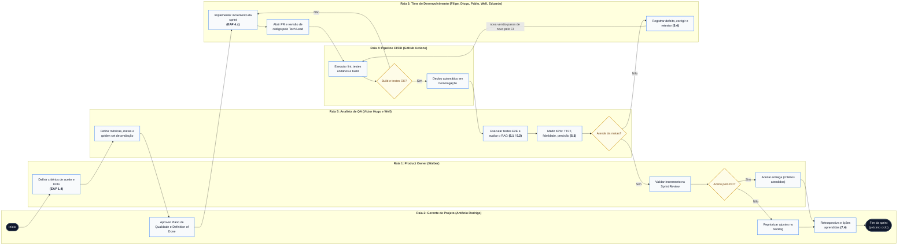

# Processo de Gestão da Qualidade por Sprint — SmartSales RAG

## 1. Visão Geral

O **Processo de Gestão da Qualidade por Sprint** do projeto **SmartSales RAG** estrutura como a equipe planeja, gerencia (garantia da qualidade — QA) e controla (inspeção e aceite — QC) a qualidade em cada iteração, distribuindo as responsabilidades em **5 raias funcionais (*swimlanes*)** e **3 macroprocessos**:

- **Macroprocessos**:
  1. **`1. PLANEJAR A QUALIDADE`**
  2. **`2. GERENCIAR A QUALIDADE (garantia)`**
  3. **`3. CONTROLAR A QUALIDADE (inspeção e aceite)`**
- **Raias de Papel (*Swimlanes*)**:
  1. **Product Owner (`Walber`)**
  2. **Gerente de Projeto (`Antônio Rodrigo`)**
  3. **Time de Desenvolvimento (`Filipe`, `Diogo`, `Pablo`, `Well`, `Eduardo` e `Victor Hugo`)**
  4. **Pipeline CI/CD (`GitHub Actions`)**
  5. **Analista de QA (`Victor Hugo` e `Well`)**

---

## 2. Diagrama do Processo de Gestão da Qualidade por Sprint (Mermaid)

---

## 3. Especificação Detalhada das Atividades e Pontos de Inspeção

| Fase do Processo | Ordem | Raia / Papel | Nó do Fluxograma | Pacote EAP | Descrição Técnica e Critério de Passagem |
| :--- | :---: | :--- | :--- | :---: | :--- |
| **1. Planejar a Qualidade** | **1** | Gerente de Projeto | `Início` | — | Abertura do ciclo da Sprint / planejamento da qualidade do projeto. |
| **1. Planejar a Qualidade** | **2** | Product Owner | `Definir critérios de aceite e KPIs (EAP 1.4)` | **`1.4`** | Estabelece os critérios funcionais de aceite das histórias da Sprint e os KPIs de produto. |
| **1. Planejar a Qualidade** | **3** | Analista de QA | `Definir métricas, metas e golden set de avaliação` | **`1.4` / `5.1`** | Prepara o *Golden Set* de perguntas técnicas (voltagem, capacidade, especificações) e os roteiros de teste automatizado. |
| **1. Planejar a Qualidade** | **4** | Gerente de Projeto | `Aprovar Plano de Qualidade e Definition of Done` | **`2.1` / `6.1`** | Formaliza a *Definition of Done* (DoD) e libera o início da execução técnica da Sprint. |
| **2. Gerenciar a Qualidade (garantia)** | **5** | Time de Desenvolvimento | `Implementar incremento da sprint (EAP 4.x)` | **`4.1` a `4.11`** | Codificação dos módulos de ingestão, RAG, *guardrails*, motor de recomendação, *Gateway* SSE/Redis, chat e vitrine de cards. |
| **2. Gerenciar a Qualidade (garantia)** | **6** | Time de Desenvolvimento | `Abrir PR e revisão de código pelo Tech Lead` | **`3.5` / `4.x`** | Submissão de *Pull Request* no GitHub e *Code Review* técnico liderado por **Filipe** verificando arquitetura, contratos OpenAPI e testes. |
| **2. Gerenciar a Qualidade (garantia)** | **7** | Pipeline CI/CD | `Executar lint, testes unitários e build` | **`3.5`** | Execução automatizada de *linters*, suíte de testes unitários/integração, aferição de cobertura ($\ge 70\%$) e *build* dos containers Docker. |
| **2. Gerenciar a Qualidade (garantia)** | **8** | Pipeline CI/CD | **Decisão**: `Build e testes OK?` | **`3.5`** | • **Não**: bloqueia o *merge* e retorna para `Implementar incremento da sprint (EAP 4.x)`. • **Sim**: avança para implantação automática. |
| **2. Gerenciar a Qualidade (garantia)** | **9** | Pipeline CI/CD | `Deploy automático em homologação` | **`3.5`** | Publica a versão aprovada pelo CI no ambiente integrado de homologação (*Staging*). |
| **3. Controlar a Qualidade (inspeção e aceite)** | **10** | Analista de QA | `Executar testes E2E e avaliar o RAG (5.1 / 5.2)` | **`5.1` / `5.2`** | Executa os testes integrados *end-to-end* (`chat → card → mock checkout → redirecionamento ao marketplace`) e roda a avaliação RAGAS sobre o *Golden Set*; resultados comunicados via rotina `C07`. |
| **3. Controlar a Qualidade (inspeção e aceite)** | **11** | Analista de QA | `Medir KPIs: TTFT, fidelidade, precisão (5.3)` | **`5.3`** | Afere na telemetria e nos relatórios de teste se `TTFT <= 2 s`, `Fidelidade >= 0,85`, `P@5 >= 0,80` e `Alucinação <= 5%`. |
| **3. Controlar a Qualidade (inspeção e aceite)** | **12** | Analista de QA | **Decisão**: `Atende às metas?` | **`5.1` a `5.3`** | • **Não**: aciona `Registrar defeito, corrigir e retestar (5.4)`. • **Sim**: libera o incremento para a *Sprint Review* com o PO. |
| **3. Controlar a Qualidade (inspeção e aceite)** | **13** | Time de Desenvolvimento | `Registrar defeito, corrigir e retestar (5.4)` | **`5.4`** | Analisa a causa raiz (via Diagrama de Ishikawa), corrige o defeito no código/prompt/índice e reenvia pelo fluxo `nova versão passa de novo pelo CI`. |
| **3. Controlar a Qualidade (inspeção e aceite)** | **14** | Product Owner | `Validar incremento na Sprint Review` | **`6.1`** | Inspeciona a demonstração funcional do incremento ao final da Sprint (`C08`). |
| **3. Controlar a Qualidade (inspeção e aceite)** | **15** | Product Owner | **Decisão**: `Aceito pelo PO?` | **`6.1`** | • **Sim**: segue para `Aceitar entrega (critérios atendidos)` (meta $\ge 90\%$ dos itens aceitos). • **Não**: segue para `Repriorizar ajustes no backlog`. |
| **3. Controlar a Qualidade (inspeção e aceite)** | **16A** | Product Owner | `Aceitar entrega (critérios atendidos)` | **`6.1`** | Homologa formalmente os pacotes entregues na Sprint para cômputo de Valor Agregado ($EV$). |
| **3. Controlar a Qualidade (inspeção e aceite)** | **16B** | Gerente de Projeto | `Repriorizar ajustes no backlog` | **`6.1` / `6.2`** | Reorganiza os ajustes pendentes junto ao PO para entrada prioritária na Sprint subsequente. |
| **3. Controlar a Qualidade (inspeção e aceite)** | **17** | Gerente de Projeto | `Retrospectiva e lições aprendidas (7.4)` | **`6.1` / `7.4`** | Conduz a retrospectiva da Sprint (junto à *Sprint Review*, rotina `C08`), consolida melhorias de processo e encerra no nó `Fim da sprint (próximo ciclo)`. |

---

## 4. Síntese de Metas de Qualidade e Ferramentas por Processo

| Quadro de Referência | Detalhamento |
| :--- | :--- |
| **Metas de Qualidade (Critérios de Aceite Sugeridos)** | • **TTFT (tempo até o 1º token)**: $\le 2\text{ s}$ • **Fidelidade do RAG (*faithfulness*)**: $\ge 0,85$ • **Precisão das recomendações (`P@5`)**: $\ge 0,80$ • **Taxa de alucinação**: $\le 5\%$ no *golden set* • **Cobertura de testes automatizados**: $\ge 70\%$ • **Zero defeitos críticos abertos** na entrega |
| **Ferramentas e Técnicas por Processo** | • **Planejar**: critérios de aceite, KPIs, *golden set* de perguntas, *Definition of Done* (DoD). • **Gerenciar (garantia)**: revisão de código em PR pelo Tech Lead, pipeline CI (*lint*, testes unitários, *build*), auditoria do DoD nas cerimônias. • **Controlar (inspeção)**: testes E2E, avaliação RAG (fidelidade/precisão), medição de TTFT e relevância, *Sprint Review*. • **Melhoria contínua**: retrospectiva, lições aprendidas e análise de causa raiz (Diagrama de Ishikawa). |
