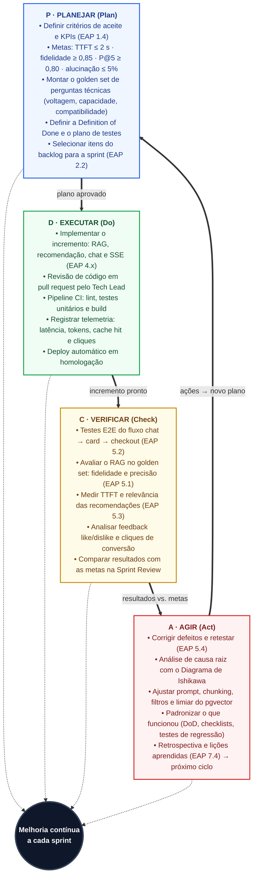

# Ciclo PDCA da Qualidade — SmartSales RAG

## 1. Visão Geral

O **Ciclo PDCA da Qualidade (*Plan – Do – Check – Act*)** do projeto **SmartSales RAG** sistematiza a melhoria contínua aplicada a cada Sprint, conectando diretamente o planejamento, a construção técnica, a inspeção de KPIs e a correção de desvios aos pacotes de trabalho da **EAP (`1.4`, `2.2`, `4.x`, `5.1`, `5.2`, `5.3`, `5.4` e `7.4`)**.

Ao centro do ciclo opera o núcleo **"Melhoria contínua a cada sprint"**, alimentado pelas quatro transições formais do ciclo:
1. De **P · PLANEJAR (*Plan*)** para **D · EXECUTAR (*Do*)**: `plano aprovado`
2. De **D · EXECUTAR (*Do*)** para **C · VERIFICAR (*Check*)**: `incremento pronto`
3. De **C · VERIFICAR (*Check*)** para **A · AGIR (*Act*)**: `resultados vs. metas`
4. De **A · AGIR (*Act*)** para **P · PLANEJAR (*Plan*)**: `ações → novo plano`

---

## 2. Diagrama do Ciclo PDCA da Qualidade (Mermaid)

---

## 3. Detalhamento Operacional e Rastreabilidade à EAP por Etapa do PDCA

| Etapa PDCA | Transição de Saída | Ações Obrigatórias no Ciclo da Sprint | Pacotes EAP Vinculados | Responsáveis Principais |
| :--- | :---: | :--- | :---: | :--- |
| **P · PLANEJAR (*Plan*)** | `plano aprovado` | 1. **Definir critérios de aceite e KPIs (`EAP 1.4`)**. 2. **Fixar metas da iteração**: `TTFT ≤ 2 s` · `fidelidade ≥ 0,85` · `P@5 ≥ 0,80` · `alucinação ≤ 5%`. 3. **Montar/atualizar o *golden set*** de perguntas técnicas (voltagem, capacidade, compatibilidade). 4. **Definir a *Definition of Done* (DoD)** e o plano de testes da Sprint. 5. **Selecionar itens do backlog para a sprint (`EAP 2.2`)**. | **`1.4`**, **`2.2`**, **`6.1`** | Walber (`PO`), Antônio Rodrigo (`GP`), Victor Hugo (`QA`) |
| **D · EXECUTAR (*Do*)** | `incremento pronto` | 1. **Implementar o incremento**: RAG, recomendação, chat e SSE (**`EAP 4.x`** — `4.1` a `4.11`). 2. **Revisão de código em *pull request*** pelo Tech Lead (**Filipe**). 3. **Pipeline CI**: executar *lint*, testes unitários e *build* (`EAP 3.5`). 4. **Registrar telemetria**: latência, tokens, *cache hit* e cliques (`EAP 4.7`, `4.8`). 5. **Deploy automático em homologação** (`EAP 3.5`). | **`3.5`**, **`4.1` a `4.11`** | Filipe, Diogo, Pablo, Well, Eduardo, Victor Hugo |
| **C · VERIFICAR (*Check*)** | `resultados vs. metas` | 1. **Testes E2E do fluxo `chat → card → checkout` (`EAP 5.2`)**. 2. **Avaliar o RAG no *golden set***: fidelidade e precisão (**`EAP 5.1`**). 3. **Medir TTFT e relevância das recomendações (`EAP 5.3`)**. 4. **Analisar *feedback like/dislike*** (`EAP 4.11`) e **cliques de conversão** (`EAP 4.8`). 5. **Comparar resultados com as metas na *Sprint Review*** (`EAP 6.1`). | **`5.1`**, **`5.2`**, **`5.3`**, **`6.1`** | Victor Hugo, Well (`QA`), Diogo (`IA`), Walber (`PO`) |
| **A · AGIR (*Act*)** | `ações → novo plano` | 1. **Corrigir defeitos e retestar (`EAP 5.4`)**. 2. **Análise de causa raiz** utilizando o **Diagrama de Ishikawa (6M)**. 3. **Ajustar *prompt*, *chunking*, filtros e limiar do `pgvector`** (`EAP 4.2`, `4.3`, `4.4`). 4. **Padronizar o que funcionou** (DoD, *checklists*, testes de regressão). 5. **Retrospectiva e lições aprendidas (`EAP 7.4`)** alimentando o próximo ciclo. | **`5.4`**, **`6.1`**, **`7.4`** | Toda a Equipe (8 integrantes) |

---

## 4. Evolução do Ciclo PDCA nas 4 Sprints do Projeto (`22/09/2026` a `24/11/2026`)

*Datas no calendário UFAL 2026.2 (Res. nº 126/2026-CONSUNI): sem expediente em `12/10`, `15/10`, `28/10`, `02/11` e `20/11`.*

| Sprint / Ciclo | Período (`9 Semanas`) | Entregas de Construção (`Do — EAP 4.x`) | Foco de Verificação (`Check — EAP 5.1 a 5.3`) | Ações Corretivas e Padronização (`Act — EAP 5.4 e 7.4`) |
| :---: | :---: | :--- | :--- | :--- |
| **Sprint 1** | `22/09/2026` a `02/10/2026` | Setup Docker, `pgvector`, ingestão do catálogo (`4.1`), contratos OpenAPI (`3.3`) e protótipos Figma (`3.4`). | Validação dos containers, integridade do *schema* do catálogo e conformidade dos contratos (**Marco M1 em `02/10`**). | Padronização de *checklists* de PR no GitHub Actions e ajuste de índices HNSW no `pgvector`. |
| **Sprint 2** | `05/10/2026` a `16/10/2026` | Orquestração LLM (`4.3`), *Gateway* e sessões (`4.5`), rota de *streaming* SSE (`4.6`) e interface de chat (`4.9`). | Medição inicial de `TTFT ≤ 2 s (p95)` (`5.3`) e estabilidade da conexão SSE multi-turno (**Marco M2 em `16/10`**). | Otimização do *flush* de eventos SSE e ajuste do tamanho do histórico de sessão no Redis. |
| **Sprint 3** | `19/10/2026` a `30/10/2026` | Pipeline de *embeddings* de manuais (`4.2`), *guardrails* (`4.3`), cache Redis (`4.7`) e *feedback* do usuário (`4.11`). | Avaliação RAGAS no *Golden Set* (`5.1`: Fidelidade $\ge 0,85$, Alucinação $\le 5\%$) e *Cache Hit* $\ge 30\%$ (**Marco M3 em `29/10`**). | Recalibração de *chunking*/*overlap* e endurecimento do *System Prompt* contra alucinações de voltagem. |
| **Sprint 4 + Homologação** | `03/11/2026` a `24/11/2026` (Sprint 4 até `13/11`; Homologação `16/11` a `24/11`) | Motor de recomendação e filtros (`4.4`), vitrine de cards (`4.10`), *mock* de *checkout* (`4.8`) e bateria E2E (`5.2`). | Aferição final de `P@5 ≥ 0,80`, `100%` filtros E2E, `CTR ≥ 10%` e `0` defeitos críticos (**Marcos M4 em `10/11` e M5 em `24/11`**). | Fechamento de todos os defeitos (`5.4`), registro final de lições aprendidas (`7.4`) e apresentação da demo (`7.2`) — com apenas 1 dia útil de reserva (`24/11`). |
