# Estrutura Analítica de Recursos (EAR) — SmartSales RAG

## 1. Visão Geral

A **Estrutura Analítica de Recursos (EAR — *Resource Breakdown Structure*)** do projeto **SmartSales RAG** organiza hierarquicamente todos os recursos humanos, de software, de infraestrutura, de dados e financeiros necessários para a execução dos pacotes de trabalho da **EAP (`1.0` a `7.0`)** e para sustentar a arquitetura definida no Diagrama de Atividades (SSE, Redis, `pgvector`, LLM com *guardrails*).

A árvore da EAR decompõe os recursos do projeto em **5 categorias principais** e **30 itens analíticos**:
1. **`1. Recursos Humanos`** (`1.1` a `1.8`) — 8 papéis funcionais mapeados aos 8 membros da squad.
2. **`2. Software e Serviços`** (`2.1` a `2.7`) — Serviços de IA, bancos de dados, orquestração, prototipação e gestão ágil.
3. **`3. Infraestrutura`** (`3.1` a `3.6`) — Computação em nuvem, containers, CI/CD, ambientes, telemetria e estações de trabalho.
4. **`4. Dados e Insumos`** (`4.1` a `4.5`) — Catálogo local (seed JSON/CSV), manuais técnicos, regras de negócio, *golden set* e histórico/feedback.
5. **`5. Recursos Financeiros`** (`5.1` a `5.4`) — Orçamento de tokens da LLM, custos de hospedagem em nuvem, licenças de ferramentas e reserva de contingência (integrados ao `BAC = R$ 115.670,50` na EAC e `R$ 0,00` no cenário real UFAL).

---

## 2. Diagrama da Estrutura Analítica de Recursos — EAR (Mermaid)

```mermaid
flowchart TD
    classDef root fill:#0f172a,stroke:#334155,stroke-width:2px,color:#ffffff
    classDef cat fill:#eff6ff,stroke:#2563eb,stroke-width:2px,color:#1e3a8a
    classDef item fill:#f8fafc,stroke:#64748b,stroke-width:1.5px,color:#0f172a

    ROOT["<b>SmartSales RAG</b><br/>Recursos do Projeto"]:::root

    C1["<b>1. Recursos Humanos</b>"]:::cat
    C2["<b>2. Software e Serviços</b>"]:::cat
    C3["<b>3. Infraestrutura</b>"]:::cat
    C4["<b>4. Dados e Insumos</b>"]:::cat
    C5["<b>5. Recursos Financeiros</b>"]:::cat

    ROOT --> C1 & C2 & C3 & C4 & C5

    %% 1. Recursos Humanos
    R1_1["<b>1.1 Gerente de Projeto / Scrum Master</b><br/>Antônio Rodrigo"]:::item
    R1_2["<b>1.2 Product Owner</b><br/>Walber"]:::item
    R1_3["<b>1.3 Tech Lead / Arquiteto</b><br/>Filipe"]:::item
    R1_4["<b>1.4 Engenheiro(a) de IA/ML</b><br/>Diogo e Filipe"]:::item
    R1_5["<b>1.5 Desenvolvedor(a) Back-end & Middle-end</b><br/>Pablo e Well"]:::item
    R1_6["<b>1.6 Desenvolvedor(a) Front-end</b><br/>Eduardo"]:::item
    R1_7["<b>1.7 Designer UX/UI</b><br/>Victor Hugo e Eduardo"]:::item
    R1_8["<b>1.8 Analista de QA</b><br/>Victor Hugo e Well"]:::item

    C1 --> R1_1 & R1_2 & R1_3 & R1_4 & R1_5 & R1_6 & R1_7 & R1_8

    %% 2. Software e Serviços
    R2_1["<b>2.1 API de LLM (inferência)</b><br/>OpenAI API"]:::item
    R2_2["<b>2.2 Modelo de embeddings</b><br/>text-embedding-3-small"]:::item
    R2_3["<b>2.3 PostgreSQL + pgvector</b><br/>Supabase"]:::item
    R2_4["<b>2.4 Redis (cache e sessões)</b><br/>Upstash"]:::item
    R2_5["<b>2.5 Framework de orquestração RAG</b><br/>LangChain"]:::item
    R2_6["<b>2.6 Figma (prototipação)</b><br/>Wireframes e Design System"]:::item
    R2_7["<b>2.7 Ferramenta de gestão ágil (GitHub Projects)</b><br/>Quadro de Sprints e Backlog"]:::item

    C2 --> R2_1 & R2_2 & R2_3 & R2_4 & R2_5 & R2_6 & R2_7

    %% 3. Infraestrutura
    R3_1["<b>3.1 Servidor em nuvem (VM/contêineres)</b><br/>Railway / Vercel"]:::item
    R3_2["<b>3.2 Docker e Docker Compose</b><br/>Padronização de containers"]:::item
    R3_3["<b>3.3 Repositório Git + CI/CD</b><br/>GitHub + GitHub Actions"]:::item
    R3_4["<b>3.4 Ambientes de dev e homologação</b><br/>Local, Staging e Demo"]:::item
    R3_5["<b>3.5 Monitoramento e telemetria</b><br/>Logs SSE, Latência e Métricas"]:::item
    R3_6["<b>3.6 Estações de trabalho da equipe</b><br/>8 Computadores de Desenvolvimento"]:::item

    C3 --> R3_1 & R3_2 & R3_3 & R3_4 & R3_5 & R3_6

    %% 4. Dados e Insumos
    R4_1["<b>4.1 Catálogo de produtos (seed local JSON/CSV)</b><br/>SKUs, preços, fotos, estoque e checkout_url"]:::item
    R4_2["<b>4.2 Manuais e fichas técnicas</b><br/>Documentos PDF de fabricantes"]:::item
    R4_3["<b>4.3 Regras de negócio (voltagem, capacidade)</b><br/>Filtros de compatibilidade, upsell e cross-sell"]:::item
    R4_4["<b>4.4 Golden set de perguntas para avaliação</b><br/>Base padrão-ouro para RAGAS"]:::item
    R4_5["<b>4.5 Histórico de conversas e feedback</b><br/>Sessões, likes/dislikes e cliques"]:::item

    C4 --> R4_1 & R4_2 & R4_3 & R4_4 & R4_5

    %% 5. Recursos Financeiros
    R5_1["<b>5.1 Orçamento de tokens da LLM</b><br/>OpenAI API (R$ 1.200,00)"]:::item
    R5_2["<b>5.2 Custos de hospedagem em nuvem</b><br/>Vercel, Railway, Supabase, Upstash, Domínio (R$ 1.400,00)"]:::item
    R5_3["<b>5.3 Licenças de ferramentas e infraestrutura</b><br/>Maquinário/Infra (R$ 2.655,00) + Mão de Obra (R$ 99.000,00)"]:::item
    R5_4["<b>5.4 Reserva de contingência</b><br/>Reserva Aquisições (R$ 900,00) + Contingência Geral 10% (R$ 10.515,50)"]:::item

    C5 --> R5_1 & R5_2 & R5_3 & R5_4
```

---

## 3. Dicionário Completo da EAR e Rastreabilidade à EAP (`1.0` a `7.0`)

### 3.1. Categoria 1: Recursos Humanos (`1.1` a `1.8`)

| Cód. EAR | Papel na EAR | Integrante(s) na Squad | Trilha na EAC (`R$ 99.000,00`) | Carga Horária (9 Semanas) | Responsabilidades Técnicas e Gerenciais | Pacotes EAP Alocados (`R` / `A`) |
| :---: | :--- | :--- | :--- | :---: | :--- | :---: |
| **1.1** | **Gerente de Projeto / Scrum Master** | **Antônio Rodrigo** | Gerência de Projetos (`R$ 65/h`) | 180h (`20h/sem`) | Governança geral, cronograma (`2.2`), matriz de riscos (`2.4`), condução de rituais ágeis (`6.1`), controle de prazo/escopo (`6.2`), métricas SPI (`6.3`) e encerramento (`7.3`, `7.4`). | `1.1`, `1.3`, `2.1` a `2.5`, `6.1` a `6.3`, `7.2` a `7.4` |
| **1.2** | **Product Owner** | **Walber** | Gerência de Projetos (`R$ 65/h`) | 180h (`20h/sem`) | Levantamento de requisitos (`1.2`), declaração de escopo (`1.3`), definição de critérios de aceite e KPIs (`1.4`), matriz RACI (`2.3`), plano de comunicação (`2.5`) e aceite nas *Sprint Reviews*. | `1.1` a `1.4`, `2.1` a `2.5`, `5.0`, `6.1` a `6.3`, `7.2` a `7.4` |
| **1.3** | **Tech Lead / Arquiteto** | **Filipe** | DEV Backend & IA (`R$ 75/h`) | 180h (`20h/sem`) | Validação da stack (`3.1`), arquitetura em 3 camadas (`3.2`), setup Docker/CI (`3.5`), base de dados (`4.1`), orquestração RAG (`4.3`), avaliação RAG (`5.1`), correção de defeitos (`5.4`) e doc técnica (`7.1`). | `1.2`, `1.4`, `3.1`, `3.2`, `3.5`, `4.1`, `4.3`, `4.4`, `5.1`, `5.3`, `5.4`, `7.1`, `7.2` |
| **1.4** | **Engenheiro(a) de IA/ML** | **Diogo** *(e **Filipe**)* | DEV Backend & IA (`R$ 75/h`) | 180h (`20h/sem`) | Pipeline de *embeddings* e indexação vetorial no `pgvector` (`4.2`), orquestração RAG e *guardrails* (`4.3`), motor de recomendação e filtros (`4.4`) e avaliação de fidelidade/precisão (`5.1`, `5.3`). | `3.1`, `3.2`, `3.5`, `4.1` a `4.4`, `5.1`, `5.3`, `5.4`, `7.1`, `7.2` |
| **1.5** | **Desenvolvedor(a) Back-end (e Middle-end / Gateway)** | **Pablo** e **Well** | DEV Middle-end & Gateway (`R$ 70/h`) | 360h (`20h/sem` cada) | Contratos OpenAPI (`3.3`), *gateway* de API e gestão de sessões (`4.5`), *streaming* de resposta SSE (`4.6`), camada de cache Redis e telemetria (`4.7`), *mock* de *checkout* (`4.8`) e aferição de TTFT (`5.3`). | `1.2`, `3.1` a `3.3`, `3.5`, `4.5` a `4.8`, `5.2` a `5.4`, `7.1`, `7.2` |
| **1.6** | **Desenvolvedor(a) Front-end** | **Eduardo** | DEV Frontend & UI/UX (`R$ 65/h`) | 180h (`20h/sem`) | Construção da interface web responsiva de chat com consumo de *streaming* SSE (`4.9`), integração dos cards de vitrine (`4.10`), módulo de *feedback* (`4.11`) e execução de testes E2E (`5.2`). | `3.1`, `3.4`, `4.9` a `4.11`, `5.2`, `5.4`, `7.1`, `7.2` |
| **1.7** | **Designer UX/UI** | **Victor Hugo** *(e **Eduardo**)* | DEV Frontend & UI/UX (`R$ 65/h`) | 90h (UX) + 90h (QA) | Prototipação de interfaces no Figma (`3.4`), design da vitrine dinâmica de recomendações (`4.10`) e experiência do módulo de avaliação rápida *like/dislike* (`4.11`). | `1.2`, `3.4`, `4.9` a `4.11`, `7.2` |
| **1.8** | **Analista de QA** | **Victor Hugo** e **Well** | Frontend/UX & Middle-end | Integrado às 360h | Definição de KPIs e *Golden Set* (`1.4`), avaliação do RAG (`5.1`), execução dos testes integrados *end-to-end* (`5.2`), aferição de KPIs técnicos (`5.3`) e validação de correção de defeitos (`5.4`). | `1.4`, `5.1`, `5.2`, `5.3`, `5.4`, `7.2` |

---

### 3.2. Categoria 2: Software e Serviços (`2.1` a `2.7`)

| Cód. EAR | Item da EAR | Tecnologia / Provedor Adotado | Aplicação Direta no SmartSales RAG | Pacotes EAP |
| :---: | :--- | :--- | :--- | :---: |
| **2.1** | **API de LLM (inferência)** | OpenAI API (`gpt-4o-mini`, *snapshot* fixado — risco `R14`) | Geração de respostas técnicas fundamentadas em modo *streaming* e detecção de intenção comercial (`UC01`, `UC03`). | `3.1`, `4.3`, `5.1` |
| **2.2** | **Modelo de embeddings** | OpenAI Embeddings (`text-embedding-3-small`) | Vetorização semântica dos *chunks* de manuais PDF (`UC08`) e das perguntas em linguagem natural dos consumidores (`UC02`). | `3.1`, `4.2` |
| **2.3** | **PostgreSQL + pgvector** | PostgreSQL 16 + extensão `pgvector` (Supabase) | Persistência relacional do catálogo de produtos e índice vetorial HNSW para busca por similaridade *top-k*. | `3.1`, `4.1`, `4.2` |
| **2.4** | **Redis (cache e sessões)** | Redis 7+ / Upstash Redis Serverless | Armazenamento em memória de sessões conversacionais (`UC07`), histórico multi-turno e cache de respostas frequentes (meta $\ge 30\%$ *hit rate*). | `3.1`, `4.5`, `4.7` |
| **2.5** | **Framework de orquestração RAG** | LangChain + FastAPI (Python) + Next.js | Pipeline de ingestão, *chunking*, construção dinâmica de *prompts*, aplicação de *guardrails* e motor de recomendação. | `3.1`, `4.2`, `4.3`, `4.4` |
| **2.6** | **Figma (prototipação)** | Figma Collaborative Design | Desenho dos *wireframes* do chat, estados de *streaming* SSE, *badges* de citação de manual e cards de vitrine. | `3.4`, `4.9`, `4.10` |
| **2.7** | **Ferramenta de gestão ágil (GitHub Projects)** | GitHub Projects (backlog e sprints) + Notion (atas) + Google Sheets (EVM) | Gestão visual do *Product Backlog*, *Sprint Backlog*, atribuições RACI e acompanhamento diário de impedimentos. | `2.1` a `2.3`, `6.1`, `6.2` |

---

### 3.3. Categoria 3: Infraestrutura (`3.1` a `3.6`)

| Cód. EAR | Item da EAR | Especificação Técnica | Aplicação Direta no SmartSales RAG | Pacotes EAP |
| :---: | :--- | :--- | :--- | :---: |
| **3.1** | **Servidor em nuvem (VM/contêineres)** | Railway (Backend/Gateway), Vercel (Frontend) e Registro.br (Domínio) | Hospedagem elástica da aplicação web e das APIs com suporte a conexões persistentes *Server-Sent Events* (SSE) sobre HTTPS. | `3.5`, `4.5`, `4.6`, `4.9` |
| **3.2** | **Docker e Docker Compose** | `Dockerfile` e `docker-compose.yml` | Orquestração local padronizada dos serviços (`db`, `redis`, `backend`, `middleend` e `frontend`). | `3.5`, `4.1` |
| **3.3** | **Repositório Git + CI/CD** | GitHub + GitHub Actions | Versionamento de código, revisão por *Pull Request*, execução automática de *lint*, testes unitários (cobertura $\ge 70\%$) e *build*. | `3.5`, `5.2`, `5.4` |
| **3.4** | **Ambientes de dev e homologação** | Isolamento lógico (`dev` local e `staging`/homologação cloud) | Validação incremental das entregas de cada Sprint antes das *Sprint Reviews* e da demonstração final (`7.2`). | `3.5`, `5.1` a `5.4`, `7.2` |
| **3.5** | **Monitoramento e telemetria** | Serviço de Métricas + Logs estruturados do Gateway e Redis | Coleta em tempo real de `TTFT (p95)`, tempo total de resposta, taxa de erro `5xx`, *cache hit* e cliques de conversão (`UC09`). | `4.7`, `5.3` |
| **3.6** | **Estações de trabalho da equipe** | 8 computadores pessoais dos integrantes da squad | Codificação, testes locais, prototipação e participação nos rituais remotos ao longo das 9 semanas. | `1.1` a `7.4` |

---

### 3.4. Categoria 4: Dados e Insumos (`4.1` a `4.5`)

| Cód. EAR | Item da EAR | Natureza e Formato dos Dados | Aplicação Direta no SmartSales RAG | Pacotes EAP |
| :---: | :--- | :--- | :--- | :---: |
| **4.1** | **Catálogo de produtos (seed local)** | Arquivo seed JSON/CSV versionado no repositório (`data/`), ingerido no PostgreSQL pela CLI do backend (`UC08`), contendo SKU, nome, foto, preço, estoque, voltagem, capacidade, `marketplace` e `checkout_url` | Fonte transacional para filtragem de disponibilidade e montagem dos cards interativos (`UC03`, `UC04`, `UC05`). | `4.1`, `4.4`, `4.8`, `4.10` |
| **4.2** | **Manuais e fichas técnicas** | Arquivos PDF e especificações técnicas oficiais dos fabricantes (`data/manuals/`) | Base documental processada pelo pipeline de *chunking* e *embeddings* para responder dúvidas técnicas com citação de página (`UC01`, `UC08`). | `4.1`, `4.2`, `4.3` |
| **4.3** | **Regras de negócio (voltagem, capacidade)** | Restrições determinísticas e matrizes de compatibilidade (*upsell* / *cross-sell*) | Garantem 100% de aderência técnica nas recomendações (ex.: bloquear sugestão `127V` quando o cliente exige `220V`). | `4.3`, `4.4`, `5.2` |
| **4.4** | **Golden set de perguntas para avaliação** | Conjunto curado de perguntas técnicas com gabarito de contexto e resposta esperada | Insumo base para aferição automatizada de Fidelidade ($\ge 0,85$), Precisão ($\ge 90\%$), Alucinação ($\le 5\%$) e `P@5` ($\ge 0,80$). | `1.4`, `5.1`, `5.3` |
| **4.5** | **Histórico de conversas e feedback** | Registros de sessão no Redis e no PostgreSQL (`chat_sessions`, `chat_messages`), votos *like/dislike* (`feedback_logs` — `UC06`) e cliques (`checkout_events` — `UC05`), retidos por 90 dias (LGPD) | Manutenção de contexto conversacional multi-turno e retroalimentação do ciclo PDCA de melhoria contínua. | `4.5`, `4.7`, `4.11`, `7.4` |

---

### 3.5. Categoria 5: Recursos Financeiros (`5.1` a `5.4`)

| Cód. EAR | Item da EAR | Detalhamento e Conciliação com a EAC e Aquisições | Valor Simulado (R$) | Valor Real UFAL (R$) | Pacotes EAP |
| :---: | :--- | :--- | :---: | :---: | :---: |
| **5.1** | **Orçamento de tokens da LLM** | Contrato **Item 01 (OpenAI — API de LLM e Embeddings)** para inferência e indexação | **R$ 1.200,00** | R$ 0,00 | `4.2`, `4.3`, `5.1` |
| **5.2** | **Custos de hospedagem em nuvem** | Contratos **Itens 02 a 06**: Vercel (`R$ 100`), Railway (`R$ 500`), Supabase (`R$ 450`), Upstash (`R$ 200`) e Registro.br (`R$ 150`) | **R$ 1.400,00** | R$ 0,00 | `3.5`, `4.1`, `4.5`, `4.7`, `4.9` |
| **5.3** | **Licenças de ferramentas, infraestrutura e RH** | Maquinário e Infraestrutura complementar (`R$ 2.655,00`) + Recursos Humanos 1.440h (`R$ 99.000,00`) | **R$ 101.655,00** | R$ 0,00 | `1.1` a `7.4` |
| **5.4** | **Reserva de contingência** | Reserva específica de Aquisições Cloud/Tokens (`R$ 900,00`) + Reserva de Contingência Geral de 10% da EAC (`R$ 10.515,50`) | **R$ 11.415,50** | R$ 0,00 | `6.2`, `6.3` |
| **Total** | **ORÇAMENTO GLOBAL CONSOLIDADO (BAC)** | **Soma integral das rubricas financeiras do projeto (9 semanas)** | **R$ 115.670,50** | **R$ 0,00** | — |
