# Plano de Gerenciamento das Comunicações — SmartSales RAG

## 1. Visão Geral

O **Plano de Gerenciamento das Comunicações** do projeto **SmartSales RAG** define o fluxo principal de informação entre os papéis do projeto e estabelece as **9 rotinas de comunicação planejadas (`C01` a `C09`)**, especificando o que é comunicado, quem emite, quem recebe, o canal/formato utilizado, a frequência/gatilho (padronizada no calendário oficial de **22/09/2026 a 24/11/2026**) e o registro/evidência gerado.

O plano está diretamente vinculado aos pacotes da EAP:
- **`EAP 2.5`**: Definir o plano de comunicação;
- **`EAP 6.1`**: Conduzir rituais ágeis;
- **`EAP 6.2`**: Controlar prazo, escopo e riscos.

---

## 2. Fluxo Principal de Informação (Mermaid)

*Nota: As setas bidirecionais (`↔`) representam canais diretos de comunicação e alinhamento contínuo, e não subordinação hierárquica rígida.*

```mermaid
flowchart LR
    classDef nodeStyle fill:#eff6ff,stroke:#2563eb,stroke-width:2px,color:#1e3a8a

    P1["<b>Patrocinador</b><br/>Gestor / Lojista"]:::nodeStyle
    P2["<b>Gerente de Projeto</b><br/>Scrum Master<br/><i>(Antônio Rodrigo)</i>"]:::nodeStyle
    P3["<b>Product Owner</b><br/>Backlog e aceite<br/><i>(Walber)</i>"]:::nodeStyle
    P4["<b>Equipe técnica</b><br/>Tech Lead, IA/ML, BE, FE e UX<br/><i>(Filipe, Diogo, Pablo, Well, Eduardo, Victor Hugo)</i>"]:::nodeStyle
    P5["<b>Analista de QA</b><br/>Testes e indicadores<br/><i>(Victor Hugo e Well)</i>"]:::nodeStyle

    P1 <==>|"TAP, Status Semanal, Escalonamento<br/>Sprint Review e Aceite Final"| P2
    P2 <==>|"Prioridades, Rituais Ágeis,<br/>Controle de Prazo/Riscos e SPI"| P3
    P3 <==>|"Planejamento de Sprint, Critérios de Aceite,<br/>Contratos de API e Demonstrações"| P4
    P4 <==>|"Builds de Homologação, Relatórios RAG,<br/>Métricas TTFT/P@5 e Correção de Bugs"| P5
```

---

## 3. Matriz de Comunicação — SmartSales RAG (`C01` a `C09`)

| CÓD. | INFORMAÇÃO / OBJETIVO | RESPONSÁVEL POR EMITIR | PÚBLICO / DESTINATÁRIOS | CANAL / FORMATO | FREQUÊNCIA / GATILHO | REGISTRO / EVIDÊNCIA | Pacotes EAP |
| :---: | :--- | :--- | :--- | :--- | :--- | :--- | :---: |
| **`C01`** | **Abertura do projeto e aprovação do TAP** | Gerente de Projeto (**Antônio Rodrigo**) | Patrocinador, PO (**Walber**) e equipe | Reunião de *kick-off* + ata | **`22/09/2026` (início)** | TAP aprovado e ata de abertura | `1.1`, `1.3`, `2.5` |
| **`C02`** | **Priorização do backlog e planejamento de sprint** | Product Owner (**Walber**) | GP, Tech Lead, time técnico e QA | Reunião de planejamento + quadro de tarefas | **Quinzenal, início da sprint** (`22/09`, `05/10`, `19/10`, `03/11` — `02/11` é feriado) | Backlog priorizado e plano da sprint | `2.2`, `6.1` |
| **`C03`** | **Acompanhamento diário e impedimentos** | Gerente de Projeto / Scrum Master (**Antônio Rodrigo**) | Equipe de desenvolvimento e QA | *Daily* (15 min) + quadro de tarefas | **Dias úteis** (`22/09/2026` a `24/11/2026`, exceto `12/10`, `15/10`, `28/10`, `02/11` e `20/11` — calendário UFAL 2026.2) | Tarefas e impedimentos atualizados | `6.1`, `6.2` |
| **`C04`** | **Decisões de arquitetura, API e integrações** | Tech Lead / Arquiteto (**Filipe**) | IA/ML, Back-end, Front-end, UX e QA | Reunião técnica + GitHub / `openapi.yaml` (OpenAPI 3.1) | **Sob demanda, antes de mudanças** | Decisões técnicas e contratos de API | `3.1`, `3.2`, `3.3` |
| **`C05`** | **Status do projeto: prazo, escopo, custos e riscos** | Gerente de Projeto (**Antônio Rodrigo**) | Patrocinador e Product Owner (**Walber**) | Relatório sintético por e-mail / Markdown | **Semanal, às sextas-feiras** (`S1` a `S9`; na semana de `20/11`, feriado, antecipado para `19/11`) | Relatório de status, indicadores (`SPI`, `CPI`) e situação do caminho crítico (reserva de apenas 1 dia útil) | `6.2`, `6.3` |
| **`C06`** | **Alerta de risco crítico ou bloqueio** | Gerente de Projeto (**Antônio Rodrigo**) | PO (**Walber**), Tech Lead (**Filipe**) e patrocinador (se necessário) | Mensagem prioritária + reunião curta | **Imediatamente ao identificar** | Matriz de riscos e plano de resposta acionado | `2.4`, `6.2` |
| **`C07`** | **Resultados de testes e qualidade do RAG** | Analista de QA (**Victor Hugo** e **Well**) | Tech Lead, IA/ML, Back-end, Front-end, PO e GP | *Issues* + relatório de testes | **A cada *build* testada / sprint** | Defeitos, TTFT, fidelidade e precisão | `5.1`, `5.2`, `5.3`, `5.4` |
| **`C08`** | **Revisão da sprint, retrospectiva (PDCA), demonstração e aceite parcial** | Product Owner (**Walber**) | Patrocinador, GP, equipe e QA | *Sprint Review* + demonstração + retrospectiva | **Quinzenal, fim da sprint** (`02/10`, `16/10`, `30/10`, `13/11` — marcos `M1` a `M4`) | Feedback, aceite e backlog ajustado | `6.1` |
| **`C09`** | **Entrega final e lições aprendidas** | Gerente de Projeto (**Antônio Rodrigo**) | Patrocinador, PO (**Walber**) e equipe | Demonstração final + reunião | **`24/11/2026` (encerramento — Marco M5)** | Aceite final e relatório de encerramento | `7.1`, `7.2`, `7.3`, `7.4` |

---

## 4. Regras de Escalonamento e Rastreabilidade Documental

| Diretriz de Governança | Regra Operacional Aplicada ao Projeto |
| :--- | :--- |
| **Escalonamento de Bloqueios e Mudanças** | Bloqueios técnicos e riscos relevantes (`C06`) são comunicados ao **Gerente de Projeto (`Antônio Rodrigo`)** imediatamente; mudanças com efeito em escopo, prazo ou orçamento envolvem obrigatoriamente o **Product Owner (`Walber`)** e, quando necessário (ex.: acionamento de reserva de contingência), o **Patrocinador**. |
| **Rastreabilidade de Decisões e Evidências** | Todas as decisões relevantes do projeto são formalmente registradas em atas de reunião, cartões do *backlog*, *issues* no GitHub e documentação técnica (`openapi.yaml` e `README.md`), mantendo rastreabilidade direta com os pacotes **`EAP 2.5` (Plano de comunicação)**, **`EAP 6.1` (Rituais ágeis)** e **`EAP 6.2` (Controle do projeto)**. |
