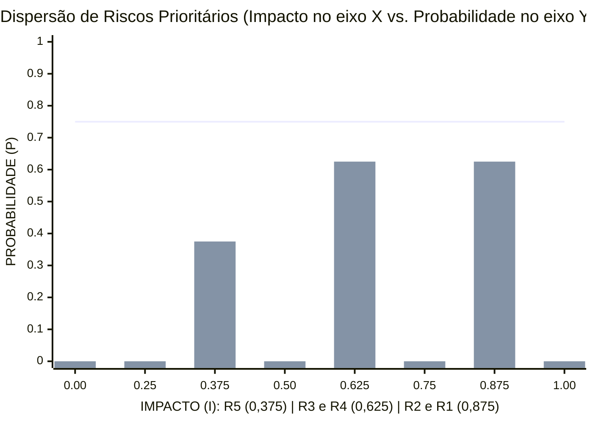
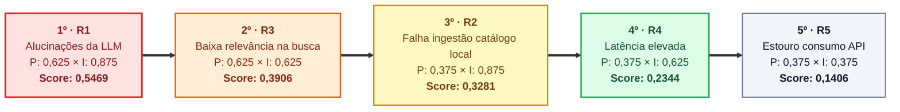

# Plano de Gerenciamento dos Riscos — SmartSales RAG

## 1. Visão Geral e Metodologia de Avaliação

O **Plano de Gerenciamento dos Riscos** do projeto **SmartSales RAG** (`EAP 2.4` e `EAP 6.2`) estrutura a identificação, a análise quantitativa e qualitativa e os planos de resposta e contingência para as incertezas técnicas, operacionais e de negócio ao longo do ciclo do projeto (`22/09/2026` a `24/11/2026`).

A metodologia unifica duas visões complementares:
1. **Matriz Executiva de Probabilidade × Impacto por Valor Representativo (`0,00` a `1,00`) — Top 5 Riscos Prioritários (`R1` a `R5`)**: quantifica a pontuação de risco pelo produto exato $P \times I$ usando os pontos médios dos quatro intervalos contínuos (`0,125`, `0,375`, `0,625`, `0,875`).
2. **Catálogo Completo da Estrutura Analítica de Riscos (EAR de Riscos — `R01` a `R20`)**: detalha os 20 riscos mapeados nas 5 categorias de engenharia, arquitetura, segurança/LGPD, produto/UX e gestão na escala inteira PMBOK (`1` a `5`, severidade $1$ a $25$).

> [!IMPORTANT]
> **Convenção de códigos**: os códigos de **dois dígitos `R01` a `R20` são os oficiais** e são os únicos usados nas demais especificações (`specs/`, `CLAUDE.md`, testes). Os códigos de **um dígito `R1` a `R5`** identificam apenas o Top 5 executivo desta matriz e **não equivalem** a `R01`–`R05`. Vínculos: `R1 → R01` · `R2 → R09` · `R3 → R03, R04, R06` · `R4 → R02` · `R5 → R13`.

---

## 2. Classificação de Probabilidade e Impacto (Intervalos Contínuos)

Cada risco recebe uma estimativa de **Probabilidade ($P$)** e **Impacto ($I$)**. A pontuação de risco é calculada pelo produto **$P \times I$**: quanto maior o produto, maior a prioridade de tratamento.

| CLASSIFICAÇÃO | INTERVALO | VALOR REPRESENTATIVO (Ponto Médio) |Equivalência Escala PMBOK (1–5) | Critério de Avaliação no Projeto |
| :--- | :---: | :---: | :---: | :--- |
| **Baixo** | `0,00` a `0,25` | **`0,125`** | Nível `1` – `2` | Baixa chance de ocorrência ou impacto facilmente absorvido pela folga das trilhas não críticas. |
| **Médio** | `0,25` a `0,50` | **`0,375`** | Nível `3` | Chance moderada de ocorrência; exige monitoramento ativo e plano de resposta predefinido. |
| **Alto** | `0,50` a `0,75` | **`0,625`** | Nível `4` | Alta probabilidade ou impacto severo sobre metas de latência (`TTFT`), busca vetorial ou orçamento cloud. |
| **Muito alto** | `0,75` a `1,00` | **`0,875`** | Nível `5` | Impacto crítico bloqueante sobre a fidelidade das respostas (`Faithfulness < 0,85`) ou integração do catálogo. |

---

## 3. Matriz dos 5 Riscos Prioritários (`R1` a `R5`) e Gráfico de Dispersão

### 3.1. Quadro de Priorização e Planos de Contingência (`R1` a `R5`)

*Ordem estrita de prioridade de tratamento (maior pontuação $P \times I$): **`R1 (0,5469) → R3 (0,3906) → R2 (0,3281) → R4 (0,2344) → R5 (0,1406)`**.*

| ID | DESCRIÇÃO DO RISCO | PROB. ($P$) | IMPACTO ($I$) | $P \times I$ | ORDEM DE PRIORIDADE | PLANO DE CONTINGÊNCIA E RESPOSTA TÉCNICA | RESPONSÁVEL DIRETO | PACOTES EAP |
| :-: | :--- | :---: | :---: | :---: | :---: | :--- | :--- | :---: |
| **`R1`** | **Respostas incorretas ou alucinações da LLM** | `0,625` *(Alto)* | `0,875` *(Muito alto)* | **`0,5469`** | **1º (Crítico)** | Revisar *prompts*, aplicar *guardrails* restritivos (`temperature <= 0,2`) e validar respostas obrigatoriamente com o contexto recuperado do catálogo e manuais (`Faithfulness >= 0,85`). | **Filipe** e **Diogo** | `4.3`, `5.1`, `5.4` |
| **`R2`** | **Falha na ingestão/integração do catálogo local de produtos** | `0,375` *(Médio)* | `0,875` *(Muito alto)* | **`0,3281`** | **3º (Alto)** | Validar o *schema* do seed JSON/CSV na CLI de ingestão (`UC08`, tabela `ingestion_jobs` com *retry*), revalidar estoque/preço no *checkout mock*, implementar *fallback* gracioso no chat (`UC03`) e executar testes automatizados de integração. | **Pablo** e **Well** | `3.3`, `4.1`, `4.5`, `5.2` |
| **`R3`** | **Baixa relevância na busca semântica** | `0,625` *(Alto)* | `0,625` *(Alto)* | **`0,3906`** | **2º (Alto)** | Ajustar modelo de *embeddings*, refinar estratégia de *chunking* com *overlap* e calibrar limiar de similaridade e filtros de recuperação no `pgvector` (`P@5 >= 0,80`). | **Diogo** e **Filipe** | `4.2`, `4.4`, `5.3`, `5.4` |
| **`R4`** | **Latência elevada nas respostas ao usuário** | `0,375` *(Médio)* | `0,625` *(Alto)* | **`0,2344`** | **4º (Médio)** | Utilizar cache Redis (`hit rate >= 30%`), transmitir respostas via *streaming* SSE (`TTFT <= 2 s`), otimizar consultas vetoriais HNSW e reduzir o contexto enviado à LLM. | **Well**, **Pablo** e **Filipe** | `4.6`, `4.7`, `5.3` |
| **`R5`** | **Estouro de orçamento no consumo da API** | `0,375` *(Médio)* | `0,375` *(Médio)* | **`0,1406`** | **5º (Moderado)** | Limitar número máximo de tokens por requisição/sessão, acompanhar custos semanalmente e estabelecer teto (*hard limit*) de consumo na API da OpenAI. | **Antônio Rodrigo** e **Walber** | `4.5`, `4.7`, `6.2`, `6.3` |

### 3.2. Gráfico de Dispersão `Probabilidade × Impacto` (Mermaid)

---

## 4. Catálogo Completo de Gestão de Riscos (EAR de Riscos — `R01` a `R20`)

### 4.1. Diagrama da Estrutura Analítica de Riscos — 5 Categorias e 20 Riscos (Mermaid)

```mermaid
flowchart TD
    classDef root fill:#0f172a,stroke:#334155,stroke-width:2px,color:#ffffff
    classDef cat fill:#1e3a8a,stroke:#1d4ed8,stroke-width:2px,color:#ffffff
    classDef crit fill:#fef2f2,stroke:#dc2626,stroke-width:2px,color:#7f1d1d
    classDef mod fill:#fff7ed,stroke:#ea580c,stroke-width:1.5px,color:#7c2d12
    classDef med fill:#f0fdf4,stroke:#16a34a,stroke-width:1.5px,color:#14532d

    ROOT["<b>SmartSales RAG — Catálogo Completo de Gestão de Riscos</b><br/>(20 Riscos · Matriz de Probabilidade × Impacto PMBOK)"]:::root

    C_IA["<b>1. Riscos de IA, RAG e Modelagem Cognitiva</b><br/>(CAT.IA)"]:::cat
    C_ENG["<b>2. Riscos de Arquitetura, Streaming e Infraestrutura</b><br/>(CAT.ENG)"]:::cat
    C_SEC["<b>3. Riscos de Segurança, Abuso e Compliance LGPD</b><br/>(CAT.SEC)"]:::cat
    C_PROD["<b>4. Riscos de Produto, UX e E-commerce</b><br/>(CAT.PROD)"]:::cat
    C_GES["<b>5. Riscos de Gestão, Prazos, Custos e Fornecedores</b><br/>(CAT.GES)"]:::cat

    ROOT --> C_IA & C_ENG & C_SEC & C_PROD & C_GES

    %% Cat 1: IA, RAG e Modelagem Cognitiva
    R01["<b>R01: Alucinação em Especificações (127V/220V/Capacidade)</b><br/>P: 4 | I: 4 | Sev: 16 (Crítico) · Resp: Filipe (Back)"]:::crit
    R02["<b>R02: Latência Elevada no RAG (>3s) gerando Abandono</b><br/>P: 3 | I: 5 | Sev: 15 (Crítico) · Resp: Diogo (Back)"]:::crit
    R03["<b>R03: Chunks Irrelevantes (Lost in the Middle)</b><br/>P: 3 | I: 4 | Sev: 12 (Moderado) · Resp: Filipe (Back)"]:::mod
    R04["<b>R04: Falha na Extração de Tabelas em PDFs de Manuais</b><br/>P: 4 | I: 3 | Sev: 12 (Moderado) · Resp: Diogo (Back)"]:::mod
    R06["<b>R06: Ambiguidade Semântica em Perguntas Coloquiais</b><br/>P: 4 | I: 3 | Sev: 12 (Moderado) · Resp: Diogo (Back)"]:::mod
    C_IA --> R01 & R02 & R03 & R04 & R06

    %% Cat 2: Arquitetura, Streaming e Infraestrutura
    R07["<b>R07: Queda de Conexão no Streaming SSE em Mobile</b><br/>P: 3 | I: 4 | Sev: 12 (Moderado) · Resp: Eduardo (Front)"]:::mod
    R08["<b>R08: Esgotamento de Conexões no PostgreSQL/pgvector</b><br/>P: 3 | I: 4 | Sev: 12 (Moderado) · Resp: Well (Mid)"]:::mod
    R09["<b>R09: Dessincronização de Estoque/Preço Cache/Cards x PostgreSQL</b><br/>P: 3 | I: 4 | Sev: 12 (Moderado) · Resp: Pablo (Mid)"]:::mod
    R10["<b>R10: Invalidação Prematura de Cache Redis gerando Picos</b><br/>P: 2 | I: 4 | Sev: 8 (Médio) · Resp: Well (Mid)"]:::med
    R11["<b>R11: Quebra de Contratos OpenAPI entre Front/Mid/Back</b><br/>P: 2 | I: 5 | Sev: 10 (Moderado) · Resp: Pablo (Mid)"]:::mod
    C_ENG --> R07 & R08 & R09 & R10 & R11

    %% Cat 3: Segurança, Abuso e Compliance LGPD
    R05["<b>R05: Ataque de Prompt Injection & Bypass de Regras</b><br/>P: 3 | I: 5 | Sev: 15 (Crítico) · Resp: Pablo (Mid)"]:::crit
    R15["<b>R15: Vazamento Inadvertido de Dados Pessoais (LGPD)</b><br/>P: 2 | I: 5 | Sev: 10 (Moderado) · Resp: Antônio (GP)"]:::mod
    R16["<b>R16: Scraping Abusivo ou Bots Esgotando Tokens</b><br/>P: 2 | I: 4 | Sev: 8 (Médio) · Resp: Pablo (Mid)"]:::med
    C_SEC --> R05 & R15 & R16

    %% Cat 4: Produto, UX e E-commerce
    R12["<b>R12: Baixa Taxa de Cliques (CTR) nas Vitrines do Chat</b><br/>P: 3 | I: 3 | Sev: 9 (Médio) · Resp: Victor Hugo (Front)"]:::med
    R17["<b>R17: Quebra de Responsividade dos Cards no Mobile</b><br/>P: 4 | I: 2 | Sev: 8 (Médio) · Resp: Eduardo (Front)"]:::med
    R18["<b>R18: Falha no Tracking de Telemetria de Checkout</b><br/>P: 3 | I: 3 | Sev: 9 (Médio) · Resp: Well (Mid)"]:::med
    R20["<b>R20: Massa de Testes de Catálogo Insuficiente</b><br/>P: 3 | I: 3 | Sev: 9 (Médio) · Resp: Victor Hugo (Front)"]:::med
    C_PROD --> R12 & R17 & R18 & R20

    %% Cat 5: Gestão, Prazos, Custos e Fornecedores
    R13["<b>R13: Estouro de Quota / Rate Limit nas APIs de LLM</b><br/>P: 3 | I: 5 | Sev: 15 (Crítico) · Resp: Antônio (GP)"]:::crit
    R14["<b>R14: Depreciação ou Mudança de Versão do Modelo LLM</b><br/>P: 2 | I: 5 | Sev: 10 (Moderado) · Resp: Filipe (Back)"]:::mod
    R19["<b>R19: Sobrecarga da Squad durante Provas da UFAL</b><br/>P: 4 | I: 3 | Sev: 12 (Moderado) · Resp: Antônio e Walber (GPs)"]:::mod
    C_GES --> R13 & R14 & R19
```

### 4.2. Tabela Detalhada dos 20 Riscos (`R01` a `R20`)

| Cód. | Categoria EAR | Evento de Risco | Vínculo Top 5 | $P$ (1–5) | $I$ (1–5) | Sev ($P \times I$) | Classificação | Estratégia | Ação Preventiva e Plano de Contingência | Responsável | Pacotes EAP |
| :---: | :--- | :--- | :---: | :---: | :---: | :---: | :---: | :---: | :--- | :--- | :---: |
| **`R01`** | `1. IA & RAG` (`CAT.IA`) | **Alucinação em Especificações (`127V`/`220V`/Capacidade)** | **`R1` (`0,5469`)** | 4 | 4 | **16** | **Crítico** | Mitigar | *System prompt* restritivo, *guardrails* de validação de atributos, citação obrigatória da página do manual e *fallback* quando sem contexto. | **Filipe** (`Back`) | `4.3`, `5.1` |
| **`R02`** | `1. IA & RAG` (`CAT.IA`) | **Latência Elevada no RAG (`>3s`) gerando Abandono** | **`R4` (`0,2344`)** | 3 | 5 | **15** | **Crítico** | Mitigar | *Streaming* SSE token a token (`TTFT <= 2s`), cache semântico no Redis (`hit >= 30%`) e índice HNSW no `pgvector`. | **Diogo** (`Back`) | `4.2`, `4.6`, `4.7`, `5.3` |
| **`R03`** | `1. IA & RAG` (`CAT.IA`) | **Chunks Irrelevantes (*Lost in the Middle*)** | **`R3` (`0,3906`)** | 3 | 4 | **12** | **Moderado** | Mitigar | Limitar recuperação a `top-k = 5`, calibrar *similarity threshold* e aplicar filtros determinísticos antes da montagem do *prompt*. | **Filipe** (`Back`) | `4.2`, `4.3`, `4.4` |
| **`R04`** | `1. IA & RAG` (`CAT.IA`) | **Falha na Extração de Tabelas em PDFs de Manuais** | **`R3` (`0,3906`)** | 4 | 3 | **12** | **Moderado** | Mitigar | Converter tabelas técnicas para Markdown estruturado durante a ingestão e cruzar atributos críticos com o banco relacional. | **Diogo** (`Back`) | `4.1`, `4.2` |
| **`R05`** | `3. Segurança` (`CAT.SEC`) | **Ataque de *Prompt Injection* & *Bypass* de Regras** | — | 3 | 5 | **15** | **Crítico** | Prevenir | `InputGuardrail (G-IN)` no Backend, limite de tamanho de mensagem e *rate limiting* no API Gateway, separação estrita de delimitadores de sistema/usuário e bloqueio de comandos fora do domínio. | **Pablo** (`Mid`) | `4.3`, `4.5` |
| **`R06`** | `1. IA & RAG` (`CAT.IA`) | **Ambiguidade Semântica em Perguntas Coloquiais** | **`R3` (`0,3906`)** | 4 | 3 | **12** | **Moderado** | Mitigar | Reescrita contextual da consulta (*query expansion*) considerando o histórico da sessão e perguntas de clarificação pelo assistente. | **Diogo** (`Back`) | `4.2`, `4.3` |
| **`R07`** | `2. Arquitetura` (`CAT.ENG`) | **Queda de Conexão no *Streaming* SSE em Mobile** | — | 3 | 4 | **12** | **Moderado** | Mitigar | Cliente `fetch` + `ReadableStream` (o `EventSource` não suporta `POST`): 1 reconexão automática reenviando a pergunta preservada, histórico restaurado da sessão no Redis e botão *"Tentar novamente"* se a falha persistir. | **Eduardo** (`Front`) | `4.6`, `4.9` |
| **`R08`** | `2. Arquitetura` (`CAT.ENG`) | **Esgotamento de Conexões no `PostgreSQL/pgvector`** | — | 3 | 4 | **12** | **Moderado** | Prevenir | Utilização de *connection pooling* (PgBouncer / Supabase Pooler) e liberação assíncrona imediata após a consulta *top-k*. | **Well** (`Mid`) | `4.1`, `4.2`, `4.5` |
| **`R09`** | `2. Arquitetura` (`CAT.ENG`) | **Dessincronização de Estoque/Preço entre Cache/Cards e PostgreSQL** | **`R2` (`0,3281`)** | 3 | 4 | **12** | **Moderado** | Mitigar | Chave `catalog:version` no Redis incrementada pela ingestão (`UC08`) e pelo *checkout mock* (invalida o cache), cards sempre montados a partir do PostgreSQL (`RN06`) e revalidação transacional `SELECT ... FOR UPDATE` no clique em `Comprar` (`UC05`, `RN10`). | **Pablo** (`Mid`) | `4.1`, `4.4`, `4.8` |
| **`R10`** | `2. Arquitetura` (`CAT.ENG`) | **Invalidação Prematura de Cache Redis gerando Picos** | — | 2 | 4 | **8** | **Médio** | Mitigar | Invalidação seletiva por prefixo de SKU em vez de `FLUSHALL` e escalonamento de TTL com *jitter*. | **Well** (`Mid`) | `4.7` |
| **`R11`** | `2. Arquitetura` (`CAT.ENG`) | **Quebra de Contratos OpenAPI entre Front/Mid/Back** | — | 2 | 5 | **10** | **Moderado** | Prevenir | Congelamento do `openapi.yaml` na Concepção Técnica (`EAP 3.3`), validação Pydantic e testes de contrato no CI (`EAP 3.5`). | **Pablo** (`Mid`) | `3.3`, `3.5` |
| **`R12`** | `4. Produto & UX` (`CAT.PROD`) | **Baixa Taxa de Cliques (CTR `< 10%`) nas Vitrines do Chat** | — | 3 | 3 | **9** | **Médio** | Mitigar | Prototipação de alta conversão no Figma (`EAP 3.4`), destaque para foto, preço, selo de compatibilidade e CTA direto no card (`EAP 4.10`). | **Victor Hugo** (`Front/UX`) | `3.4`, `4.10` |
| **`R13`** | `5. Gestão & Custos` (`CAT.GES`) | **Estouro de Quota / *Rate Limit* nas APIs de LLM** | **`R5` (`0,1406`)** | 3 | 5 | **15** | **Crítico** | Mitigar | Teto de gastos configurado na OpenAI, alerta em 70%, cache Redis ativo e acionamento da Reserva de Aquisições (`R$ 900,00`). | **Antônio Rodrigo** (`GP`) | `4.7`, `6.2`, `6.3` |
| **`R14`** | `5. Gestão & Custos` (`CAT.GES`) | **Depreciação ou Mudança de Versão do Modelo LLM** | — | 2 | 5 | **10** | **Moderado** | Mitigar | Fixar versão exata do modelo (*pinned model snapshot*) nas variáveis de ambiente e abstrair provedor via LangChain. | **Filipe** (`Back`) | `3.1`, `4.3` |
| **`R15`** | `3. Segurança` (`CAT.SEC`) | **Vazamento Inadvertido de Dados Pessoais (LGPD)** | — | 2 | 5 | **10** | **Moderado** | Prevenir | Não exigir dados sensíveis no chat, aplicar máscara de PII nos logs, expirar sessões no Redis (`TTL = 1800s`) e reter mensagens no PostgreSQL por no máximo 90 dias (`UC07`). | **Antônio Rodrigo** (`GP`) | `4.5`, `4.7` |
| **`R16`** | `3. Segurança` (`CAT.SEC`) | **Scraping Abusivo ou Bots Esgotando Tokens** | — | 2 | 4 | **8** | **Médio** | Prevenir | *Rate limiting* por IP e por `session_id` no API Gateway (`EAP 4.5`) e limite de caracteres na mensagem de entrada. | **Pablo** (`Mid`) | `4.5` |
| **`R17`** | `4. Produto & UX` (`CAT.PROD`) | **Quebra de Responsividade dos Cards no Mobile** | — | 4 | 2 | **8** | **Médio** | Mitigar | Design *mobile-first* com carrossel horizontal responsivo para os cards de produto (`EAP 4.10`) e validação em *viewports* móveis (`EAP 5.2`). | **Eduardo** (`Front`) | `4.9`, `4.10`, `5.2` |
| **`R18`** | `4. Produto & UX` (`CAT.PROD`) | **Falha no Tracking de Telemetria de Checkout** | — | 3 | 3 | **9** | **Médio** | Mitigar | Disparo assíncrono garantido do evento de conversão (`UC05`) antes do redirecionamento HTTP ao *checkout* e validação nos testes E2E. | **Well** (`Mid`) | `4.7`, `4.8`, `5.2` |
| **`R19`** | `5. Gestão & Custos` (`CAT.GES`) | **Sobrecarga da Squad durante Provas da UFAL** | — | 4 | 3 | **12** | **Moderado** | Aceitar Ativamente | Divisão em duplas técnicas por camada e folga nas trilhas não críticas. **Agravante (calendário UFAL 2026.2 — Res. nº 126/2026-CONSUNI)**: os dias sem expediente `12/10`, `15/10`, `28/10`, `02/11` e `20/11` reduzem a reserva para **1 dia útil** (`24/11/2026`), com probabilidade de ≈ 73% de cumprir o `M5`; prazos de avaliação da UFAL (AB1 até `25/09`, AB2 até `04/12`) concentram carga no início e no fim do projeto. Resposta: monitoramento semanal do caminho crítico (`C05`), alerta imediato (`C06`) e *crashing* interno (pareamento) em `B02`–`B04`/`F05`. | **Antônio** e **Walber** (`GPs`) | `2.2`, `6.1`, `6.2` |
| **`R20`** | `4. Produto & UX` (`CAT.PROD`) | **Massa de Testes de Catálogo Insuficiente** | — | 3 | 3 | **9** | **Médio** | Prevenir | Construção antecipada do *Golden Set* (`EAP 1.4`) e enriquecimento sintético de fichas técnicas variando voltagens e capacidades. | **Victor Hugo** (`Front/QA`) | `1.4`, `4.1`, `5.1` |
