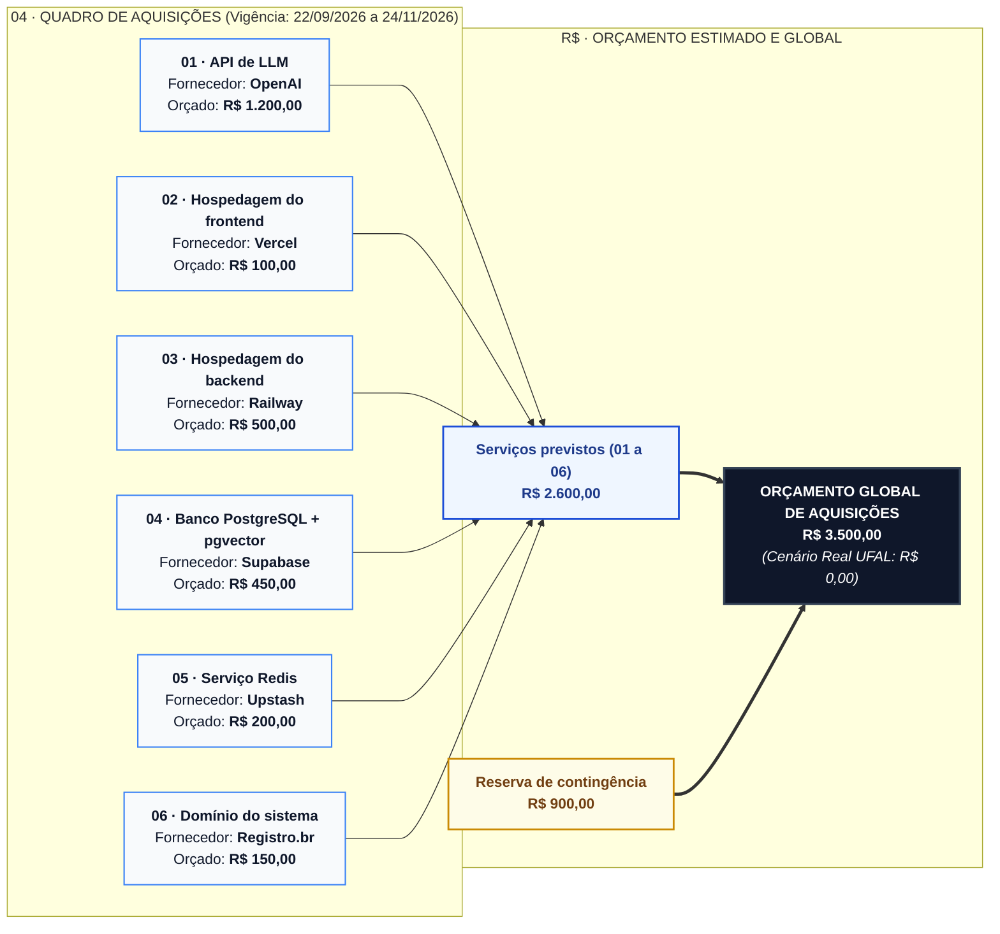

# Plano de Gerenciamento das Aquisições — SmartSales RAG

## 1. Visão Geral

O **Plano de Gerenciamento das Aquisições** do projeto **SmartSales RAG** estrutura o planejamento dos serviços tecnológicos externos (APIs de Inteligência Artificial, hospedagem de aplicações, banco de dados vetorial gerenciado, cache em memória e registro de domínio) e consolida o orçamento de referência para o período oficial do projeto (**22/09/2026 a 24/11/2026** — 9 semanas / 41 dias úteis no calendário UFAL 2026.2).

Em conformidade estrita com a **Estrutura Analítica de Custos (EAC — Categoria 2: Materiais, Serviços e Aquisições Cloud)** e com a **Estrutura Analítica de Recursos (EAR — Categoria 5: Recursos Financeiros)**, o orçamento global de aquisições é de **R$ 3.500,00** no cenário simulado de mercado (`R$ 0,00` no cenário real acadêmico UFAL via planos gratuitos e créditos educacionais):
- **Serviços Previstos (`Itens 01 a 06`)**: **R$ 2.600,00**
- **Reserva de Contingência de Aquisições**: **R$ 900,00**
- **Orçamento Global de Aquisições**: **R$ 3.500,00**

---

## 2. Diagrama de Arquitetura de Fornecedores e Orçamento de Aquisições (Mermaid)

---

## 3. Quadro de Aquisições e Cláusulas Contratuais (`01` a `06`)

| CÓD. | ITEM DE AQUISIÇÃO | INÍCIO | FIM | CONTRATO / CLÁUSULAS E ESCOPO DO SERVIÇO | FORNECEDOR | ORÇAMENTO ESTIMADO (R$) | CUSTO REAL UFAL (R$) | VÍNCULO EAP / EAR |
| :--: | :--- | :---: | :---: | :--- | :---: | :---: | :---: | :---: |
| **`01`** | **API de LLM** | `22/09/2026` | `24/11/2026` | Cobrança por consumo de tokens (*pay-as-you-go*), limite orçamentário de utilização (*hard limit*), disponibilidade do serviço e condições de acesso à API para geração RAG e *embeddings*. | **OpenAI** | **R$ 1.200,00** | R$ 0,00 *(créditos/free)* | `EAP 4.2`, `4.3`, `5.1` · `EAR 2.1`, `2.2`, `5.1` |
| **`02`** | **Hospedagem do frontend** | `22/09/2026` | `24/11/2026` | Hospedagem da aplicação web em Next.js/React, disponibilidade do serviço ($\ge 99\%$), limites de utilização de banda/funções e condições do plano contratado com deploy contínuo. | **Vercel** | **R$ 100,00** | R$ 0,00 *(Hobby tier)* | `EAP 3.5`, `4.9` a `4.11` · `EAR 3.1`, `5.2` |
| **`03`** | **Hospedagem do backend** | `22/09/2026` | `24/11/2026` | Execução da API e do Gateway SSE em containers Docker, limites de processamento (vCPU) e memória (RAM), disponibilidade ($\ge 99\%$) e possibilidade de expansão sob demanda. | **Railway** | **R$ 500,00** | R$ 0,00 *(Trial/Local)* | `EAP 3.5`, `4.3` a `4.8` · `EAR 3.1`, `5.2` |
| **`04`** | **Banco PostgreSQL + pgvector** | `22/09/2026` | `24/11/2026` | Armazenamento relacional do catálogo, persistência de dados, consultas vetoriais de similaridade (`pgvector` HNSW), segurança (TLS) e política de *backup* automatizado. | **Supabase** | **R$ 450,00** | R$ 0,00 *(Free tier)* | `EAP 4.1`, `4.2` · `EAR 2.3`, `5.2` |
| **`05`** | **Serviço Redis** | `22/09/2026` | `24/11/2026` | Armazenamento temporário em memória de cache semântico (`hit >= 30%`) e sessões conversacionais (`UC07`), limites de uso, alta disponibilidade e política de retenção/TTL de dados. | **Upstash** | **R$ 200,00** | R$ 0,00 *(Free tier)* | `EAP 4.5`, `4.7` · `EAR 2.4`, `5.2` |
| **`06`** | **Domínio do sistema** | `22/09/2026` | `24/11/2026` | Registro DNS e utilização do domínio institucional/comercial com certificado SSL/HTTPS para disponibilização e demonstração oficial do sistema durante o projeto (`EAP 7.2`). | **Registro.br** | **R$ 150,00** | R$ 0,00 *(subdomínio)* | `EAP 3.5`, `7.2` · `EAR 3.1`, `5.2` |

---

## 4. Resumo do Orçamento Estimado de Aquisições e Conciliação com a EAC

| Rubrica Orçamentária de Aquisições | Fornecedor / Referência | Valor Estimado Simulado (R$) | Participação no Orçamento de Aquisições (%) | Valor Real UFAL (R$) |
| :--- | :--- | :---: | :---: | :---: |
| **OpenAI · API de LLM** | Item `01` (`EAR 5.1`) | R$ 1.200,00 | 34,29% | R$ 0,00 |
| **Railway · Backend** | Item `03` (`EAR 5.2`) | R$ 500,00 | 14,29% | R$ 0,00 |
| **Supabase · Banco de dados (`PostgreSQL + pgvector`)** | Item `04` (`EAR 5.2`) | R$ 450,00 | 12,86% | R$ 0,00 |
| **Upstash · Redis** | Item `05` (`EAR 5.2`) | R$ 200,00 | 5,71% | R$ 0,00 |
| **Registro.br · Domínio** | Item `06` (`EAR 5.2`) | R$ 150,00 | 4,29% | R$ 0,00 |
| **Vercel · Frontend** | Item `02` (`EAR 5.2`) | R$ 100,00 | 2,86% | R$ 0,00 |
| **Subtotal — Serviços Previstos (`01` a `06`)** | **Contratos Ativos (`22/09` a `24/11/2026`)** | **R$ 2.600,00** | **74,29%** | **R$ 0,00** |
| **Reserva de Contingência de Aquisições** | Cobertura para picos de tokens (`R5` / `R13`) | **R$ 900,00** | **25,71%** | **R$ 0,00** |
| **ORÇAMENTO GLOBAL DE AQUISIÇÕES (EAC Cat. 2)** | **Conciliado com o BAC (`R$ 115.670,50`)** | **R$ 3.500,00** | **100,00%** | **R$ 0,00** |

---

## 5. Diretrizes de Gestão de Contratos e Mitigação de Riscos de Fornecedores

1. **Modalidade *Cloud-Native* sem *Vendor Lock-in* Rígido (`EAP 3.1`, `3.5`)**:
   - O banco vetorial baseia-se em `PostgreSQL + pgvector` padrão (podendo rodar tanto no **Supabase** quanto em container Docker local ou AWS RDS), e o cache utiliza protocolo **Redis** padrão (compatível com **Upstash** ou container Redis local).
2. **Controle Preventivo de Consumo de Tokens (`R5` / `R13` — `EAP 4.7`, `6.2`)**:
   - O contrato `01 (OpenAI)` opera com teto orçamentário configurado no painel administrativo e cache Redis obrigatório (`EAP 4.7`) para evitar cobranças redundantes em perguntas técnicas repetidas.
   - O acionamento da **Reserva de Contingência de Aquisições (`R$ 900,00`)** exige autorização expressa do Gerente de Projeto (**Antônio Rodrigo**) e do Product Owner (**Walber**).
3. **Política de Transição entre *Free Tiers* Acadêmicos e Planos Comerciais**:
   - Durante o desenvolvimento e homologação acadêmica na UFAL, os 6 serviços operam nos planos gratuitos (*Free / Hobby / Trial*) com custo real de desembolso igual a `R$ 0,00`, mantendo a arquitetura pronta para chaveamento imediato aos planos comerciais orçados (`R$ 3.500,00`) em produção.
