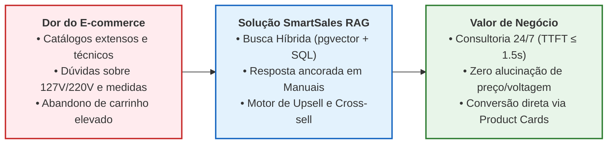

# Termo de Abertura do Projeto (TAP), Visão de Produto e Escopo (`EAP 1.1`, `1.3`, `1.4`)

---

## 1. Identificação do Projeto

| Campo | Descrição Oficial |
| :--- | :--- |
| **Nome do Projeto** | **SmartSales RAG — Assistente Especialista de Vendas Consultivas B2B/B2B2C** |
| **Instituição / Unidade** | Universidade Federal de Alagoas (UFAL) — Instituto de Computação (IC) |
| **Gerentes de Projeto (GPs)** | **Antônio Rodrigo** (GP / Scrum Master) e **Walber** (Product Owner / Co-GP) |
| **Tech Lead / Arquiteto** | **Filipe** (Backend e IA / RAG) |
| **Período de Execução** | `22/09/2026` a `24/11/2026` (9 semanas / 41 dias úteis no calendário UFAL 2026.2: 40 dias úteis no Caminho Crítico + 1 dia útil de reserva) |
| **Orçamento Global (BAC)** | **R$ 115.670,50** (Cenário de Mercado) / **R$ 0,00** (Desembolso Financeiro Real na UFAL) |

---

## 2. Justificativa do Projeto e Valor de Negócio

No comércio eletrônico moderno, catálogos extensos e produtos tecnicamente complexos (eletrônicos, eletroportáteis, periféricos, cosméticos) geram sobrecarga cognitiva no consumidor. Isso resulta em altas taxas de abandono de carrinho, buscas frustradas e necessidade de equipes extensas de suporte pré-venda.

Nossa solução resolve essa dor integrando a inteligência contextual de Grandes Modelos de Linguagem (LLMs) aos dados dinâmicos do catálogo de produtos e manuais técnicos por meio da arquitetura **RAG (*Retrieval-Augmented Generation*)**. A solução atua como um **consultor de vendas 24/7** capaz de:
1. Responder dúvidas técnicas com **citação verificável da página do manual do fabricante**;
2. Sugerir itens complementares (**cross-selling**) ou modelos superiores (**upselling**) respeitando rigorosamente o estoque ativo (`estoque > 0`);
3. Encurtar a jornada do usuário até a conversão de compra por meio de um **Painel Lateral Contextual (*Side-Drawer* estilo Amazon Rufus)** que abre ao selecionar um produto na vitrine e exibe **Product Cards interativos** com links diretos de checkout/afiliado (`Amazon`, `Mercado Livre`, `Shopee`, `Loja Oficial`).

> **Exemplo de Experiência do Usuário:**  
> Em vez de ficar perdido lendo 500 comentários contraditórios no Mercado Livre ou na Shopee, o cliente entra no **SmartSales RAG**, clica em um produto na vitrine (abrindo o chat contextual ao lado) e pergunta:  
> *"Tô em dúvida entre esse monitor gamer LG e o Samsung, qual tem DisplayPort 1.4 real no manual e qual cabo eu preciso comprar junto?"*  
> O assistente consulta os manuais PDF no `pgvector`, responde citando a página exata e já exibe os *cards* do monitor, da opção de *Upsell* e do cabo compatível (*Cross-sell*) com link direto de compra rastreado.

---

## 3. Personas e Stakeholders

| Persona / Stakeholder | Papel | Dores Principais | Critério de Sucesso no SmartSales RAG |
| :--- | :--- | :--- | :--- |
| **Consumidor Técnico / Indeciso** (*Ator Primário*) | Comprador final no e-commerce | Não sabe se uma Airfryer de `4L` serve para a família ou se o modelo é `127V` ou `220V`; desconfia de respostas sem fonte. | Receber resposta em $\le 1,5\text{ s}$ (TTFT), ver a citação exata do manual (`p. 14`) e comprar pelo card no chat. |
| **Gestor Comercial / Lojista B2B** (*Ator Secundário*) | Operador do catálogo local (executa a ingestão — `UC08`) e acompanha vendas (`UC09`) | Alto custo de atendimento humano pré-venda, baixo ticket médio e perda de vendas por falta de recomendação consultiva. | Aumentar o ticket médio com *upsell/cross-sell* automatizado (`CTR >= 10%`), sem recomendar itens sem estoque, acompanhando os indicadores na página `/admin/metricas`. |
| **Banca Avaliadora / Sponsor** (*Stakeholder Externo*) | Professor e Avaliadores UFAL | Exigem aderência metodológica ao PMBOK, rastreabilidade fim a fim e produto funcional homologado. | Entregar 100% do escopo nas 4 Sprints (`SPI >= 0,90`), com documentação e testes E2E/RAGAS auditáveis. |

---

## 4. Objetivos do Projeto (Metas SMART Harmonizadas)

- **S (*Específico*)**: Desenvolver uma aplicação web *full-stack* em 3 camadas (*Frontend Next.js*, *Middle-end Gateway SSE + Redis* e *Backend Python RAG + pgvector*) com assistente conversacional inteligente que realiza recomendações contextualizadas com base no catálogo de produtos e manuais indexados.
- **M (*Mensurável*)**:
  - Atingir índice de **Fidelidade de Contexto (*Faithfulness*) e Precisão Técnica $\ge 90\%$** nos testes de RAG (com piso mínimo bloqueante de CI de **$\ge 0,85$** no RAGAS e **Taxa de Alucinação $\le 5\%$**), evitando alucinação de preços, voltagens e especificações;
  - Manter **Tempo para o Primeiro Token ($\text{TTFT}$) $\le 1,5\text{ s}$** como alvo operacional nominal via *streaming* SSE (respeitando o teto de SLA de homologação **$\le 2,0\text{ s p95}$** e Tempo Total **$\le 8,0\text{ s p95}$**);
  - Atingir **Precision@5 (`P@5`) $\ge 0,80$** e **100% de aderência** aos filtros de negócio (`estoque > 0`, voltagem e capacidade);
  - Atingir **Cache Hit Ratio $\ge 30\%$** no Redis, aprovação de usuários (**likes $\ge 80\%$**), **CTR nos cards $\ge 10\%$** e **cobertura de testes $\ge 70\%$**.
- **A (*Atingível*)**: Utilizar modelos pré-treinados via API de inferência rápida (`OpenAI gpt-4o-mini` / `text-embedding-3-small`) e banco vetorial/cache gerenciados (`Supabase pgvector` + `Upstash Redis`), viabilizando o escopo dentro do prazo acadêmico.
- **R (*Relevante*)**: Conectar diretamente conceitos de Engenharia de Software (SDD/TDD), IA Generativa (RAG + Guardrails) e Gestão de Projetos (PMBOK) ao mercado de *MarTech* e Varejo Digital.
- **T (*Temporal*)**: Entregar a solução completa, testada e documentada ao longo de **4 Sprints** (**9 semanas / 41 dias úteis**, de **22/09/2026 a 24/11/2026**).

---

## 5. Declaração do Escopo (`EAP 1.3`)

### 5.1. No Escopo (*In-Scope*)

1. **Base de Conhecimento e Vetores (`EAP 4.1`, `4.2` | `B01`, `B03`)**:
   - Ingestão do **catálogo local** (arquivo seed JSON/CSV + PDFs de manuais versionados no repositório) por CLI do backend (`python -m app.ingestion.run`, `UC08`), pipeline de limpeza, normalização de atributos (`127V`/`220V`/`Bivolt`, capacidade em litros, potência em watts), *chunking* (`500 tokens` com `50 tokens` de *overlap*) e indexação vetorial de catálogo e manuais PDF em banco vetorial (`PostgreSQL + pgvector` com índice `HNSW`).
2. **Mecanismo de RAG e Motor de Recomendação (`EAP 4.3`, `4.4` | `B02`, `B04`, `B05`)**:
   - Orquestração de busca semântica híbrida, *prompt chaining*, filtros determinísticos de negócio (*cross-selling* e *upselling* com teto de `+35%`), extração de citações e *guardrails* anti-alucinação.
3. **Middle-end / Gateway (`EAP 4.5`, `4.6`, `4.7`, `4.8` | `M01` a `M05`)**:
   - Gerenciamento de sessões de chat, controle de histórico de conversa multi-turno, cache de respostas em memória (`Redis`), telemetria de latência/tokens (`GET /api/v1/metrics/summary` — `UC09`) e transmissão em tempo real via *Server-Sent Events* (`SSE`).
4. **Interface do Usuário — Frontend (`EAP 4.9`, `4.10`, `4.11` | `F01` a `F05`)**:
   - Interface de chat responsiva, renderização de texto via *streaming*, *badges* de citação da fonte, exibição de *cards* visuais interativos com links de compra (`Comprar agora`), botões de feedback (*like/dislike*) e página simples de métricas `/admin/metricas` protegida por `ADMIN_TOKEN` (`UC09`).
5. **Simulação de Negócio (`EAP 4.8` | `M05`, `F04`)**:
   - *Mock* de fluxo de checkout/conversão (`POST /api/v1/checkout/mock`, `UC05`) para revalidação de estoque/preço no PostgreSQL local, rastreamento de métricas de clique (CTR) e redirecionamento ao `checkout_url` do marketplace/afiliado (`Amazon`, `Mercado Livre`, `Shopee`, `Loja Oficial`).
6. **Documentação de Gestão de Projetos (`EAP 1.0` a `7.0` | `G01` a `G04`)**:
   - TAP, EAP, Matriz RACI, Diagramas UML/Fluxo, Rede CPM, Cronograma Gantt, EAC, Plano de Qualidade (Árvore, Ishikawa, Fluxo, PDCA), EAR, Plano de Comunicações, Matriz de Riscos, Gestão de Aquisições e Relatório de Encerramento.

### 5.2. Fora do Escopo (*Out-of-Scope / Exclusões*)

- Processamento financeiro real de pagamentos (cartões de crédito, boletos ou PIX liquidado em instituição financeira);
- Integração com APIs externas de lojas/marketplaces (sincronização de catálogo, carrinho ou *webhooks*): o catálogo é local e o marketplace só recebe o redirecionamento do navegador;
- Integração com sistemas de ERP fiscal, emissão de nota fiscal eletrônica (NF-e) ou cálculo de frete com transportadoras;
- Atendimento por chamadas de voz ou vídeo em tempo real;
- Treinamento ou *fine-tuning* de modelos de linguagem próprios a partir do zero;
- Painel administrativo completo de CRUD de catálogo para múltiplos lojistas (*multi-tenant backoffice*).

---

## 6. Premissas, Restrições e Resumo Orçamentário

### 6.1. Premissas
- Disponibilidade de *free tiers* educacionais/gratuitos nos provedores **Vercel**, **Railway**, **Supabase (`pgvector`)** e **Upstash (`Redis`)**, além de créditos iniciais na API **OpenAI**;
- Dedicação regular de **20 horas semanais por integrante** (incluindo trabalho assíncrono) (160h/semana da equipe, totalizando **1.440 horas** em 9 semanas).

### 6.2. Restrições
- Prazo final improrrogável de homologação e apresentação (*Marco M5*): **`24/11/2026`**;
- Calendário acadêmico UFAL 2026.2 (Res. nº 126/2026-CONSUNI): sem expediente em `12/10`, `15/10`, `28/10` (ponto facultativo), `02/11` e `20/11`, o que reduz a janela a **41 dias úteis** e a reserva de cronograma a **1 dia útil** (`24/11`);
- Custo financeiro de desembolso direto para a UFAL igual a **`R$ 0,00`**;
- Proibição estrita de exposição de dados sensíveis de clientes (conformidade LGPD / sessões anônimas por `UUID`).

### 6.3. Síntese Orçamentária (`EAC` vs. `Aquisições`)

| Grupo de Custo | Valor Orçado de Mercado (`BAC`) | Desembolso Real (`UFAL`) | Referência Detalhada |
| :--- | :---: | :---: | :--- |
| **1. Recursos Humanos (1.440h — 8 membros)** | `R$ 99.000,00` | `R$ 0,00` | [`09_quadro_custos_eac.md`](../diagrams_and_pm/09_quadro_custos_eac.md) |
| **2. Materiais, Nuvem, APIs e Aquisições (`01–06` + Reserva)** | `R$ 3.500,00` | `R$ 0,00` | [`17_gestao_aquisicoes.md`](../diagrams_and_pm/17_gestao_aquisicoes.md) |
| **3. Maquinário, Infraestrutura e Ferramental** | `R$ 2.655,00` | `R$ 0,00` | [`09_quadro_custos_eac.md`](../diagrams_and_pm/09_quadro_custos_eac.md) |
| **4. Reserva de Contingência Geral (10%)** | `R$ 10.515,50` | `R$ 0,00` | [`09_quadro_custos_eac.md`](../diagrams_and_pm/09_quadro_custos_eac.md) |
| **TOTAL DO PROJETO (`BAC`)** | **`R$ 115.670,50`** | **`R$ 0,00`** | **100% Conciliado** |
