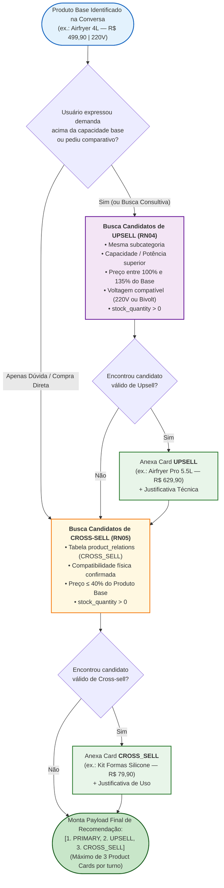

# Especificação das Regras de Negócio, Motor de *Upsell / Cross-sell* e *Guardrails* (`EAP 4.3`, `4.4`)

Este documento define as **Regras de Negócio (`RN01` a `RN10`)** e os algoritmos determinísticos do **SmartSales RAG** para filtragem de catálogo, recomendações de **Upselling** e **Cross-selling** (`UC03`) e **Guardrails Anti-Alucinação** (`UC01`, `UC02`).

---

## 1. Catálogo de Regras de Negócio (`RN01` a `RN10`)

| Código | Regra de Negócio | Condição / Fórmula Determinística | Ação do Sistema | Risco Mitigado |
| :---: | :--- | :--- | :--- | :---: |
| **RN01** | **Exclusão Obrigatória de Itens Sem Estoque** | `product.stock_quantity > 0` E `product.is_active == TRUE` | Produtos com `stock_quantity <= 0` são filtrados na cláusula `WHERE` do SQL de **toda recomendação** (`PRIMARY`, `UPSELL`, `CROSS_SELL`) e de todo card. A busca de *chunks* de manual não filtra estoque (permite responder dúvidas sobre item esgotado e oferecer substituto). | `R09` |
| **RN02** | **Limiar Mínimo de Similaridade Semântica** | $\text{cosine\_similarity}(q, c_i) \ge 0,72$ (com `top_k = 5`) | *Chunks* com similaridade $< 0,72$ são descartados. Se nenhum *chunk* atingir $\ge 0,72$, aciona-se o **Fallback Seguro** (`RN03`). O valor `0,72` é o ponto de partida configurável (`SIMILARITY_THRESHOLD`), a ser calibrado empiricamente no *Golden Set* (`EAP 5.1`). | `R01`, `R03` |
| **RN03** | **Fallback Seguro por Ausência de Evidência** | `len(valid_chunks) == 0` | O LLM não é invocado; o sistema emite o evento SSE `error` (`LOW_SIMILARITY_FALLBACK`) com a resposta padronizada informando ausência no manual, seguido de `recommendations` com itens similares em estoque. | `R01` |
| **RN04** | **Elegibilidade de Upsell (`UC03`)** | Mesma categoria + `tier_rank > base.tier_rank` (ou `capacity_liters > base.capacity_liters`) + $1,00 < \frac{\text{price}_{\text{upsell}}}{\text{price}_{\text{base}}} \le 1,35$ + voltagem compatível + `stock > 0` | Seleciona o produto superior com melhor *score* composto dentro do **teto máximo de +35% de preço** sobre o produto base. | `R09` |
| **RN05** | **Elegibilidade de Cross-sell (`UC03`)** | Relação cadastrada em `product_relations` (`relation_type = 'CROSS_SELL'`) OU categoria complementar compatível + $\text{price}_{\text{cross}} \le 0,40 \times \text{price}_{\text{base}}$ + `stock > 0` | Seleciona **1** acessório ou consumível (o de maior $S_{\text{cross}}$) diretamente compatível com o `SKU` principal, respeitando o máximo de 3 cards por turno. | `R09` |
| **RN06** | **Imutabilidade de Preço e Voltagem pelo LLM** | `card.price == db.product.price` E `card.voltage == db.product.voltage` | Os dados exibidos nos *Product Cards* são injetados diretamente do PostgreSQL pelo Backend/Middle-end, jamais extraídos do texto livre do LLM. | `R01`, `R09` |
| **RN07** | **Obrigatoriedade de Citação Técnica** | Resposta utiliza `manual_chunks` ($\text{count} \ge 1$) | O output deve conter pelo menos 1 item em `citations[]` com `manual_title`, `page_number` ($\ge 1$) e `chunk_id` existente nos *chunks* recuperados. | `R01` |
| **RN08** | **Validador Pós-Geração de Grandezas Críticas** | Regex de grandezas no texto gerado (`110V`, `127V`, `220V`, `Bivolt`, `\d+(,\d+)?\s?L`, `\d+\s?W`, `R\$\s*\d{1,3}(\.\d{3})*(,\d{2})?`) | Verifica se toda voltagem/preço citado no texto bate com o registro SQL do produto discutido. Se houver inversão (ex.: texto diz `127V` para SKU exclusivamente `220V`), emite o evento SSE `correction` com o texto corrigido antes de `citations`/`done` (os tokens já transmitidos são substituídos na UI). | `R01` |
| **RN09** | **Invalidação e Chaveamento de Cache Semântico** | `cache_key = "cache:sem:{catalog_version}:" + sha256(catalog_version \| sku_context \| voltage_filter \| normalized_query)` | O cache no Redis (`TTL = 3600s`) inclui a versão do catálogo/estoque (`catalog:version`, incrementada pela CLI de ingestão e pelo *mock checkout*) para nunca servir recomendação de produto cujo estoque zerou ou cujo preço mudou. | `R10`, `R09` |
| **RN10** | **Revalidação Atômica no Mock Checkout (`UC05`)** | `SELECT stock_quantity, price FROM products WHERE sku = :sku FOR UPDATE` no instante do clique | Se o estoque zerou ou o preço mudou entre a exibição do card e o clique em `Comprar agora`, o endpoint retorna `HTTP 409` (`OUT_OF_STOCK` ou `PRICE_CHANGED`) com os valores atuais em vez de confirmar pedido inválido. | `R09` |

---

## 2. Fluxo Decisório do Motor de *Upsell* e *Cross-sell* (`B04` / `M04`)

---

## 3. Fórmulas de *Scoring* de Recomendação (`EAP 4.4`)

### 3.1. Score de Ranking de *Upsell* ($S_{\text{upsell}}$)
Para cada candidato $u$ que satisfaz os filtros rígidos da **RN04**, o score é calculado como:

$$S_{\text{upsell}}(u) = 0,50 \cdot \text{Sim}_{\text{semântica}}(q, u) + 0,30 \cdot \left(\frac{\text{Capacidade}(u) - \text{Capacidade}(\text{base})}{\text{Capacidade}(\text{base})}\right)_{\text{norm}} + 0,20 \cdot \left(1 - \frac{\text{Preço}(u) - \text{Preço}(\text{base})}{0,35 \cdot \text{Preço}(\text{base})}\right)$$

- Prioriza o item que melhor responde à necessidade semântica do usuário, entrega ganho real de capacidade/potência e possui o acréscimo de preço mais próximo ao orçamento original.

### 3.2. Score de Ranking de *Cross-sell* ($S_{\text{cross}}$)
Para cada acessório/complemento $c$ que satisfaz os filtros rígidos da **RN05**:

$$S_{\text{cross}}(c) = 0,60 \cdot \text{PesoRelação}(\text{base}, c) + 0,25 \cdot \text{Sim}_{\text{contexto}}(q, c) + 0,15 \cdot \left(1 - \frac{\text{Preço}(c)}{0,40 \cdot \text{Preço}(\text{base})}\right)$$

Onde $\text{PesoRelação}(\text{base}, c) \in [0, 1]$ é o peso de afinidade cadastrado na tabela `product_relations` (ex.: `0.95` para *Cesto de Silicone Compatível com Airfryer 4L/5.5L*).

---

## 4. Arquitetura em 3 Níveis de *Guardrails* (`EAP 4.3` | Mitigação de `R01`)

| Nível | Nome do Guardrail | Momento de Execução | Regra de Bloqueio / Sanitização |
| :---: | :--- | :---: | :--- |
| **G-IN** | **Input Guardrail (Anti-Injection & Escopo)** | Antes da busca vetorial | Bloqueia padrões de *Prompt Injection* (`"ignore previous instructions"`, `"você agora é..."`, `"altere o preço para R$ 1,00"`) e perguntas totalmente fora do domínio do e-commerce, retornando redirecionamento educado em `< 50 ms` (evento SSE `error` com `GUARDRAIL_BLOCKED`). |
| **G-RET** | **Retrieval Guardrail (Limiar de Evidência)** | Após a consulta ao `pgvector` | Exige `similarity_score >= 0.72` (limiar calibrável). Se `valid_chunks == []`, aborta a chamada livre ao LLM e aciona o template determinístico de *Fallback Seguro* (evento `error` com `LOW_SIMILARITY_FALLBACK`). O filtro `stock_quantity > 0` é aplicado às recomendações (`RN01`). |
| **G-OUT** | **Output Guardrail (Verificador Factual)** | Durante / Após geração | Valida se as citações `[Fonte: ..., p. X]` correspondem aos `chunk_id`s fornecidos no contexto e se nenhuma voltagem (`127V`/`220V`) ou preço contradiz os metadados SQL do produto. Divergências geram o evento SSE `correction` (`VOLTAGE_MISMATCH`, `PRICE_MISMATCH` ou `MISSING_CITATION`). |
