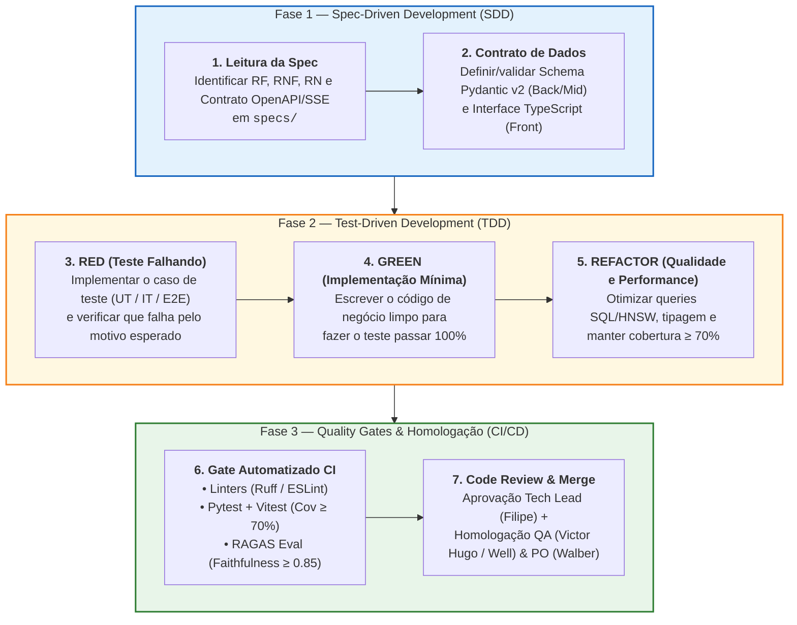

# Especificação do Fluxo SDD + TDD, Pirâmide de Testes e Gates de Qualidade CI/CD (`EAP 3.5`, `5.1`–`5.4`)

Este documento normatiza a metodologia de **Engenharia Guiada por Especificações (*SDD — Spec-Driven Development*)** combinada com **Desenvolvimento Guiado por Testes (*TDD — Test-Driven Development*)** em todas as 4 Sprints do projeto **SmartSales RAG**.

---

## 1. O Ciclo Operacional SDD + TDD no SmartSales RAG

---

## 2. Pirâmide de Testes e Metas de Cobertura (`EAP 5.1`, `5.2`, `5.3`)

| Nível da Pirâmide | Escopo de Validação | Ferramentas | Meta de Cobertura / SLA | Momento de Execução |
| :--- | :--- | :--- | :---: | :--- |
| **1. Testes Unitários (`UT`)** | Funções puras: *chunking* (`500/50`), normalização de cache, cálculo de *score* de *Upsell* (`+35%`), *Guardrails* (`G-IN`, `G-OUT`), componentes React isolados. | `Pytest` (Python) `Vitest + RTL` (TS) | **$\ge 75\%$** nas regras de negócio (`>= 70%` global) | A cada `git push` (`< 15s`) |
| **2. Testes de Contrato e Integração (`IT` / `CT`)** | Ingestão do *seed* local, busca híbrida real no `pgvector` (via container de teste), sessão e cache no `Redis`, streaming SSE e contingência no FastAPI, métricas e transação `FOR UPDATE` do Mock Checkout (`IT-B01-01` a `IT-M05-01`, `CT-M01-01`). | `Pytest Async` + `httpx` + `testcontainers` | **100%** dos endpoints OpenAPI 3.1 testados | Em todo Pull Request (`< 60s`) |
| **3. Avaliação Cognitiva RAG (`RAGAS`)** | *Faithfulness*, *Answer Relevance*, *Context Precision* e Taxa de Alucinação sobre o *Golden Set* de 50 perguntas técnicas. | `RAGAS` + `Pytest` | **Faithfulness $\ge 0,85$** (alvo $\ge 90\%$) **Alucinação $\le 5\%$** **`P@5 >= 0,80`** | Nos caminhos semânticos definidos pelo job `eval-rag-quality-gate` (seção 3) |
| **4. Testes End-to-End e Performance (`E2E`)** | Jornada completa no navegador (Pergunta $\to$ Streaming SSE $\to$ Citação $\to$ Card Upsell $\to$ Mock Checkout $\to$ Like/Dislike) + aferição de `TTFT`. | `Playwright` + Script de Benchmark SSE | **100% de aprovação** dos 8 fluxos críticos (`E2E-01` a `E2E-08`); **$\text{TTFT} \le 1,5\text{ s}$** nominal ($\le 2,0\text{ s p95}$) | No fechamento de cada Sprint e nos Marcos `M2`, `M3`, `M4`, `M5` |

---

## 3. Pipeline de Integração Contínua (`.github/workflows/ci.yml` — `EAP 3.5`)

O pipeline do GitHub Actions é dividido em 4 *jobs* paralelos bloqueantes (*Required Status Checks*):

1. **`lint-and-typecheck`**:
   - Python (`backend/` e `middleend/`): `ruff check .`, `ruff format --check .`, `mypy app`;
   - Frontend (`frontend/`): `pnpm lint`, `pnpm exec tsc --noEmit`.
2. **`test-backend-and-middleend`**:
   - Sobe serviços `pgvector/pgvector:pg16` e `redis:7.2-alpine` como *service containers* do GitHub Actions e carrega o *seed* do catálogo local (`python -m app.ingestion.run` com embeddings *mockados*);
   - Executa as suítes em **passos separados**, cada uma no seu diretório (os dois serviços possuem um pacote chamado `app`, que colidiria num único processo do Pytest):
     - `cd backend && pytest tests/unit tests/integration --cov=app --cov-fail-under=70`;
     - `cd middleend && pytest tests --cov=app --cov-fail-under=70`.
3. **`test-frontend-and-e2e`**:
   - Executa `pnpm -C frontend run test:unit -- --coverage`;
   - Executa `npx playwright test` validando o contrato de streaming e renderização de cards.
4. **`eval-rag-quality-gate`**:
   - Executa o subconjunto rápido de regressão do *Golden Set* garantindo **0 inversões de voltagem/preço** e **Faithfulness $\ge 0,85$**;
   - Roda regressão rápida em alterações de `backend/app/**` (inclui ingestion, recommendation, modelos/settings), `backend/tests/ragas_eval/**`, `data/**`, dependências/lockfiles do Backend e configuração do avaliador/CI. Requer `OPENAI_API_KEY` e respeita `R13`. PR sem secret roda testes determinísticos e permanece com avaliação cognitiva PENDENTE; um mantenedor executa o job protegido no commit exato após revisão, sem expor secrets a código de fork. Nunca considerar skip como qualidade aprovada. Avaliação completa dos 50 casos é obrigatória no commit integrado após B04 e em toda alteração semântica posterior antes de homologar M4/M5.

---

## 4. Checklist de *Definition of Done (DoD)* por Camada

| Critério de Aceite | Backend & IA (`B01–B05`) | Middle-end (`M01–M05`) | Frontend (`F01–F05`) |
| :--- | :---: | :---: | :---: |
| Testes unitários escritos **antes** do código, com evidência da falha esperada (TDD) com cobertura $\ge 70\%$ | Obrigatório | Obrigatório | Obrigatório |
| Validação estrita de tipos (`Pydantic v2` / `TypeScript strict`) sem uso de `any` | Obrigatório | Obrigatório | Obrigatório |
| Conformidade com os contratos de [`03_openapi_and_sse_contracts.md`](../architecture/03_openapi_and_sse_contracts.md) | Obrigatório | Obrigatório | Obrigatório |
| Verificação de *Guardrails* (`estoque > 0`, `similarity >= 0.72`, teto `+35%` de *upsell*) | Obrigatório | N/A (Pass-through) | Exibição fiel do Badge |
| Aferição de latência dentro do orçamento ($\text{TTFT} \le 1,5\text{ s}$ nominal / $\le 2,0\text{ s p95}$) | $\le 1.150\text{ ms}$ (RAG+LLM) | $\le 80\text{ ms}$ (Overhead) | Renderização `< 16 ms`/frame |
